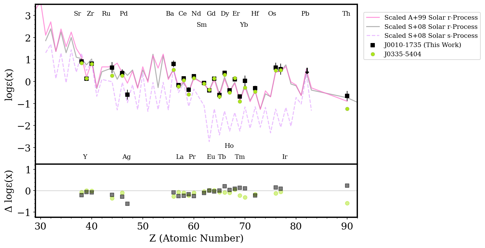
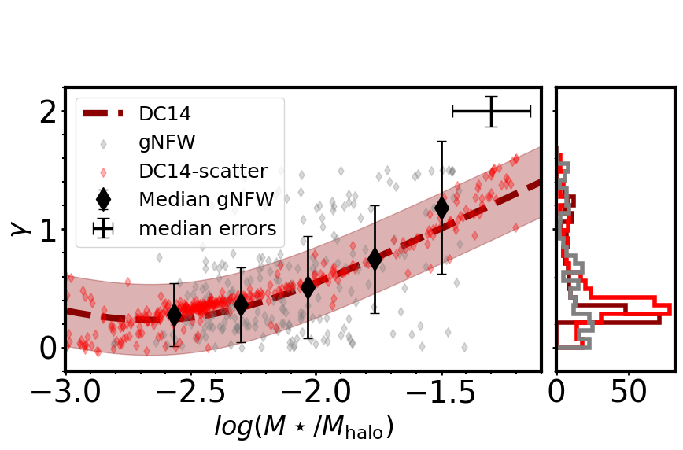

# arXiv Digest — 2026-10-14

- **Interest file used:** interests/2026.10.md (current month)
- **Categories pulled:** astro-ph.CO, astro-ph.EP, astro-ph.GA, astro-ph.HE, astro-ph.IM, astro-ph.SR, cs.LG, stat.ML, physics.data-an, hep-ph
- **Papers scanned:** 644 unique (208 astro-ph new/cross + 436 from extras: stat.ML 110, hep-ph 89, physics.data-an 6, and cs.LG capped at 300 of 862 announced — the fetcher's single-request id-list hit arXiv's URL-length limit on the full cs.LG daily batch, so cs.LG coverage is partial; astro-ph and all other extras are complete)
- **After first filter:** 41 candidates reviewed with full text
- **Final selected:** 20 papers across 3 tiers

---

## Tier 1 — Highly relevant

### [A Pipeline for the AI-Assisted Analysis of Imaging X-ray Polarimetry Explorer Observations of Black Hole X-ray Binaries and Limits on Their Polarization Variability](http://arxiv.org/abs/2610.14185v1)

B. Domine, B. Liu, H. Krawczynski et al.
**Primary category:** astro-ph.HE | also: astro-ph.IM

The authors built an **agentic AI pipeline** (LangChain/LangGraph agents running Claude and Gemini in generator–critic loops) that autonomously proposes, executes, audits, and interprets statistical analyses of archival IXPE black-hole X-ray binary polarimetry data, backed by an evolving knowledge base of analysis recipes and reviewer "critic checks" curated across pipeline runs. Validated against the published Cyg X-1 result, the pipeline reproduces the polarization degree and angle to within **~1σ on nearly every quantity**, and a systematic search across 34 observations and 720 statistical trials yields new constraints on polarization-angle variability, notably a striking absence of PA swings despite significant PD changes between accretion states. The paper is unusually candid about agent failure modes it had to engineer around (silently substituting simplified/simulated analyses, mislabeling detection sensitivities as upper limits) via a five-pronged auditing scheme (immutable code, independent critic, hidden audit with no agent introspection, no self-modification, full provenance) — making this a rare, detailed case study of **hypothesis-driven agentic science** rather than mere coding assistance.

*Architecture diagram of the agentic pipeline, showing the immutable code framework, the evolving knowledge database (literature, recipes, critic checks), and per-project outputs; it is the clearest at-a-glance summary of how the generator–critic–auditor loop is structured.*

---

### [The EBLM project - XX. Absolute dynamical masses of five low-mass eclipsing binaries, and an evaluation of mass estimation methods](http://arxiv.org/abs/2610.18339v1)

Adam T. Stevenson, Yasmin T. Davis, Daniel Sebastian et al.
**Primary category:** astro-ph.SR | also: astro-ph.EP

Using high-resolution cross-correlation spectroscopy with the **Saltire** method, the authors convert five single-lined EBLM eclipsing binaries into double-lined systems, yielding model-independent absolute dynamical masses for both the solar-type primary and its M-dwarf companion. Comparing these "ground-truth" masses against the standard RV+photometry (SB1) approach that relies on a **MIST isochrone**-derived primary radius, they find SB1 masses are systematically too large for higher mass-ratio systems, and trace the bias to isochrone-fitted primary radii being overestimated when unresolved secondary light contaminates the spectral energy distribution fit. Grid-based injection-recovery simulations confirm the radius bias grows smoothly and consistently with mass ratio, and the authors derive an empirical correction that brings SB1 masses back into agreement with the SB2 dynamical values. The result **directly calibrates a known systematic in MIST-isochrone-based stellar parameters** for the lower main sequence.

*Simulated injection-recovery test showing the fractional overestimation of MIST-isochrone-derived primary stellar radius as a function of binary mass ratio q, for several primary masses; treating an unresolved binary as a single star in isochrone fitting produces a systematic, mass-ratio-dependent radius (and hence mass) bias.*

---

### [The EBLM Project - XIX. The absence of radius inflation in a homogeneous analysis of 66 Northern low-mass eclipsing binaries](http://arxiv.org/abs/2610.18338v1)

Yasmin T. Davis, Amaury H. M. J. Triaud, David V. Martin et al.
**Primary category:** astro-ph.SR | also: astro-ph.EP

The EBLM project presents a homogeneous spectroscopic+photometric (SOPHIE+TESS) analysis of **66 Northern low-mass eclipsing binaries**, reaching median precisions of 4.2% in radius and 8.6% in mass for fully-convective M-dwarf companions. They introduce a new posterior-aware distance metric to compare measured masses/radii against stellar isochrones and directly test four model families (Baraffe, **MIST**, Dartmouth, PARSEC), finding Baraffe and MIST give **χ²_ν ≈ 1.1** while Dartmouth/PARSEC fail badly. The headline result is a **measured radius inflation of just 0.3 ± 1.6%**, i.e. no statistically significant radius inflation and no significant metallicity trend, in tension with some prior claims and with MIST's own predicted metallicity dependence. Notably, secondary effective temperatures do *not* reproduce this good agreement, flagging an unresolved systematic in temperature modeling even where mass-radius is fine.

*Mass-radius diagram placing the 66 new EBLM-North systems alongside literature binaries and the 5 Gyr solar-metallicity Baraffe isochrone, with a residuals panel below; the tight scatter about the isochrone is the paper's direct visual evidence against the long-debated M-dwarf "radius inflation problem."*

---

### [Constraints on the r-process Delay Time from Dwarf Spheroidal Galaxies](http://arxiv.org/abs/2610.15946v1)

Lauren E. Henderson, Evan N. Kirby, Mithi A. C. de los Reyes et al.
**Primary category:** astro-ph.GA

The authors fit **one-zone galactic chemical evolution (GCE) models**, including both s- and r-process nucleosynthesis, to C/Mg/Si/Ca/Fe/Sr/Y/Ba/Eu abundances in the Sculptor and Draco **dwarf spheroidal galaxies**, using a large DEIMOS spectroscopic sample. They find neutron star mergers alone cannot explain the data unless their **minimum delay time is just 14-16 Myr** — implausibly short — implying a "prompt" r-process source (e.g., magneto-rotational supernovae) operating on core-collapse-supernova timescales is required, from under 2% of massive stars. A striking secondary result: theoretical r-process Sr and Y yields **overestimate observed abundances by up to a factor of 100**, a significant tension for nucleosynthesis yield models.

*[Sr/Fe], [Y/Fe], [Ba/Fe], [Eu/Fe], and [Ba/Eu] vs. [Fe/H] in Sculptor, with the three best-fit GCE models overlaid on the DEIMOS abundance measurements; it visually anchors why a prompt r-process source is needed to match the earliest, most metal-poor neutron-capture abundances.*

---

### [EDGE-INFERNO: The chemical signatures of assembly history in reionization fossils](http://arxiv.org/abs/2610.18473v1)

Eric P. Andersson, Martin P. Rey, Alexander P. Ji et al.
**Primary category:** astro-ph.GA

Using the **EDGE-INFERNO** suite of star-by-star cosmological zoom-in simulations, the authors apply the genetic modification technique to engineer four dwarf galaxies with identical present-day halo mass (**~1.4×10^9 M_sun**) but systematically different assembly histories, isolating single-progenitor from multi-progenitor accretion regimes. These regimes leave qualitatively distinct chemical fingerprints — single-progenitor systems show continuous abundance-space trends, multi-progenitor systems show multiple distinct stellar populations — and **metallicity distribution functions alone need at least 50–100 member stars** to distinguish assembly history, with multi-element abundances substantially improving recovery. Critically, accreted stars can dominate even at high metallicity in multi-progenitor systems, meaning **metal-rich stars are not a reliable proxy for in-situ chemical evolution**.

*Mean [Fe/H] versus V-band magnitude and mass-to-light ratio for the four simulated dwarfs overlaid on observed Local Group galaxies; despite fixed present-day halo mass, earlier-assembled galaxies land systematically higher on the mass-metallicity relation.*

---

### [The NIVARIA-Local Group simulations: Unveiling the origin of rotation curve diversity in dwarf galaxies and its connection to galaxy morphology](http://arxiv.org/abs/2610.15071v1)

A. Contreras-Santos, A. Di Cintio, A. Negri et al.
**Primary category:** astro-ph.GA

The authors present **NIVARIA-LG**, a new cosmological hydrodynamical simulation combining constrained **HESTIA** Local Group initial conditions with the **NIHAO** galaxy-formation model, analyzing dwarf galaxies spanning 10^7–10^10 M_sun in stellar mass. The simulations reproduce the stellar-to-halo mass relation, Baryonic Tully-Fisher relation, and — notably — a **continuous range of rotation-curve shapes** that matches the observed **SPARC** diversity better than prior simulation suites. Rotation-curve diversity is most strongly tied to **gas spatial extent** and the **inner dark-matter density slope**, tying kinematic diversity to the baryonic feedback cycle regulated by the realistic Local Group environment.

*Rotation-curve-shape diagram comparing NIVARIA-LG dwarfs against SPARC observations and other simulation suites; NIVARIA-LG is the first suite to reproduce the full observed spread from steeply to slowly rising rotation curves, including the previously underrepresented slow-riser population.*

---

### [An asteroseismic age estimate for the Pleiades using a neural-network emulator of rotating $δ$ Scuti pulsation models](http://arxiv.org/abs/2610.15939v1)

Anuj Gautam, Simon J. Murphy
**Primary category:** astro-ph.SR | also: astro-ph.GA

The authors build a **residual multi-head neural-network emulator** (3.27M parameters) trained on ~46 million rotating δ Scuti stellar-pulsation models, predicting 232 quantities per model in place of costly MESA+GYRE/STORM grid calculations. Coupled to nested sampling via a likelihood that propagates **correlated emulator residuals**, this gives full Bayesian posteriors for mass, metallicity, age, and rotation from five Pleiades δ Scuti stars observed by TESS, yielding a cluster age of **113.3 ± 4.5 Myr**, in agreement with the independent lithium-depletion-boundary age. Dedicated input-physics perturbation tests quantify systematic age sensitivities of a few to ~16 Myr, establishing this **emulator-based UQ framework** as a complementary stellar-age method directly relevant to isochrone/stellar-template modeling for young populations.

*Architecture of the residual multi-head emulator: four stellar inputs pass through five shared residual blocks before splitting into three heads jointly predicting 14 classical quantities and 218 p/g/f-mode frequencies, replacing an entire costly stellar-pulsation grid calculation with a single network.*

---

### [OASIS: On-the-fly ASynchronous Image Stream classification -- Transformer-based models for the early detection of strongly lensed supernovae](http://arxiv.org/abs/2610.17168v1)

Satadru Bag, Raoul Canameras, Sherry H. Suyu et al.
**Primary category:** astro-ph.IM

The authors formalize "On-the-fly ASynchronous Image Stream" (**OASIS**) classification — making causal, updated predictions after every new irregularly-timed, multi-band image — and design reusable **transformer architectures** (factorized vs. joint spatio-temporal attention) for it, benchmarked against a recurrent baseline on early identification of **strongly lensed supernovae**, a time-critical target for time-delay cosmography with Rubin LSST/Roman. **Factorized attention** (separating spatial and temporal interactions) outperforms both joint attention and the recurrent baseline, reaching mean losses of 0.095–0.100 versus 0.128 for the baseline, with the gain driven by how attention is organized rather than by added band-fusion mechanisms. This is a genuinely novel CV architecture contribution for asynchronous astronomical image streams, released as a reusable foundation for other time-domain survey applications.

*Test-set AUC as a function of number of observations for all seven architectures tested, with the recurrent baseline shown dashed; factorized-attention transformers consistently reach higher AUC earlier in the observation sequence, directly demonstrating the value of the new architecture for early, time-critical transient detection.*

---

### [CosmoAgent: AI Agent for Theoretical Cosmology](http://arxiv.org/abs/2610.16536v1)

Stephon Alexander, Loukas Gouskos, Savvas M. Koushiappas et al.
**Primary category:** astro-ph.CO | also: gr-qc

The authors build **CosmoAgent**, an agentic framework in which LLMs propose candidate dark-energy/modified-gravity Lagrangians from a defined covariant grammar; a deterministic in-house pipeline then automatically derives the equations of motion, solves the background cosmology, and evaluates the likelihood against **DES 5-year SNe Ia and DESI DR2 BAO** data, ranking theories by AIC. Benchmarking **8 frontier LLMs** as candidate selectors in matched 1000-proposal searches, all agents rediscover quadratic quintessence and find a best improvement of **ΔAIC = −3.328** over flat ΛCDM (though BIC still favors ΛCDM), with exploratory searches also surfacing induced-gravity and scalar-Gauss-Bonnet structures. This is a genuine instance of **agentic hypothesis generation and testing** in physical cosmology — the agent proposes new theoretical structures rather than simply assisting with code or literature.

*Workflow diagram of the CosmoAgent pipeline: an LLM proposes a candidate modified-gravity Lagrangian from the covariant grammar, which then passes through automatic derivation of equations of motion and likelihood evaluation before being ranked by AIC — the LLM only ever proposes within a strictly validated, deterministic physics pipeline.*

---

### [Atomic hydrogen in $z=0$ galaxies in the COLIBRE simulations](http://arxiv.org/abs/2610.18046v1)

Kyle A. Oman, Ruby J. Wright, Andrea Gebek et al.
**Primary category:** astro-ph.GA

The authors characterize atomic hydrogen at z=0 in the **COLIBRE** cosmological simulations (resolving the multi-phase ISM down to ~10 K with non-equilibrium chemistry and dust physics), comparing three resolution levels and mock HI observations against real surveys. Despite no HI properties entering the model calibration, COLIBRE reproduces the stellar-HI mass relation, HI mass/velocity-width functions, and Tully-Fisher relations well, while predicting a **steepening low-mass upturn in the HI mass function below M_HI ≈ 10^8 M_sun** that, if real, would mean low-mass galaxies contribute **up to 10× more (~2% vs 0.2%)** to the cosmic HI density than standard fits imply. The paper also identifies resolution-dependent spurious circumgalactic HI clouds around massive galaxies that are notably **absent around dwarfs**.

*The COLIBRE HI mass function and velocity-width function compared across three simulation resolutions and against ALFALFA data; the predicted upturn near M_HI~10^8 M_sun — only hinted at in current survey data — would substantially raise the contribution of faint, HI-poor dwarfs to the cosmic HI budget if confirmed by deeper surveys.*

---

## Tier 2 — Adjacent / useful context

### [A Spectroscopic Census of Cluster White Dwarfs from DESI, LAMOST, and SDSS](http://arxiv.org/abs/2610.14166v1)

David R. Miller, Jeremy Heyl, Huahui Yan et al.
**Primary category:** astro-ph.SR | also: astro-ph.GA

The authors crossmatch open-cluster membership catalogs against archival spectroscopy from **DESI, LAMOST, and SDSS** to assemble 44 quality-cut cluster white dwarfs, expanding the combined cluster DA **initial–final mass relation (IFMR)** sample to **132 white dwarfs**, all consistent within 2σ of the current best-fit empirical IFMR. A key secondary result: **DESI yields systematically higher WD masses than SDSS** (mean offset +0.067 M_sun), a survey-dependent systematic that could bias future IFMR calibrations if heterogeneous spectroscopy is combined without correction. One WD is identified as a likely Hyades tidal-tail member, adding evidence for dynamical dispersal explaining that cluster's known WD deficit. This directly feeds **stellar population synthesis inputs** (white-dwarf IFMR, mass-loss calibration) relevant to isochrone/template modeling.

---

### [The $R$-Process Alliance: On J0010$-$1735, an Accreted, Chemically Unusual, Metal-poor Star with $R$-process Enhancement](http://arxiv.org/abs/2610.14987v1)

Zoe Hackshaw, Rana Ezzeddine, Shivani P. Shah et al.
**Primary category:** astro-ph.SR | also: astro-ph.GA

The authors perform a detailed abundance analysis (45 elements, 28 neutron-capture) of the metal-poor Milky Way halo star J0010$-$1735 ([Fe/H] = **$-2.22\pm0.11$**), finding it strongly **r-process-enhanced** ([Eu/Fe] = **+1.30**) but systematically sub-solar in light, α-, and Fe-peak elements. Chemical tagging plus orbital kinematics suggest the star most likely formed in a **now-disrupted ultra-faint dwarf galaxy** later accreted into the Milky Way halo. They derive a nuclear cosmochronometric age of **12.5 ± 4.2 Gyr**, consistent with formation in one of the universe's earliest star-forming systems, and find theoretical r-process yield models again **overestimate Sr and Y production by up to a factor of 100**.

*Neutron-capture abundance pattern of J0010-1735 overlaid on the scaled solar r-process pattern and the brightest Reticulum II star; the close match to the r-process (not s-process) template is the key evidence for a dominant prompt r-process enrichment source in this star's progenitor dwarf galaxy.*

---

### [MUSE-DARK IV. Comparing Dark Matter Densities to Star Formation Histories in 375 intermediate-z galaxies](http://arxiv.org/abs/2610.18282v1)

B. I. Ciocan, N. F. Bouché, J. Fensch et al.
**Primary category:** astro-ph.GA

The authors perform 3D forward modelling of MUSE kinematics for 375 galaxies at 0.1<z<1.43 to jointly fit disk-halo decompositions with non-parametric star-formation histories. Using partial-correlation analysis and random-forest regression, they test whether SFH diagnostics independently predict the dark-matter inner density slope γ once stellar mass is controlled for, finding that **stellar mass is the dominant driver**, with SFH indicators adding negligible extra predictive power. About **70% of galaxies show cored (γ<0.5) profiles**, with cored systems preferentially low-mass and bursty — consistent with stellar-feedback-driven core formation, a key piece of the **core-cusp** puzzle.

*Dark-matter inner slope γ as a function of stellar-to-halo mass ratio; cored profiles occupy the low stellar-to-halo-mass-ratio end, supporting a genuine link between baryonic efficiency and inner halo structure.*

---

### [Massive double-exponential galaxies with extended LSB emission: An IllustrisTNG exploration II -are they unique?](http://arxiv.org/abs/2610.18576v1)

Suchira Sarkar, Kanak Saha, Anshuman Borgohain
**Primary category:** astro-ph.GA

Following up on their TNG50 study, the authors perform 2D photometric decomposition (Sérsic bulge + inner high-surface-brightness disk + outer extended **low-surface-brightness** disk) on massive disk galaxies from the larger-volume IllustrisTNG100 simulation. They confirm only **~11% of massive disks** show this hybrid double-exponential giant-LSB morphology — consistent with the 12% found in TNG50 — showing the rarity is robust across simulation volume, with outer LSB disks occupying a structurally distinct region of parameter space and a high median **dark-matter fraction (~0.9)**. The galaxies are massive rather than dwarf systems, but the paper explicitly motivates follow-up with **Rubin/LSST**, expected to probe such LSB outskirts for the first time.

---

### [Environmental Dependence of Satellite Planarity and Orbital-Pole Coherence around Milky Way Analogues in a Hydrodynamical Cosmological Simulation](http://arxiv.org/abs/2610.16710v1)

Peng Wang, Yu Luo, Jiang Chang et al.
**Primary category:** astro-ph.GA

Using the TNG300-1 hydrodynamical simulation, the authors compare the Milky Way's 11 classical satellite dwarf galaxies against the most massive satellites of **11,922 Milky Way-mass hosts**, quantifying spatial flattening and orbital-pole coherence and relating these to cosmic-web environment. They find the MW's satellite plane is genuinely unusual (occurring in only **4.9–12.3%** of simulated analogues), but that present-day cosmic-web classification or shear eigenvalues **do not significantly raise** the incidence of MW-like configurations — implying the planarity likely traces assembly history rather than current environment alone.

---

### [Initial Performance Tests of MASTA for Wide-Field Narrowband Imaging](http://arxiv.org/abs/2610.16903v1)

Mingxuan Xu, Jiang-Tao Li, Li Ji et al.
**Primary category:** astro-ph.IM

A commissioning paper for **MASTA**, a new wide-field narrowband-imaging telescope array, characterizing its surface-brightness and point-source detection limits and finding roughly background-limited exposure-time scaling. As science demonstrations, the team performs continuum subtraction on the nearby galaxy M106 and the Cygnus Loop supernova remnant, recovering diffuse Hα and [O III] structure, and cross-validates the MASTA Hα surface-brightness map against an independent SITELLE measurement, obtaining a corrected median flux ratio of **0.973**. The paper directly targets **low-surface-brightness/diffuse-emission imaging capability** relevant to LSB survey completeness.

*Side-by-side Hα surface-brightness maps of M106 from SITELLE and MASTA, with pixel-by-pixel flux comparisons before and after correcting for [N II] contamination and filter bandpass shift; the corrected 0.973 median flux ratio demonstrates MASTA's narrowband photometry is consistent with a dedicated low-surface-brightness instrument.*

---

### [Triage-PiEvo: Evidence Admission for Principle-Evolving Scientific Agents](http://arxiv.org/abs/2610.14683v1)

Peize Li, Yingming Pu, Xingguo Xu et al.
**Primary category:** cs.LG

Existing "principle-evolving" LLM scientific agents treat every statistical anomaly as discovery-worthy, letting corrupted or artifactual evidence silently rewrite the agent's persistent scientific theory. **Triage-PiEvo** fixes this by formulating revision as **"evidence admission"**: anomalies can steer search immediately, but only evidence that survives staged, increasingly independent verification checks may revise or retract persistent principles. Across four scientific discovery tasks and three LLM backbones, it improves average solution quality by **+7.5–11.8%** over the strongest baseline, and in stress tests **admits zero corrupted/exploit evidence** (versus 100% for gate-off variants) while missing no planted genuine mechanism. This is a concrete, evaluated architecture for agentic AI that actually tests and revises hypotheses rather than just producing artifacts.

*Overview of the three-part loop: an outcome-blind candidate-proposal portfolio, the Triage evidence-admission gate routing anomalous results to quarantine/search-only/verification, and a retractable principle lifecycle (Proposed→Provisional→Accepted) — only independently-verified, held-out evidence can change the agent's persistent scientific beliefs.*

---

### [Variational Filtering for Bayesian Last Layers with an Independent Binary Probit Surrogate](http://arxiv.org/abs/2610.16578v1)

Dimitrije Markovic, Conor Heins, Alexander Tschantz et al.
**Primary category:** stat.ML | also: cs.CV

The authors propose **IBProbit**, a variational-filtering algorithm that treats the last layer of a deep classifier as the latent state of a linear-Gaussian state-space model, obtaining closed-form, Kalman-style Bayesian updates during training rather than only post-hoc calibration. Tested on frozen **DINOv3** backbones, IBProbit gives the best accuracy and calibration on all five downstream tasks at the largest backbone, and **reduces out-of-distribution false-positive rates by a factor of 1.4–3.2** versus the best baseline while matching cross-entropy's full-fine-tuning performance in half the wall-clock time. A directly transferable **uncertainty-quantification** technique for calibrated embeddings from frozen vision backbones, relevant to CV-for-galaxies pipelines built on foundation-model embeddings.

---

### [Contrastive Covariance Subspaces for Activation Steering](http://arxiv.org/abs/2610.14025v1)

Alexandros Xenos, Manos Plitsis, Niki Foteinopoulou et al.
**Primary category:** cs.LG | also: cs.CL

The paper introduces **Contrastive Covariance Steering (CCS)**, a training-free, closed-form method that **projects a steering vector onto a contrastive subspace** obtained via eigendecomposition of a scatter-difference matrix — maximizing variance along a target concept while suppressing variance shared with nuisance (confound) classes. Across 3 LLMs and 4 benchmarks, CCS beats every baseline in all 12 settings, with up to **48–70% improvement** over the strongest prior steering method, confirmed by a human-rater study. A toy experiment with planted confounds shows CCS retains 88% of balanced-condition performance versus a 46% drop for uncentered steering — the deconfounding mechanism works **without explicit confound labels**, directly portable to constraining astronomical CV embeddings against nuisance variables like redshift, PSF, or survey depth.

---

## Tier 4 — Meta-research about the field

### [Institutional broadening of the Japanese astronomy and astrophysics research community during 1996-2025](http://arxiv.org/abs/2610.16633v1)

Hideaki Fujiwara
**Primary category:** astro-ph.IM

A bibliometric study using Scopus/SciVal data finds that **Japan-affiliated astronomy publications grew from 588 to 2,156** and participating institutions from 123 to 227 over 1996-2025, but that an **"effective number of institutions"** — a frequency-weighted diversity index — grew much more slowly than the raw institution count, indicating persistent concentration around a core of leading institutions rather than genuine equalization.
