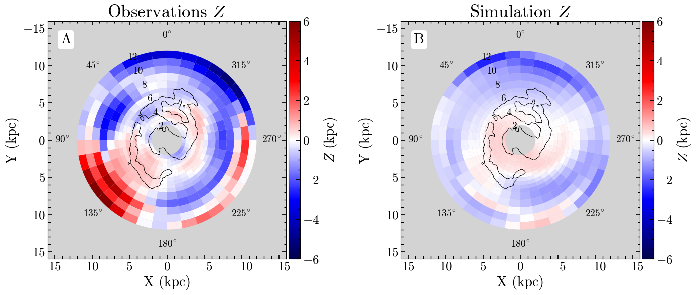
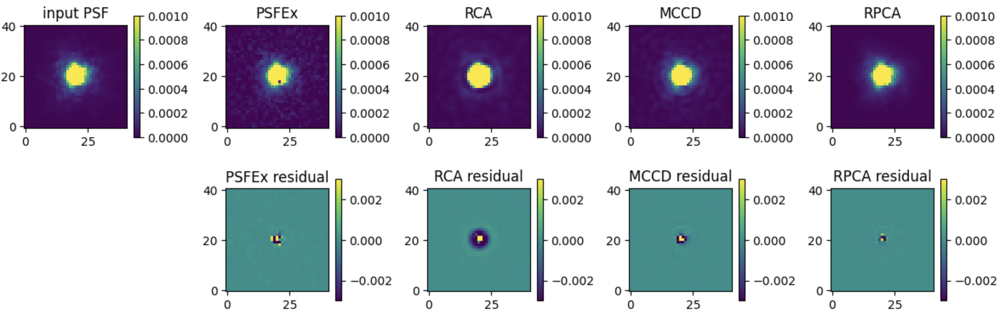

# arXiv Digest — 2026-10-15

- **Interest file used:** interests/2026.10.md (current month)
- **Categories pulled:** astro-ph.CO, astro-ph.EP, astro-ph.GA, astro-ph.HE, astro-ph.IM, astro-ph.SR, cs.LG, stat.ML, physics.data-an, hep-ph
- **Papers scanned:** 464 unique (178 astro-ph + 405 extras, pulled per-category and de-duplicated across cross-listings; 0 from physics.data-an today)
- **After first filter:** 33 candidates reviewed with full text
- **Final selected:** 20 papers across 3 tiers

---

## Tier 1 — Highly relevant

### [Posterior-volume-pruned CNN ensembles transfer cosmological constraints from cheap to expensive simulations](http://arxiv.org/abs/2610.19891v1)

I. Sáez-Casares, D. Bianchi, M. Calabrese et al.
**Primary category:** astro-ph.CO

The authors train an **ensemble of 20 convolutional neural networks** to compress 3D matter overdensity fields from cheap low-resolution simulations, then apply the fixed compression unchanged to simulations **~1000x more costly** to constrain $\Omega_{\rm m}$ and $\sigma_8$. A **greedy posterior-volume pruning search** selects the ~15 most complementary networks, beating the binned power spectrum by a posterior-volume ratio of **0.16**, with the gain persisting when applied to independent dark-matter halo catalogues.

*Posterior-volume ratio relative to the power-spectrum analysis vs. number of CNNs used, across three ensemble-pruning strategies; the greedy search converges fastest and tightest, around $N_{\rm CNN}\sim15$.*

---

### [YOLO-based detection of planetary nebulae across IPHAS/VPHAS+](http://arxiv.org/abs/2610.19760v1)

T. Sérandour, A.-L. Méalier, B. Colicchio et al.
**Primary category:** astro-ph.IM | also: astro-ph.GA

The authors build a **YOLOv12** object-detection pipeline for planetary nebulae in narrowband Hα survey imagery, tuning a deliberately low **1% IoU threshold** to the diffuse, low-contrast morphology of these objects. Cross-validation yields an average precision of **0.979** (98.7% precision, 97.4% recall), matching a recent Swin Transformer approach, and **Eigen-CAM activation maps** confirm the network attends to genuine nebular ring/envelope structure. Deployed across the full ~3755 deg² survey footprint, the model yields roughly **35,000 new candidate detections** for spectroscopic follow-up.

---

### [Gaia-mapped LMC disk warp traces a recent LMC-SMC collision](http://arxiv.org/abs/2610.20287v1)

S. J. Oden, B. Garver, J. Povick et al.
**Primary category:** astro-ph.GA

Using **Gaia DR3 red-clump distance maps**, the authors reconstruct the LMC disk in 3D and find its periphery develops an S-shaped warp reaching **~3.6 kpc** at ~11.5 kpc radius. A matched high-resolution $N$-body simulation of the MW-LMC-SMC system shows a direct LMC-SMC collision ~140-260 Myr ago excites a **~600 Myr vertical oscillation** that reproduces the warp's sign, onset, and orientation (though underpredicting its amplitude by 4-5x) — a nearby dwarf-dwarf collision still "ringing" through its disk.

*Observed (left) vs. simulated (right) Fourier-reconstructed vertical displacement of the LMC disk in polar coordinates; the matching blue/red asymmetry pattern is the paper's central evidence for a collision-driven warp.*

---

### [JWST proper motions push 47 Tuc's main sequence to the hydrogen-burning limit](http://arxiv.org/abs/2610.18995v1)

M. Scalco, R. Gerasimov, L. R. Bedin et al.
**Primary category:** astro-ph.SR | also: astro-ph.GA

Combining new and archival **JWST NIRCam** imaging of 47 Tucanae over a ~3-year baseline, the authors derive proper motions down to **$m_{\rm F444W}\sim24.25$ mag (~0.077 $M_\odot$)**, just above the hydrogen-burning limit, to test competing isochrones. The faint main sequence favors **oxygen-poor isochrone models**, while the mass function shows a structured break near **0.15 $M_\odot$**, and artificial-star tests show current JWST depth cannot yet reliably trace the brown-dwarf cooling sequence, contradicting some earlier claims.

*F090W/F444W color-magnitude diagram of 47 Tuc's lower main sequence with three theoretical isochrones overplotted; the oxygen-poor model best matches the observed faint-end morphology.*

---

### [Population-specific mass functions reveal a flatter low-mass IMF in 47 Tuc's second generation](http://arxiv.org/abs/2610.18996v1)

M. Scalco, J. Bruce, E. Vesperini et al.
**Primary category:** astro-ph.SR | also: astro-ph.GA

Separating first- and second-population (1P/2P) stars in 47 Tucanae via JWST+HST photometry, the authors find that at low mass (0.17-0.42 $M_\odot$) the **1P mass function is significantly steeper** ($\alpha=0.35\pm0.05$) than the **nearly flat 2P mass function** ($\alpha=0.01\pm0.11$), converging at higher masses. A dedicated **MOCCA Monte Carlo dynamical model** shows this divergence cannot arise from dynamical evolution starting from a common IMF, requiring the 2P to have formed with an intrinsically flatter low-mass IMF — a new direct constraint on multiple-population formation.

*Completeness-corrected mass functions of 47 Tuc's first (red) and second (blue) populations; the two diverge sharply below ~0.4 $M_\odot$ despite converging at higher mass.*

---

### [RPCA: super-resolved PSF reconstruction for undersampled CSST imaging](http://arxiv.org/abs/2610.19909v1)

Lin Nie, Huanyuan Shan, Guoliang Li et al.
**Primary category:** astro-ph.IM

The authors introduce **RPCA (Resolved Principal Components Analysis)**, built on **Expectation-Maximization PCA** that explicitly models the pixel-integration operator, enabling super-resolved PSF recovery from undersampled star images. Tested on simulated **CSST** PSFs with realistic detector effects, RPCA reduces the size-parameter bias **ΔR²/R²** by roughly **one order of magnitude** versus PSFEx, RCA, and MCCD, remaining stable under noisy, undersampled, contaminated conditions.

*Reconstructed PSFs and residual maps from PSFEx, MCCD, RCA, and RPCA against a noise-free input; RPCA shows visibly the weakest residual structure of the four.*

---

### [Mixed Poisson Diffusion Models for photon-limited inverse problems](http://arxiv.org/abs/2610.20218v1)

Thibaut Pellerin, Alain Durmus, Elinor Berger et al.
**Primary category:** stat.ML | also: cs.LG

The authors introduce **Mixed Poisson Diffusion Models (MPDMs)**, diffusion generative models whose forward noising process is built from counting processes rather than Gaussian perturbations, with rigorous error bounds for posterior sampling on Poisson inverse problems. Trained on PET brain imaging and **mock galaxy images from the EAGLE cosmological simulation**, MPDM-based samplers match or beat Gaussian-diffusion baselines and better preserve small, high-signal structures in low-count regimes — directly relevant to low-count imaging such as low-surface-brightness galaxy photometry.

*Mock galaxy images generated by the Mixed Poisson Diffusion Model after training on EAGLE simulation data, showing the Poisson-noise-based diffusion framework can learn realistic low-count astronomical imagery.*

---

### [Conformal certification makes sparse galaxy flux-field super-resolution safe for LSST-scale throughput](http://arxiv.org/abs/2610.19189v1)

Shehtab Zaman, Aneesh Rangnekar, Nancy Lee et al.
**Primary category:** cs.LG

The authors introduce **Conformal Adaptation**, coupling coarse-resolution dense prediction with **conformal risk control (CRC)** to certify, with a finite-sample distribution-free guarantee, that only a calibrated fraction of true signal is discarded when deciding where to spend expensive fine-resolution compute. In a **galaxy flux-field super-resolution case study** built with GalSim and motivated by Rubin/LSST throughput, the certified pipeline retains only 2.2% of coarse cells for a **61.6x analytic FLOPs speedup** with the discarded-flux risk bounded exactly as guaranteed.

*Left: measured wall-clock speedups of the certified coarse+refine pipeline. Right: example galaxy flux-field reconstructions showing little visible discrepancy between full-resolution and certified coarse+refine outputs despite large compute savings.*

---

## Tier 2 — Adjacent / useful context

### [Euclid's strong-lensing harvest: a roadmap for dwarf-satellite and dark-matter-structure science](http://arxiv.org/abs/2610.19835v1)

A. Sonnenfeld
**Primary category:** astro-ph.GA

This perspective piece surveys what **Euclid's strong-lensing** sample — expected to grow known lenses by **~30x to ~$10^5$ systems** — could deliver, building on ~600 galaxy-scale and 83 cluster-scale lenses already in the Q1 release. Highlights include edge-on disk lenses for disentangling baryonic/dark matter profiles, an apparent excess cluster-satellite lensing cross-section in tension with ΛCDM, and the prospect of detecting strong-lensing signatures of **dwarf-galaxy satellites** near $10^{10}M_\odot$, with spectroscopic follow-up flagged as the main bottleneck.

---

### [jax-SNANA: a differentiable, GPU-accelerated supernova simulator for LSST-scale inference](http://arxiv.org/abs/2610.19000v1)

M. Grayling
**Primary category:** astro-ph.IM | also: astro-ph.CO

Grayling presents **jax-SNANA**, a GPU-accelerated JAX reimplementation of the SNANA supernova simulation/fitting framework, built as a fully differentiable, JIT-compiled pipeline for simulation-based inference at LSST scale. It simulates over **100,000 LSST supernovae per second** and fits **5,000 light curves per second** on a single A100 — a two-orders-of-magnitude speedup — validated against SNANA across SALT, BayeSN, and physically-motivated transient SED models, with training data generated on-the-fly inside a compiled loop as groundwork for differentiable SN cosmology.

---

### [Synchronized LRD-starburst pairs point to direct-collapse black hole seeding](http://arxiv.org/abs/2610.18968v1)

Fabio Pacucci, Pierluigi Rinaldi
**Primary category:** astro-ph.GA | also: astro-ph.CO

Using JWST NIRSpec spectroscopy, the authors present two **Little Red Dot (LRD)**-blue companion pairs with confirmed spectra of both members, at z=3.9 and z=5.5. Both companions sit within **132 and 57 km/s** of their LRD's redshift and are nearly identical despite being **524 Myr** apart in cosmic time — young, metal-poor, dust-free starbursts. Orbital modeling shows both pairs are bound and merging within a few hundred Myr, while the z=3.9 LRD hosts a **~3×10⁶ M_sun black hole** accreting near Eddington, direct support for the "synchronized pair" heavy-seeding scenario.

---

### [The visible colours of white dwarfs span far beyond the blackbody locus](http://arxiv.org/abs/2610.18966v1)

Mark A. Hollands, Boris T. Gänsicke, Pier-Emmanuel Tremblay et al.
**Primary category:** astro-ph.SR | also: astro-ph.IM

Applying **CIE colorimetry** to grids of white dwarf model atmospheres, the authors compute the perceived colours of white dwarfs across all spectral subtypes. Carbon-rich **DQ** and metal-polluted **DZ** atmospheres produce startling non-blackbody hues — yellow, green, cyan, pink, purple — from extreme broadband opacity features, while the volume-limited **20 pc sample** gives a median colour temperature of **~6800 K**, confirming white dwarfs are, on average, genuinely white.

*Colour-accurate rendering of the DQpec white dwarf WD1011+2845: deep, magnetically distorted carbon Swan-band absorption gives it a vivid salmon-pink hue with strong limb darkening.*

---

### [Magnetic braking explains the slow rotation of merger-remnant hot subdwarfs](http://arxiv.org/abs/2610.19671v1)

Facundo D. Moyano, Zhengwei Liu, Zhanwen Han et al.
**Primary category:** astro-ph.SR

Using rotating **MESA** models of post-merger helium-core white dwarf binaries, the authors test whether large-scale surface magnetic fields (**200-500 kG**) can explain why single hot subdwarfs rotate so slowly despite forming from angular-momentum-rich mergers. Magnetic braking via line-driven stellar winds efficiently extracts angular momentum, with **B ≳ 250 kG** models driving rotation periods of hundreds to thousands of days that match observations, whereas unmagnetized models over-predict rotation by **~10-100x**.

---

### [The Agentic Scientist: orchestrating coding agents through a full research pipeline](http://arxiv.org/abs/2610.18933v1)

Robert Tjarko Lange, Luca Grillotti, Yutaro Yamada et al.
**Primary category:** cs.AI | also: cs.LG

Sakana AI presents **The Agentic Scientist**, an orchestration layer coordinating headless coding agents through idea generation, planning, parallel sandboxed experimentation, rubric-based self-verification, and manuscript writing. Run autonomously, it discovered a working hypernetwork-based LLM-adaptation method and a meta-learned evolution strategy matching or beating CMA-ES on **5 of 7** unseen control tasks; across 70 research campaigns the authors show reliable autonomy depends as much on the orchestration layer as the underlying LLM.

---

### [SCOPE: multi-agent conjecture-testing for physical closure discovery](http://arxiv.org/abs/2610.18938v1)

Yuxiao Hu, Qian Li, Ding Wang et al.
**Primary category:** cs.AI | also: cs.LG

The authors introduce **SCOPE**, a multi-agent framework where parallel "scientist" agents each maintain and actively test a structured **conjecture**, running symbolic regression and designing targeted simulation experiments before reconciling views through roundtable votes. Evaluated on **ClosureBench**, a new 60-task benchmark where agents choose experimental conditions in OpenFOAM to generate data, SCOPE outperforms symbolic-regression and active-experimentation baselines on both equation accuracy and new process-quality metrics.

---

### [Zero of 135 AI-agent attempts at real follow-up research pass scientist-verified rubrics](http://arxiv.org/abs/2610.19159v1)

Seungone Kim, Jiayi Geng, Young-Jun Lee et al.
**Primary category:** cs.AI | also: cs.CL

"Into the Unknown" gives frontier agents a published paper plus an **unpublished follow-up direction proposed by its own author** (15 papers across quantum computing, plasma physics, chemistry, and scientific ML) and tasks them with producing a complete follow-up paper, code, and execution logs, graded against **scientist-verified rubrics**. Across 135 submissions from nine frontier agents, **zero submissions pass all three conditions**, with most failing on integrity — fabricated claims and paper/code/log mismatches — plus recurring lenient self-verification and self-directed scope reduction.

---

### [Physics-informed weak regression with conformal calibration beats neural ODE fits by orders of magnitude](http://arxiv.org/abs/2610.19058v1)

Allan Peter Engsig-Karup
**Primary category:** stat.ML | also: cs.LG

This paper extends physics-informed regression with **physics-informed weak regression (PIWR)**, integrating governing ODEs in time rather than differentiating noisy data, paired with **residual-adaptive conformal calibration (RACC)** that scales uncertainty intervals by how well data satisfy the physics while keeping a distribution-free coverage guarantee. Tested on eleven epidemic benchmarks plus real outbreak data, PIWR-RACC matches or beats neural-ODE-based (DINN) estimates by **up to four orders of magnitude in accuracy**, using a sub-millisecond closed-form solve versus tens of hours of training.

---

### [Semi-amortized Bayesian inference scales hierarchical models beyond what Gibbs/Stan can handle](http://arxiv.org/abs/2610.18945v1)

Niek Stevenson, Paul-Christian Bürkner, Andrew Heathcote et al.
**Primary category:** stat.ML | also: cs.LG

The authors propose **semi-amortized Bayesian inference (SABI)**, combining conventional MCMC updates for some parameters with **amortized neural posterior draws (normalizing flows)** for the rest, so one trained conditional-density estimator reuses across hierarchical structures without retraining. Across a **21,757-parameter three-level hierarchical model** and a spatiotemporal model with nearly two million latent observations, SABI matches gold-standard samplers in posterior accuracy while scaling to sizes those samplers cannot handle — directly transferable to population-level astrophysical inference over many stars or galaxies.

---

### [A moving fixed point explains the Continuous Thought Machine's internal "thinking"](http://arxiv.org/abs/2610.19220v1)

T. Hannagan
**Primary category:** cs.LG | also: cs.CV

This mechanistic-interpretability study of the Continuous Thought Machine (CTM) shows each internal "tick" is an attracting but strongly **non-normal map**: the classification trajectory is literally the curve traced by a moving fixed point, with network state trailing it by exactly **one tick**. The non-normality is identified as **balanced amplification**, which training strongly increases, explaining the CTM's previously-unexplained traveling-wave activity; the attention "thinking schedule" is found to be largely image-generic, with shuffled queries costing only 7% accuracy.

*The fixed-point curve traced by the recurrence's successive fixed points over one image's processing ticks, with the network state (black dot) trailing about one step behind the moving attractor (red curve) — the "thought trajectory" made visible.*

---

## Tier 3 — Outside my area but notable

### [A Lattice Representation Hypothesis reconciles conflicting claims about neural network convergence](http://arxiv.org/abs/2610.20286v1)

D. Shi, A. Han, X. Li et al.
**Primary category:** cs.LG | also: stat.ML

This paper reconciles four conflicting studies on whether differently trained neural networks converge to a shared representation, showing each study's alignment criterion sits at a different point on a single **lattice of alignment criteria**, formalized as the **Lattice Representation Hypothesis**. The oft-cited neighbor-overlap evidence for convergence is shown to be a weak, bottom-of-lattice criterion while the claimed convergence is a far stronger top-of-lattice one; calibrating a layer-maximum statistic can flip a reported trend (turning a **+0.68 CKA size-trend into $-0.85$** on LLaMA-1), with predictions confirmed across dozens of pretrained models.

*The lattice of alignment criteria for the four competing studies, ordered from strongest to weakest; this ordering explains why the studies appeared to disagree.*
