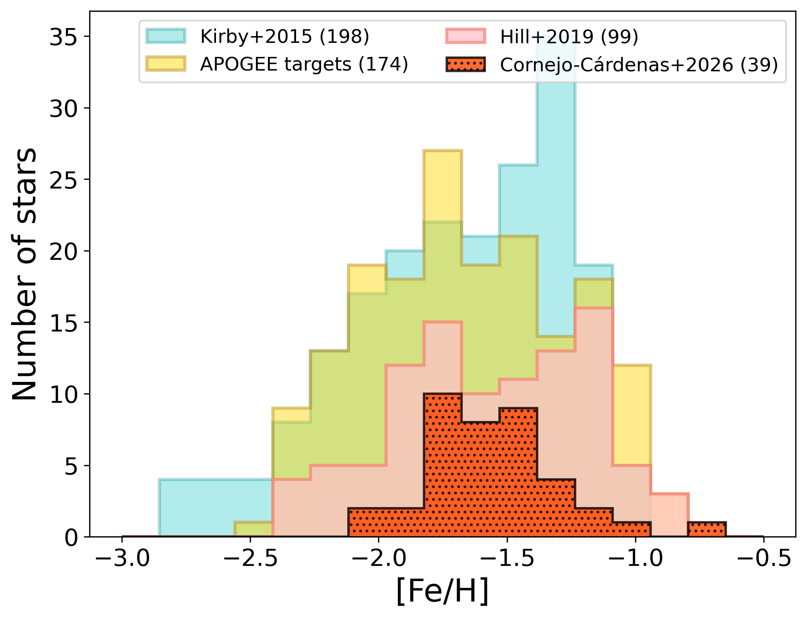
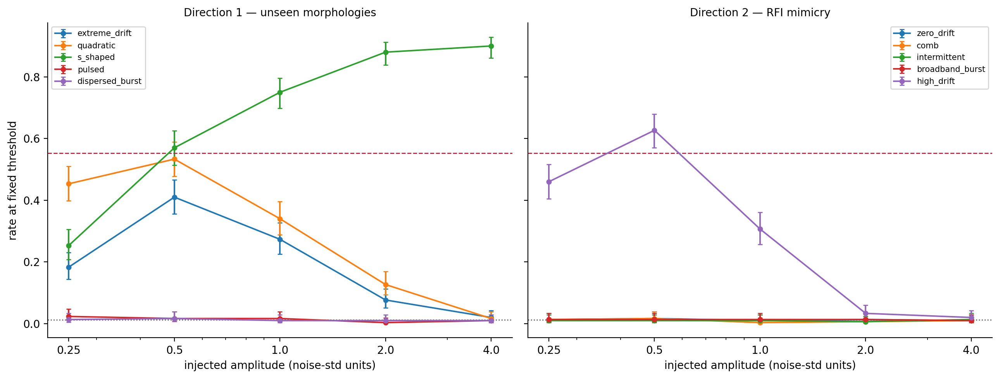
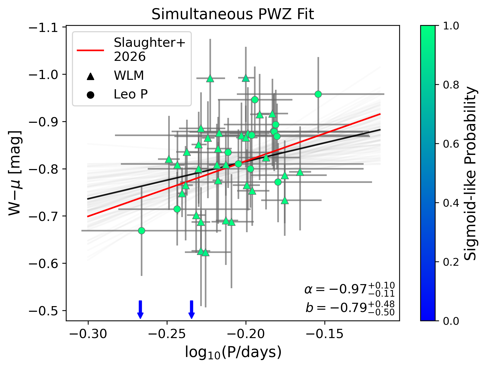
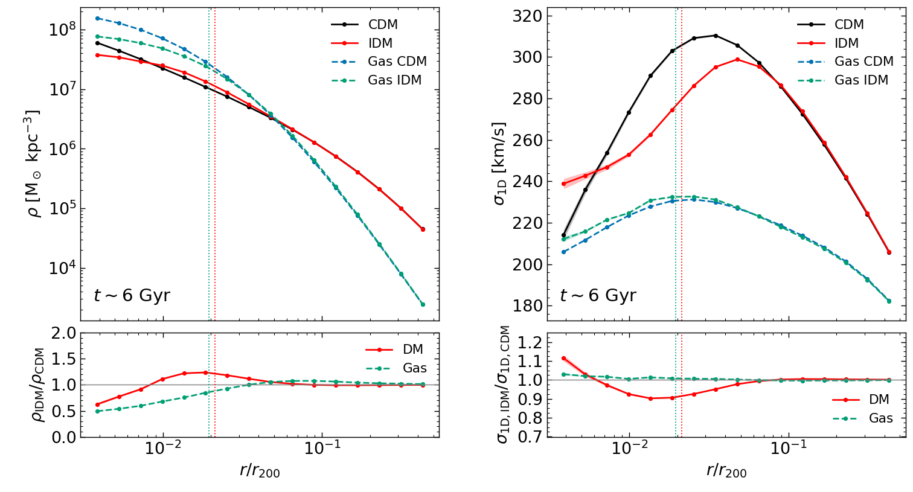
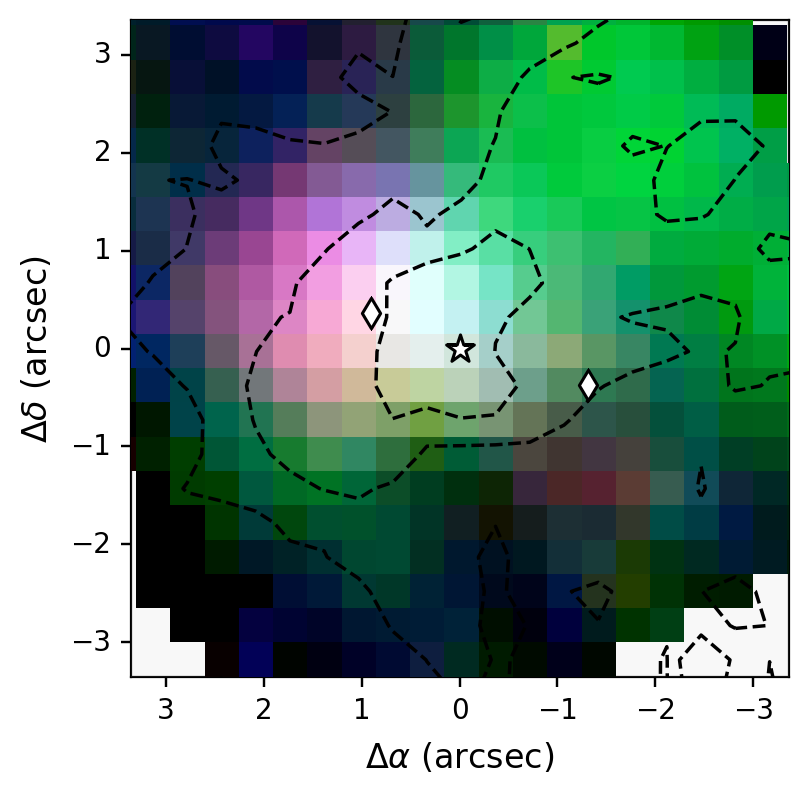
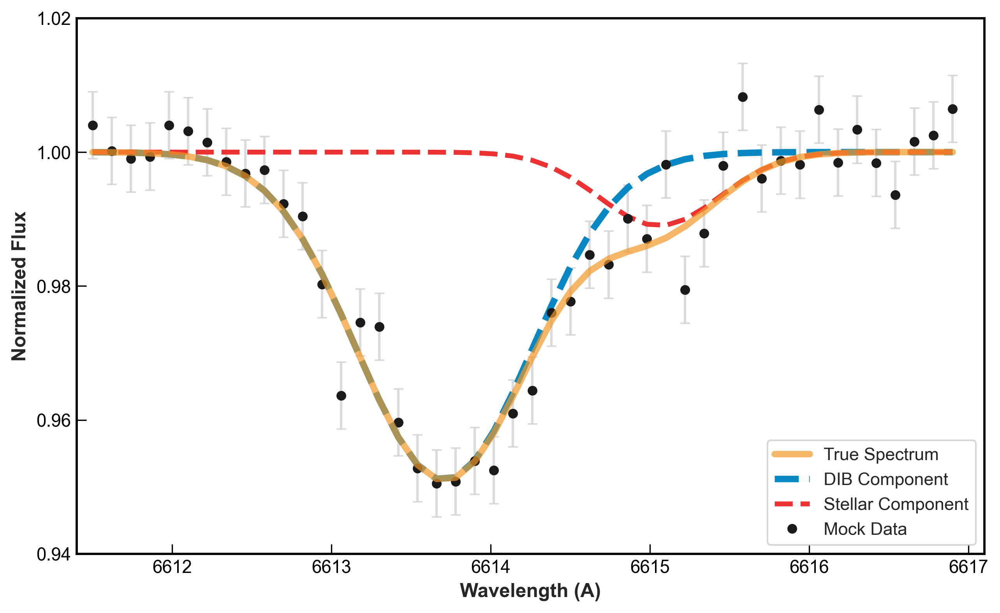

# arXiv Digest — 2026-10-16

- **Interest file used:** interests/2026.10.md (current month)
- **Categories pulled:** astro-ph.CO, astro-ph.EP, astro-ph.GA, astro-ph.HE, astro-ph.IM, astro-ph.SR, cs.LG, stat.ML, physics.data-an, hep-ph
- **Papers scanned:** 536 unique (138 astro-ph + 306 cs.LG + 92 stat.ML/physics.data-an/hep-ph, deduplicated)
- **After first filter:** 17 candidates reviewed with full text
- **Final selected:** 17 papers across 4 tiers

---

## Tier 1 — Highly relevant

### [ACACIAS II: element abundances for 39 stars in the dwarf galaxy Sculptor](http://arxiv.org/abs/2610.21028v1)

Anell Cornejo-Cárdenas, Sven Buder, Melissa K. Ness, J. Trevor Mendel
**Primary category:** astro-ph.GA

Second paper in the ACACIAS program, applying the data-driven method **The Cannon** to low-resolution (R=1800), low-SNR (~25) MUSE spectra of **39 red giants in the Sculptor dwarf spheroidal**. The model transfers labels from high-fidelity APOGEE spectra via LAMOST-matched training, recovering [Mg/Fe], [Mn/Fe], [C/Fe], [N/Fe], and [Al/Fe] with precisions of **σ = 0.09–0.37 dex**. By comparing four training-set configurations (full-spectrum vs. physically-motivated absorption windows vs. telluric masking), the authors show Mg, Mn, C, and N are best recovered from targeted spectral windows (**up to 27% lower RMS**), while [Al/Fe] and stellar parameters need full-spectrum information — a direct test of whether abundance predictions are driven by physically relevant features or spectral correlations.

*The Cannon-inferred [Fe/H] distribution for the 39 Sculptor giants (orange) compared with medium- and high-resolution literature measurements, showing the low-resolution MUSE pipeline recovers the expected metal-poor distribution of the dwarf spheroidal.*

---

### [An Energetic Consistency Test for Feedback-Driven Gas Loss in Milky Way Dwarf Satellites](http://arxiv.org/abs/2610.21186v1)

Sena A. Matsui, Tsutomu T. Takeuchi, Suchetha Cooray, Kiyoaki Christopher Omori

**Primary category:** astro-ph.GA

Applies an order-of-magnitude energy-budget test to **nine Milky Way dwarf spheroidals**, comparing the cumulative core-collapse supernova energy (from published CMD-based star formation histories) against the gravitational binding energy of each galaxy's gas, under several halo-mass/radius prescriptions. All nine galaxies reach the nominal energy threshold under the fiducial **kinematic-size (K+B16)** prescription, defining an **energy-equivalence lookback time** that the authors carefully compare — but do not causally equate — with the lookback time at which 90% of stellar mass had formed. The paper is explicit that threshold-crossing is necessary but not sufficient for a real wind, and that whether the threshold is reached at all depends sensitively on the adopted halo mass, radius, retained gas fraction, and SN-coupling efficiency.

*Differential star formation histories for the nine dwarfs with vertical lines marking the inferred energy-equivalence lookback time under three halo prescriptions, showing how sensitive the timing diagnostic is to the assumed halo model.*

---

### [Hydrostatic Equilibrium Constraints on the Fuzzy Dark Matter Mass from Dwarf Spheroidals: Method, Systematics, and Robustness](http://arxiv.org/abs/2610.21722v1)

Samrat Mitra, Koushik Dutta

**Primary category:** astro-ph.CO

Introduces a non-parametric estimator for the fuzzy (ultralight-boson) dark matter mass based on local hydrostatic equilibrium between classical gravity and quantum pressure in the Schrödinger–Poisson–Madelung system, applied directly to **pyGravSphere** density/mass posteriors for nine Milky Way dwarf spheroidals — without assuming a soliton profile, which the authors note would otherwise make the test circular. Per-galaxy median masses span **m₂₁ ~ 8–46** (in units of 10⁻²¹ eV), with Draco and Ursa Minor the lightest and Carina/Sextans the heaviest; the **inverse-variance-weighted estimate is m = (1.3 ± 3.5) × 10⁻²⁰ eV**, dominated by Draco and Ursa Minor. The spread across galaxies is large enough that the authors devote a full robustness section to the force-balance residual and fitting-window sensitivity.

*Per-galaxy posterior-median fuzzy dark matter mass (m₂₁) with 68% credible intervals for all nine dwarf spheroidals, showing the factor-of-several spread in implied boson mass across the sample.*

---

### [Missed Detections and False Alarms in a CNN Technosignature Detector on Breakthrough Listen Data](http://arxiv.org/abs/2610.22050v1)

Omer Imran

**Primary category:** astro-ph.IM | also: cs.LG

A rigorous interpretability audit of a standard SETI CNN detector (EfficientNet-B0, trained on the Breakthrough Listen Kaggle baseline), probed with **15,000 pre-registered injections** across ten signal morphologies and five amplitudes in real telescope backgrounds. Recall **fell as signals brightened** even for the detector's own training-distribution morphology (0.590→0.090), and one interference family reached a **false-positive rate of 0.627** — comparable to the detector's baseline recall on genuine signals. **Grad-CAM analysis**, validated with sanity-check randomization and deletion tests, traces the failure to the architecture itself: the CNN reads only the three ON-source panels and discards the OFF panels that are the only evidence distinguishing a real signal from terrestrial interference, so it can judge whether a signal *looks* genuine but not whether it *is*.

*Detection rate vs. injected amplitude for genuine signals (left) and interference (right); recall peaks and then collapses at high amplitude, and the interference false-positive-rate curve peaks in the same amplitude band where genuine detections are highest — the regime where the detector is least able to tell the two apart.*

---

### [A Comprehensive AGN Inventory for the Dwarf-Dominated RESOLVE and ECO Surveys: Mass-Dependent AGN Types and Occupation Fractions](http://arxiv.org/abs/2610.22115v1)

Mugdha S. Polimera, Sheila J. Kannappan, Chris T. Richardson, David V. Stark, Kathleen D. Eckert et al.

**Primary category:** astro-ph.GA

Builds a multi-method AGN census (BPT/VO optical diagnostics plus custom WISE mid-IR photometry) across the volume-complete, **dwarf-dominated RESOLVE and ECO surveys** (~8,300 galaxies). AGN occupation fractions rise steeply with baryonic mass — **2–5% in dwarfs, 16–27% in transitional galaxies, 20–48% in giants**, a roughly **5× increase across the $10^{9.7}\,M_\odot$ gas-richness/bimodality transition** — and the dominant AGN *type* shifts continuously with mass, from diluted "SF-AGN" in metal-poor star-forming dwarfs to conventional AGN in giants. The authors also show that off-the-shelf WISE catalog photometry gives high false-positive **and** false-negative rates for dwarf AGN, and release their custom WISE photometry and homogenized line measurements publicly.

---

## Tier 2 — Adjacent / useful context

### [JWST Observations of RR Lyrae in Leo P](http://arxiv.org/abs/2610.20692v1)

Catherine M. Slaughter, Alessandro Savino, Meredith Durbin, Andrew E. Dolphin, Kristen B. W. McQuinn et al.

**Primary category:** astro-ph.GA | also: astro-ph.SR

Analyzes co-spatial HST and JWST/NIRCam time-series photometry of RR Lyrae in the **low-metallicity dwarf galaxy Leo P**, identifying 20 RR Lyrae in HST and 15 in JWST imaging via MCMC template fitting. The HST-based Period-Wesenheit-Metallicity (PWZ) distance, **μ = 26.04 ± 0.07 (1.61 ± 0.06 Mpc)**, agrees with *Gaia* and prior TRGB/HB measurements, and a joint JWST PWZ calibration combining Leo P with earlier WLM data **reduces the fractional slope uncertainty by 31% and intercept uncertainty by 11%**, strengthening the case for JWST as a practical tool for metal-poor RR Lyrae distance work in dwarf galaxies.

*The combined JWST Period-Wesenheit-Metallicity fit using both Leo P (circles) and WLM (triangles) RRab stars, compared with the WLM-only calibration (red); the larger period range from Leo P better anchors the fit slope.*

---

### [Efficient numerical evolution of self-gravitating systems with dark-matter-baryon scattering](http://arxiv.org/abs/2610.20702v1)

Marc Kamionkowski, Vera Gluscevic, Kris Sigurdson

**Primary category:** astro-ph.CO | also: astro-ph.GA

Extends the spherical *N*-body code **NSphere** with a Lagrangian gas component and a Monte Carlo treatment of dark-matter-baryon scattering plus radiative cooling, producing **NSphere-IDM** — a tool fast enough to run full halo-plus-gas simulations on a laptop rather than requiring full 3D hydro runs. For a $10^{13}\,M_\odot$ halo at the CMB-bound cross section, scattering removes pressure-supported gas from the center (central gas density drops by **~50%**) while cooling the dark matter's velocity dispersion by up to **~10%**; in a separate cooling-flow demonstration, scattering from heavy dark matter delays a cooling catastrophe by ~140 Myr while light dark matter accelerates it. The code and its fast turnaround make it a practical tool for scanning how new dark-matter physics (including in dwarf-mass halos) reshapes galaxy-scale gas content.

*Dark matter (left) and gas (right) density and velocity-dispersion profiles after 6 Gyr, comparing a standard CDM run (black/blue) against the same halo with dark-matter-baryon scattering switched on (red/green): scattering evacuates gas from the center while cooling the dark matter.*

---

### [The Pristine survey XXIX. Data Release 2: Photometric metallicities for 15 million stars down to G~20.5](http://arxiv.org/abs/2610.20714v1)

Zhen Yuan, Anke Ardern-Arentsen, Nicolas F. Martin, Else Starkenburg, Morgan Fouesneau et al.

**Primary category:** astro-ph.GA

Releases the second data release of the **Pristine** narrow-band CaHK photometric metallicity survey, extending coverage to ~8,000 deg² and reaching **G ~ 20.5** — roughly 3 magnitudes deeper than DR1's *Gaia*-spectrophotometry limit. Metallicities are derived via a neural network (**PhotCalib**) trained on bright-star *Gaia* XP synthetic CaHK photometry and then applied to the full magnitude-limited sample, producing photometric [Fe/H] for **15 million FGK stars** with more than 200,000 very metal-poor and 6,500 extremely metal-poor candidates, in good agreement with independent DESI metallicities — a substantial new resource for Milky Way halo stellar population studies.

---

### [The optical colors of hidden spiral-like features in nine Virgo early-type dwarfs](http://arxiv.org/abs/2610.20819v1)

Mauricio Gracia, Rory Smith, Anna Pasquali, Laura Ferrarese, Patrick Côté et al.

**Primary category:** astro-ph.GA

Applies a residual-based image decomposition to deep NGVS $g$- and $i$-band imaging of **nine Virgo dwarf early-type galaxies** with previously identified embedded spiral-like features (bars, arms), isolating the light fraction and color of the hidden structure relative to the diffuse host. The features contribute only **1.5–5.5% (i) and 1.7–3.7% (g)** of total light, and show a surprisingly **diverse color pattern**: four galaxies have redder arms, four show no significant color difference, and one has a distinctly bluer, apparently recently-quenched component — evidence against a single formation channel (e.g., purely quenched late-type progenitors) for spiral-like structure in dwarf ellipticals.

---

### [JWST reveals a highly ionized nebula powered by an ultraluminous X-ray source with a massive black hole in the metal-poor galaxy Holmberg II](http://arxiv.org/abs/2610.20948v1)

F. A. Fogantini, P. Zeidler, L. M. Oskinova, T. Bao, W.-R. Hamann et al.

**Primary category:** astro-ph.GA | also: astro-ph.HE

Presents the first JWST IFU spectroscopy (NIRSpec + MIRI MRS) of the nebula around the template ULX **Ho II X-1** in the metal-poor dwarf galaxy Holmberg II, spatially resolving it on ~15–25 pc scales and reporting the first detections of **[Ne V] and [Ne VI]** in this source. The highest-ionization emission is offset from the ULX toward previously identified radio knots rather than centered on it, suggesting **anisotropic escape of the ionizing continuum** tied to jet-ejection activity, while narrow, kinematically quiescent line profiles across the nebula disfavor shocks as the dominant excitation mechanism — direct evidence linking an individual accreting black hole to the extreme-ionization nebular lines increasingly seen in low-metallicity JWST spectra.

*JWST/MIRI MRS RGB map of the Ho II X-1 nebula ([S III] green, [Ne V] red, [O IV] blue), with radio-knot positions marked; the highest-ionization [Ne V] emission is offset from the ULX itself toward the radio knots rather than centered on it.*

---

### [A machine-learning-driven dataset of 144,111 polycyclic aromatic hydrocarbon infrared spectra for interpreting aromatic infrared bands](http://arxiv.org/abs/2610.21205v1)

Xinghong Mai, Zu-Jia Lu, Zhao Wang

**Primary category:** astro-ph.GA | also: astro-ph.IM

Generates a large synthetic library of **144,111 IR spectra for 48,037 PAH structures** (neutral, cationic, anionic) using an ML "double-harmonic" framework that pairs a neural-network force field with an electron-passing dipole network, reaching near-DFT accuracy at a **~36× speedup**. Each spectrum carries a **per-molecule uncertainty estimate** derived from nearest-neighbor similarity to a validated test set, and the library is shown to densely cover nonplanar and topologically complex PAH motifs that are essentially absent from the benchmark PAHdb — directly extending the reference spectra available for interpreting JWST aromatic-infrared-band observations of the interstellar medium.

*Composition of the released dataset: representative PAH structures spanning the covered size range (top) and the number of structures per carbon count, with small and medium-sized PAH regimes marked (bottom).*

---

### [A clump population framework for star formation across galactic scales](http://arxiv.org/abs/2610.21623v1)

J. W. Zhou, Sami Dib, Tie Liu, Ralf S. Klessen, Davide Elia et al.

**Primary category:** astro-ph.GA

Using a dendrogram-identified clump catalog across **30 dwarf and disk galaxies**, plus Milky Way sub-parsec cloud substructure and 311 further nearby galaxies, finds a **single, environment-insensitive relation between molecular gas mass and star formation rate that holds across ten orders of magnitude** in both quantities. A simple model in which star formation proceeds within dense clumps embedded in molecular clouds reproduces this relation, offering a physical explanation for why galaxy-scale Kennicutt–Schmidt-type relations look so similar despite very different host environments, including dwarf galaxies.

---

### [Disentangling Multi-epoch Single-lined Binary Star Spectra to Reveal Interstellar Medium Features via MCMC](http://arxiv.org/abs/2610.21997v1)

Shao-Song Huang, Jian-Jun Chen, Xiao-Xiao Ma, Ji-Wei Shi

**Primary category:** astro-ph.GA

Introduces **MCMC-RVSD**, a template-independent Bayesian method that separates stationary interstellar diffuse band (DIB) absorption from Doppler-shifting stellar lines by jointly fitting multi-epoch spectra of single-lined spectroscopic binaries, exploiting orbital radial-velocity variation rather than relying on template-matching accuracy. Validated on mock LAMOST-resolution spectra, the method recovers DIB λ6614 parameters to **0.01 Å wavelength precision**, and applied to 434 real LAMOST binaries, the authors find that an **RV span greater than 20 km/s** is the primary driver of successful stellar/ISM line separation, with the algorithm remaining robust at SNR > 50 and RV errors below 5 km/s.

*A mock single-lined binary spectrum (black points) decomposed by the MCMC-RVSD fit (yellow) into its stationary DIB λ6614 component (blue, ISM) and Doppler-shifted stellar Fe I line (red), illustrating how orbital motion alone separates the two.*

---

### [The Radius-Luminosity Relationship for Active Galactic Nuclei with Hierarchical Bayesian Reverberation Mapping](http://arxiv.org/abs/2610.22096v1)

Hugh McDougall, Tamara M. Davis, Benjamin J. S. Pope, Paul Martini, Zhefu Yu et al.

**Primary category:** astro-ph.GA | also: astro-ph.CO

Presents an end-to-end hierarchical Bayesian framework that fits individual AGN reverberation-mapping lags and the population-level radius-luminosity relation **simultaneously**, fully marginalizing over data quality and aliasing rather than using the traditional "cut-and-constrain" approach of discarding low-quality lag measurements before fitting a population relation. Applied to the OzDES sample, the method yields **more than double the constraining power** on the R–L relation and expands the usable sample from 24 high-quality lag recoveries under traditional methods to an effective sample size of **~297**, while remaining robust against random chance false positives — a methodological template for Bayesian population modeling of any large, heterogeneous AGN time-series dataset.

---

## Tier 3 — Outside my area but notable

### [PTagent: An LLM-assisted tool for finite-temperature model construction in cosmological phase transitions](http://arxiv.org/abs/2610.21118v1)

Lei Wu, Yang Xiao, Jin Min Yang, Yang Zhang

**Primary category:** hep-ph

An LLM-agent framework that automates the laborious, error-prone step of assembling a consistent finite-temperature effective potential for cosmological phase-transition calculations — interpreting SARAH model files, research papers, or DRalgo output, organizing the required physical ingredients, and flagging unresolved theoretical choices (gauge-fixing, renormalization, resummation scheme) for human review before a deterministic backend generates CosmoTransitions- or PhaseTracer-style numerical potentials. The agent is explicitly scoped to the model-construction step rather than the full analysis pipeline, with human approval gating any theoretical choice before numerical calculation — a useful case study in constraining an LLM agent to the parts of a scientific workflow where it's genuinely better suited than deterministic code, applied here to particle cosmology rather than observational astronomy.

---

### [Dark Matter in the Galaxy: Insights from the Dynamics of Stellar Streams](http://arxiv.org/abs/2610.22202v1)

Mohammad Ayaz, Priya Hasan

**Primary category:** astro-ph.GA

A review of how tidal streams from disrupted globular clusters and dwarf galaxies — including Sagittarius, GD-1, Palomar 5, Orphan-Chenab, and Cetus Polar — constrain the Milky Way's dark matter halo shape and substructure, synthesizing analytic, statistical, and Bayesian stream-fitting methods and surveying how gaps, spurs, and large-scale wiggles in stream morphology could eventually discriminate between cold, warm, and self-interacting dark matter. Useful as a current-state summary of a technique built entirely on dwarf-galaxy and globular-cluster tidal debris, though it presents no new result of its own.

---

## Tier 4 — Meta-research about the field

### [The Mission Market: Flying NASA's Vetted, Unflown Science](http://arxiv.org/abs/2610.22159v1)

Blakesley Burkhart

**Primary category:** astro-ph.GA

A policy proposal arguing that NASA validates far more fully peer-reviewed, flight-ready small missions (Explorer/MoO-class, $50–300M) than it can afford to fly, and that the solve is an **advance market commitment** funded primarily by **AI companies' demand for frontier, non-scrapeable scientific data** for training foundation models, modeled on the pneumococcal vaccine AMC and NASA's own fixed-price CLPS lunar-delivery program. The mechanism is explicitly structured to preserve NASA peer review as the sole quality gate and mandate normal public data release after a bounded proprietary window — a concrete, timely example of how AI-sector capital is starting to reshape astronomy funding mechanisms rather than just astronomy methods.
