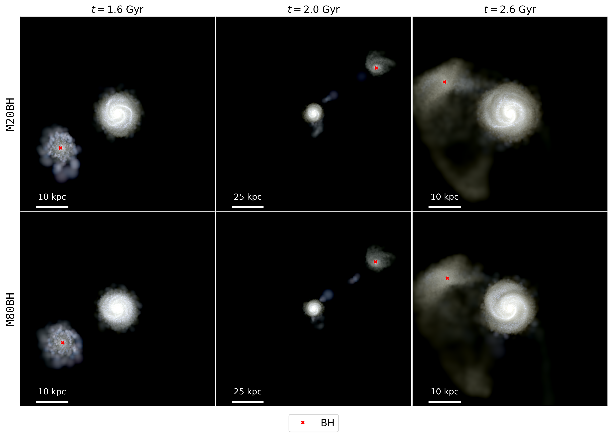
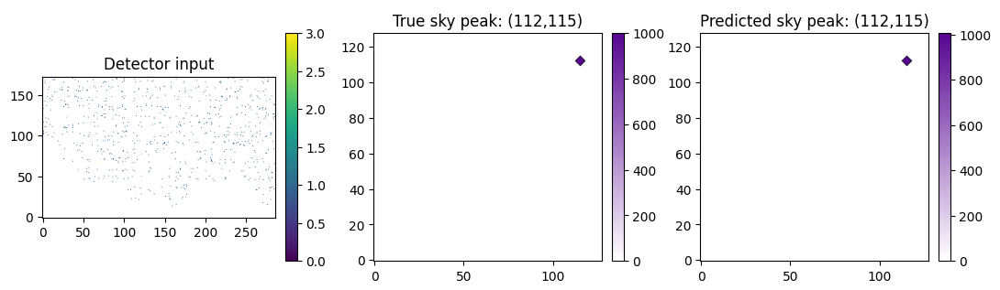
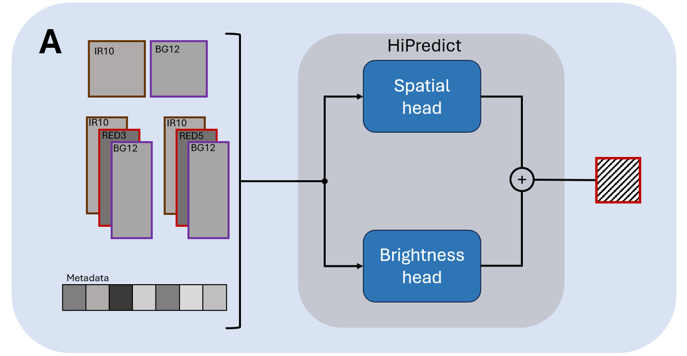
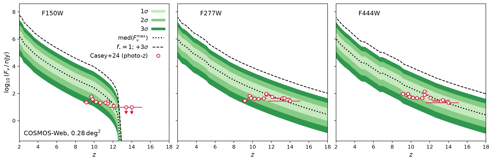

# arXiv Digest — 2026-10-19

- **Interest file used:** interests/2026.10.md (current month)
- **Categories pulled:** astro-ph.CO, astro-ph.EP, astro-ph.GA, astro-ph.HE, astro-ph.IM, astro-ph.SR, cs.LG, stat.ML, physics.data-an, hep-ph
- **Papers scanned:** 389 raw / 348 unique (98 astro-ph + 222 cs.LG + 31 stat.ML + 5 physics.data-an + 33 hep-ph, deduplicated)
- **After first filter:** 25 candidates reviewed with full text
- **Final selected:** 20 papers across 4 tiers

---

## Tier 1 — Highly relevant

### [Star Light, Star Bright: Can Multimodal Models Parse an Astronomy Visual Question Answering Dataset Right?](http://arxiv.org/abs/2610.22474v1)

J. P. Naiman
**Primary category:** cs.CV | also: astro-ph.IM

Builds a domain-specific **visual question answering (VQA) dataset** of 2001 astronomical figures (contour plots, real sky images, and GMM-generated "fake" sky images) with 47,357 questions, including historically-aged versions to mimic the archival literature. Testing three low-cost multimodal models (GPT, Gemini, Claude) finds they **correctly identify GMM-generated sky images only 4–14% of the time**, against 80–98% for real images, and show large, model-dependent errors reading angular scales off plot axes. A comparison against 104 human-verified published figures shows similar error rates to the synthetic test set, suggesting the benchmark's weaknesses generalize to the real literature. The results indicate current low-cost multimodal models remain **unreliable at basic domain-specific figure reading** in astronomy.

*Accuracy of the three models at identifying plot type and distinguishing real-sky images from GMM-generated fakes; models badly over-guess "real image" and are much better at spotting contour plots than synthetic sky images.*

---

### [Native Geometry vs. Linear Recoverability: How Alignment Changes Platonic Scaling](http://arxiv.org/abs/2610.22749v1)

Angus Hoy, Austin Lutterbach, Jasper Chong et al.
**Primary category:** cs.LG | also: astro-ph.IM

Tests the Platonic Representation Hypothesis using matched galaxy image **embeddings from the Legacy Survey and Hyper Suprime-Cam (HSC)** across five model families, distinguishing "native" cosine-geometry correspondence from **linear recoverability** exposed by a supervised Ridge alignment. Larger models show a clearly steeper scaling in linearly-recoverable cross-survey correspondence than in their native embedding geometry, an effect that holds in all five families and persists after matching dimensionality. The improvement is concentrated in a strongly anisotropic, non-rotational part of the fitted map, with **only 2–17% of singular directions needed to recover 90% of the alignment gain**, even though the anisotropy itself is spread across roughly 40% of directions. The results suggest model scale improves how well cross-domain structure can be linearly extracted from astronomical embeddings, without necessarily making the embeddings' native geometry more universal.

*Held-out neighbor-recovery accuracy versus model size for native embedding geometry compared to the same embeddings after a supervised Ridge alignment; the Ridge-aligned curve's slope grows faster with model size.*

---

### [Learning without relearning physical symmetry: an SO(3)-equivariant convolutional network (CNN) on the sphere](http://arxiv.org/abs/2610.23821v1)

Joshua Williamson, Niall Jeffrey, Lorne Whiteway
**Primary category:** stat.ML | also: astro-ph.CO

Introduces an **SO(3)-equivariant convolutional network** built from steerable filters for data on the HEALPix sphere, giving CMB and weak-lensing analyses an architecture with the sphere's rotational symmetry built in exactly rather than learned from data. The network achieves **per-cent-level or better SO(3)-invariance error**, and beats planar CNN, DISCO and DeepSphere compressors on dense gradient regression and CMB foreground removal/denoising benchmarks. In a cosmic-shear simulation-based-inference task, the equivariant compressor yields the **tightest Ω_m–S8 posteriors at matched simulation budget**, since the built-in symmetry means training data isn't spent re-learning something already known about the geometry. The authors argue this matters most for expensive simulators, where a fixed compute budget otherwise forces reliance on cheaper, less accurate training simulations.

*Ω_m–S8 posteriors from simulation-based cosmic-shear inference, comparing the new spherically-equivariant CNN compressor against a planar CNN, DISCO and DeepSphere at the same simulation budget; the equivariant network gives the tightest constraints.*

---

### [$\texttt{GASTRO-BH}$: Effects of a Central Black Hole in GSE-like Dwarf-galaxy Mergers Around Milky Way-like Hosts](http://arxiv.org/abs/2610.22860v1)

Pedro Naethe Motta, João A. S. Amarante, Guilherme Limberg et al.
**Primary category:** astro-ph.GA | also: astro-ph.HE

Uses high-resolution **N-body/SPH merger simulations** (ChaNGa) of GSE-like dwarf galaxies merging with a Milky Way-like host to test whether such mergers help or hinder the growth of an intermediate-mass black hole (IMBH), motivated by the putative IMBH in ω Centauri. Tidal interactions and pericentric gas inflows during the merger **enhance BH accretion rather than suppressing it**, growing the BH mass by **more than two orders of magnitude** in both low- and high-feedback models, while star formation in the dwarf is simultaneously suppressed. The result suggests GSE-like mergers are an efficient channel for fueling IMBH growth in satellite galaxies, in tension with the low inferred IMBH mass in ω Centauri, and points to a possible mechanism for triggering AGN-like activity in dwarf galaxies.

*Rendering of star particles during the dwarf-galaxy/Milky-Way-like merger, with the central black hole's position marked, at three simulation times spanning the interaction.*

---

### [Dust in Galaxies at $z=10-15$: Attenuation and Re-emission Predictions from the FirstLight Simulations](http://arxiv.org/abs/2610.22766v1)

Yurina Nakazato, Akio K. Inoue, Rachel S. Somerville et al.
**Primary category:** astro-ph.GA

Post-processes **208 snapshots of 99 galaxies ($M_*=10^{6.5}$–$10^{9.5}\,M_\odot$) from the FirstLight cosmological simulations** at $z=10$-15 with 3D dust radiative transfer, running twelve combinations of dust-to-metal (DTM) prescription and grain-size distribution per snapshot to self-consistently predict JWST UV attenuation and ALMA dust re-emission. **Metallicity-dependent DTM models reproduce the observed ALMA dust-mass limits**, while a constant DTM of 0.4 violates more than half of them, and small-grain, SMC-like dust best matches the observed UV-slope–magnitude relation. The simulations predict dust peak temperatures of **60–80 K**, well above the 40–50 K commonly assumed in ALMA dust-mass estimates, meaning current mass estimates for these faint, dusty systems may be systematically biased.

*Simulated galaxy FL962 at z=11, shown as a mock JWST image with and without dust attenuation alongside its predicted ALMA-band dust continuum, V-band extinction map, dust column density and temperature map.*

---

### [Double Trouble: How Unresolved Spectroscopic Binary Stars Skew GALAH DR4 Stellar Parameters](http://arxiv.org/abs/2610.22707v1)

Yani Lach, Sven Buder, Gregor Traven
**Primary category:** astro-ph.SR | also: astro-ph.GA

Fits ~917,000 GALAH DR4 spectra with a **binary spectral model** that decomposes each spectrum into two superposed synthetic components, with masses and ages interpolated from **PARSEC isochrones**, to identify unresolved binaries masquerading as single stars. The method recovers ~12,911 candidate binary systems and quantifies the resulting biases on single-star fits: **T_eff shifts of -142 to +200 K, log g shifts of -0.070 to +0.35 dex, and [Fe/H] shifts of -0.055 to +0.13 dex**. Recovered trends of increasing binary fraction with higher primary mass and lower metallicity track known binary population statistics, underscoring that unresolved binarity is an important systematic for stellar population modelling, especially in metal-poor or massive-star-dominated populations.

*Example binary star detection: the cross-correlation function reveals two radial-velocity components, and the two-star spectral model fits the observed Hα line profile, including its velocity-shifted components.*

---

### [A New AI/ML Based Image Reconstruction Technique for Hard X-ray Coded Aperture Imagers](http://arxiv.org/abs/2610.22709v1)

Shayla Sharmin, Branden Allen
**Primary category:** astro-ph.IM | also: astro-ph.HE

Replaces the standard FFT-based image reconstruction pipeline for hard X-ray **coded-aperture imagers** with a neural network (convolutional features plus attention) that maps detector counts directly to source position, demonstrated on simulated Swift Burst Alert Telescope data, without needing the mask pattern explicitly encoded. The network achieves **over 93% exact-pixel localization accuracy with only 400 detected source photons** under zero background, and maintains **at least 90% accuracy with up to 8,500 background counts** for 900-photon sources. Because the approach learns the imaging response directly from data rather than requiring an explicit deconvolution, the authors suggest it could enable real-time, embedded image reconstruction on future spaceflight missions and extend coded-aperture imaging to non-planar detector geometries.

*Example reconstruction showing the neural network recovering a source's position directly from a simulated coded-aperture detector measurement.*

---

### [HiPredict: Predicting the missing HiRISE RED4 spectral channel with machine learning](http://arxiv.org/abs/2610.23335v1)

Ardan Suphi, Ben Moseley, Gareth S Collins et al.
**Primary category:** cs.LG

Addresses the 2023 failure of the **RED4 detector** on the HiRISE camera aboard the Mars Reconnaissance Orbiter, which halved the instrument's color-imaging capability, by reconstructing the missing channel with a **U-Net architecture** trained on co-located infrared and blue-green imagery, neighboring red-channel observations, and acquisition metadata. Trained on 81,717 samples and evaluated on 23,348 held-out pre-failure samples, **HiPredict reconstructs RED4 with 1.1% error, versus 3.1% for the pipeline's existing linear workaround (SYN4)**, because it captures non-linear relationships between color channels that the linear approach misses. The reconstructed images better recover features of interest such as icy craters and chloride deposits, and the tool is released openly as a practical fix for an aging planetary-imaging instrument.

*Overview of the HiPredict architecture: a U-Net-based spatial head and a lightweight convolutional brightness head jointly reconstruct the failed RED4 channel from the neighboring IR10 and BG12 bands, nearby red-channel imagery, and acquisition metadata.*

---

## Tier 2 — Adjacent / useful context

### [Hidden Disruption in Milky Way-like Satellite Galaxy Populations](http://arxiv.org/abs/2610.22481v1)

Gray Thoron, Nora Shipp, Alexander H. Riley et al.
**Primary category:** astro-ph.GA

Using the **Auriga cosmological simulations**, tests several commonly used photometric indicators of tidal disruption in Milky Way-mass satellite galaxies and finds that shape, size, and proper-motion alignment are **unreliable disruption indicators**, despite their widespread use. Instead, the ratio of stellar mass in the extended region (3–10 half-light radii) to the inner region — the **extended mass ratio μ_EMR** — correlates strongly with the true bound fraction, with intact satellites below μ_EMR ≈ 0.1 and disrupted ones above μ_EMR ≈ 1. Applying this metric to eight real Milky Way satellites shows **all eight have extended mass ratios consistent with substantial ongoing disruption**, even among systems traditionally classified as intact, suggesting disruption is far more widespread among observed dwarf satellites than currently recognized.

*The extended mass ratio μ_EMR versus bound stellar fraction for simulated Auriga satellites: intact satellites cluster at low μ_EMR and disrupted ones at high μ_EMR, with the dashed line marking the expected ratio for an undisrupted profile.*

---

### [Inferring the delay time distribution of type Ia supernovae with CAALAM I: SED modelling choices and their effect on the delay time distribution](http://arxiv.org/abs/2610.23340v1)

Aman N. Raju, Jens Hjorth, Radosław Wojtak, Christa Gall
**Primary category:** astro-ph.GA | also: astro-ph.CO

Introduces **CAALAM**, a framework to infer the **delay time distribution (DTD)** of Type Ia supernovae from the posterior star-formation histories of their host galaxies, applied to a volume-limited ZTF sample, and tests the sensitivity of the inferred DTD to SED modelling choices (**stellar templates, dust law, star-formation history model, photometric coverage**). The favoured model — a standard stellar template with a non-parametric SFH and flexible dust law — gives a DTD peaking at **100–330 Myr** with a power-law exponent of **-1.30 ± 0.04**, and implies a **bimodal progenitor population**, with ~60% of SNe Ia occurring promptly (within 330 Myr) and the rest arising from an older channel. The DTD's shape depends sensitively on the dust attenuation and SFH assumptions, highlighting SED systematics as a key uncertainty in using supernova demographics to constrain progenitor physics.

*Comparison of the inferred Type Ia delay-time distribution under different SED-modelling choices — stellar template library, dust law, star-formation-history model, and photometric coverage — showing how much the recovered DTD shifts with each assumption.*

---

### [ENFR: Evidence Networks with Flow-Matched References for Amortized Simulation-Based Model Inference](http://arxiv.org/abs/2610.23825v1)

Kai Lehman, Jameson Dong, Carolina Cuesta-Lazaro et al.
**Primary category:** stat.ML | also: astro-ph.CO

Presents **Evidence Networks with Flow-Matched References (ENFR)**, a method for fast, amortized estimation of the Bayesian **model evidence** in simulation-based inference, which first learns Bayes factors relative to a flow-matched reference distribution and recovers the absolute evidence from there. ENFR **improves evidence-estimation accuracy over the flow-based baseline in every application tested** and gives the best performance among all density-estimation methods compared, including cosmological applications such as DESI DR2 evidence estimates that match likelihood-based results within the model's ensemble scatter. The authors also introduce an architecture that **jointly learns the evidences of multiple candidate models** at once, providing a practical route to model-misspecification and goodness-of-fit tests when only a simulator, not a likelihood, is available.

*The two-step ENFR architecture: flow matching is trained once across all candidate models, then an evidence-network classifier learns Bayes factors from the flow and the simulated data, which combine with the flow density to give the absolute evidence.*

---

### [How bright can a galaxy be? Extreme value predictions for high-redshift survey observables](http://arxiv.org/abs/2610.23016v1)

Christopher C. Lovell, Theodore Martin, Sandro Tacchella et al.
**Primary category:** astro-ph.GA | also: astro-ph.CO

Combines the halo mass function with a conditional galaxy emission model under the **Extreme Value Statistics (EVS)** formalism to predict the flux of the single brightest galaxy expected in a given high-redshift survey area, sidestepping the systematic uncertainty of inverse-modelling individual extreme candidates. The choice of parametric **star-formation history dominates the modelling uncertainty** (up to ~1 dex by z~18), while the **stellar population synthesis model, IMF, and metallicity each contribute ≲0.3 dex**. Luminous z≳9 COSMOS-Web candidates cluster near the median EVS prediction and lie **at least an order of magnitude below the 3σ bound**, so none of the extreme high-redshift candidates found so far actually strain the model, though the most liberal SFH choice would bring the brightest into tension at the 3σ level.

*Predicted flux of the brightest galaxy expected in the COSMOS-Web survey area versus redshift, in three JWST/NIRCam bands, with observed luminous z≳9 candidates overlaid; all detections remain well below the model's 3σ bound.*

---

### [Combining Rubin and Roman photometry and its implications for photometric redshift estimation](http://arxiv.org/abs/2610.22547v1)

Tae-hyeon Shin, Rachel Mandelbaum, Chun-Hao To et al.
**Primary category:** astro-ph.IM

Performs a joint **Rubin–Roman photometry simulation analysis** using the LSST Science Pipelines, finding that standard CModel photometry has a bright-end systematic floor of **7–8%** in flux (negligible in color), and that neglecting correlated pixel noise in Roman's IMCOM-coadded images **underestimates flux errors by roughly a factor of 4**. The team builds a machine-learning model mapping true galaxy properties to empirical flux errors, avoiding the need to re-run expensive image simulations, and applies it to a new mock catalog to study photometric-redshift performance. **Roman photometry becomes important above z~1.5**, and combining it with Rubin improves photo-z precision across all redshifts, though additional systematic photometry errors can significantly erode that synergy at high redshift.

*Side-by-side simulated cutout of the same sky field as seen by Roman (H band) and Rubin (i band) at their expected survey depths, illustrating the resolution and depth contrast the joint photometry analysis must account for.*

---

### [Causal Integrated Gradients: Scalable Feature Attribution Along Causal Paths](http://arxiv.org/abs/2610.22126v1)

Joran Michiels, Anis Ismail, Maarten De Vos, Alejandro Sifrim
**Primary category:** cs.LG | also: stat.ML

Extends **integrated gradients** feature attribution to incorporate known **causal structure** between input features, routing the attribution's integration path along the causal graph so each feature's score decomposes into a direct effect and effects mediated through its causal descendants — addressing existing gradient-based methods' tendency to credit a downstream effect over its true upstream cause. On synthetic benchmarks with a known causal model, the method's attributions **match ground-truth Pearl do-calculus effects at a fraction of the cost of causal Shapley values**, and on simulated and real single-cell gene-expression data it **more accurately recovers the transcription factors driving the measured response** than DeepSHAP and standard integrated gradients. The result demonstrates that embedding known causal structure into gradient-based attribution recovers upstream drivers that existing interpretability methods miss, without sacrificing computational scalability to high dimensions.

---

### [Benchmarking and Enhancing Agentic Causal Discovery](http://arxiv.org/abs/2610.22846v1)

Pingchuan Ma, Rui Ding, Shuai Wang
**Primary category:** cs.LG

Introduces **Heuresis**, a benchmark of anonymized simulated causal-discovery datasets (mechanisms spanning linear Gaussian to heavy-tailed) built to separate what a better existing algorithm can gain from what an LLM agent gains only by actually looking at the data — a distinction existing benchmarks blur, since variable names alone let an LLM solve 99% of the Tübingen cause-effect pairs. Running an agent harness with three LLMs, **GPT-6.1 Sol beats the best chosen causal-discovery algorithm on all six mechanism families, by 14% adjacency F1 on the hardest one**, with Claude Opus 5.5 beating it by 7.4% there. On the two hardest families, **a third of the true edges the agents restore appear in no algorithm's output at all**, showing the gain comes from genuine data-driven reasoning rather than algorithm selection.

---

### [When is a large language model a good calibration agent? Physics-labeled prompting for budgeted engineering simulator calibration](http://arxiv.org/abs/2610.22379v1)

Ruo-Qian Wang
**Primary category:** cs.LG | also: cs.AI

Tests whether an LLM, given **physics-labeled diagnostic descriptions** of simulation error, can propose more informative parameter updates for calibrating expensive engineering simulators than conventional derivative-free optimizers, on a cylinder-wake large-eddy simulation and a damped-oscillator inverse problem. The physics-informed LLM's **first proposal improves on the initial design in 23 of 25 trials**, driving the median calibration error **21.9 times lower** than physics-free controls after five evaluations — but this advantage vanishes by fifteen evaluations, and LLM output variability causes a **9.8-fold spread in performance**. A hybrid workflow that uses the LLM only as a warm start for a conventional optimizer reaches target accuracy in just **9 simulator runs**, beating the LLM alone, Nelder-Mead, and Bayesian optimization — physics-informed LLM proposals look most valuable as an early-stage accelerant rather than a stand-alone calibration agent.

---

### [Is a Linear Probe Evidence of a Linear Representation?](http://arxiv.org/abs/2610.22655v1)

Nadir Kutluozen, Christian Internò, David Klindt
**Primary category:** stat.ML | also: cs.CV

Argues that the standard test for the linear representation hypothesis — train a linear probe, declare a factor represented if accuracy is high — is **too permissive**, because any sufficiently rich feature map, including a random one, admits a high-accuracy linear readout. The authors propose three diagnostics (**reverse predictivity, spectral concentration, and out-of-distribution generalization**) that distinguish a true linear world model from a curved kernel machine with the latent factors merely embedded linearly inside it, validating them on a benchmark with known ground truth. Applied to six pretrained vision transformers, the diagnostics show pretraining produces structure **beyond a random kernel but well short of a true linear world model**, meaning high linear-probe accuracy alone should not be read as evidence that a network's embedding space is organized around the probed factors.

---

## Tier 3 — Outside my area but notable

### [Revisiting the Mass and Scale Dependence of the "Lensing is Low" Effect with DECADE](http://arxiv.org/abs/2610.23828v1)

Kimiko Queen, Abigail V. Fisher, Johannes U. Lange
**Primary category:** astro-ph.CO | also: astro-ph.GA

Revisits the long-standing **"lensing-is-low" problem** — galaxy-galaxy lensing amplitudes predicted ~20-40% higher than observed, previously claimed to extend to large scales where astrophysical explanations are disfavored — using new lensing measurements from the **DECADE** survey in place of SDSS. The updated DECADE measurements **reduce the large-scale tension substantially while leaving the small-scale discrepancy largely unchanged**, favoring a scale-dependent resolution to the lensing-is-low problem rather than a single cosmological-level discrepancy. This narrows the room for a fundamental tension with the standard cosmological model and points instead toward galaxy-formation or small-scale astrophysical effects as the likely explanation.

*Galaxy-galaxy lensing measurements and predictions across stellar mass bins, comparing the new DECADE data against the original SDSS measurements that originally reported the large-scale tension.*

---

### [Clustering of JWST LRDs. Implications for PBHs and other early-forming seeds](http://arxiv.org/abs/2610.23806v1)

Gert Hütsi
**Primary category:** astro-ph.CO | also: astro-ph.GA, astro-ph.HE, gr-qc

Uses the observed abundance and spatial clustering of JWST's **little red dots (LRDs)** at z=4-8 to test whether they form in ordinary virialized dark-matter halos or are seeded by a subdominant population of **primordial black holes (PBHs)**. The standard halo-formation picture reproduces both the abundance and clustering **without fine-tuning**, while matching the LRD abundance in the PBH scenario requires a **negligibly small PBH mass fraction** whose predicted clustering signal falls **far below** what is observed. The result strongly favors ordinary halo formation over PBHs (or similar early-forming seeds) as the origin of this mysterious high-redshift population, unless PBH activity is tied specifically to massive host halos, in which case clustering alone can no longer distinguish the two scenarios.

*Clustering bias versus number density for dark-matter halos at z=4-8, with the observed LRD abundance and bias constraints overlaid, showing the halo-formation picture naturally passes through the allowed region.*

---

## Tier 4 — Meta-research about the field

### [Null Controls Are Necessary but Not Sufficient: Evaluating Acceptance Guards for Scientific Discovery and Interpretability](http://arxiv.org/abs/2610.22445v1)

Tianyu Wu
**Primary category:** cs.AI | also: cs.LG

Asks whether passing an acceptance test actually establishes that an automated-discovery system's proposed scientific explanation is correct, developing four executable operations (identifying redundancies, coarse-graining dynamics, transferring structure, inferring missing quantities) and testing them against **null acceptance, positive acceptance, and consequence-agreement** criteria. A trivial reduction that maps every state to zero and predicts its own future perfectly **passes closure tests on 96% of 129 public chaotic systems** despite capturing no real dynamics, while an independent observable-preservation test rejects it every time; in sparse autoencoders, enrichment metrics reject all 16 tested null features, yet independent ablation supports only **45% of the enriched features actually claimed**, versus 0.5% of matched controls. The results argue that reliable automated scientific discovery needs to evaluate both what a test accepts and whether the accepted claim has independently verified consequences — not just whether it passes a single acceptance criterion.
