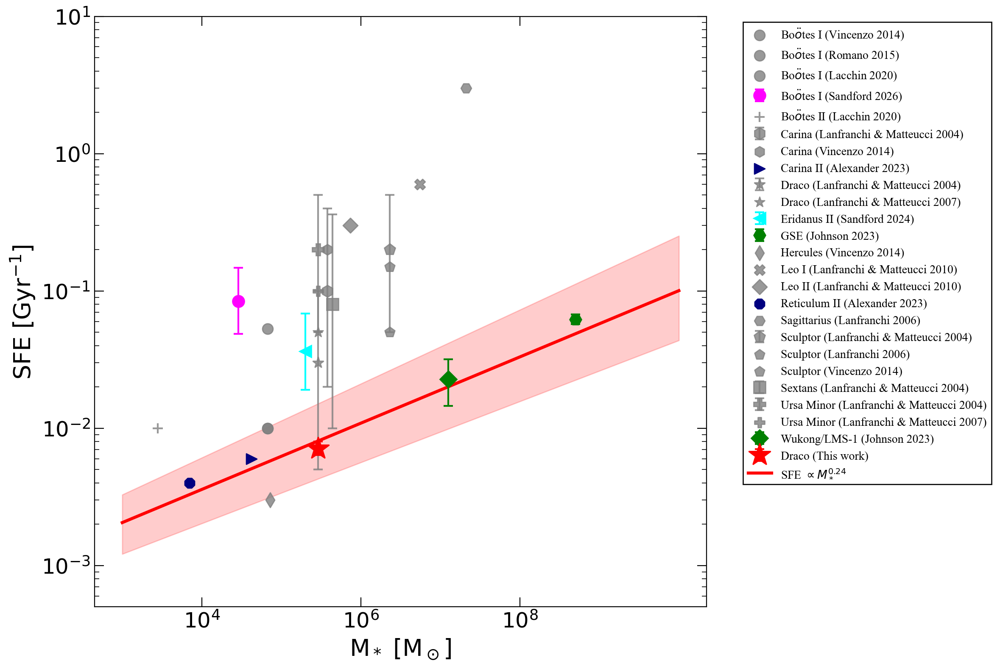
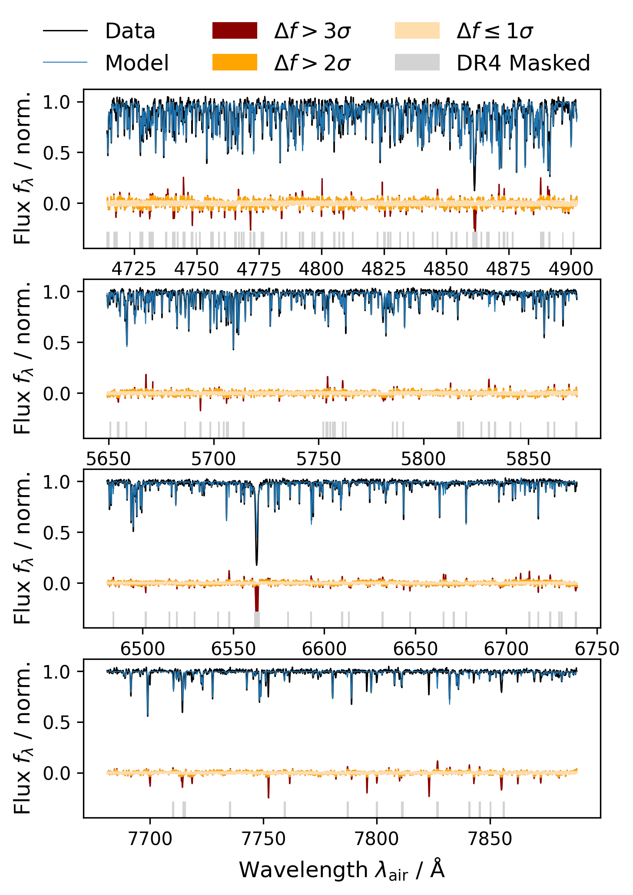
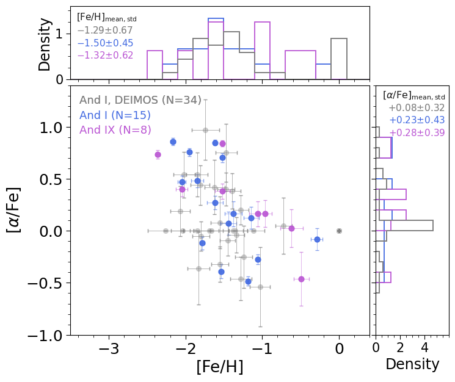
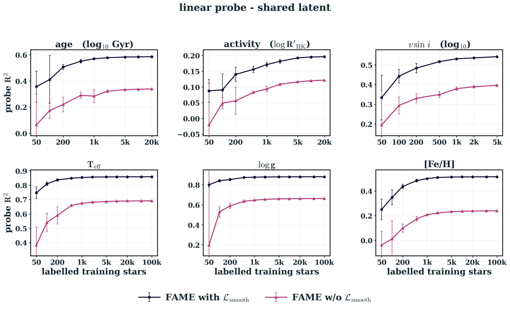

# arXiv Digest — 2026-10-20

- **Interest file used:** interests/2026.10.md (current month)
- **Categories pulled:** astro-ph.CO, astro-ph.EP, astro-ph.GA, astro-ph.HE, astro-ph.IM, astro-ph.SR, cs.LG, stat.ML, physics.data-an, hep-ph
- **Papers scanned:** 690 unique (120 astro-ph + 622 from extras: 511 cs.LG, 58 hep-ph, 51 stat.ML, 2 physics.data-an; 52 cross-listing duplicates removed)
- **After first filter:** 30 candidates reviewed with full text
- **Final selected:** 20 papers across 3 tiers

---

## Tier 1 — Highly relevant

### [Forecasting the Resolvability of Stellar Velocity Dispersions in Ultra-faint Dwarf Galaxies](http://arxiv.org/abs/2610.24563v1)

Pierre Thibodeaux, Alex Drlica-Wagner, Alexander P. Ji, et al.
**Primary category:** astro-ph.GA

The authors formalize a **likelihood-ratio hypothesis test** to standardize when an ultra-faint dwarf galaxy's velocity dispersion counts as statistically "resolved," replacing inconsistent ad hoc criteria used across the literature. Applying it to mock spectroscopic observations, they forecast that Keck/DEIMOS and Magellan/IMACS will struggle to resolve most of the faint satellites Rubin/LSST is expected to discover. Near-future instruments like **Viaspec and GMACS**, delivering **~0.1–0.3 km/s velocity precision**, will resolve the majority — except the faintest, most distant systems.

*50%-resolved contours for Keck/DEIMOS as a function of stellar sample size and UFD luminosity/distance; DEIMOS's larger aperture reaches fainter, more distant satellites than IMACS, but even it fails for the faintest, most distant dwarfs Rubin will find.*

---

### [Newly Identified Planetary Nebula Candidates in M31 using Deep-Learning Search of Hubble Space Telescope Images](http://arxiv.org/abs/2610.24554v1)

Yiğit C. Atılgan, Aleyna Demirci, Nazım Aksaker, et al.
**Primary category:** astro-ph.GA

The team trains an **ensemble of four Faster R-CNN detectors with partial (positive-unlabeled) supervision**, so undiscovered planetary nebulae aren't mistakenly taught as background, on HST imaging of M31 with a spatially-blocked train/test split to prevent leakage. The ensemble ranks **73% of known PNe in its top 200 candidates**, **4–6× the purity of classical color–magnitude selection**, and surfaces **175 uncataloged candidates**, one confirmed independently via narrow-band follow-up. They show newer detection transformers and segmentation networks don't beat this ensemble, and catalog pitfalls specific to rare-object detection.

*Walks through the full pipeline on one real candidate: the Faster R-CNN backbone's region proposals, its 0.995 PN classification score, and the final check against independent exposures, showing end-to-end how a true positive is found and confirmed.*

---

### [Single-Transit Parameter Estimation with Calibrated Uncertainties](http://arxiv.org/abs/2610.24882v1)

Helem Salinas, Rafael Brahm, Greg Olmschenk, et al.
**Primary category:** astro-ph.EP | also: astro-ph.IM

The authors design a **1D convolutional network with parameter-specific pooling heads** that predicts transit depth, duration, and mid-transit time plus **calibrated heteroscedastic uncertainties** directly from a single-transit light curve, with no phase-folding, detrending, or stellar priors required. Trained on 300,000 synthetic TESS-like light curves and validated on 120 confirmed TESS planets, the CNN matches a classical baseline's median accuracy but cuts the **catastrophic epoch-failure rate from ~10% to ~1%**, because it learns to separate the transit from stellar variability rather than absorbing variability into the fit.

*The four-block 1D-CNN architecture: shared convolutional features feed depth/duration pooling heads and a soft-argmax head for mid-transit time, each outputting both a mean and a calibrated log-uncertainty.*

---

### [Star formation history of Draco revealed by DESI DR1: suppressed early star formation efficiency for Milky Way dwarf galaxies](http://arxiv.org/abs/2610.26375v1)

Yujiao Yang, Maosheng Xiang, Yang Huang, et al.
**Primary category:** astro-ph.GA

Fitting DESI DR1 abundances for 69 Draco member stars with the **flexCE galactic chemical evolution model**, the authors derive a **star formation efficiency of just 0.003–0.007 Gyr⁻¹**, about **10× lower** than earlier literature estimates, paired with a large wind mass-loading factor consistent with FIRE cosmological simulations. Combining with other dwarfs, they establish an empirical **SFE ∝ M*^0.24** scaling relation, and show the inferred star-formation history remains broadly consistent after correcting for DESI's CMD-dependent spectroscopic incompleteness.

*Star formation efficiency vs. stellar mass for Local Group dwarfs; Draco's two newly-derived points sit on an empirical power-law trend, ~5–10× below older literature values for similarly-massed systems.*

---

### [Reading Between the Lines: How Much Information Remains After Fitting a Stellar Spectrum?](http://arxiv.org/abs/2610.25583v1)

Sven Buder, Tomasz Różánski
**Primary category:** astro-ph.SR | also: astro-ph.GA

Analyzing **7087 GALAH DR4 spectra**, the authors find **4.5% of residual pixels exceed 3σ** (vs. 0.3% expected for noise) and catalogue **380 significant residual regions**, **62% attributable to stellar line-strength/profile mismatches**. Training data-driven models on the residuals alone recovers **T_eff to 80–150 K and [Fe/H] to 0.059–0.086 dex**, showing spectral-fit residuals are not noise but encode missing line data and unmodeled physics — a direct line on how much systematic error is baked into standard stellar population synthesis fits.

*Example GALAH DR4 spectrum (observed vs. best-fit synthesis) with residuals shaded by significance, showing where and how strongly the model under/over-predicts the observed flux across the four HERMES CCD arms.*

---

### [Beyond the Disc–Spheroid Dichotomy at 0.6<z<8.0: Evidence for a Morphological Indeterminacy Regime from JWST](http://arxiv.org/abs/2610.24078v1)

Igor Kolesnikov, Reinaldo Ramos de Carvalho, Jeong Hwan Lee, et al.
**Primary category:** astro-ph.GA

Applying a non-parametric morphology framework to **15,567 JWST galaxies plus 6,099 IllustrisTNG synthetic images** via a hybrid unsupervised-pseudo-labeling + supervised CNN-ensemble pipeline, the authors identify a **"Morphological Indeterminacy Regime"** where parametric and non-parametric classifications diverge above z~2.5, reaching **F_MIR ≈ 0.55** at z>2.5. Cross-domain (JWST↔simulation) and multi-viewing-angle tests show **~95% label agreement** and ~82% stability across 20 projections per galaxy, arguing the divergence is physical rather than a classification artifact.

*Confusion matrices from swapping JWST- and IllustrisTNG-trained CNN ensembles; ~95% label agreement shows the morphological classes are not an artifact of the training data.*

---

### [The Star Formation Histories of Different Components of M31's Halo from Photometric Estimates of Fe and α Abundances](http://arxiv.org/abs/2610.24915v1)

Jihye Hong, Evan Kirby, Roman Gerasimov, et al.
**Primary category:** astro-ph.GA

From **~76,400 M31 giant candidates** (PAndAS + Subaru/HSC narrow-band photometry), a random-forest model trained on **MIST isochrone-based synthetic photometry** estimates [Fe/H] and [α/Fe] for ~32,500 "smooth halo" stars plus resolved substructures including the **And I and IX dwarf spheroidals**. Radial gradients show **[Fe/H] decreasing and [α/Fe] increasing outward**, with M31's smooth halo more metal-rich than the Milky Way's, implying a larger fraction of recently accreted, younger stellar populations.

*[Fe/H] vs. [α/Fe] for the And I and IX dwarf spheroidals compared against the M31 smooth-halo distribution, showing the dSphs occupy a distinct abundance locus consistent with their own truncated star-formation histories.*

---

### [Plate-YOLO: An End-to-End Object Detection Framework for Robust Astrometric Registration of Historical Plates](http://arxiv.org/abs/2610.25677v1)

Quanfeng Xu, Zhengjun Shang, Shiyin Shen, et al.
**Primary category:** astro-ph.IM

Plate-YOLO adapts YOLOv5 with **Space-to-Depth rearrangement, SimAM attention, a high-resolution P2 head, and a Normalized Wasserstein Distance loss** for small-object detection on degraded historical photographic plates. On **150 previously-unsolvable UBAI plates**, Gaia-guided fine-tuning recovers **146/150 (97.3%)**, while running **6.61 s/plate vs. 16.73 s for SExtractor** — a novel, astronomy-motivated detection architecture built specifically for this failure mode.

*Plate-YOLO architecture, highlighting the Space-to-Depth module, SimAM attention, and the dedicated micro-scale (P2) detection head used to recover faint/small sources on degraded plates.*

---

### [The DARWIN Project: Cosmological Simulations of Galaxy Formation down to Dwarf Scales in Diverse Environments](http://arxiv.org/abs/2610.25786v1)

Jaehyun Lee, Kyungwon Chun, Taysun Kimm, et al.
**Primary category:** astro-ph.GA

The DARWIN project combines a **large-volume cosmological box (65.5 cMpc, 500 pc resolution)** with **24 zoom-in regions plus a Milky Way analog at 62.5 pc resolution** to study dwarf-galaxy formation across environments, generating **mock JWST/LSST imaging** via radiative transfer. To bridge the resolution gap between the large box and the zoom-ins, the team trains a **LightGBM model to correct resolution-driven biases**, cutting **gas-mass RMSE from 1.06 to 0.52 dex** while improving stellar-occupancy classification (**ROC-AUC 0.87→0.93**).

*Top row compares matched halo properties between the low- and high-resolution DARWIN runs; bottom row shows the ML-corrected low-resolution predictions tracking high-resolution truth far more closely, especially for gas mass.*

---

### [Inducing Fourier Geometry: A Smoothness Prior Imposes Approximate Translation Equivariance in Multimodal Stellar Embeddings](http://arxiv.org/abs/2610.24292v1)

Ilay Kamai, Alex M. Bronstein, Hagai B. Perets
**Primary category:** cs.LG

A **graph-Laplacian smoothness prior** forces a multimodal stellar-embedding network to vary smoothly over physical parameters like T_eff, without hand-specifying representation geometry. Across **six astronomical surveys**, the prior induces a **Toeplitz, Fourier-like latent geometry** (R² = 0.92 vs. 0.63 without it) and transfers structure into modalities lacking it natively. Downstream, **linear-probe age estimation reaches R² ≈ 0.38 from just 50 labeled stars**, matching the unconstrained model's performance at 20,000 labels — exactly the kind of embedding-space-constraining, label-efficient architecture the interest profile flags as high value.

*Downstream linear-probe accuracy on frozen embeddings, with vs. without the smoothness prior, across training-set sizes; large label-efficiency gains especially where labels are scarce.*

---

## Tier 2 — Adjacent / useful context

### [PRISMS/U13151. A Glimpse into the Earliest Phases of Galaxy Formation through an Ultra-Faint System ≈500 Myr after the Big Bang](http://arxiv.org/abs/2610.26560v1)

Pierluigi Rinaldi, Javier Álvarez-Márquez, Alejandro Crespo Gómez, et al.
**Primary category:** astro-ph.GA

Using JWST NIRCam/NIRSpec/MIRI on a lensed, ultra-faint z≈9.8 galaxy, the authors make the **first direct detection of Hα in an ultra-faint system at z≈10**, finding an intrinsic stellar mass of just **log(M*/M☉) = 6.68 ± 0.11** and a burst so intense the galaxy **could build its entire stellar mass in only ~10.6 Myr**. The system resolves into five compact UV clumps with no smooth underlying host and extremely low metallicity (3–6% solar), leading the authors to propose it as a possible progenitor stage of the massive "Blue Monster" galaxies seen at z>10.

---

### [The Milky Way's Early Disk Was Built in Bursts. I. Evidence from Low-angular-momentum, High-α Stars Scattered Out of the Protodisk by Merger Events](http://arxiv.org/abs/2610.26374v1)

Tiancheng Sun, Maosheng Xiang, Shaolan Bi, et al.
**Primary category:** astro-ph.GA | also: astro-ph.SR

From **2,078 candidate "Splash" stars** among over 2 million Gaia DR3 subgiants with ~7% age precision, the authors reconstruct the age–[Fe/H] distribution of stars dynamically scattered out of the Milky Way's early high-α disk. Forward-modeling reveals an intrinsic **two-Gaussian age structure** (peaks at ~11.5 and ~12.5 Gyr) rather than one smooth population, implying the high-α disk was built through **multiple distinct star-formation/enrichment episodes**, with the younger component's timing consistent with an early passage of the Gaia-Sausage-Enceladus merger.

---

### [IMF-aware N-body forward modelling of membership selection functions for young open clusters](http://arxiv.org/abs/2610.25200v1)

Yue-Yue Shen, Chao Liu, Zepeng Zheng, et al.
**Primary category:** astro-ph.GA | also: astro-ph.SR

The authors forward-model 35 young open clusters with N-body simulations under three IMF slopes, generate synthetic Gaia observations, and recover members with **HDBSCAN** to quantify magnitude-dependent completeness and field contamination. They show membership recovery is **strongly tied to a cluster's dynamical expansion and stellar density**, not just its age, and that a **flatter assumed IMF systematically yields lower completeness**, meaning luminosity-function corrections derived with the wrong IMF leave residual shape distortions even after the star counts look right.

*Global completeness and contamination for the cluster sample at three IMF slopes; nearly every cluster shows lower completeness and higher contamination under a flatter IMF, showing the selection function itself depends on an assumption usually fixed in advance.*

---

### [Statistical Strong Lensing V. Inference with Microlensed Quasars](http://arxiv.org/abs/2610.24423v1)

Shuo Zhang, Alessandro Sonnenfeld
**Primary category:** astro-ph.GA

Extending a hierarchical strong-lensing framework to include microlensing, the authors show that **quasar image-flux measurements break the degeneracy between the stellar IMF mismatch parameter α_SPS and dark matter mass**. Tested on 219 mock doubly-imaged lensed quasars, including microlensing **shrinks the 68% credible interval on the SPS mismatch parameter from 0.16 dex to 0.09 dex**, versus large biases when microlensing is ignored — a direct improvement on a parameter central to stellar population synthesis calibration.

---

### [ERGO-ML and how to directly infer the multi-temperature nature of intra-cluster gas: simulation-based inference with TNG-Cluster](http://arxiv.org/abs/2610.26627v1)

Joey Braspenning, Annalisa Pillepich, Marine Prunier, et al.
**Primary category:** astro-ph.CO | also: astro-ph.GA

A 1D-CNN trained via **simulation-based inference** on ~140,000 TNG-Cluster X-ray sightlines directly infers the **multiphase temperature distribution** of intracluster gas from mock XRISM/Chandra spectra, recovering cluster mass-weighted temperature to **<0.01 dex** and total gas mass to **0.04 dex**, even extracting cooler sub-virial gas phases **three orders of magnitude fainter** than the dominant virial component.

*Predicted vs. true cluster-wide mass-weighted temperature and gas mass for the test set; predictions track the one-to-one line with no systematic bias, showing the network recovers multiphase ICM structure directly from X-ray spectra.*

---

### [Modeling Multi-band Active Galactic Nuclei Lightcurves Using a Self-supervised Attentive Neural Process Network](http://arxiv.org/abs/2610.24195v1)

Tzuken Shen, Chengcheng Xin, Joshua Fagin, et al.
**Primary category:** astro-ph.HE | also: astro-ph.GA

A self-supervised **attentive neural process** jointly reconstructs quasar light curves across all six LSST bands and infers **black-hole mass, Eddington ratio, and variability timescale with full-covariance posteriors**, trained only on sparse noisy observations. Against a near-optimal Gaussian-process baseline, the model matches overall performance while **exceeding it on power-spectrum reconstruction and damped-random-walk timescale estimation**, with better-calibrated uncertainty.

---

### [Cross-Fitting for Neural Posterior Estimation](http://arxiv.org/abs/2610.26733v1)

Jeffrey Regier
**Primary category:** cs.LG | also: stat.ML

Standard Neural Posterior Estimation, a workhorse of simulation-based inference, is **structurally overconfident** because its training objective rewards arbitrarily tight posteriors on training data. **Cross-Fitting NPE** uses K-fold sample splitting to decouple posterior-mean estimation from higher-moment estimation; on a **strong-gravitational-lensing source-reconstruction** benchmark, it achieves higher held-out log-likelihood than standard NPE, with **calibration within 0.03 of ideal** versus standard NPE's overconfidence.

*True unlensed source, observed lensed image, and posterior samples from Cross-Fitting NPE, showing calibrated uncertainty on a realistic astrophysical inverse problem.*

---

## Tier 3 — Outside my area but notable

### [Bayesian Model Discovery with Language Models: Closing the Loop between Hypotheses and Experiments](http://arxiv.org/abs/2610.25747v1)

JooKyung Yuh, Byungmin Park, Eunseo Choi, et al.
**Primary category:** cs.LG

An LLM proposes candidate model families; a numerical engine fits and weighs them by **model evidence**; the system picks the next experiment by **maximizing joint expected information gain**, feeding results back to the LLM, closing the hypothesis↔experiment loop rather than acting as a passive assistant. Across four scientific-discovery benchmarks (chemistry, physics, behavioral modeling), this achieves **lower final prediction error and more frequent exact functional-form recovery** than in-context-learning agents and prior LLM science agents.

*Prediction error vs. observation count aggregated across benchmarks; the evidence-guided method converges to lower error than baselines.*

---

### [The Explainability Illusion: Must ViTs Exhibit Patch-Decoding Interpretability?](http://arxiv.org/abs/2610.25289v1)

Ronen Schaffer, Hila Manor, Tomer Michaeli
**Primary category:** cs.CV | also: cs.LG

A systematic study across architectures, scales, and training objectives finds patch-token decoding interpretability is **not an inherent transformer property**: some models give aligned, interpretable maps, others give **inverted or uncorrelated** ones, depending only on the optimization landscape. A toy transformer provably implements the same optimal classifier via internally different solutions with different explainability behavior, so **token-decoding explainability cannot be assumed a priori** — a cautionary result for anyone treating ViT patch maps as ground-truth explanations.

*Schematic of the three explainability regimes (aligned, unexplainable, inverted) with an aligned "elephant" vs. an inverted "cat" example.*

---

### [What "Form" of Uncertainty Does Conformal Prediction Quantify?](http://arxiv.org/abs/2610.24510v1)

Soroush H. Zargarbashi, Mohammad Sadegh Akhondzadeh, Rebekka Burkholz, et al.
**Primary category:** cs.LG

The authors prove a direct theoretical link between **conformal-prediction set size and Bayesian posterior (epistemic) variance**: the full-vs-split conformal-prediction size gap decomposes into a model-accuracy term and a **"formability" term bounding epistemic uncertainty**. This formability measure **matches state-of-the-art epistemic-uncertainty estimators** empirically, bridging two previously disconnected uncertainty-quantification frameworks.

*Full-vs-split conformal prediction set-size gap shrinking with calibration-set size and feature dimension — the pattern the formability theory explains.*
