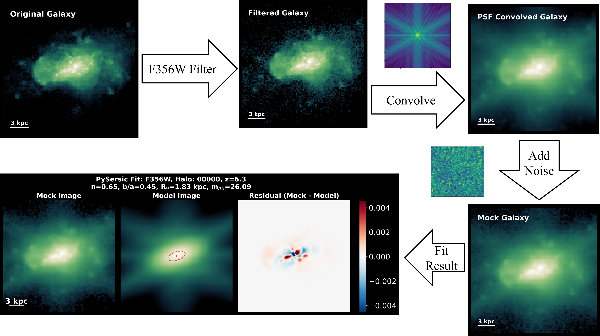
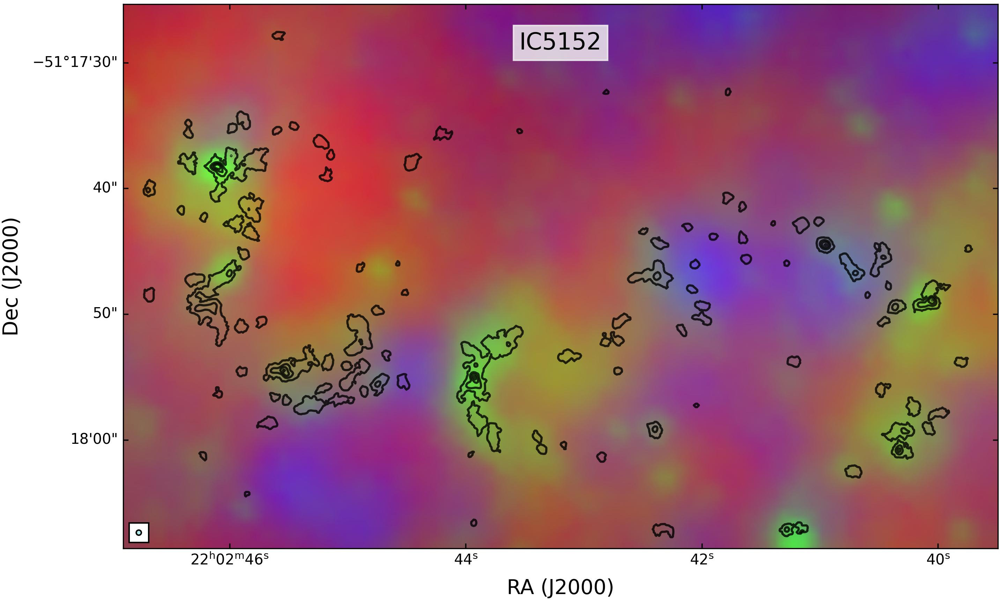
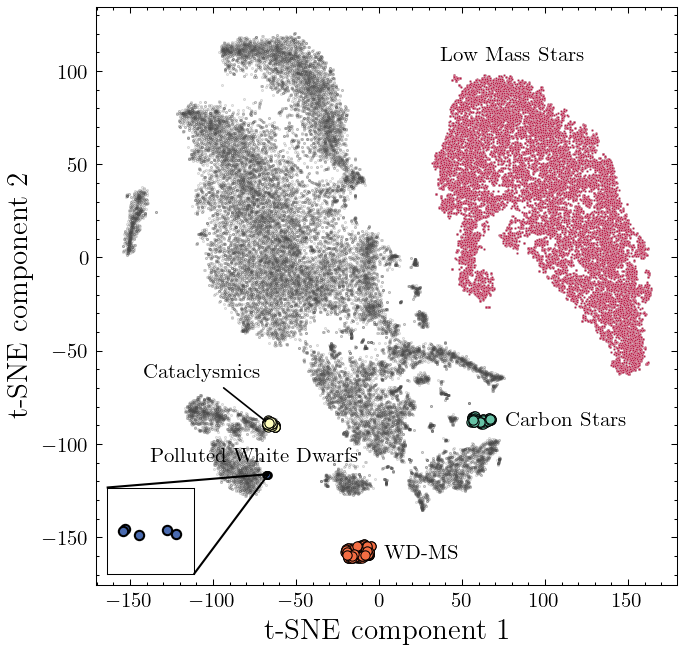
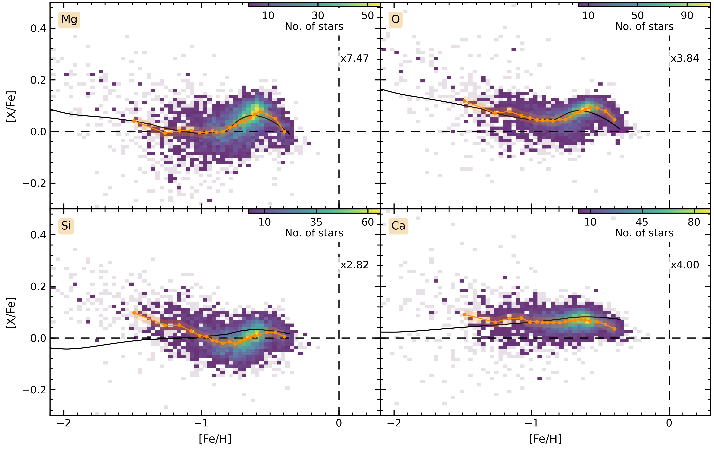
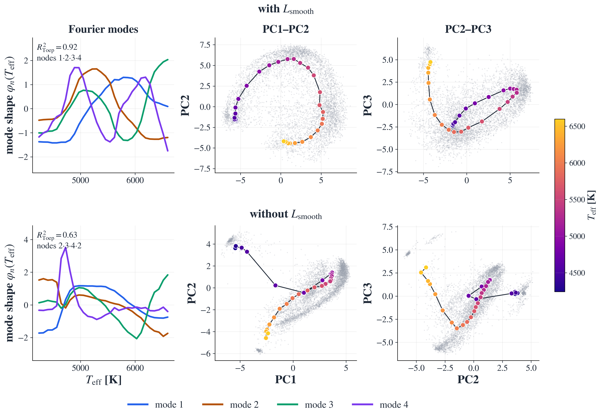

# arXiv Digest — 2026-10-21

- **Interest file used:** interests/2026.10.md (current month)
- **Categories pulled:** astro-ph.CO, astro-ph.EP, astro-ph.GA, astro-ph.HE, astro-ph.IM, astro-ph.SR, cs.LG, stat.ML, physics.data-an, hep-ph
- **Papers scanned:** 525 (126 astro-ph, complete + 399 from extras: cs.LG 300/511 capped, stat.ML 40, physics.data-an 4, hep-ph 55); 486 unique after cross-listing dedup
- **After first filter:** 24 candidates reviewed with full text
- **Final selected:** 20 papers across 4 tiers

---

## Tier 1 — Highly relevant

### [Inferring the shapes of low-mass galaxies at $z>6$ from FIREbox$^{HR}$](http://arxiv.org/abs/2610.26969v1)

Haojie Geng, Robert Feldmann, Jorge Moreno, et al.
**Primary category:** astro-ph.GA

Tests whether commonly adopted population-level distributional assumptions bias Bayesian 3D shape inference for high-redshift, low-mass galaxies. Using the FIREbox$^{HR}$ zoom simulation ($\log M_\star/M_\odot=6.5$–$9.5$, $z\sim6$–$15$) plus mock JWST/NIRCam images, the authors measure intrinsic shapes directly from stellar particles and compare to shapes recovered from forward-modeled mock observations. They find these **low-mass galaxies are predominantly prolate with a substantial spheroidal component**, and that a **logit-transformed multivariate normal model for (ellipticity, triaxiality, size)** recovers the simulation truth far better than the standard multivariate-normal assumption used in prior JWST shape-inference work. Triaxiality remains poorly constrained from projected data alone without large samples or informative priors.

*The mock-observation pipeline: a SKIRT radiative-transfer cube is filtered through the NIRCam F356W throughput, convolved with the PSF, and fit with a single-Sérsic model — the residual panel shows how much structure a smooth profile misses for these clumpy low-mass galaxies.*

---

### [Graph Neural Networks for Astrophysics and Cosmology](http://arxiv.org/abs/2610.27051v1)

Christian Kragh Jespersen
**Primary category:** astro-ph.IM | also: astro-ph.CO, astro-ph.GA, cs.LG

A review arguing that **Graph Neural Networks (GNNs) are often a better physical match for astronomical data than generic architectures**, because they encode relational structure directly — a galaxy in its environment, a halo in its merger history — rather than imposing it indirectly through convolution or attention. The review builds GNNs from first principles and shows that CNNs and transformers can be seen as **special cases of one unified geometric blueprint**, and surveys applications across cosmology, galaxy formation, dynamics, and instrumentation. A notable finding from the survey itself: **only one in six non-instrumentation GNN papers applies the method to real data rather than simulations only**, and the review distills best practices including when *not* to reach for a graph at all.

---

### [Metal-poor molecular clouds in dwarf galaxies at parsec-scale resolution](http://arxiv.org/abs/2610.27064v1)

L. K. Hunt, M. Heyer, U. Lisenfeld, et al.
**Primary category:** astro-ph.GA

ALMA CO(2–1) mapping at 3–4 pc resolution of four nearby dwarf galaxies spanning **1/9–1/3 solar metallicity**, targeting how stars form when the usual CO tracer is faint and clumpy. The cloud-finding pipeline identifies **over 200 molecular clouds**, including roughly 50 in NGC 3109 at 1/9 $Z_\odot$ — the **lowest-metallicity parsec-scale molecular cloud population yet observed**. The clouds follow a Milky-Way-like size–linewidth slope but with systematically **lower velocity dispersion at fixed size**, and show large, size-dependent virial ratios that decrease with metallicity. Significant CO is also detected outside the bright cloud cores, attributed to shielding by cospatial dust despite the low metallicity.

*CO(2–1) contours tracing molecular clouds overlaid on a UV/mid-IR/FIR composite of the dwarf galaxy IC 5152, showing how sparse and clumpy the cold gas reservoir is at this metallicity.*

---

### [ASTROLABE: A 3D Particle-Level Surrogate for Cosmology Simulation with Physical Flow Matching](http://arxiv.org/abs/2610.27068v1)

Ibrahim Elsharkawy, David Curtin, Yonatan Kahn, et al.
**Primary category:** astro-ph.CO

A flow-matching emulator that acts directly on the **6N phase-space coordinates of N-body particles** instead of a voxel grid, removing the usual resolution ceiling and keeping compute **linear in particle number** via a field-particle hybrid transformer. Rather than starting from noise, the flow's prior is a **COLA-based physical approximation**, with momentum and mass conservation enforced throughout — a genuinely physics-incorporated generative design. In $\Lambda$CDM tests, Astrolabe reproduces power spectra, halo mass functions, velocity dispersions, and density profiles, and **generalizes out-of-distribution** to dark-acoustic-oscillation initial conditions it was never trained on. It can also be fine-tuned to emulate a full TNG50 hydrodynamic simulation at a fraction of the usual compute cost.

*Side-by-side density fields: ground-truth TNG50-3-Dark (left) versus Astrolabe fine-tuned to emulate it (right), showing the emulator reproducing large-scale structure and halo substructure from COLA initial conditions.*

---

### [J-PLUS: Identifying Outlier Spectral Energy Distributions in the Fourth Data Release Using Unsupervised Machine Learning](http://arxiv.org/abs/2610.27252v1)

F. Quispe-Huaynasi, F. Roig, V. Loaiza-Tacuri, V. M. Placco, et al.
**Primary category:** astro-ph.IM | also: astro-ph.GA, astro-ph.SR

Combines **autoencoder-based anomaly detection** with **t-SNE embedding and DBSCAN/HDBSCAN clustering** on 12-band J-PLUS photometry to flag SEDs that deviate from the dominant stellar population — exactly the embedding-space, anomaly-search approach the interest profile flags as high value. Cross-matching outlier islands in t-SNE space against SIMBAD and other catalogs yields large, robust samples of **white dwarfs and low-mass stars**, plus **19 carbon-rich stars, 11 cataclysmic variables, and 170 white-dwarf–main-sequence binaries**, all previously unreported and now flagged for spectroscopic follow-up.

*Recomputed t-SNE map of J-PLUS stellar outliers, with DBSCAN/HDBSCAN-recovered populations (carbon stars, cataclysmic variables, WD–MS binaries, polluted white dwarfs) forming distinct, robust islands.*

---

### [A $\wedge$-like metallicity profile in the disk of the Sagittarius dwarf galaxy](http://arxiv.org/abs/2610.27526v1)

Zixi Guo, Xiang-Xiang Xue, Jiang Chang, et al.
**Primary category:** astro-ph.GA

N-body modeling of the Sagittarius dwarf's tidal streams tests what progenitor structure can reproduce the observed **[Fe/H]–$L_y$ correlation** seen in both the leading and trailing arms. Only a progenitor with a **$\wedge$-shaped (rising-then-falling) disk metallicity profile** reproduces the correlation in both arms simultaneously; other tested configurations fail. A similar $\wedge$-profile independently turns up in 3 of 217 MaNGA field dwarf galaxies, suggesting the feature is **rare but not unique to Sagittarius**, and that vertical metallicity gradients in tidal debris can preserve detailed chemo-structural "fossil records" of disrupted dwarf-galaxy progenitors.

*Observed vs. simulated [Fe/H]–$L_y$ contours for the leading and trailing Sagittarius arms across several disk-progenitor models — only the $\wedge$-disk model (top-left) matches the observed correlation shape.*

---

### [The chemical evolution of the LMC from APOGEE abundances: a hybrid two-infall OMEGA+ analysis](http://arxiv.org/abs/2610.27831v1)

Erik Gasteiger, Viola Hegedűs, Szabolcs Mészáros
**Primary category:** astro-ph.GA

Fits a two-zone OMEGA+ chemical-evolution model to the **[Mg/Fe]–[Fe/H] sequence of 4,933 LMC red-giant stars** from APOGEE-2, testing whether a second gas-infall episode plus a temporary star-formation-efficiency boost can explain the LMC's non-monotonic Mg sequence. The best fit needs a **second infall beginning at 10.4 Gyr** (contributing ~14% of total accreted mass) followed roughly 1 Gyr later by a **star-formation-efficiency enhancement reaching 17.5× baseline**, reproducing the Mg sequence to **0.01 dex RMS**. Posterior (non-fitted) comparisons for O and Ca agree well, but Si is less satisfactory (0.038 dex), and the model under-produces metal-rich stars relative to the observed metallicity distribution — a concrete test case for dwarf-galaxy baryonic-physics modeling assumptions.

*APOGEE LMC abundance distributions (density maps) against the fitted two-infall model tracks for Mg, O, Si, and Ca — Mg is the formal fit target, the rest are posterior checks.*

---

### [The clumpy fraction of galaxies at $z=1-9$ with JADES: evidence for a mass-dependent transition in clump origin](http://arxiv.org/abs/2610.28515v1)

Dávid Puskás, Sandro Tacchella, Phoebe Chapman, et al. (incl. Patricia Iglesias-Navarro)
**Primary category:** astro-ph.GA

Applies a **dendrogram-based clump-detection algorithm** to JWST/NIRCam rest-UV, blue, and optical cutouts of 24,064 JADES galaxies ($z=1$–$9$, $\log M_\star/M_\odot\geq8$), with completeness quantified through injection-recovery simulations — a careful computer-vision pipeline applied directly to real survey imaging rather than simulations only. The **clumpy fraction falls from ~55% at $z\sim1$–$2$ to under 5% by $z\sim8$–$9$** in blue/optical light, while the UV-selected fraction stays comparatively flat near 12%. At $z\sim1$–$2$, clumpiness rises steeply with stellar mass (35% to 85%), and comparison with merger rates suggests **mergers dominate low-mass, high-redshift clumps while in-situ disc instabilities take over in more massive, lower-redshift systems**.

---

### [Large fluctuations and cusp-core transformation in dwarf galaxies](http://arxiv.org/abs/2610.28583v1)

Mahmoud Hashim, Amr El-Zant, Francoise Combes
**Primary category:** astro-ph.GA

Measures the **power spectra of neutral-gas density fluctuations** in a sample of gas-rich dwarf galaxies and compares them, via a stochastic dynamical model, to the fluctuation levels theoretically required for feedback-driven erasure of central dark-matter cusps — directly testing the long-hypothesized resolution to the **cusp/core problem**. The derived core-formation relaxation times cluster **around or below a Hubble time** for most galaxies (with DDO 47 a notable outlier retaining a steep inner cusp), and **relaxation time increases with halo mass**, implying the fluctuation-driven mechanism becomes less efficient in more massive dwarfs. This is one of the first direct observational constraints — rather than purely simulation-based arguments — on whether baryonic feedback fluctuations are strong enough to actually form cores.

*Distribution of core-formation relaxation times (relative to the Hubble time) across the dwarf galaxy sample, clustering just below a Hubble time — consistent with cores still actively forming via feedback-driven fluctuations.*

---

### [Inducing Fourier Geometry: A Smoothness Prior Imposes Approximate Translation Equivariance in Multimodal Stellar Embeddings](http://arxiv.org/abs/2610.24292v1)

Ilay Kamai, Alex M. Bronstein, Hagai B. Perets
**Primary category:** cs.LG

Aligns six stellar surveys (LAMOST, APOGEE, GALAH, *Gaia* XP, *Kepler*, TESS) into a **shared VICReg embedding**, then adds a **graph-Laplacian smoothness prior in physical label space** ($T_{\rm eff}$, $\log g$) — exactly the "constrain the embedding space with physically informed structure" approach the interest profile prioritizes. The prior **installs Toeplitz Gram structure and Fourier-like sinusoidal modes** in the shared latent even for modalities whose raw features lack it ($R^2_{\rm Toep}$ rising from 0.63 to 0.92), and the induced geometry **transfers to an unconstrained coordinate** ([Fe/H], e.g. TESS 0.27→0.76). Linear probes on the shared latent improve at every training-set size, most dramatically in the label-scarce regime: **age $R^2\approx0.38$ from just 50 labeled stars**, matching the no-prior probe's performance at 20,000 labels. Careful ablations (label permutation, label-free regularizers) confirm the gain comes specifically from the physical coordinate graph, not generic smoothness.

*Shared-latent Gram matrix and principal-component structure along $T_{\rm eff}$, with (top) vs. without (bottom) the smoothness prior — the prior installs clean Fourier modes and Lissajous-like PC trajectories that are absent otherwise.*

---

## Tier 2 — Adjacent / useful context

### [Cross-Fitting for Neural Posterior Estimation](http://arxiv.org/abs/2610.26733v1)

Jeffrey Regier
**Primary category:** cs.LG | also: stat.ML

Identifies that standard **Neural Posterior Estimation (NPE)** training systematically **overfits posterior variance while underfitting the mean**, since the log-likelihood objective rewards assigning arbitrarily high density to training points. The proposed **Cross-Fitting NPE (CF-NPE)** uses $K$-fold sample splitting to separate mean estimation from higher-moment estimation, fitting a density estimator to out-of-fold residuals. In both synthetic benchmarks and a **cosmological application**, CF-NPE achieves higher held-out log-likelihood and better calibration than standard NPE, with the largest gains in **high-dimensional, simulation-limited settings** — the exact regime simulation-based cosmological inference operates in.

---

### [Euclid Bypass end-to-end simulations for spectroscopic galaxy clustering performance assessment](http://arxiv.org/abs/2610.26990v1)

Euclid Collaboration, B. R. Granett, S. de la Torre, et al.
**Primary category:** astro-ph.CO

Introduces a fast "bypass" simulation framework (FastSpec + Pypelid) that reproduces the **Euclid spectroscopic selection function** without full pixel-level simulation. Calibrated against the Euclid Wide Survey baseline selection, it finds a **redshift purity of 74% and completeness of 45%**, improving with Euclid's own photometric colours, and a Gaussian redshift-error core of $\sigma_z=9.4\times10^{-4}$ that stays flat across $0.9<z<1.8$. Forward-modeled random catalogues successfully recover the DR1-footprint 2-point correlation function monopole and quadrupole despite complex survey selection effects — the computational backbone behind Euclid's upcoming clustering systematic-error budget.

---

### [How does a galaxy's quenching probability depend on its black hole's mass?](http://arxiv.org/abs/2610.27061v1)

Antonio J. Porras-Valverde, John C. Forbes
**Primary category:** astro-ph.GA

A parametric toy model links **black-hole-mass scatter ($\sigma_{\rm BH}$)** and the steepness of the quenching-probability–BH-mass relation to the **faint-end slope of the quenched galaxy stellar mass function**. At low scatter ($\sigma_{\rm BH}\lesssim0.4$ dex) the faint-end slope is a sensitive diagnostic of AGN feedback sharpness, but at large scatter ($\gtrsim0.6$ dex) very different feedback prescriptions converge to the same slope, erasing the signature. Comparing against cosmological simulations, only models with $\sigma_{\rm BH}\gtrsim0.4$ dex (SAGE, Dark Sage, COLIBRE) reproduce the **observed slope of $\alpha\approx0.7$**, while IllustrisTNG and EAGLE ($\sigma_{\rm BH}\lesssim0.2$ dex) predict steeper slopes than observed — meaning the faint-end slope alone can't distinguish feedback models without an independent handle on $\sigma_{\rm BH}$.

---

### [Modular Bayesian Inference for Partially Misspecified Mixtures with Uncertain Class Labels](http://arxiv.org/abs/2610.27085v1)

Maximilian Autenrieth, Konstantin Karchev, David A. van Dyk, et al.
**Primary category:** stat.ME | also: astro-ph.CO

A modular Bayesian framework for mixture inference when some latent sub-populations are **less trustworthy or model-misspecified**, decoupling classification (via fixed, externally supplied class probabilities) from the downstream parameter inference so that unreliable populations can't bias the quantities of interest. The method reduces to **sampling label allocations, fitting a protected model per sample, and averaging posteriors**, with established calibration conditions guaranteeing it matches the known-label inferential target. Demonstrated on synthetic data and a **cosmological analysis of photometric supernova samples** — a general recipe for robust uncertainty quantification wherever classifier-derived labels feed into a cosmological fit.

---

### [DDELenS: Tomographic Weak Lensing Simulations with Dynamical Dark Energy](http://arxiv.org/abs/2610.27088v1)

Shu-Fan Chen, J. Colin Hill, Zoltán Haiman
**Primary category:** astro-ph.CO

A suite of **128 N-body simulations** ($1024^3$ particles, $512\,h^{-1}$Mpc box) spanning $w_0w_a$CDM cosmologies with massive neutrinos, sampled via Sobol sequence over $\Omega_m$, $\sigma_8$, $w_0$, $w_a$ in ranges **motivated by DESI's recent dynamical-dark-energy hints**. The suite delivers 10,000 ray-traced convergence maps per cosmology at six source redshifts, plus halo catalogues, built specifically to enable **field-level and non-Gaussian-statistic inference with Rubin LSST, Euclid, Roman, and CMB-lensing experiments** — a simulation resource aimed squarely at testing whether weak lensing can corroborate or refute DESI's dark-energy signal.

---

### [Searching for Dense Perturbers in Cold Dark Matter Simulations](http://arxiv.org/abs/2610.27236v1)

Xingyu Zhang, Hai-Bo Yu, Demao Kong, et al.
**Primary category:** astro-ph.CO | also: astro-ph.GA

Analyzes **over 5,000 subhalos** (down to $10^6\,M_\odot$) in a CDM-only Milky-Way-analog zoom simulation to test recently inferred dense, low-mass perturbers — seen via gravitational lensing, stellar streams, and satellite galaxies — against standard-CDM density-profile predictions. **None of the simulated CDM subhalos are dense enough** to match the observed perturbers' inferred mass distributions, even accounting for tidal truncation and the redshift evolution of concentration, pointing toward either rare formation channels or physics beyond standard CDM on dwarf-galaxy scales.

---

### [Understanding the formation of alpha-Fe bimodality in the Milky Way using constrained cosmological simulations of the Local Group](http://arxiv.org/abs/2610.27985v1)

Anna Genina, Ewoud Wempe, Amina Helmi, et al.
**Primary category:** astro-ph.GA

Uses a new suite of **constrained cosmological zoom simulations of the Local Group** to trace how Milky-Way-analog discs develop the observed high-/low-[$\alpha$/Fe] bimodality, confirming the Auriga-model picture that the high-$\alpha$ sequence forms in a **merger-induced starburst** that quenches star formation, letting subsequent stars form at low $[\alpha/{\rm Fe}]$. A prominent bimodality at large galactic radii requires quenching across all radii, achievable either via a **galaxy-wide starburst** or a **retrograde merger** that strips outer-disc angular momentum, letting metal-poor circumgalactic gas dilute it more efficiently; mergers also tilt the disc, redirecting outflows and enriching a larger CGM volume.

---

### [Data-Driven Ages from Asteroseismology for FGK Dwarfs](http://arxiv.org/abs/2610.28345v1)

Christopher Lam, Aida Behmard, Sarah Ballard, et al.
**Primary category:** astro-ph.SR | also: astro-ph.EP

Trains **The Cannon**, a data-driven spectral model, on 323 *Kepler* FGK dwarfs with asteroseismic ages and APOGEE spectra, then applies it to **48,828 APOGEE FGK dwarfs lacking asteroseismology** to infer data-driven ages with **~1.0 Gyr RMS scatter** against held-out asteroseismic labels. Demonstrates a practical template for scaling an expensive stellar-population diagnostic (asteroseismic age) far beyond the stars actually observed with seismology, ahead of forthcoming large-scale datasets like PLATO.

---

## Tier 3 — Outside my area but notable

### [Single-Parameter Exponential Model Outperforms Standard Dark Matter and Modified Newtonian Frameworks in Predicting Galactic Rotation Curves](http://arxiv.org/abs/2610.27876v1)

Mohammed Guhdar
**Primary category:** astro-ph.GA

A Bayesian MCMC/AICc model comparison of five rotation-curve models against the full **175-galaxy SPARC sample** finds that a minimal **one-parameter empirical law**, anchored only to each galaxy's flat rotation velocity, is statistically preferred for **60.6% of galaxies** with the best median fit (reduced $\chi^2=0.41$) — beating three-parameter NFW halo+baryons (12.6%), one-parameter MOND (10.3%), and the two-parameter Freeman disk (9.1%). A purely phenomenological one-parameter law outperforming both the standard dark-matter and MOND paradigms on fit quality and parsimony is a striking claim; it comes from a single-author analysis against two well-entrenched competing frameworks, so it's flagged here as notable rather than settled, pending independent replication.

---

## Tier 4 — Meta-research about the field

### [AI and The Enclosure of the Scientific Commons](http://arxiv.org/abs/2610.27251v1)

P. K. G. Williams
**Primary category:** astro-ph.IM | also: cs.CY

Frames the scientific literature as an **"information commons"** and draws on the history of the 17th–19th century English agricultural enclosure movement — the privatization of common lands, distinct from the "tragedy of the commons" — as a lens for understanding how AI could enable an analogous **privatization of scientific knowledge**. Argues that AI-enabled enclosure doesn't physically destroy the commons the way hedges and fences did, but instead **undermines the social systems that sustain it**, including through large-scale "slop spam" and private extraction of value from openly shared literature. A historical/scholarly framework rather than new empirical results, offered as vocabulary for a felt-but-previously-unarticulated concern about AI's effect on the research ecosystem.
