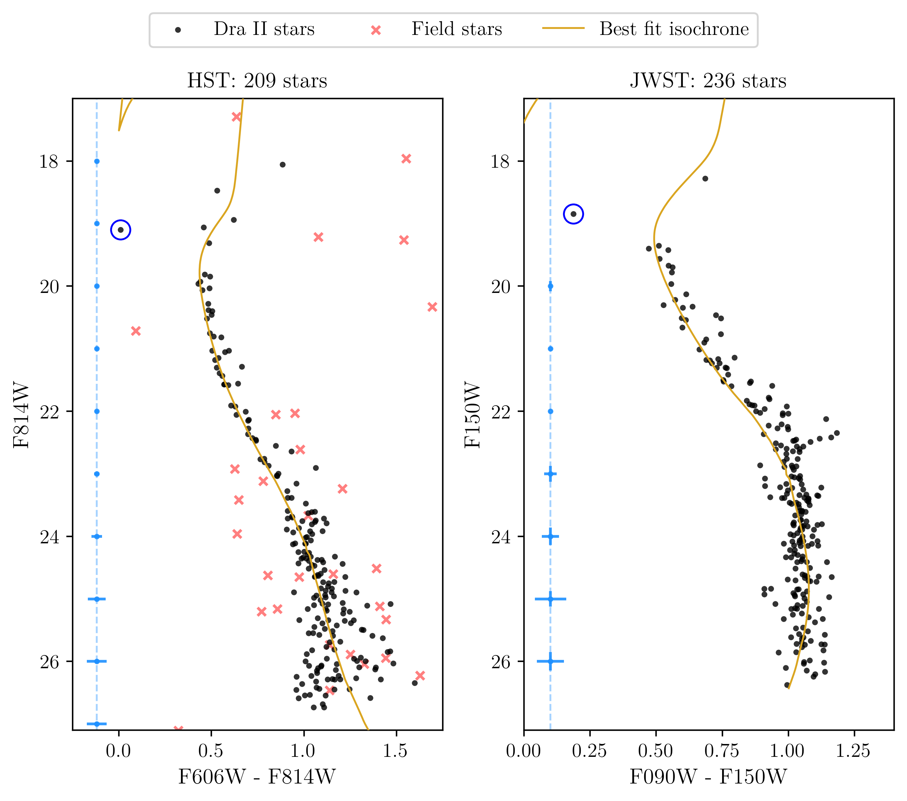
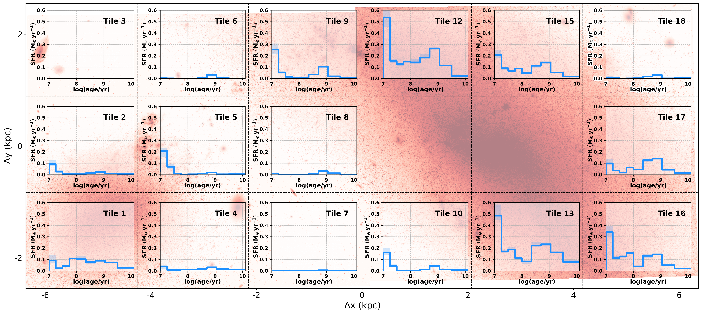
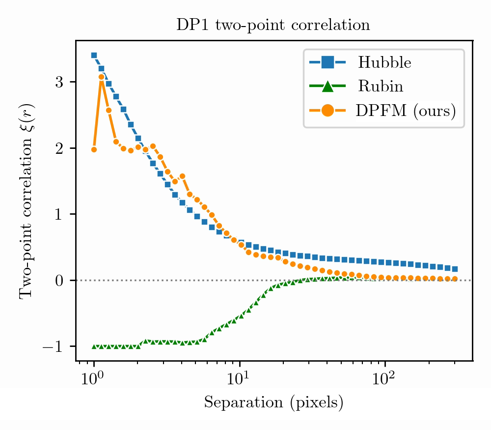
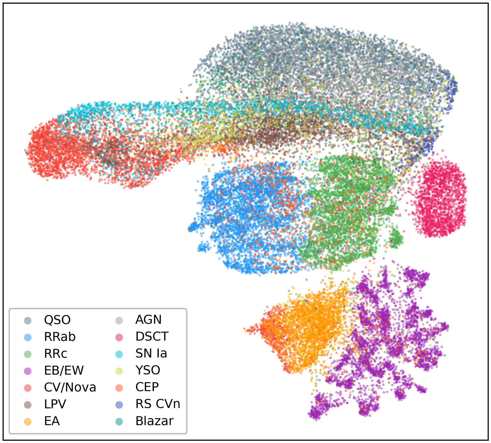

# arXiv Digest — 2026-10-22

- **Interest file used:** interests/2026.10.md (current month)
- **Categories pulled:** astro-ph.CO, astro-ph.EP, astro-ph.GA, astro-ph.HE, astro-ph.IM, astro-ph.SR, cs.LG, stat.ML, physics.data-an, hep-ph
- **Papers scanned:** 349 unique papers (111 from the six astro-ph sub-categories + 238 unique from the extras, after removing 46 cross-listed duplicates between the two pulls)
- **After first filter:** 16 candidates reviewed with full text
- **Final selected:** 13 papers across 3 tiers

---

## Tier 1 — Highly relevant

### [A combined HST and JWST analysis of the stellar population in Draco II](http://arxiv.org/abs/2610.28738v1)

Axelle C. Raffin, Giacomo Cordoni, Helmut Jerjen et al.
**Primary category:** astro-ph.GA | also: astro-ph.SR

Combines deep HST and JWST photometry to settle whether Draco II is an ultra-faint dwarf galaxy or an extended globular cluster. Isochrone fitting of the resolved main sequence gives an old, **13.5 Gyr** population at **19.2 ± 0.9 kpc**, with **[Fe/H] = -2.38 ± 0.17 dex** and a resolved **intrinsic metallicity spread of 0.85 ± 0.13 dex** — the key diagnostic, since globular clusters are nearly mono-metallic. The HST catalogue also yields an **unresolved binary fraction of 0.21 ± 0.07**, higher than expected for a star cluster and closer to low-density dwarf-galaxy environments. Together these point to Draco II being best classified as an ultra-faint dwarf galaxy rather than a globular cluster.

*Combined HST+JWST color-magnitude diagram of Draco II, showing the well-defined main sequence and turn-off used to derive its age, distance and metallicity spread.*

---

### [Evaluating Zero-Shot Anomaly Detection for Identifying Unusual Galaxy Morphologies in CEERS and NGDEEP](http://arxiv.org/abs/2610.29868v1)

T. B. Surakan, J. S. Kartaltepe, R. Pattnaik et al.

**Primary category:** astro-ph.GA

Applies AdaCLIP, a **CLIP-based zero-shot anomaly detector** adapted using non-astronomical defect datasets (manufacturing scratches, colonoscopy polyps), to **38,853 CEERS and NGDEEP galaxies** with no astronomy-specific training or morphology labels at all. The resulting anomaly scores and 768-dimensional embeddings concentrate the highest scores among genuinely disturbed and merging systems, and the **embedding space self-organizes into coherent morphological groups** — ellipticals, spirals, edge-on disks, mergers/irregulars — that only weakly track standard GALFIT/statmorph structural indices. The result demonstrates that an anomaly detector trained entirely outside astronomy can flag unusual galaxy morphology at survey scale, a capability the authors flag as relevant for upcoming Roman imaging.

*UMAP projection of the AdaCLIP embedding for all 38,853 galaxies, colored by anomaly score: mergers and irregulars cluster together and separate from ellipticals, spirals, and edge-on disks, with no galaxy-specific training.*

---

### [FEAST: Spatially Resolved Star Formation History of the NGC 4485/NGC 4490 System and its Tidal Bridge from JWST/NIRCam Color Magnitude Diagrams](http://arxiv.org/abs/2610.29405v1)

Giacomo Bortolini, Matteo Correnti, Angela Adamo et al.

**Primary category:** astro-ph.GA

Uses JWST/NIRCam resolved-star photometry and the `SFERA 2.0` CMD-fitting code to reconstruct the **spatially resolved star formation history** of the interacting, low-mass, gas-rich pair NGC 4485/NGC 4490 and the tidal bridge connecting them. Recent star formation is **widely spread across both galaxies and the bridge**, not centrally concentrated as in massive spiral mergers, with **two SFR bursts several times the average rate** appearing a few hundred Myr after the first and second pericenter passages predicted by N-body models. The spatial pattern and timing match hydrodynamical simulations of **dwarf–dwarf tidal interactions**, supporting repeated close passages as the trigger for the enhanced, spatially extended star formation.

*Star-formation rate vs. lookback time for each spatial tile, overlaid on the JWST/NIRCam mosaic, showing recent star formation spread across the system rather than concentrated at the galactic centers.*

---

### [Dual-Phase Flow Matching for Probabilistic Source Detection and Measurement in Astronomical Images](http://arxiv.org/abs/2610.28919v1)

Yicun Duan, Jeffrey Regier

**Primary category:** stat.AP | also: astro-ph.IM

Introduces DPFM, a **generative flow-matching model** that approximates the full posterior over source configurations — which sources exist, where, and how bright — in crowded LSST-depth images, rather than committing to a single deblended catalog as the standard pipeline does. On simulated data DPFM's posterior is **nearly indistinguishable from the exact posterior**, beating both MCMC and neural posterior estimation baselines on calibration. Applied to real LSST Data Preview 1 imagery, DPFM's credible intervals achieve **near-nominal coverage against an independent Hubble reference even for heavily blended sources**, whereas the Rubin pipeline's intervals cover the reference only about a quarter of the time, and DPFM alone recovers the small-scale galaxy clustering signal that the deterministic pipeline misses.

*Two-point correlation function recovered from real LSST DP1 imagery: DPFM's probabilistic catalog reproduces the small-scale clustering signal measured independently from Hubble imaging, which the Rubin pipeline's deterministic catalog does not.*

---

### [Data-driven characterisation of variable source light curves with multimodal representation learning](http://arxiv.org/abs/2610.29412v1)

M. Madarász, G. Marton, M. Audard

**Primary category:** astro-ph.IM | also: astro-ph.SR

Presents a **label-free, survey-agnostic representation-learning framework** for variable-star light curves: a Transformer encoder on raw photometry and a CNN on the Lomb-Scargle periodogram are trained jointly with a **self-supervised VICReg objective** across random temporal halves of each light curve — no labels, phase folding, or survey-specific features required. On 37,006 ZTF sources across 14 variability classes, a simple linear probe on the frozen 64-dimensional embedding reaches **77.1% balanced accuracy** (90.5% for broad categories), and the **learned embedding organizes sources by light-curve morphology rather than catalog label**: it correctly places cataclysmic variables mislabeled in the training catalog next to the eclipsing binaries they actually resemble.

*2D UMAP of the 64-dimensional self-supervised embedding, colored by the 14 ALeRCE variability classes, showing pulsators, eclipsing binaries, AGN/QSO, and long-period variables separating into distinct regions purely from light-curve shape.*

---

### [Poisson Clustering and Seed Effect of PBHs: Implications for Microlensing, Gravitational Waves, Little Red Dots and Ultra-Faint Dwarf Galaxies](http://arxiv.org/abs/2610.28723v1)

Bernard Carr, Sebastien Clesse, Juan Garcia-Bellido et al.

**Primary category:** astro-ph.CO | also: hep-ph

Develops a theory of **primordial black hole (PBH) Poisson clustering combined with massive-seed effects**, modeling dynamical heating, core collapse, collisions, tidal disruption and gas accretion that shape which clusters survive. The picture predicts that PBH clusters could seed **highly inhomogeneous early structure formation**, producing both the massive seeds invoked for Little Red Dots and smaller clusters whose predicted stellar-plus-gas content could resemble observed **ultra-faint dwarf galaxies**, though the match to UFDG size–mass proxies remains only qualitative. The authors show that the compactness needed to explain UFDGs is **not by itself enough to relax microlensing constraints** on the PBH dark-matter fraction unless the halo density profile is also modified.

*Remaining baryon fraction after Bondi–Hoyle accretion onto PBHs in Poisson clusters, as a function of cluster mass and radius; crosses mark the stellar size and mass of observed ultra-faint dwarf galaxies for comparison.*

---

## Tier 2 — Adjacent / useful context

### [Probabilistic Machine Learning for Short-Term Atmospheric Seeing Forecasting](http://arxiv.org/abs/2610.29654v1)

Mary-Joe Medlej, Rahul Srinivasan, Simon Prunet et al.

**Primary category:** cs.LG | also: astro-ph.IM

Benchmarks ML models for forecasting atmospheric seeing up to two hours ahead at Maunakea, comparing deterministic RNN/LSTM baselines against **Gaussian Processes and a normalizing-flow model (FloTS)** with a focus on calibrated uncertainty. LSTM gives the best point forecast, but FloTS matches it on accuracy while producing **flexible, non-Gaussian predictive densities** that, after post-hoc temperature calibration, align well with empirical forecast uncertainty — useful for scheduling decisions where the full range of plausible seeing matters, not just the mean.

---

### [KROME-X: a GPU-ready library for chemistry and microphysics in astrophysical simulations](http://arxiv.org/abs/2610.28917v1)

Alessandro Lupi, Tommaso Grassi, Stefano Bovino

**Primary category:** astro-ph.GA | also: astro-ph.IM

A full C++ rewrite of the widely used KROME chemistry/microphysics code for astrophysical simulations, adding **GPU support, photon-field co-evolution with exact photon conservation, and dust growth/sputtering/sublimation with element conservation**. KROME-X reproduces legacy results to solver precision while running **2.6–13.5x faster on CPU**, and a single A100 GPU outperforms eight CPU cores by **5–30x** once batch sizes exceed ~10⁵ cells — directly useful for simulations needing to resolve photoionization, cooling, and dust physics at dwarf-galaxy scales.

---

### [Not so Fast: Revised Calibration of SIDM Core Collapse](http://arxiv.org/abs/2610.28890v1)

Frank C. van den Bosch, Yarone M. Tokayer

**Primary category:** astro-ph.CO | also: astro-ph.GA

Introduces SphDSMC, a new spherical Direct Simulation Monte Carlo code for self-interacting dark matter (SIDM) halo evolution that avoids force softening and reaches far higher central densities than standard N-body codes. Shows the standard interpolation used to connect conductivities in gravothermal fluid models is **inaccurate**, and recalibrates it with a gentler transition that matches the new simulations across NFW concentrations. The revised calibration gives a **shorter collapse time** than prior estimates, but collapse slows sharply once the core becomes optically thick — leading the authors to argue SIDM-driven black-hole seed formation has generally been **underestimated in duration**, making it unlikely to explain JWST's massive high-redshift black holes without extra physics.

---

### [Gravothermal Evolution of Self-Interacting Dark Matter Halos across Knudsen Numbers](http://arxiv.org/abs/2610.28745v1)

James Gurian, Suroor Seher Gandhi, Neal Dalal, Simon May

**Primary category:** astro-ph.CO

Runs 31 kinetic simulations of idealized and cosmological SIDM halos across cross sections from 50 to 250,000 cm²/g, deriving a **fitting formula for the core-collapse time** based on the halo's Knudsen number and relaxation time. The collapse trajectory differs qualitatively between regimes — central density grows **quasi-exponentially** in the long-mean-free-path regime versus **super-exponentially** in the short-mean-free-path regime — with velocity-dependence and cosmological accretion adding only factor-of-a-few scatter. Also introduces SIDMStars, a cheaper 1D conducting-fluid code for exploring SIDM's impact on predicted dwarf-halo density profiles.

---

### [Euclid Quick Data Release (Q1). The metallicity of the intracluster light](http://arxiv.org/abs/2610.29686v1)

Euclid Collaboration, J. B. Golden-Marx, N. A. Hatch, S. P. Bamford et al.

**Primary category:** astro-ph.GA

Uses Euclid Q1 imaging of 168 galaxy clusters to measure radial color profiles of the brightest cluster galaxy (BCG) and the surrounding **intracluster light (ICL)**, a diffuse, low-surface-brightness stellar component. Stacked profiles reach ~300 kpc and show a clear color gradient; combined with stellar population synthesis models, this translates into a **metallicity gradient**, with a super-solar BCG core falling to a **metal-poor ICL ([Z/Z⊙] ≈ -0.5)** — the first statistical metallicity constraint on the ICL out to large radii, consistent with the ICL being built from tidally stripped, lower-metallicity satellite stars.

*ICL metallicity as a function of radius in four redshift bins, compared with predictions from the TNG100 and Hydrangea simulations: the outer ICL is consistently metal-poor relative to the BCG core.*

---

### [Euclid Quick Data Release (Q1). A systematic study of the intracluster light fraction at 0.2 < z < 1.5](http://arxiv.org/abs/2610.29684v1)

Euclid Collaboration, H. Gully, N. A. Hatch, H. Gao et al.

**Primary category:** astro-ph.GA

Measures ICL and BCG light fractions in ~300 galaxy clusters spanning $0.2 < z < 1.5$, combining Euclid imaging with SPT- and DES-selected cluster samples and comparing to the Hydrangea simulations. The ICL contributes **~40% of the combined BCG+ICL light and ~20% of total cluster stellar light**, with both fractions staying **approximately constant across the full redshift range** at fixed cluster mass. This lack of evolution disfavors a scenario where the BCG forms first and the ICL builds up gradually through ongoing stripping, instead favoring **concurrent growth** of the BCG and ICL through shared merger and stripping events.

---

## Tier 3 — Outside my area but notable

### [Tropical Cyclone Attributes in Sparse Autoencoder Features of an AI Weather Model](http://arxiv.org/abs/2610.28904v1)

Jiapei Liu, Ruidong Li, Ting Sun, Guangheng Ni

**Primary category:** physics.ao-ph | also: cs.LG

Applies **sparse autoencoders (SAEs)**, a mechanistic-interpretability tool, to probe how GraphCast, an AI weather model, internally represents tropical cyclones. Across 2,115 six-hourly timesteps from 205 cyclones, each physical attribute (position, intensity, pressure structure) is encoded across **multiple SAE features rather than one-to-one**, and this distributed organization recurs across independently trained SAEs and network layers. In deeper layers, the leading position feature aligns better with the cyclone's position and pressure structure **six hours into the future than at the present time**, suggesting GraphCast's internal representations are organized around short-term predictive structure rather than just the current state.
