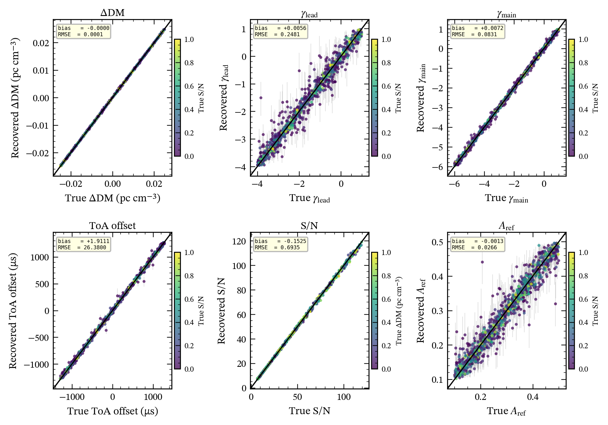
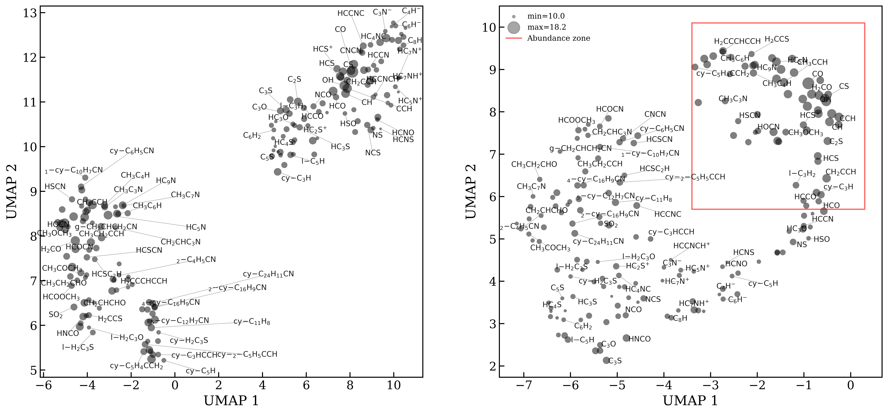

# arXiv Digest — 2026-10-23

- **Interest file used:** interests/2026.10.md (current month)
- **Categories pulled:** astro-ph.CO, astro-ph.EP, astro-ph.GA, astro-ph.HE, astro-ph.IM, astro-ph.SR, cs.LG, stat.ML, physics.data-an, hep-ph
- **Papers scanned:** 374 (112 astro-ph new/cross + 262 from extras)
- **After first filter:** 9 candidates reviewed with full text
- **Final selected:** 9 papers across 4 tiers

---

## Tier 1 — Highly relevant

### [Self-Supervised Representation Learning for JWST Galaxy Images and Low Resolution Spectra](http://arxiv.org/abs/2610.31078v1)

Yang Cheng, Morgan Fouesneau, Ivelina G. Momcheva, Tobias Buck et al.
**Primary category:** astro-ph.GA

Trains two **self-supervised encoders** — a DINOv2 vision transformer on single-band JWST F150W cutouts and a masked-autoencoder transformer on low-resolution (R~100) NIRSpec PRISM spectra — then aligns them with a **CLIP-style contrastive objective** on ~11,700 matched image-spectrum pairs. The joint embedding recovers **galaxy stellar mass at $R^2 \sim 0.90$, $\sigma_{\mathrm{NMAD}} = 0.24$ dex** for $1<z\le3$, beating a photometry-only baseline by 0.15 in $R^2$, and CLIP alignment alone boosts single-modality performance by **$\Delta R^2=+0.04$ (imaging) and $+0.09$ (spectroscopy)**. The approach targets exactly the sparse single-band/low-res-spectrum regime that wide-field parallel surveys and the upcoming Roman and Euclid grisms will produce in bulk.

*Predicted vs. catalog stellar mass from the CLIP-aligned joint embedding, binned by redshift; points cluster tightly along the one-to-one line out to $z\sim3.5$ before accuracy degrades at higher $z$ where the fixed wavelength window no longer samples rest-frame optical light.*

---

## Tier 2 — Adjacent / useful context

### [CURTAIN: Towards a Foundation Model for Neutrino Telescopes](http://arxiv.org/abs/2610.30894v1)

Severin Magel, Felix J. Yu, Carlos A. Argüelles

**Primary category:** hep-ex | also: astro-ph.IM

Introduces a **temporal-masking self-supervised pretraining scheme** for neutrino-telescope point-cloud data: events are split at a random time $T$, and the model must predict which sensors light up afterward from only the pre-$T$ context. Unlike prior SSL tasks for IceCube-like detectors, this is the first to satisfy all three foundation-model criteria at once — monotonic improvement with pretraining-set size, transfer to an unseen detector geometry, and beating training from scratch — cutting the **median angular error by 45% and energy error by 31%** on the leading `DeepIce` architecture, with a 36% error reduction on a never-seen detector layout. A clean example of scaling-law-governed self-supervised representation learning applied to raw detector point clouds rather than images.

*Downstream direction and energy reconstruction error fall monotonically as pretraining-set size grows, overtaking a from-scratch baseline (dashed) and generalizing to an unseen detector geometry.*

---

### [Optimal cosmological cross-correlation analysis with U-Net-based processing](http://arxiv.org/abs/2610.30294v1)

Weitong Yan, Daniel Grün, Oliver Friedrich, András Kovács

**Primary category:** astro-ph.CO

Trains a 1D U-Net to transform a tracer field into one that maximally **cross-correlates with a target field**, testing whether a CNN can beat the standard two-point/linear estimator on non-Gaussian (log-normal) random fields. For Gaussian inputs the network exactly reproduces the analytic matched filter, validating the setup; for log-normal fields it **raises the mean Pearson correlation from 0.857 (linear estimator) to 0.953**, showing it exploits non-Gaussian, bispectrum-like information beyond the power spectrum. A simple, interpretable proof-of-concept (the authors even recover the network's implicit quadratic nonlinearity in closed form) for using CV architectures to extract higher-order statistics in cosmological cross-correlations.

*Input, target, U-Net output, and linear-estimator fields for the log-normal test case: the U-Net output tracks the target field more closely than the linear filter, consistent with its higher measured correlation (0.953 vs. 0.857).*

---

### [Simulation-based inference of profile evolution for high-precision pulsar timing](http://arxiv.org/abs/2610.31450v1)

Sai C. Susarla, Gregory Ashton, A. Parthasarathy, K. De Man et al.

**Primary category:** astro-ph.IM | also: astro-ph.HE

Replaces the computationally prohibitive stochastic sampling used in profile-domain pulsar timing with **simulation-based inference**: a normalizing flow conditioned on a convolutional embedding of the frequency-phase portrait returns joint posteriors on dispersion measure, arrival time, and profile-evolution parameters **instantaneously from a single observation**, with uncertainties validated against known injected values. Because the method is likelihood-free, non-Gaussian noise, jitter, scattering, and profile change can all be handled by simulating them rather than deriving a bespoke likelihood for each — a template for folding ML-based UQ into large-scale timing pipelines.

*Recovered posterior medians vs. injected true values for all six inferred parameters across 1000 simulated test observations, with error bars showing the 1σ posterior width; points fall tightly along the perfect-recovery line with no systematic bias.*

---

### [A neural-network model to find correlations in astrochemical space](http://arxiv.org/abs/2610.30842v1)

Daniel Giovanni Vargas, Darío Barreiro-Lage, Carlos Cabezas, José Cernicharo et al.

**Primary category:** astro-ph.GA

Builds a neural-network pipeline that encodes molecular structures (via NLP-style chemical-string embeddings) and regresses their **column densities in the TMC-1 molecular cloud**, producing a latent space that organizes molecules by their underlying chemical relationships rather than just fitting a lookup table. Applying the trained model to systematic permutations of the TMC-1 inventory, the authors flag **several promising new candidates for future interstellar detection**, and show that retraining on successive historical detection epochs shifts the latent structure substantially, arguing recent detections have reshaped — not just incrementally extended — our picture of interstellar chemistry. A nice example of using embedding-space structure as a discovery/interpretability tool rather than just a black-box regressor.

*UMAP projection of the TMC-1 molecular inventory using raw chemical-string embeddings (left) vs. the trained model's learned latent layer (right); the learned representation visibly concentrates the most abundant molecules into a compact region, indicating the network organizes molecules by physically meaningful abundance structure.*

---

### [Sequential SBI for Resonance Searches at the LHC](http://arxiv.org/abs/2610.30244v1)

Benjamin M. Boyd, Maximilian Autenrieth, Kaisey S. Mandel, Matthew Grayling et al.

**Primary category:** astro-ph.CO | also: stat.AP

*2Flow2SN / FlowSN2* reframes photometric Type Ia supernova cosmology as a joint **simulation-based inference problem** over light-curve summaries and photometric redshifts rather than a two-step regression, using normalizing flows for amortized neural likelihood estimation that can be reused across cosmological models without retraining. The framework recovers unbiased cosmological and SN population parameters even under realistic **non-Ia contamination (~18% post-selection)** via a principled Bayesian-resampling correction, without needing an explicit contaminant likelihood, and scales to >100,000 SNe — directly relevant to Rubin/LSST-era photometric SN cosmology.

*Posteriors on $w_0w_a$CDM parameters: naive inference including contaminants (biased) vs. the modular Bayesian-resampling correction, which recovers posteriors consistent with the pure-Ia, true-label baseline despite ~18% contamination.*

---

### [The THESAN-ZOOM project: the delayed rise of Lyman continuum escape fractions in bursty high-redshift galaxies](http://arxiv.org/abs/2610.30265v1)

Parth Mehrotra, Aaron Smith, Yuan Bian, William McClymont et al.

**Primary category:** astro-ph.GA | also: astro-ph.CO

Using thirteen zoomed, radiation-hydrodynamic THESAN-ZOOM simulations of $z>3$ haloes post-processed with COLT radiative transfer, this traces the time lag between a burst of star formation and the resulting rise in **Lyman continuum escape fraction**, finding typical delays of **~16 Myr** that scale as roughly $M_\star^{-0.19}$ and $M_\text{halo}^{-0.27}$ — longer and less coherent toward lower-mass haloes. The recent-SFR-to-escape-fraction connection, and the derived scaling with halo/stellar mass down toward the dwarf regime, gives a concrete, testable link between bursty star formation and cosmic reionization that bears on interpreting observed LyC leakers.

---

## Tier 3 — Outside my area but notable

### [FRB 20210601A: Extreme Temporal Clustering in a Repeating Fast Radio Burst Source as Evidence for a Hidden Class of Episodic Repeaters](http://arxiv.org/abs/2610.31365v1)

Ryan Mckinven, Amanda M. Cook, Alice P. Curtin, B. M. Gaensler et al.

**Primary category:** astro-ph.HE

CHIME/FRB reports a repeating fast radio burst source that produced **at least nine bursts within a single 106.5-second window** — the highest instantaneous burst rate yet seen among CHIME/FRB repeaters above ~2 Jy ms — yet was otherwise silent across ~320 hours of exposure over 7 years. Modeling a population of "episodically active" repeaters (short storms separated by long quiescence), the authors forecast **1–4 similar discoveries over the next CHIME/FRB decade**, implying a detectable population of order $9^{+200}_{-8}$ such sources and suggesting episodic repeaters are a real, selection-biased slice of the FRB population reflecting distinct magnetospheric states.

*De-dispersed dynamic spectra of the nine detected bursts, each fired off-meridian in CHIME's first side-lobe; the spectral shape of each burst closely tracks the instrument's predicted beam response rather than reflecting intrinsic source structure.*

---

## Tier 4 — Meta-research about the field

### [Astro2Method: Benchmarking LLMs on Machine Learning Method Selection in Astronomy](http://arxiv.org/abs/2610.30282v1)

Xingzhong Fan, Hangfeng He, Fatemeh Nargesian

**Primary category:** astro-ph.IM

Introduces a 500-question benchmark, built from 346 astronomy papers, that tests whether LLMs can correctly pick the better of two ML methods for a given astronomical problem. Direct prompting scores **87.5–92.6% on questions with clear author explanations (Easy) but only 58.9–64.5% on partially-explained ones (Hard)**, and neither retrieval-augmented generation nor agentic reasoning (ReAct, Self-Ask, CRITIC) over historical literature improves on direct prompting — web-search agents only help when they manage to retrieve the source paper itself. Masking method names but providing the paper's own pipeline description closes much of the Hard-question gap, suggesting LLMs can reason well from concrete experimental detail but struggle to infer it from related work and domain knowledge alone — a useful data point on how much to trust LLM-based method-selection assistance in practice.
