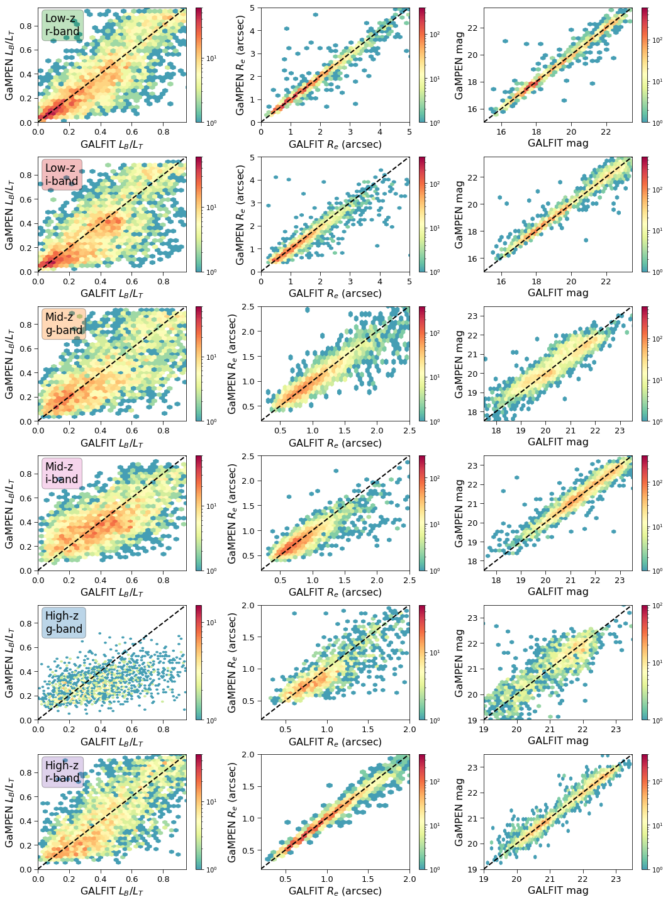
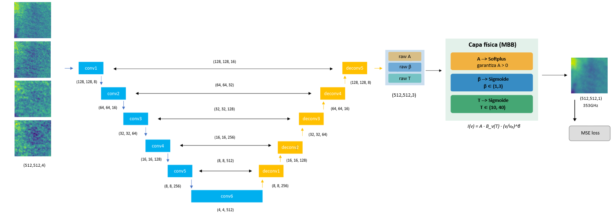
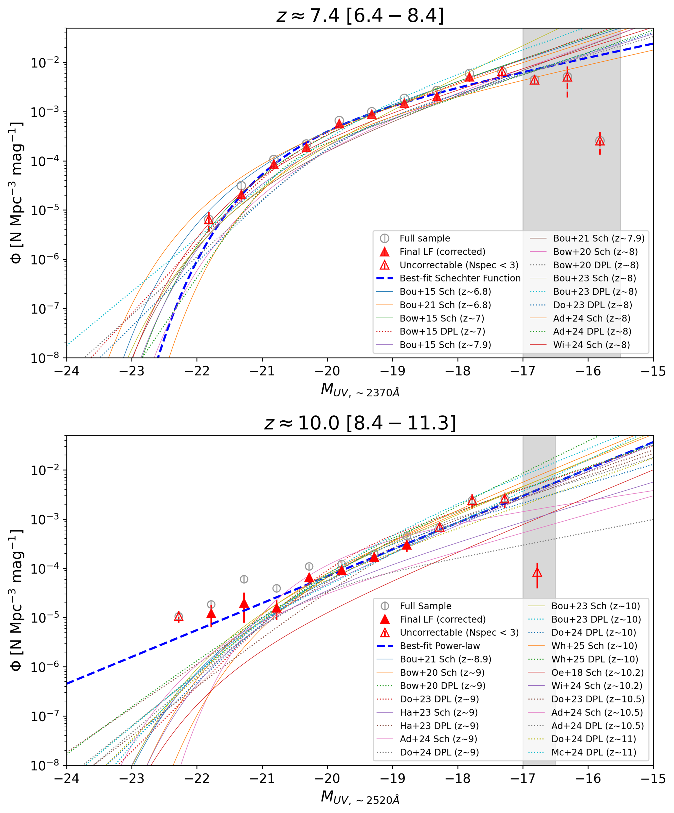
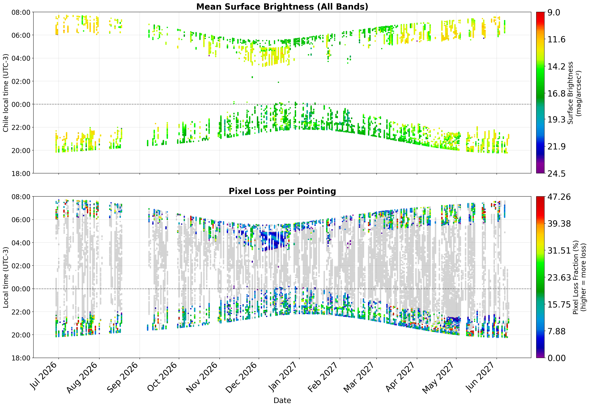
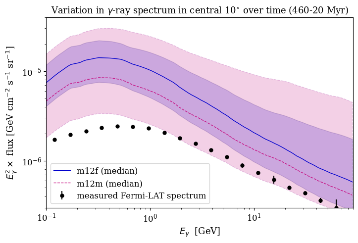
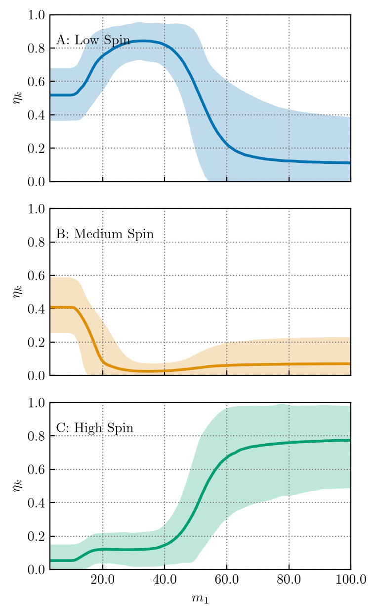

# arXiv Digest — 2026-10-26

- **Interest file used:** interests/2026.10.md (current month)
- **Categories pulled:** astro-ph.CO, astro-ph.EP, astro-ph.GA, astro-ph.HE, astro-ph.IM, astro-ph.SR, cs.LG, stat.ML, physics.data-an, hep-ph
- **Papers scanned:** 295 (68 astro-ph new/cross + 227 from extras)
- **After first filter:** 25 candidates reviewed with full text
- **Final selected:** 20 papers across 4 tiers

---

## Tier 1 — Highly relevant

### [Star clusters at cosmic dawn I: the emergence of the initial cluster mass function](http://arxiv.org/abs/2610.32497v1)

Fred S. Thompson, Julien Devriendt, Adrianne Slyz et al.
**Primary category:** astro-ph.GA

Using cosmological radiation-hydrodynamics zoom-in simulations of a galaxy in a $10^{10}\,M_\odot$ halo at $z=6$, the authors let the **initial cluster mass function (ICMF) emerge self-consistently** from sink particles that accrete gas and self-regulate via radiation and supernova feedback, rather than imposing a fixed formation efficiency. Schechter fits give a truncation mass near **$6\times10^6\,M_\odot$**, and including stellar radiation makes the low-mass slope shallower (from $-1.60$ to $-1.34$) by shortening cluster formation times to about a Myr, before the first supernovae fire. The brightest simulated clusters reach UV luminosities comparable to the unusually bright lensed star-cluster candidates JWST has found in the first billion years.

*The fitted initial cluster mass function across three simulation variants (full resolution, fiducial, no-radiation): including stellar radiation flattens the low-mass slope and shifts the Schechter cut-off, while doubling the resolution steepens it back.*

---

### [Complete Multi-Band Structural Characterization for 10 Million Galaxies in the Hyper Suprime-Cam Wide Survey using Deep Learning](http://arxiv.org/abs/2610.32913v1)

Milind Sarkar, Aritra Ghosh, Andrew Connolly et al.

**Primary category:** astro-ph.GA

The authors use **GAMPEN**, a Bayesian deep-learning framework combining a spatial transformer network with a CNN, to produce per-galaxy posterior distributions of bulge-to-total light ratio, effective radius, and flux in the $g$, $r$, $i$ bands for nearly **10 million galaxies** across ~1400 deg$^2$ of HSC-SSP Wide. By fine-tuning previously trained single-band models on only **~0.5% of the dataset** via transfer learning, they reproduce light-profile-fitting measurements with well-calibrated posteriors (**$\lesssim6\%$ mean deviation** in coverage). Performance degrades only for the $g$-band at $z\gtrsim0.5$, where it probes rest-frame UV, and those measurements are excluded from the public release, which the authors frame as a scalable template for structural measurements from Rubin, Euclid, and Roman.

*GAMPEN's most-probable predictions plotted against GALFIT light-profile-fitting values across all redshift bins and bands: the tight clustering along the line of equality shows the network reproduces traditional fits at scale.*

---

### [Physics-Informed Neural Networks vs U-Net: Application to thermal dust emission recovery in the microwave](http://arxiv.org/abs/2610.31813v1)

Nicolas Morant Juan, José M. Casas, Laura Bonavera

**Primary category:** astro-ph.IM | also: astro-ph.CO

The authors build a **physics-informed neural network (PINN)** that embeds the Modified Black Body spectral model as a hard, differentiable constraint for separating Galactic thermal dust emission from the CMB, and compare it against a standard U-Net baseline on simulated Planck HFI patches. Both architectures reach comparable reconstruction quality (**SSIM consistently above 0.96**, angular power-spectrum spectral index matching the input to within 1%) across validation and three independent PySM dust realizations (D4, D7, D10). Critically, enforcing the physical constraint costs no measurable accuracy relative to the unconstrained U-Net while guaranteeing every output is a **thermodynamically admissible** dust configuration, establishing the physics-informed approach as a viable alternative with interpretability the purely data-driven model lacks.

*The PINN architecture: identical to the U-Net baseline up to the output layer, which instead predicts three physical parameter maps (amplitude, spectral index, temperature) combined through a non-trainable modified-blackbody layer, so every output is physically consistent by construction.*

---

### [ARENA: Active Region attENtion Aggregation for interpretable solar flare prediction](http://arxiv.org/abs/2610.32758v1)

Luis Bauer, Annalena Kofler, Andrés Asensio Ramos et al.

**Primary category:** astro-ph.SR | also: cs.CV

ARENA predicts solar flares from a variable number of active-region image cutouts using **multiple-instance learning under weak supervision**: it is trained only on a flare/no-flare label for the full observation, never told which active region caused the flare. An **attention mechanism** learns to weight the active regions, so the model can localize the flare-originating region at inference time without ever being given origin labels. The approach reaches a **Heidke skill score of 0.45**, comparable to existing flare-prediction methods, while adding interpretability that those methods lack.

*Each active region is tokenized by a shared ResNet-18, and an attention-based aggregator combines all region tokens from one timestep into a single prediction; the learned attention weight doubles as a pointer to the flare-originating region.*

---

### [Spatial distribution of star formation in dwarf galaxies: Merger-driven and secular starburst](http://arxiv.org/abs/2610.32624v1)

Rakshit Chauhan, Smitha Subramanian

**Primary category:** astro-ph.GA

Using GALEX FUV imaging for 272 isolated starburst dwarf galaxies (17 post-merger, 255 non-interacting) spanning $10^7$–$10^{9.6}\,M_\odot$, the authors measure the **radial profile of star-formation-rate surface density enhancement** relative to main-sequence control dwarfs. In contrast to massive starbursts, where merger-driven star formation is centrally concentrated while secular starbursts are enhanced uniformly, they find that in **low-mass dwarfs star formation is enhanced roughly uniformly across the galaxy regardless of trigger mechanism** — merger-driven and secularly-driven dwarf starbursts look spatially alike. They attribute this to dwarfs' shallow gravitational potentials, which let tidal interactions compress and enhance star formation across extended gas envelopes rather than funneling gas to the center.

*Radial profile of SFR-surface-density enhancement for post-merger versus non-interacting starburst dwarfs: both curves stay roughly flat with radius, unlike the centrally-peaked profile seen in merger-driven starbursts among massive galaxies.*

---

### [Physics Informed Neural Network for Multi-dimensional Turbulent Self-gravitating Flows](http://arxiv.org/abs/2610.32840v1)

Tirthankar De, Sayantan Auddy, Ramit Dey et al.

**Primary category:** astro-ph.SR | also: astro-ph.GA

The authors apply **physics-informed neural networks (PINNs)** — mesh-free solvers that bake the governing PDEs directly into the training loss — to isothermal, turbulent, self-gravitating molecular clouds in two and three dimensions, across subsonic and supersonic regimes, benchmarked against the finite-volume code Athena++. The PINNs **accurately recover the global density and velocity evolution over multiple free-fall times** across Mach numbers and dimensionalities, and their training cost scales weakly with spatial resolution (**under 25% increase from $128^3$ to $1024^3$**). This establishes PINNs as a viable, resolution-cheap complement to grid-based codes for modeling realistic turbulent self-gravitating flows.

*Side-by-side density and velocity-magnitude fields from the PINN versus Athena++ for the 2D subsonic case, with the pixel-wise log-ratio panel showing the agreement is tight across the whole domain.*

---

## Tier 2 — Adjacent / useful context

### [A probabilistic approach to separate mergers and jellyfish galaxies: Application of morphological non-parametric indexes to the DESI Legacy Survey](http://arxiv.org/abs/2610.32960v1)

V. M. Sampaio, Y. Jaffé, A. Moretti et al.

**Primary category:** astro-ph.GA

The authors classify regular spirals, ellipticals, mergers, and ram-pressure-stripped "jellyfish" galaxies in the DESI Legacy Imaging Surveys using ten non-parametric morphological indices, combining a cross-validated **Bayesian kernel-density classifier** on 2D diagnostic planes with a **probability-calibrated LightGBM** model fusing all indices. The three-class model (spirals/ellipticals/perturbed) reaches **balanced accuracy and macro-F1 of 0.89**, while separating mergers from jellyfish specifically is harder (~0.73 balanced accuracy), since jellyfish candidates occupy a coherent low-concentration region but mergers remain spread across overlapping morphologies. Class probabilities are released for **1,744,454 galaxies**.

*Example r-band cutouts for each of the four morphological classes used to train the classifier — spirals, ellipticals, mergers, and jellyfish candidates — illustrating why mergers and jellyfish are harder to separate than regular galaxies.*

---

### [Semi-Analytic Predictions for Strong-Lensing Perturbers in Cold and Self-Interacting Dark Matter](http://arxiv.org/abs/2610.31881v1)

Jonathan Tekverk, Duncan K. Adams, Simon Birrer et al.

**Primary category:** astro-ph.CO | also: hep-ph

The authors combine semi-analytic CDM subhalo accretion histories with a gravothermal-evolution model for self-interacting dark matter (SIDM) to predict the projected masses and density-slope signatures of dark subhalos detectable through **strong-lensing perturbers**, comparing against three observed cases (PJ011646, SDSS J0946+1006, JVAS B1938+666). For SIDM parameters $\sigma_0/m_\chi=147.1\,\mathrm{cm^2/g}$, $w=120\,\mathrm{km/s}$, cored and core-collapsed SIDM subhalos reproduce all three perturbers far more often than CDM — e.g., **~220 core-collapsed SIDM subhalos per host match JVAS B1938+666 versus only ~0.2 in CDM** — while CDM would require implausibly early accretion ($z\sim13$) to match the same perturber.

---

### [Forward model of the Gaia DR3 selection function](http://arxiv.org/abs/2610.32551v1)

Alfred Castro-Ginard, Anthony G. A. Brown, Eduardo Belotto Evangelista et al.

**Primary category:** astro-ph.GA | also: astro-ph.IM

Using a **hierarchical Bayesian model** fit by MCMC to all 1.8 billion Gaia DR3 sources with reported positions, the authors jointly infer how many times Gaia scanned each sky position and the per-scan source detection efficiency, producing a full-sky, full-magnitude selection function derived purely from the data and the nominal scanning law. Gaia DR3 is **essentially complete for $G\in(5,19.5)$**, after which completeness falls off tracking the scanning-law pattern and crowding; the team also traces an unexpected completeness increase beyond $G\sim21$ to extended sources, confirmed by cross-matching against Euclid Q1. The resulting selection function is released in the public **GaiaUnlimited** package.

*All-sky selection-function maps at four faint-end magnitude bins: completeness degrades first in crowded regions, then more broadly as fewer scans accumulate toward the survey's magnitude limit.*

---

### [Galaxy Luminosity Functions at z~7-10 from Four Years of JWST Observations](http://arxiv.org/abs/2610.32307v1)

Bangzheng Sun, Haojing Yan

**Primary category:** astro-ph.GA

Using the dropout technique across nine JWST NIRCam fields (~1045 arcmin$^2$), the authors assemble the **largest candidate galaxy samples to date** at $z\approx7.4$ (3,733 F090W-dropouts) and $z\approx10$ (2,396 F115W-dropouts), cross-checked against hundreds of NIRSpec-confirmed redshifts. After correcting for incompleteness and contamination, the $z\approx7.4$ luminosity function follows a Schechter form with a **shallower-than-expected faint-end slope of $\alpha=-1.70\pm0.16$**, while the $z\approx10$ luminosity function is better described by a pure power law ($\beta=-2.36\pm0.16$) than a Schechter function, driven by high number densities at the bright end ($M_{UV}\lesssim-21.8$).

*Luminosity functions at $z\approx7.4$ (top) and $z\approx10$ (bottom): the $z\approx10$ function is better fit by a power law than the Schechter form that works at $z\approx7.4$, reflecting an excess of bright galaxies.*

---

### [The MIRI/MRS Library. III. Detector-based optimal spectral extraction and high-contrast imaging applications](http://arxiv.org/abs/2610.32530v1)

Danny Gasman, Ioannis Argyriou, David R. Law et al.

**Primary category:** astro-ph.IM

The authors introduce a method to extract JWST MIRI/MRS spectra directly from detector images rather than from reconstructed spectral cubes, using sub-pixel-scanned PSF models to subtract a bright central source via direct subtraction and PCA. The **detector-based optimal extraction reaches over 1.5 times higher S/N** than the standard pipeline's cube extraction and can subtract the central-source PSF to **sub-percent levels**, enabling extraction of faint companion spectra that would otherwise be buried.

---

### [The SDSS-V Local Volume Mapper (LVM): Technical Overview](http://arxiv.org/abs/2610.31936v1)

Guillermo A. Blanc, Niv Drory, Sebastián F. Sánchez et al.

**Primary category:** astro-ph.IM | also: astro-ph.GA

This paper is the technical primer for the **Local Volume Mapper**, an ultra-wide integral-field spectroscopic survey mapping the Milky Way, the Magellanic Clouds, and nearby galaxy disks with a custom robotic telescope at Las Campanas. LVM covers the bulk of the optical range at **medium resolution ($R=2200$–$5500$)** with spatial resolution better than **1 pc in the Milky Way and ~10 pc in the Magellanic Clouds**, and the paper documents the hardware, observing strategy, data reduction, and calibration quality that future users of LVM data products will rely on.

---

### [The Impact of Orbital Data Centers on the NSF-DOE Vera C. Rubin Observatory](http://arxiv.org/abs/2610.31772v1)

Nayan Jangid, Meredith L. Rawls, Peter Yoachim et al.

**Primary category:** astro-ph.IM

The authors simulate a proposed ~1 million-satellite **Orbital Data Center (ODC)** constellation across four orbital regimes and assess its impact on one year of Rubin Observatory LSST observations via a six-stage pipeline covering orbit propagation through pixel-loss estimation. They find that on a given night **up to 80% of LSST pointings** would contain at least one illuminated ODC streak, with a yearly average of **~20% contaminated exposures**, and that even at just 10% deployment the constellation would still drastically raise sky brightness near twilight — **by more than 1000%** with no Moon — causing significant nightly pixel losses even under proposed mitigation strategies.

*Mean satellite-streak surface brightness per pointing over a year (top) alongside the corresponding pixel-loss fraction (bottom): contamination tracks the twilight window and varies strongly with season.*

---

## Tier 3 — Outside my area but notable

### [The Galactic Center Gamma-Ray Excess and the Look-Elsewhere Effect](http://arxiv.org/abs/2610.32845v1)

Isabel S. Sands, Philip F. Hopkins

**Primary category:** astro-ph.HE | also: astro-ph.CO

Using full magnetohydrodynamic simulations of Milky Way analogs with time-dependent, spectrally-resolved cosmic-ray transport, the authors reconstruct diffuse galactic-center gamma-ray emission and compare instantaneous snapshots against a time-averaged baseline. They find **residuals up to several times larger than the measured Fermi-LAT Galactic Center Excess (GCE)**, with spectral shapes and morphologies that at some snapshots closely resemble the real GCE — suggesting the two-decade-old excess, long debated as a dark-matter annihilation signal versus a millisecond-pulsar population, **may simply be a transient fluctuation in diffuse emission caught at an inopportune moment**.

*Simulated gamma-ray spectra in the central 10° region for two Milky Way-analog galaxies, compared to the measured Fermi-LAT excess (dotted): the simulated spectra bracket the real signal's shape despite arising from ordinary diffuse-emission variability, not a new source population.*

---

### [Three subpopulations of binary black holes in mass, spin magnitudes and tilts following GWTC-5](http://arxiv.org/abs/2610.32935v1)

Asad Hussain, Maximiliano Isi, Aaron Zimmerman

**Primary category:** astro-ph.HE

Modeling the 259 binary black holes in the fifth LIGO-Virgo-KAGRA catalog (GWTC-5) with mass-dependent mixing of distinct spin and mass-ratio distributions, the authors resolve **three subpopulations with low, medium, and high spins** that trade off dominance with primary mass. The low-spin population favors equal-mass pairs with negligible spin and dominates near $35\,M_\odot$; the high-spin population, with a rapidly spinning primary ($\chi_1\approx0.7$), dominates above $60\,M_\odot$. A log Bayes factor of **$\log_{10}B=6.1^{+0.2}_{-0.3}$** favors vanishing spin for the low-spin population, adding to growing evidence of real substructure in the merging black-hole population that traces distinct formation channels.

*Inferred mixing fractions of the three black-hole subpopulations as a function of primary mass: the low-spin population dominates near 35 solar masses while the high-spin population takes over above 60 solar masses.*

---

### [Local Analogs of Little Red Dots: Clues to the X-ray Weakness](http://arxiv.org/abs/2610.32430v1)

Shi-Jiang Chen, Jun-Xian Wang, Zhen-Ya Zheng et al.

**Primary category:** astro-ph.GA | also: astro-ph.HE

To probe why JWST's "little red dots" (LRDs) at $z\sim4$–8 appear X-ray weak, the authors study six $z\sim0.3$ "local little red dots" — V-shaped green pea galaxies selected as low-redshift counterparts — with deep Einstein Probe/FXT soft X-ray exposures, which need $10^{3-4}$ times less exposure than high-z Chandra stacks for the same signal-to-noise. They find the stacked X-weak sources sit **~0.5–0.7 dex below standard unobscured-quasar scaling relations** (detected at $3.3\sigma$), favoring a **mildly X-ray-weak corona with Compton-thin absorption** ($N_H\sim10^{22-23}\,\mathrm{cm^{-2}}$) over the simplest super-Eddington or heavily Compton-thick explanations for the high-redshift LRD puzzle.

*X-ray luminosity versus broad-Hα and UV luminosity for the local LRD analogs compared against standard AGN relations and high-redshift LRD limits: the X-weak sources (green) fall well below the type-1 AGN track that the X-normal sources (blue) follow.*

---

### [Earth embeddings are decomposable records of the land surface](http://arxiv.org/abs/2610.32617v1)

Robin Young, Srinivasan Keshav

**Primary category:** cs.LG | also: cs.CV

Annual Earth-observation embeddings compress a year of satellite imagery per 10-meter pixel into a learned vector, but what these vectors actually encode had not been established. The authors decompose two widely used embedding products with sparse autoencoders and show the recovered features correspond to **individually interpretable ecological concepts** — fire, forest clearing, crop type — validated against independent reference data across six continents, with disturbance features reliably dating abrupt canopy loss to the correct post-event growing season. The two embedding products also diverge in what they preserve: one separates crop type more strongly, the other retains small, fast-recovering fires that the first misses entirely.

---

## Tier 4 — Meta-research about the field

### [FacilityAudit-Agent: Beyond Mention-as-Usage for Fine-Grained Facility Contribution Attribution in Astrophysics Publications](http://arxiv.org/abs/2610.32135v1)

Wujun Shao, Dongwei Fan, Daoqi Peng et al.

**Primary category:** astro-ph.IM

Observatory bibliographies need to know not just whether a facility is *named* in a paper but how much its data actually drove the result. FacilityAudit-Agent is a tool-calling LLM framework that builds a page-bounded outline of each PDF, then uses an explicit decision tree over a six-level contribution scale (non-use through exclusive data support) to classify facility usage, routing uncertain cases to human review. On 39,358 human-annotated paper-facility pairs it reaches **89.1% accuracy and 79.8% macro-F1**, outperforming baselines by 5.8–12.1 accuracy points, and is already deployed at the National Astronomical Data Center to audit publications citing LAMOST, FAST, and EP.

---

### [PaperScorer: How Predictable Is Paper Acceptance?](http://arxiv.org/abs/2610.31791v1)

Sachin Konan, Jonathan Liu, Zhuang Liu

**Primary category:** cs.LG

The authors train models to predict a paper's accept/reject decision directly from its text or page-image screenshots, with author identity and formatting shortcuts stripped out. **Vision models prove most predictive** — reaching **68% accuracy on ICLR papers and 77% on ML arXiv papers**, beating both text-only and frontier reasoning models — because page images retain figures, layout, and presentation that plain text discards. Predictions are strongest and most confident at the extremes (clearly weak or strong papers), while middling submissions stay unpredictable for every model tested, offering an early, if partial, empirical read on how much of a peer-review decision a paper carries on its own.
