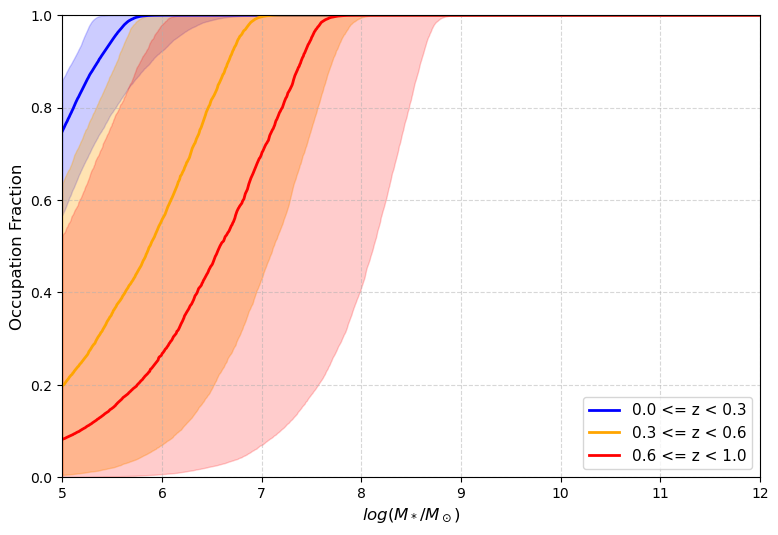
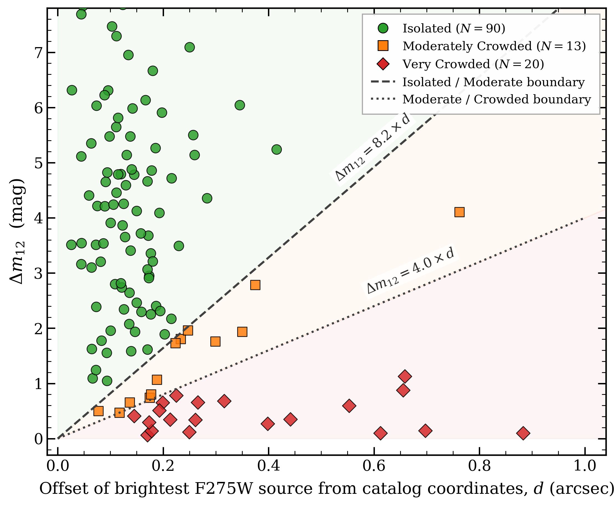
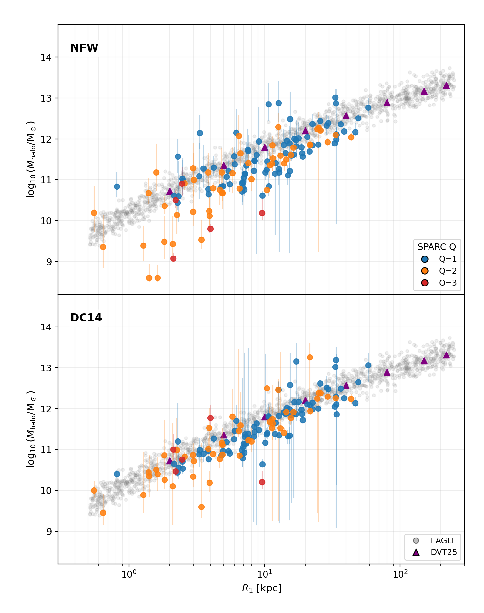
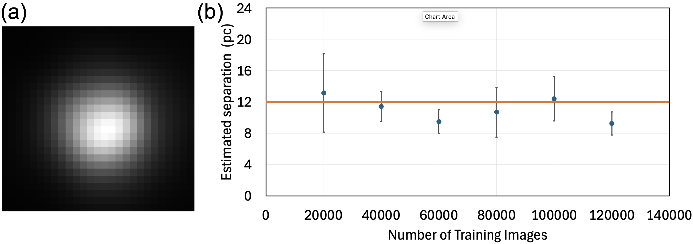
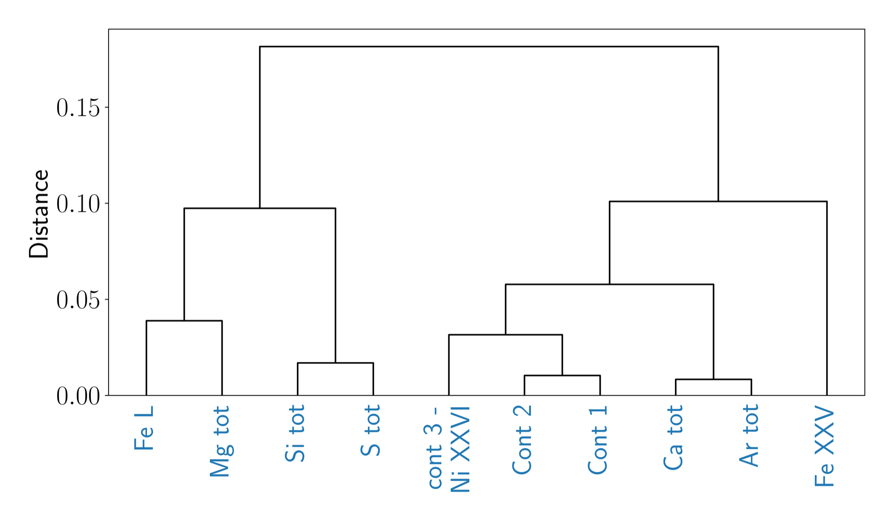

# arXiv Digest — 2026-10-27

- **Interest file used:** interests/2026.10.md (current month)
- **Categories pulled:** astro-ph.CO, astro-ph.EP, astro-ph.GA, astro-ph.HE, astro-ph.IM, astro-ph.SR, cs.LG, stat.ML, physics.data-an, hep-ph
- **Papers scanned:** 441 (145 astro-ph + 296 extras: cs.LG 198, stat.ML 58, physics.data-an 10, hep-ph 52, minus 22 cross-listed duplicates removed on merge)
- **After first filter:** 28 candidates reviewed with full text
- **Final selected:** 19 papers across 3 tiers

---

## Tier 1 — Highly relevant

### [Constraining Supermassive Black Hole Seeding and Accretion via Occupation Fractions and Mass-Weighted Distributions](http://arxiv.org/abs/2610.35673v1)

Gianni Sims, Vicki Sarajedini
**Primary category:** astro-ph.GA

Using multiwavelength AGN catalogs from the LSST Deep Drilling Fields, the authors apply a **hierarchical Bayesian model** to the AGN luminosity function (detections plus upper limits) to infer the black hole occupation fraction (BHOF) across host galaxy mass and redshift. They find the **BHOF remains consistent with 100% down to host masses below $10^9\,M_\odot$**, favoring light-seed black hole formation scenarios over heavy-seed ones. A separate reduced-$\chi^2$ comparison of mass-weighted black hole mass distributions for ~30 spectroscopically measured sources favors a **main-sequence (star-formation-coupled) accretion mode** over a universal power-law Eddington-ratio distribution, regardless of seeding channel.

*BHOF as a function of galaxy mass in three redshift bins (z~0–0.3, 0.3–0.6, 0.6–1); solid curves are the median posterior BHOF and shaded bands are 1σ credible intervals. The occupation fraction stays pinned near unity down to very low host masses in every bin, the paper's central result.*

---

### [EP241021a as An Off-nuclear Month-duration Transient in a Dwarf Starburst Galaxy](http://arxiv.org/abs/2610.34217v1)

Luming Sun, Xinwen Shu, Jiazheng Zhu et al.
**Primary category:** astro-ph.HE | also: astro-ph.GA

Deep HST/WFC3 and Gemini-N imaging of the host of the peculiar fast X-ray transient EP241021a reveal a **dwarf starburst disk galaxy** ($M_\star \sim 3\times10^8\,M_\odot$, $R_e = 1.7$ kpc, SFR $\sim5\,M_\odot\,{\rm yr}^{-1}$) at $z=0.748$. The transient sits **0.95 ± 0.13 kpc off-nucleus**, squarely in the galaxy's disk, and its late-time light curve shows a synchronous X-ray/optical shutoff consistent with jet switch-off. The off-nuclear location and starburst host favor a **post-supernova micro-tidal-disruption-event scenario** — a compact object natally kicked into disrupting a stellar companion — over a standard nuclear TDE.

*HST F606W/F814W images of the host (left), best-fit exponential disk models (middle), and residuals (right), with the galaxy center and the VLBA/e-MERLIN transient positions marked. The transient sits well off the galaxy's photometric center, inside the visible disk.*

---

### [The origin and distribution of diffuse HI in the close interacting MHONGOOSE galaxy systems](http://arxiv.org/abs/2610.34366v1)

D. Kleiner, W. J. G. de Blok, J. Healy et al.
**Primary category:** astro-ph.GA

Deep MeerKAT HI mapping of two close interacting galaxy systems in the MHONGOOSE survey resolves HI down to $N_{\rm HI}=10^{17.9}\,{\rm cm^{-2}}$ at 4 kpc scales, detecting gas in seven galaxies including two newly identified dwarf satellites. One of them, **MKT 25413, has $\log(M_{\rm HI}/M_\odot)=5.7$ — the lowest HI mass yet measured for a galaxy that is not a Milky Way satellite** — and shows **anomalously low star formation and HI fraction for its stellar mass**, a low-surface-brightness outlier from the normal star-forming scaling relations. Combined MUSE/ALMA kinematics show ordered rotation and tidally stripped, low-column-density HI around the interacting pairs, pointing to mild recent flyby interactions rather than major mergers.

*VST g-band optical image of MKT 25413 overlaid with primary-beam-corrected HI column-density contours at two angular resolutions, with a 1 kpc scale bar. The faint stellar body is barely visible against the surrounding HI, illustrating just how low-surface-brightness and gas-poor this newly identified dwarf satellite is.*

---

### [How Quickly Did the Giants Form? Constraining the Formation Timescales of Massive Quiescent Galaxies at Cosmic Noon Using Chemical Evolution Modelling](http://arxiv.org/abs/2610.34883v1)

Patrick N. O'Connor, J. Trevor Mendel, Sven Buder et al.
**Primary category:** astro-ph.GA

The authors build a one-zone chemical evolution model whose nucleosynthetic yields are **calibrated against resolved stellar abundances in the Sculptor dwarf spheroidal**, then apply it to the $\alpha$-enhanced abundance patterns ([Mg/Fe]~0.4–0.5 at near-solar [Fe/H]) observed in massive quiescent galaxies (MQGs, $M_\star\sim10^{11}M_\odot$) at $z\sim2$. They find the abundances require **rapid formation timescales of $\Delta t_{\rm SF}\sim0.1$–$0.4$ Gyr**, with high star-formation efficiency ($\tau_\star\sim0.05$ Gyr) and near-total metal retention ($\eta\sim0$), and that progenitor star-formation rates of **200–400 $M_\odot\,{\rm yr^{-1}}$** — matching recently identified "NIRCam-dark" galaxies rather than the most extreme dusty starbursts — reproduce the observed abundance pattern best.

*Illustrative summary of how the model's three governing parameters (formation timescale Δt_SF, star-formation efficiency timescale τ⋆, and metal mass-loading η) each shift the predicted stellar [Mg/Fe]-[Fe/H] track relative to the observed MQG population, showing why short Δt_SF and near-zero η are required to match the data.*

---

### [Wolf-Rayet Stars in M33: The Impact of Stellar Crowding on Spectral Classification and Mass-Loss Diagnostics](http://arxiv.org/abs/2610.33163v1)

Rohit Raj, Puragra Guhathakurta, Robert E. Williams et al.
**Primary category:** astro-ph.SR

Using $0.1''$-resolution HST/PHATTER imaging, the authors quantify how much the ground-based discovery spectra of M33's 213 confirmed Wolf-Rayet (WR) stars are contaminated by unresolved neighboring OB stars. For 123 WR stars in the HST footprint, **~27% suffer moderate-to-severe dilution** (continuum flux fraction $F_{\rm WR}<0.85$), which biases the equivalent-width-based spectral classifications and **mass-loss rates that feed directly into massive-star evolutionary and population-synthesis models**. They provide crowding classifications and six-band photometry for each star, and confirm the dilution directly with less-contaminated Keck/DEIMOS slit spectra of five targets.

*Two-parameter crowding diagnostic (positional offset vs. brightness contrast of the nearest neighbor) for the 123 M33 WR stars, with empirical boundaries separating isolated, moderately crowded, and severely crowded stars. Over a quarter of the sample falls in the compromised regime.*

---

### [How Steep is your Dust? Direct Measurements of Nebular Attenuation Curves at Cosmic Noon with JWST](http://arxiv.org/abs/2610.33166v1)

Gabriel Maheson, Sirio Belli, Sandro Tacchella et al.
**Primary category:** astro-ph.GA

Using deep JWST/NIRSpec spectra from the Blue Jay survey, the authors directly measure **nebular dust attenuation curves from up to eight Balmer/Paschen recombination lines per galaxy** for 24 star-forming galaxies at $1.8<z<3.3$. They find **little diversity in curve shape**, with most galaxies consistent with the local Calzetti (2000) curve, but show that using the wrong attenuation curve in strong-line metallicity diagnostics can shift inferred metallicities by **as much as 0.3 dex (up to 5σ)** for some diagnostics (S32, S3, S23, S3O3) — a direct systematic relevant to stellar population synthesis and nebular-emission modeling.

*Measured nebular attenuation curve k'(λ) for each galaxy (blue), the SED-derived stellar continuum attenuation curve (green), and literature curves (Calzetti 2000, dashed-dot red), all normalized to zero at Hα. Most galaxies track the Calzetti shape closely, with nebular and stellar curves overlapping within errors.*

---

### [Theoretical Pulsation Properties of RR Lyrae and Type II Cepheids in the JWST and Roman photometric systems](http://arxiv.org/abs/2610.34441v1)

M. Marconi, R. Molinaro, A. Bhardwaj et al.
**Primary category:** astro-ph.SR | also: astro-ph.GA

The authors convert existing nonlinear convective pulsation models for RR Lyrae (RRL) and Type II Cepheids (T2C) into the **JWST and Roman photometric systems**, deriving multi-filter Period-Luminosity, Period-Wesenheit, and Period-Amplitude relations across $Z=0.0001$–$0.02$. They find **RRL relations carry a significantly stronger metallicity dependence than T2C relations**, making T2Cs a more metallicity-robust Population II distance indicator. As a first application to real data, they apply the new JWST relations to RRL photometry in the **WLM dwarf galaxy**, obtaining a distance modulus of **$\mu = 24.85\pm0.03$ mag**, consistent with but slightly shorter than literature TRGB/Cepheid distances.

*Distance modulus to WLM derived from the new JWST Period-Wesenheit-Metallicity relations (green dashed/dotted lines with uncertainty bands), compared against independent literature distances from the TRGB, Classical Cepheids, and the JAGB method. The new RRL-based distance is consistent with, but modestly shorter than, most prior determinations.*

---

### [Inferring the Total Mass of Galaxy Halos Using Photometry](http://arxiv.org/abs/2610.35366v1)

Chris Brook, Arianna di Cintio, Claudio Dalla Vecchia et al.
**Primary category:** astro-ph.GA

Cosmological simulations predict a tight relation between $R_1$ (the radius where stellar surface density falls to $1\,M_\odot\,{\rm pc^{-2}}$) and dark matter halo mass $M_{200}$, but this had never been tested observationally. Using SPARC rotation curves to measure $M_{200}$ independently of photometry, the authors show **$R_1$ and $M_{200}$ follow the same tight relation simulations predict, with low intrinsic scatter**, providing the first observational validation. Because $R_1$ requires only imaging, this gives a simple, **purely photometric estimator of dark matter halo mass** — directly useful for inferring halo masses in dwarf and low-surface-brightness galaxies from imaging surveys alone.

*The R1–M200 relation for SPARC galaxies (observational points) overplotted on the EAGLE simulation's predicted relation and fit (grey circles, purple triangles). Observations and simulation agree closely across the probed mass range.*

---

### [Parameter-Decoupling-Informed Learning for Superresolution: Laboratory Validation and Galaxy Imaging](http://arxiv.org/abs/2610.35449v1)

Abdelali Sajia, Bilal Benzimoun, James Qu et al.
**Primary category:** physics.optics | also: astro-ph.GA

Building on a **parameter-decoupled quantum superresolution theory**, the authors design a **physics-informed convolutional neural network** that estimates the angular separation of two unresolved point sources without needing to know nuisance parameters like brightness imbalance or partial coherence, and validate it on both synthetic/experimental optics data and archival astronomical imaging. Applied to an archival **Hubble image of the double-nucleus system NGC 4486B**, the model recovers a nuclear separation of **9.3–13.2 pc**, consistent with the previously reported 12 pc value, and the physics-informed, decoupled approach achieves **substantially higher fidelity than a conventional direct data-driven CNN** trained the same way.

*(a) Original HST image of the NGC 4486B double-nucleus system, (b) the processed 33×33-pixel cutout fed to the network, and (c) the resulting nuclear separation estimate from the physics-informed CNN — a direct demonstration of the method on real archival galaxy imaging.*

---

## Tier 2 — Adjacent / useful context

### [Investigating supernova-remnant X-ray maps with dendrogram-based techniques](http://arxiv.org/abs/2610.35181v1)

S. Calderaro, G. Parisi, V. Sapienza et al.
**Primary category:** astro-ph.HE

The authors introduce a **dendrogram-based hierarchical clustering method — compared using both classical multivariate metrics and a deep-learning graph-based metric** — to quantitatively measure similarity among narrow-band X-ray and equivalent-width maps of supernova remnants (Cassiopeia A, Tycho, Kepler, G292.0+1.8, W49B), validated against synthetic maps from 3D hydrodynamic simulations. The clustering **cleanly separates Type Ia remnants (Tycho, Kepler) from core-collapse remnants (Cas A, G292.0+1.8)**, with **W49B's chemical clustering pattern aligning more closely with the core-collapse group**, adding quantitative weight to the core-collapse side of its long-disputed origin.

*Dendrogram clustering of real Chandra X-ray flux maps of Cassiopeia A using the cosine-distance metric, grouping narrow-band maps by the chemical element and plasma layer they trace.*

---

### [Comparison of Hybrid and Standard Reconstruction Methods on IXPE Astrophysical Data](http://arxiv.org/abs/2610.35087v1)

Riccardo Ferrazzoli, Nicolò Cibrario Stefano Silvestri, Michela Negro et al.
**Primary category:** astro-ph.IM | also: astro-ph.HE

The authors present the first test, on real astrophysical sources with known polarization, of a **CNN-plus-moment-analysis hybrid reconstruction algorithm** for photoelectron tracks in IXPE's gas pixel detectors, previously validated only on lab calibration data. Applied to the bright accreting pulsar Her X-1 and the transient XTE J1701-461, the **hybrid method improves polarimetric sensitivity over the standard moment-analysis pipeline**, quantified as a function of X-ray energy, confirming the CNN-based approach is ready for science-grade polarimetric analysis of real IXPE targets.

*Stokes parameters, polarization degree, and polarization angle vs. energy for Her X-1 and XTE J1701-461, comparing the hybrid CNN-based reconstruction against the standard moment-analysis pipeline.*

---

### [Cracking into RACS - I. Measuring the cosmic dipole in the RACS-low3 and RACS-mid1 radio surveys with simulation-based inference](http://arxiv.org/abs/2610.35207v1)

Oliver T. Oayda, Mali Land-Strykowski, Stefan W. Duchesne et al.
**Primary category:** astro-ph.CO

The authors measure the radio-source-count dipole in two ASKAP/RACS survey epochs using a **simulation-based inference (SBI) pipeline in which a neural network learns the likelihood function directly**, explicitly forward-modeling a newly identified systematic where reported flux densities are suppressed when ASKAP's antennas are warmer. Even after modeling this temperature systematic, both RACS epochs show a dipole **inconsistent with the CMB kinematic dipole**, with amplitudes **roughly 4–5 times larger** than the CMB expectation — adding further evidence to the ongoing "cosmic dipole tension" and demonstrating SBI's power for handling instrumental systematics that a standard likelihood would struggle to marginalize over.

---

### [Model-independent calibration of gamma-ray bursts with Bayesian neural networks](http://arxiv.org/abs/2610.35503v1)

P. Caterino, M. Demianski, E. Piedipalumbo et al.
**Primary category:** astro-ph.CO

To extend cosmological distance ladders beyond the Type Ia supernova redshift range, the authors train a **Bayesian neural network on Pantheon+ supernovae and explicitly recalibrate its predictive uncertainties**, then use it to calibrate the gamma-ray-burst Amati correlation without assuming a background cosmology. The resulting GRB Hubble diagram extends standardized distances out to **$z\simeq9.4$**, and a battery of diagnostics (leave-three-out, redshift-evolution, Efron-Petrosian) finds the calibration stable, with **dark-energy extensions beyond flat ΛCDM mildly preferred** by the Akaike criterion once GRBs are combined with supernovae, BAO, and Hubble measurements.

---

### [Explainable Prediction of High-Speed Solar Wind Streams driven by Coronal Holes via Topological Data Analysis](http://arxiv.org/abs/2610.35549v1)

Francesco Marchetti, Sabrina Guastavino, Daniel Collin
**Primary category:** astro-ph.SR | also: cs.LG

The authors use **persistent homology (topological data analysis)** to extract multiscale shape information from EUV solar images and test whether coronal-hole topology alone predicts high-speed solar wind streams at Earth four days later. Topological features fed to linear classifiers achieve an **AUC of ~0.82 and True Skill Statistic of ~0.43**, showing that the raw topology of coronal structures — independent of explicit physical modeling — carries real predictive skill, while the persistence-based representation keeps the method inherently **interpretable** (the topological features driving each prediction can be traced back to specific coronal structures).

---

### [Distilling neural networks into equations to predict planetary instability](http://arxiv.org/abs/2610.35617v1)

Simon Alford, Edward Gu, Omar Costilla-Reyes et al.
**Primary category:** cs.LG | also: astro-ph.EP

Starting from black-box neural network classifiers that predict long-term orbital stability in compact planetary systems, the authors **distill the trained networks into closed-form symbolic equations**, trading a small amount of predictive accuracy for a fully interpretable analytic expression for the instability boundary. The distilled equations **recover known analytic resonance-overlap criteria as special cases** while generalizing beyond them, demonstrating that symbolic distillation can turn an opaque ML stability classifier into physical insight about which resonances actually drive instability.

---

### [pbhalo: computing primordial black hole and minihalo populations from a single primordial perturbation spectrum](http://arxiv.org/abs/2610.35703v1)

B. A. Rudenko
**Primary category:** astro-ph.CO

The author releases **pbhalo**, an open-source Python package that computes, from a single input primordial curvature power spectrum, both the resulting **primordial black hole (PBH) mass function and the dark matter minihalo mass function** (including ultracompact minihalos), self-consistently applying observational constraints on both populations jointly. The code is validated against existing tools (colossus, pbhstat) and published results, and the paper demonstrates **joint PBH/minihalo constraints for lognormal power-spectrum peaks** — directly relevant to small-halo-abundance predictions in extended cosmological volumes.

*Maximum allowed amplitude of a lognormal power-spectrum peak as a function of its scale, combining PBH-overproduction, observational PBH bounds, CMB/Lyman-α power-spectrum limits, and ultracompact-minihalo constraints into one joint exclusion plot.*

---

### [FastPM: Fast Pretrained Model for Cosmological Simulation-Based Inference](http://arxiv.org/abs/2610.33955v1)

Masaya Yamamoto, Adrian E. Bayer
**Primary category:** astro-ph.CO | also: astro-ph.IM

The authors show that **transfer learning from fast, low-fidelity particle-mesh simulations can sharply cut the cost of training simulation-based-inference models** for cosmological parameter inference. Pretraining on cheap FastPM runs before fine-tuning on expensive high-fidelity CAMELS N-body/hydrodynamical simulations reduces the **number of costly high-fidelity simulations needed by a factor of 7–20**, cutting total training compute by **up to an order of magnitude**, with the gains persisting even for the full hydrodynamical matter power spectrum despite FastPM containing no baryonic physics.

*Posterior inference performance (negative log target probability) vs. number of high-fidelity CAMELS simulations used, comparing models trained from scratch (solid) against models pretrained on cheap FastPM simulations then fine-tuned (dashed). Pretraining reaches the same accuracy with far fewer costly simulations.*

---

### [ARENA: Active Region attENtion Aggregation for interpretable solar flare prediction](http://arxiv.org/abs/2610.32758v1)

Luis Bauer, Annalena Kofler, Andrés Asensio Ramos et al.
**Primary category:** astro-ph.SR | also: cs.CV, cs.LG

ARENA predicts solar flares from a variable number of active-region image cutouts using an **attention-based multiple-instance-learning architecture**, trained with only a whole-image flare/no-flare label and no information on which active region actually produced the flare. The learned attention weights let the model **localize the flare-driving active region without ever seeing origin labels during training**, achieving a Heidke skill score of **0.45**, comparable to prior flare-prediction approaches, while providing a built-in, weakly-supervised form of interpretability.

*Density-normalized distribution of the model's learned attention weights assigned to flare-producing active regions versus non-producing ones, for the validation subset with confirmed flare origins — showing the attention mechanism concentrates weight on the correct region without being told which one it was.*

---

## Tier 3 — Outside my area but notable

### [Automated, auditable dating of the Babylonian Astronomical Diaries with language models and astronomical tools](http://arxiv.org/abs/2610.34297v1)

Lucas Carrit Delgado Pinheiro, Yuan-Sen Ting, Jon Clindaniel et al.
**Primary category:** astro-ph.IM | also: cs.AI, cs.CL

The authors build an **agentic pipeline — a rule-based parser plus a language model that checks and supplements the parsed clauses, backed by astronomical tools the system calls to test each candidate year** — to automatically date the ~2,500-year-old Babylonian Astronomical Diaries, most of which have lost their date formula. The system tests every clause against **all 701 candidate years from 626 BCE to 75 CE** and ranks years by agreement. On 120 already-dated tablets held out as a benchmark, the **top-ranked candidate group contains the published year 96% of the time**, and for 86 of those tablets that group is a single year — the published one in 84 cases — demonstrating genuine hypothesis generation and testing by an LLM-plus-tool system on a problem far outside conventional astrophysics.

*The automated workflow end-to-end: a parser turns diary text into scored clauses, astronomical tools (callable by the agent) verify each clause against all 701 candidate years, and fixed scoring rules combine the verdicts into a ranked set of candidate years, illustrated with a worked tablet example.*
