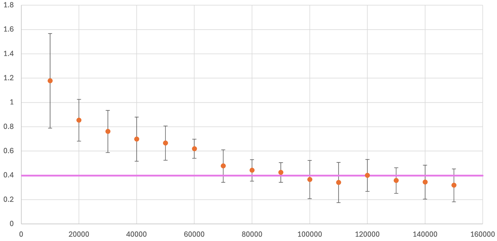
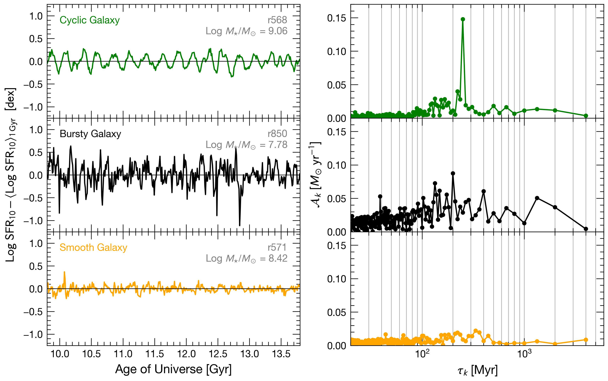
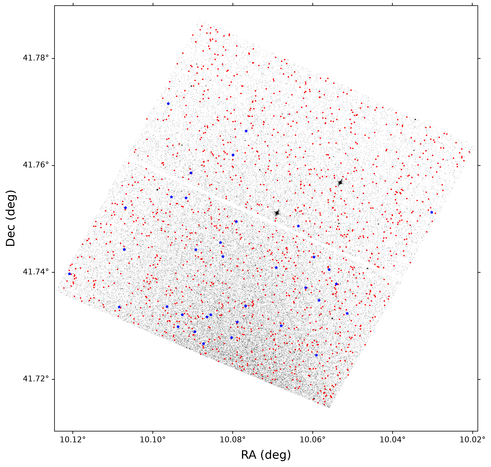
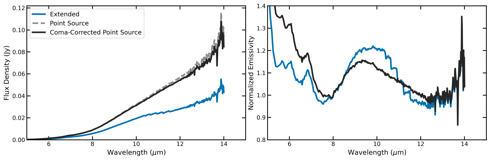

# arXiv Digest — 2026-10-28

- **Interest file used:** interests/2026.10.md (current month)
- **Categories pulled:** astro-ph.CO, astro-ph.EP, astro-ph.GA, astro-ph.HE, astro-ph.IM, astro-ph.SR, cs.LG, stat.ML, physics.data-an, hep-ph
- **Papers scanned:** 411 (100 astro-ph new/cross + 311 from extras: cs.LG 149, hep-ph 46, stat.ML 15, plus cross-listings)
- **After first filter:** 25 candidates reviewed with full text
- **Final selected:** 20 papers across 3 tiers

---

## Tier 1 — Highly relevant

### [The Great Chat in the Sky: Aligning Exotic Astronomical Data to Language with AstroBridge](http://arxiv.org/abs/2610.36375v1)

Ibrahim Habib, Kevin Li, Trung Nguyen, et al.
**Primary category:** astro-ph.IM

AstroBridge aligns raw astronomical images, spectra, and light curves to a language model using a **literature-assisted caption-generation pipeline** that sidesteps manual annotation, fusing frozen modality-specific encoders through a shared Q-Former into an LLM's embedding space. Fine-tuned with LoRA, it substantially outperforms its unmodified base model and larger VLMs, reaching **91.5% accuracy distinguishing quasars from galaxies** (vs **69.0%** for the base model) and **macro F1 = 52.25%** on supernova light-curve classification. The architecture is modality-agnostic — new observation types plug in by adding an encoder — though it still underperforms on galaxy morphology description.

*Overview of AstroBridge: an LLM generates training captions from matched literature and catalog metadata, while raw images, spectra, and light curves pass through frozen modality-specific encoders, trainable projectors, and a shared Q-Former whose output tokens are prepended to the language model's input.*

---

### [Parameter-Decoupled Superresolution with Airy-Disk-Informed Learning: Application to NGC 4486B](http://arxiv.org/abs/2610.36021v1)

James Qu, Isabella L. Lee, Gang Zhang, et al.
**Primary category:** physics.optics | also: astro-ph.GA

The authors derive an exact parameter-decoupling theorem for Airy-disk (rather than Gaussian) point-spread functions, showing that ratios of Hermite-Gaussian mode probabilities with matching parity cancel out unknown source brightness, coherence, and phase. They use this **physics-informed** result to train an Airy-disk-informed CNN for sub-diffraction source-separation estimation, cutting the mean absolute error roughly **tenfold versus a Gaussian-PSF CNN** (0.018 vs 0.18). Applied to archival HST imaging of the double-nucleus galaxy NGC 4486B, the network converges to a **nuclear separation of ~11.7 pc**, consistent with the historical ~12 pc measurement.

*Airy-informed CNN estimate of the NGC 4486B double-nucleus separation as a function of training-set size, with the magenta line marking the previously reported ~12 pc separation; predictions converge toward the literature value as training-set size grows.*

---

### [ASTROLABE: A 3D Particle-Level Surrogate for Cosmology Simulation with Physical Flow Matching](http://arxiv.org/abs/2610.27068v1)

Ibrahim Elsharkawy, David Curtin, Yonatan Kahn, Neal Weiner
**Primary category:** astro-ph.CO | also: cs.AI

ASTROLABE is a generative N-body emulator that operates directly on particle phase-space coordinates rather than a voxel grid, using a field-particle hybrid transformer (linear cost in particle number) to transport a fast, coarse COLA approximation to the full N-body distribution via **physical flow matching** — a flow-matching objective modified to exactly conserve momentum and mass at every integration step. Trained on 1500 simulations and ~200 billion particles, it reproduces power spectra, velocity profiles, and **NFW halo density profiles down to halo masses of $10^9\,M_\odot/h$**, generalizes to out-of-distribution initial conditions, and fine-tunes to a TNG50-3-dark run at **up to ~500× speedup** over the full simulation.

*Density-field comparison for a 10 Mpc/h box: the ground-truth N-body simulation, the fast but coarse COLA approximation, and ASTROLABE's reconstruction from COLA using only 10 ODE integration steps — ASTROLABE recovers small-scale halo structure that COLA alone misses.*

---

### [The CGM in a New Light: Emitted Hα, [NII], and [OIII] around Simulated Dwarf Galaxies](http://arxiv.org/abs/2610.37363v1)

Daniel R. Piacitelli, Alyson M. Brooks, N. Nicole Sanchez, et al. (co-author: Pieter van Dokkum)
**Primary category:** astro-ph.GA

Using the **Marvelous Massive Dwarfs** zoom-in simulation suite, the authors predict circumgalactic medium (CGM) **surface brightness in Hα, [NII], and [OIII]** around dwarf galaxies ($M_\star \lesssim 10^9\,M_\odot$), targeting the detection limits of the upcoming MOTHRA telephoto array. Each emission line traces distinct CGM structure and phase, with brightness declining steeply with stellar mass for the metal lines but staying shallow for Hα. Emission is systematically eccentric and oriented along the galaxy's minor axis, with outflows and inflows contributing roughly **40% and 50% of total surface brightness** — the first theoretical framework for interpreting optical CGM emission maps around dwarfs, directly testable with MOTHRA, KCWI, and MUSE.

*Simulated Hα, [NII], and [OIII] surface-brightness maps for four representative dwarf galaxies, showing that observable CGM emission extends well beyond the stellar disk and HI halo, with each line tracing a different structure and phase of the gas.*

---

### [Galactic Dynamics Drives Cyclic Star Formation in Dipole Dwarf Galaxies](http://arxiv.org/abs/2610.37621v1)

Robel Geda, Akaxia Cruz, Alyson Brooks, et al.
**Primary category:** astro-ph.GA

Using 50 dwarf galaxies from the Marvelous/Extended Marvelous Dwarfs zoom-in simulations, the authors measure **star formation history power spectral densities** and find a broken power law with a break near **100 Myr**. A subset of disk galaxies (**18% of the sample**) show quasi-periodic "cyclic" star formation rather than pure burstiness; these host lopsided, Magellanic-type gas disks whose dominant oscillation timescale matches the **orbital period at the half-light radius**. The cycle arises because the lopsided cold gas disk sloshes radially, compressing star-forming gas once per orbit — a mechanism distinct from the "breathing mode" bursty cycle seen in FIRE-2 dwarfs.

*Comparison of cyclic, bursty, and smooth star-formation histories and their Fourier amplitude spectra, showing that only the cyclic galaxy has a sharply peaked spectrum indicating a single dominant oscillation timescale.*

---

### [Prospects for Near-Far Constraints on Reionization from Simulated LSST Observations of Milky Way Dwarf Galaxies and Stellar Streams](http://arxiv.org/abs/2610.36056v1)

Aritra Kundu, Robyn Sanderson, Nora Shipp, et al.
**Primary category:** astro-ph.GA | also: astro-ph.CO

The authors release public **mock LSST catalogs** of satellites, stellar streams, and field dwarfs around 13 Milky Way-mass FIRE-2 hosts. At LSST's surface-brightness limit, **≈29% of stellar streams are detectable with tidal tails** and **≈96% of satellites and ≈64% of field galaxies** above $10^5\,M_\odot$ are detectable. Applying the **near-far technique to reconstruct the proto-MW UV luminosity function at z=7** improves the recovered faint-end slope and cuts halo-to-halo scatter by ≈33%, making these catalogs a direct, public completeness-estimate tool for LSST's dwarf galaxy and reionization science.

*Cumulative radial distribution of detectable mock satellites, stream progenitors, and field galaxies compared to observed Milky Way satellites and local field dwarfs, showing agreement within the halo-to-halo scatter.*

---

### [Simulations agree: the Milky Way's satellites are disrupting](http://arxiv.org/abs/2610.37328v1)

Alexander H. Riley, Nora Shipp, J. Sebastian Monzon, et al.
**Primary category:** astro-ph.GA

Comparing satellite tidal disruption across four independent frameworks — **Auriga and FIRE hydrodynamical simulations, the Aquarius N-body + particle-tagging model, and the semi-analytic SatGen** — the authors find FIRE, Aquarius, and SatGen agree remarkably well: **~20–30% of classical-mass satellites retain less than 90% of their bound stellar mass**. Critically, both Aquarius and SatGen predict that **ultra-faint dwarfs are disrupted at least as much as classical satellites**, implying many of the 33 known ultra-faints may harbor undetected tidal tails.

*Cumulative distribution of bound stellar mass fraction for classical-mass satellites across the four simulation frameworks, showing close agreement between FIRE, Aquarius, and SatGen while Auriga predicts substantially greater disruption.*

---

### ["Helium Enrichment Law": The Relation Between Helium and Metal Enrichment in Stars in FIRE-3 Simulations of Milky Way-mass Galaxies](http://arxiv.org/abs/2610.37529v1)

Pratik J. Gandhi, Earl P. Bellinger, Andrew Wetzel, et al.
**Primary category:** astro-ph.GA | also: astro-ph.SR

Using FIRE-3 cosmological zoom-ins, the authors directly measure the **helium-to-metal chemical enrichment slope ΔY/ΔZ** that stellar models must assume to infer ages and masses of resolved stars. Core-collapse supernovae dominate helium production below $Z\lesssim0.1\,Z_\odot$, but stellar winds take over near solar metallicity, giving best-fit slopes of **ΔY/ΔZ ≈ 0.75–2.1** that depend on stellar age and increase over cosmic time. Critically, there is **no single "universal" enrichment law** — galaxy-to-galaxy variance is intrinsic even with fixed nucleosynthetic yields — meaning fixed-slope assumptions in stellar population synthesis carry real, non-negligible systematics.

*Best-fit helium-to-metal enrichment slope ΔY/ΔZ as a function of stellar age for three simulated Milky Way-mass galaxies, rising from ≈0.5–1.0 for the oldest stars to ≈1.25–2.5 for stars younger than ~6 Gyr, with galaxy-to-galaxy scatter.*

---

### [The Stellar Populations of Resolved Galaxies](http://arxiv.org/abs/2610.36040v1)

Daniel R. Weisz, Alessandro Savino, Evan D. Skillman, et al.
**Primary category:** astro-ph.GA | also: astro-ph.SR

A comprehensive review of extragalactic science enabled by **resolved stellar population imaging**, covering **star formation histories, bursty star formation, the stellar initial mass function, and orbital histories of Local Group galaxies**, synthesized across two decades of panchromatic photometry and astrometry for hundreds of millions of resolved stars. The review identifies emerging trends and open shortcomings in current datasets, and discusses how **JWST, LSST, Euclid, Roman, CSST, ELTs, and HWO** will advance the field — a high-value reference for modeling individual resolved stars or dwarf-galaxy SFHs.

---

### [Variable Stars in Local Group Galaxies IX: Tracing the Complex History of NGC 205](http://arxiv.org/abs/2610.37492v1)

Irina Plaks, M. Marengo, M. Monelli, et al.
**Primary category:** astro-ph.GA

Using archival HST/ACS imaging, the authors build the most extensive variable-star catalogue yet for the dwarf elliptical **NGC 205**, detecting **1441 RR Lyrae stars and 35 anomalous Cepheids**. From the tip of the red giant branch they derive a distance modulus of **μ = 24.68 ± 0.06 mag**, and the Bailey diagram and RRc fraction indicate a metal-rich component with an **extended star formation history**. The anomalous Cepheids constrain their progenitors to **[Fe/H] ≲ -2.1**, showing metal-poor gas persisted in NGC 205 well after enrichment began — a direct observational chemical/SFH tracer dataset for stellar population synthesis work on dwarf galaxies.

*Spatial distribution of the RR Lyrae stars (red) and anomalous Cepheids (blue) identified across the NGC 205 field, overplotted on an HST/ACS F606W image.*

---

### [The Clouds in the "Middle Ages" I. Star formation history and chemical abundances in the LMC](http://arxiv.org/abs/2610.37385v1)

Mathias Schultheis, Maria-Rosa L. Cioni, Samuele Anoardo
**Primary category:** astro-ph.SR | also: astro-ph.GA

Reconstructs the LMC's star-formation history using **2047 fundamental-mode AGB pulsators** from Gaia DR3, applying two independent period-age calibrations, and derives Mg, Si, and Ca abundances from APOGEE DR17 spectra for 296 AGB and 271 RGB stars via a refined line-selection pipeline. Both calibrations recover **three distinct star-formation phases**: an ancient population at 9-10 Gyr, a quiescent phase at 4-8 Gyr, and **a starburst peaking 1.5-2 Gyr ago**. Carefully selected Mg/Si/Ca lines yield markedly reduced scatter versus standard APOGEE abundances, establishing AGB stars as reliable joint tracers of SFH and chemical enrichment in this dwarf galaxy.

*Reconstructed LMC star-formation history from the Mira-only sample under two period-age calibrations, compared against independent CMD-fitting results; all methods agree on the same ancient, quiescent, and recent-starburst phases.*

---

## Tier 2 — Adjacent / useful context

### [The First Deep Learning all-sky List of Fermi-LAT Gamma-ray Sources](http://arxiv.org/abs/2610.37287v1)

S. Bhattacharyya, G. Principe, D. Malyshev, et al.
**Primary category:** astro-ph.HE | also: astro-ph.IM

The authors build a deep-learning pipeline (1FDL) for all-sky gamma-ray source detection, pairing a **U-Net-based semantic-segmentation network** across six energy bins with dedicated CNNs for flux estimation, true/spurious classification, and ensemble-based location refinement. Applied to 10 years of Fermi-LAT data, it yields **>3800 sources**, broadly consistent with the 4FGL-DR2 catalog. Critically, the DNN pipeline proves **more robust than the standard likelihood-based method to uncertainty in the diffuse Galactic emission model**, matching or beating it under interstellar-emission-model swaps.

*Source-recall (completeness) as a function of integrated photon flux above 1 GeV, for high- and low-Galactic-latitude sources; vertical lines mark the flux at which the pipeline reaches its adopted 90%-recall detection-sensitivity threshold.*

---

### [ASTRA: An Autonomous Framework for Physics-Validated Analysis and Hypothesis Generation in Astrophysics](http://arxiv.org/abs/2610.36144v1)

Glenn J. White
**Primary category:** astro-ph.IM

ASTRA is an agentic analysis framework that pairs automated statistical/ML fitting with an independent **physics-validation engine** — dimensional analysis, conservation-law checks, and first-principles benchmark derivation — that an LLM orchestrates but never performs the science itself. Across six astrophysics test cases, it recovers known results and, notably, its **first-principles-derived equilibrium benchmark overturns an intentionally wrong encoded value**, flipping the physical conclusion about Herschel filament stability. Agentic-LLM and fine-tuned astronomy-LLM baselines match ASTRA's statistical fits but **adopt the planted erroneous benchmark in all six trap runs**, failing the physics-validation step entirely.

---

### [The Spatially-Resolved Recent Star Formation History of the M81 Disk](http://arxiv.org/abs/2610.37661v1)

Vaishnav V. Rao, Eric F. Bell, Adam Smercina, et al.
**Primary category:** astro-ph.GA

Using archival HST/ACS photometry and **color-magnitude diagram fitting**, the authors map M81's spatially-resolved star formation history over the **last ~180 Myr** across its full disk — only the third L* spiral mapped this way. The disk is notably **lopsided: the eastern half formed ~50% more stars than the western half**, a signal missed by FUV tracers due to dust. Comparing the long-term SFHs of M81 and M82 against TNG50 analogs favors a pericenter passage **~1 Gyr ago**, ruling out more recent (150–220 Myr) passage times proposed elsewhere.

*Recent star-formation-rate and cumulative star-formation histories for the eastern versus western halves of the M81 disk, showing the eastern half formed roughly 50% more stellar mass over the last ~90 Myr.*

---

### [The UKIRT M33 Monitoring Project - VII. A 15-year K-band photometric catalogue of long-period variable stars in the central kiloparsec of M33](http://arxiv.org/abs/2610.37591v1)

Mina Alizadeh, Atefeh Javadi, Yousefali Abedini, et al.
**Primary category:** astro-ph.GA | also: astro-ph.SR

Presents a homogenised 15-year K-band photometric catalogue of the central kiloparsec of M33, merging four independent UKIRT near-infrared surveys. Of 847 unique monitored stars, **771 (91%) are classified as variable**, including 385 high-amplitude Mira-type long-period-variable candidates. Cross-matching with Spitzer IRAC photometry identifies **120 dust-enshrouded AGB candidates** invisible to optical surveys, forming the photometric foundation for a companion paper's period-luminosity and star-formation-history reconstruction of M33's nuclear region.

*Near-infrared colour-magnitude diagram of the catalogue's monitored stars, colour-coded by pulsation-amplitude class; the reddest sources beyond the O-rich/C-rich divide are the dust-enshrouded AGB candidates picked out by the Spitzer cross-match.*

---

### [The inner galaxy as a window on its early assembly: lessons from a cosmological Milky Way analogue](http://arxiv.org/abs/2610.36164v1)

Thomas Tomlinson, Francesca Fragkoudi, Andreia Carrillo, et al.
**Primary category:** astro-ph.GA

Uses a high-resolution cosmological Milky-Way-analogue simulation (Auriga Superstars) to test how well kinematics, ages, and metallicities separate the inner galaxy's proto-galaxy, in-situ, and accreted stellar components. Metal-poor, low-orbital-energy stars form a **>97% pure proto-galaxy sample**, but the high-energy, metal-poor tail usually attributed to early massive mergers is instead dominated by **low-mass accreted systems ($10^7$–$10^9\,M_\odot$)**. Chemical and dynamical signatures of individual accretion events largely wash out within 4 kpc of the centre, leading the authors to caution against linking individual inner-galaxy stars to specific merger events.

*Density of in-situ, proto-galaxy, and accreted stars in energy-angular-momentum (E-Lz) space; accreted debris blends into the other populations rather than forming the clean substructure its energy alone would suggest.*

---

### [The Cosmic Ultraviolet Baryon Survey X: Density and Pressure Profiles of Clumpy Circumgalactic Gas at z=0.4-0.7](http://arxiv.org/abs/2610.36088v1)

Suyash Kumar, Hsiao-Wen Chen, Gwen C. Rudie, et al.
**Primary category:** astro-ph.GA

Combines HST/COS and STIS absorption-line spectroscopy with photoionization modeling for 23 CUBS-midz galaxies/groups to map the density, temperature, and turbulence of cool circumgalactic gas. Cool clumps have **densities of $10^{-4}$–$10^{-2}\,\mathrm{cm}^{-3}$** and subsonic non-thermal broadening, with cool-gas pressure matching hot-gas pressure from stacked X-ray data. The cool-gas mass stays roughly constant across halo mass, so the **cool-phase baryon fraction falls from ~6-19% at $M_h\sim10^{12}\,M_\odot$ to ~0.6-1.5% at $M_h\sim10^{13}\,M_\odot$**.

*Census of baryonic mass in stars, ISM, cool CGM, and hot CGM for $10^{12}$ and $10^{13}\,M_\odot$ halos; the cool-CGM share of the baryon budget drops sharply between the two halo masses even as its absolute mass stays nearly constant.*

---

### [Detection of star formation in a near-pristine pocket of the Universe](http://arxiv.org/abs/2610.36042v1)

Louise Welsh, Ryan Cooke, Michele Fumagalli, et al.
**Primary category:** astro-ph.GA

Using Keck/KCWI and KCRM, the authors report the **first detection of star formation in the environment of a chemically near-pristine ([Fe/H] < -3.66) damped Lyman-alpha system**, finding two Lyman-alpha emitters within ±1500 km/s of the absorber's redshift (z=3.078) at impact parameters of 66 and 137 physical kpc. Both sources show weak, narrow Lyman-alpha emission and only upper limits on He II 1640, consistent with low metallicity, suggesting near-pristine DLAs can serve as a **signpost for locating primitive, metal-poor galaxies just ~2 Gyr after the Big Bang**.

*Narrow-band Lyman-alpha image of the KCWI field around the near-pristine DLA sightline; the two red-circled sources are the newly detected Lyman-alpha emitters within 1500 km/s of the absorber.*

---

### [The Role of Star Formation and Morphology in the Mass-Metallicity Relation of Galaxies at Cosmic Noon](http://arxiv.org/abs/2610.37612v1)

Farhanul Hasan, Marc Rafelski, Kalina V. Nedkova, et al.
**Primary category:** astro-ph.GA

Uses JWST/NIRISS slitless spectroscopy of **>1000 galaxies at 1.7<z<3.5** from the PASSAGE and OutThere pure-parallel surveys to measure how the mass-metallicity relation depends on star-formation rate and morphology. Stacking by mass alone gives a **steep low-mass MZR slope with metallicities below 10% solar at log(M*/M_sun)<7.5**; stacking further by SFR and morphology reveals a clear **fundamental metallicity relation**, where at fixed low mass, galaxies with lower SFRs, larger sizes, bulges, or spiral structure are systematically more metal-rich — evidence that metal-poor gas accretion drives concentrated star formation and dilution in less-evolved systems.

*The mass-metallicity relation from PASSAGE/OutThere stacks compared to literature measurements across z~0.1-8; a steep decline appears at the lowest stellar masses.*

---

## Tier 3 — Outside my area but notable

### [JWST/MIRI Observations of Amorphous Silicates in Interstellar Comet 3I/ATLAS](http://arxiv.org/abs/2610.37540v1)

Cristina A. Thomas, Michael S. P. Kelley, David E. Harker, et al.
**Primary category:** astro-ph.EP | also: astro-ph.GA

The authors present JWST/MIRI mid-infrared spectroscopy of 3I/ATLAS, only the third confirmed interstellar object, obtained post-perihelion. The spectrum shows a broad, smooth **10 μm silicate emission feature unlike those of Solar System comets**, which thermal-emission modeling finds is **pyroxene-dominated and essentially fully amorphous** — the best-fit crystalline fraction is zero, with a **5.3% upper limit**. Combined with the object's previously reported unusual volatile and isotopic composition, this amorphous, unprocessed silicate signature suggests 3I/ATLAS's building material experienced little thermal alteration, preserving a record of conditions in its interstellar formation environment.

*JWST/MIRI spectrum of 3I/ATLAS showing the broad 10 μm silicate emission feature, compared against the best-fit thermal model combining amorphous pyroxene, olivine, and carbon dust — the amorphous, pyroxene-dominated fit is strongly preferred over models including crystalline silicates.*
