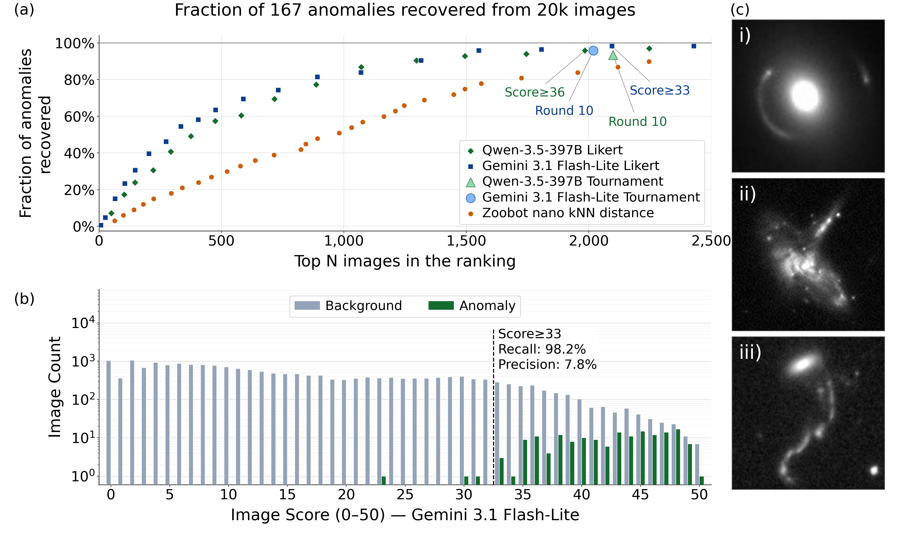
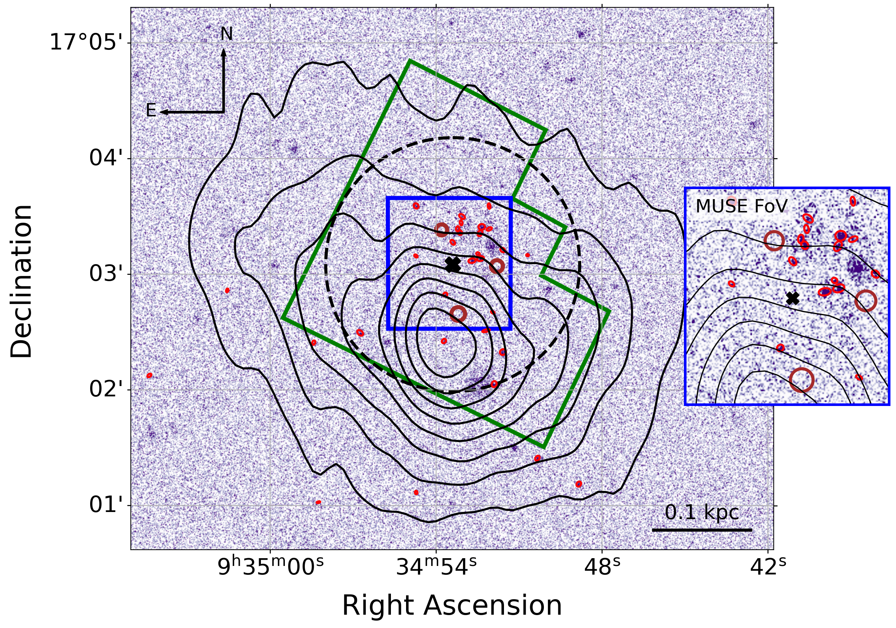
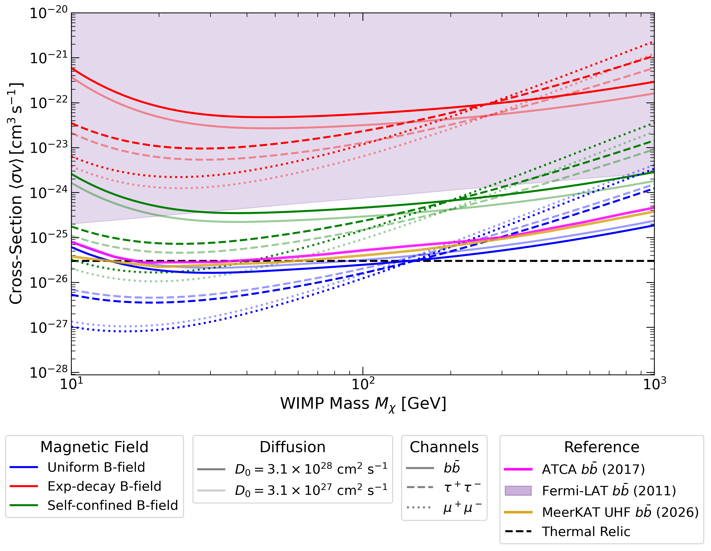

# arXiv Digest — 2026-10-30

- **Interest file used:** interests/2026.10.md (current month)
- **Categories pulled:** astro-ph.CO, astro-ph.EP, astro-ph.GA, astro-ph.HE, astro-ph.IM, astro-ph.SR, cs.LG, stat.ML, physics.data-an, hep-ph
- **Papers scanned:** 598 (200 astro-ph new/cross + 398 from extras: cs.LG 300 [capped from 372 due to an arXiv API id-list length limit], stat.ML 54, physics.data-an 8, hep-ph 92)
- **After first filter:** 27 candidates reviewed with full text
- **Final selected:** 16 papers across 2 tiers

---

## Tier 1 — Highly relevant

### [Identifying Scientifically Interesting Galaxies with Vision-Language Models](http://arxiv.org/abs/2610.37747v1)

Yixuan Cheng, Nolan Koblischke, Jo Bovy
**Primary category:** astro-ph.IM | also: astro-ph.GA

The authors test whether off-the-shelf vision-language models can rank galaxy images by scientific interest rather than statistical rarity, using **Gemini 3.1 Flash-Lite** with no training on the target data. On a 20,000-image HST benchmark seeded with 167 known anomalies, a simple Likert-scoring prompt recovers **98.2% of reference anomalies within the top ~2,000 images**, beating a dedicated Zoobot embedding + kNN/isolation-forest baseline (85.0%/70.1%) at the same budget, at a cost of **$5.05 per 10,000 images**. The method rediscovers known strong lenses, jellyfish and interacting galaxies, and the team releases a catalog of 102 new high-scoring candidates for follow-up. This shows that **general-purpose VLM judgment, not learned anomaly distance, can prioritize follow-up in large image archives**.

*Gemini's Likert scoring recovers reference anomalies far more efficiently than embedding-based anomaly detection (Zoobot kNN/isolation forest), and surfaces known lenses, mergers, and jellyfish galaxies among its highest-scoring images.*

---

### [UnEZ: A Fully Unsupervised Self-Templating Neural Network for Redshift and Line Strength Estimation](http://arxiv.org/abs/2610.38816v1)

Asha Abd, Karl Glazebrook, Colin Jacobs
**Primary category:** astro-ph.IM | also: astro-ph.GA

UnEZ is a **fully unsupervised, physics-informed neural network** that predicts galaxy and quasar redshifts directly from SDSS spectra with no redshift labels and no template library, instead fitting a learned rest-frame template against a provided line list. The model achieves **>99.5% inlier performance at SNR > 10** and stays competitive with template-based pipelines like MARZ down to SNR > 3, while each latent-space node maps to a specific, physically interpretable spectral line. Because it needs no templates, the authors argue it should transfer readily to new instruments and unseen redshift regimes such as JWST, where conventional template libraries do not yet exist. The main weakness identified is systematic under-prediction of individual emission-line fluxes, which the authors trace to the normalization scheme rather than the redshift solution itself.

---

### [Celia: Catalog Embeddings Learned from cosmologIcal simulAtions](http://arxiv.org/abs/2610.40218v1)

Xiaowen Zhang, Matthew Ho, Anshul Kumar et al.
**Primary category:** astro-ph.GA | also: astro-ph.CO

Celia is a **self-supervised foundation model** that compresses cosmological-simulation subhalo catalogs (CAMELS IllustrisTNG, SIMBA, Astrid) into a shared embedding space via masked-property reconstruction and teacher-student distillation, with **no parameter labels used in pretraining**. Simple linear probes on the embeddings recover **Ω_m with R² = 0.999** and σ₈ and supernova-feedback amplitudes with R² ≥ 0.97 across all three simulation suites, and the embeddings transfer to an out-of-distribution code (Swift-EAGLE) the model never saw, reaching r = 0.985 for Ω_m. Principal-component decomposition of the embedding further shows that simple power laws in the simulation parameters describe the leading components, suggesting the representation captures physically meaningful structure rather than code-specific artifacts. The authors position Celia as a common coordinate system for simulation-based inference, galaxy-formation-model comparison, and the discovery of new astrophysical probes.

---

### [The origin of UV emission in extremely low-mass satellite galaxies: Insights from Leo T](http://arxiv.org/abs/2610.39390v1)

S. Amrutha, Mousumi Das, Daniel Vaz, Jarle Brinchmann
**Primary category:** astro-ph.GA

Using UVIT far-UV imaging combined with HST and MUSE catalogs, the authors characterize the FUV-emitting stellar population of **Leo T, the lowest-mass gas-rich dwarf galaxy known to show recent star formation**. They extract 30 FUV star-forming clusters and show their luminosities rule out any embedded massive O/B stars, with the emitting population instead dominated by main-sequence, blue-loop, and a few horizontal-branch stars, **five of six MUSE-matched FUV emitters being extremely metal-poor ([Fe/H] ≤ -3)**. The NUV−r color profile shows **young (<1 Gyr) stars dominate the UV emission out to a radius of 185 pc**, with an older population taking over beyond ~225 pc, and the asymmetric spatial distribution of the clusters hints at an ongoing directional interaction with the Milky Way.

*UVIT far-UV image of Leo T with the 30 extracted star-forming clusters (red ellipses) overlaid on HI column-density contours; most clusters cluster near the optical center, inside the HST and MUSE survey footprints.*

---

### [ARRAKIHS: The observability of tidally stripped satellites in a Milky Way-like halo](http://arxiv.org/abs/2610.38779v1)

A. Pérez-Herrero, Y. Revaz, S. Roca-Fàbrega et al.
**Primary category:** astro-ph.GA

The authors run a grid of 392 high-resolution N-body simulations of **dwarf-galaxy progenitors (10^6-10^9 M☉) tidally stripped in a Milky Way-like potential**, with both cuspy and cored dark-matter profiles, to predict when the resulting stellar streams will be detectable by upcoming low-surface-brightness surveys. They find detectability depends most strongly on **progenitor stellar mass and orbital eccentricity**, with extended debris mainly recovered for radial orbits (e₀ ≳ 0.75) and **10^8-10^9 M☉ progenitors dominating the detectable area**, while 10^6-10^7 M☉ systems can be fully stripped with no detectable debris at all. Cuspy and cored halos produce similar stream evolution, with differences smaller than the scatter from orbital diversity alone, suggesting stream morphology is a weak core-cusp diagnostic in this regime. These predictions are tuned to the surface-brightness depths of **ARRAKIHS, LSST, and Euclid**.

*Mock ARRAKIHS-band surface brightness maps for stripped progenitors spanning 10^6-10^9 M☉, each annotated with its detectable tidal-debris area; more massive progenitors leave far more extensive, longer-lived visible debris.*

---

### [Dwarf Galaxy Reticulum II's MeerKAT L-Band Observation: Constraining WIMP Dark Matter](http://arxiv.org/abs/2610.39752v1)

Phillip Badenhorst, Michael Sarkis, Yin-Zhe Ma, Wen-Qing Guo
**Primary category:** astro-ph.CO | also: hep-ph

The authors observe the dwarf spheroidal **Reticulum II** for 6 hours with MeerKAT L-band, reaching an RMS of 4.8 μJy/beam, to search for radio synchrotron emission from WIMP dark-matter annihilation or decay. **No significant excess is detected**, so the resulting 95% CL exclusion limits depend strongly on the assumed magnetic-field morphology and electron diffusion coefficient, with a uniform field giving the strongest constraints and an exponentially decaying field the weakest. The limits are comparable to or better than prior ATCA constraints and close to, though slightly more conservative than, published MeerKAT UHF results. The authors identify a global noise-scaling parameter as the key methodological choice preventing a severe degeneracy between the DM signal and an unmodeled background template, at the cost of some conservatism in the outer annuli.

*95% CL exclusion limits on the WIMP annihilation cross-section as a function of WIMP mass, for three magnetic-field models; the null MeerKAT detection yields limits competitive with prior ATCA and MeerKAT UHF constraints.*

---

## Tier 2 — Adjacent / useful context

### [Tabular Foundation Models Dramatically Outperform Bespoke Photometric Redshift Estimators](http://arxiv.org/abs/2610.39332v1)

Biprateep Dey, Joshua S. Speagle
**Primary category:** astro-ph.IM

The authors show that **tabular foundation models (TFMs)** — transformers pretrained on billions of synthetic regression tasks and used purely via in-context learning, with no retraining — **systematically outperform bespoke photometric-redshift estimators** (FlexZBoost, GPz, CMNN) on the LSST DESC DC1 benchmark. With just **1,000 in-context training galaxies**, TFMs match or beat bespoke estimators trained on the full 43,486-galaxy catalog, and under realistic spectroscopic selection bias they still lead every bespoke method even when those are given a 10,000-galaxy representative calibration sample. The advantage is largest precisely when little or no representative calibration data exist, making TFMs a **sample-efficient, drop-in alternative for Rubin-era imaging surveys**.

---

### [Probing Cosmology with Diffusion Models: Memorization, Generalization, and Parameter Estimation](http://arxiv.org/abs/2610.37825v1)

Jiaming Pan, Nicholas Kern
**Primary category:** astro-ph.CO

Training diffusion-model surrogates on CAMELS IllustrisTNG HI fields, the authors show that **passing visual, one-point, and power-spectrum convergence tests does not guarantee a trustworthy cosmological-inference surrogate**. At small training-set sizes the model **memorizes individual training fields** while still reproducing the correct power spectrum, and pushing these memorized samples through a parameter-recovery pipeline yields **overconfident, miscalibrated posteriors** — 68% intervals that contain the true Ω_m for only 9-16 of 32 held-out cosmologies instead of the expected ~27. Generalization emerges only above a model-size-dependent training-set threshold, past which posterior coverage approaches that of real simulated fields. The authors argue **memorization checks and parameter-recovery coverage tests should be standard diagnostics** alongside summary-statistic agreement whenever neural surrogates are deployed for cosmological inference.

---

### [Field-level inference under pressure: the information content of the thermal Sunyaev-Zel'dovich field](http://arxiv.org/abs/2610.40617v1)

Carmen Embil Villagra, Adrian E. Bayer, William R. Coulton et al.
**Primary category:** astro-ph.CO

The authors compare a **field-level CNN** against interpretable summary statistics — Minkowski functionals and the angular power spectrum — for constraining cosmological and astrophysical parameters from simulated thermal Sunyaev-Zel'dovich maps, via simulation-based inference. On **noiseless maps the CNN gives the tightest constraints**, particularly on Ω_c and the cluster-pressure slope β, but once realistic Simons-Observatory-level noise is included, the **combination of Minkowski functionals with the power spectrum recovers essentially all of the CNN's constraining power**. This suggests that at realistic noise levels, physically interpretable statistics can extract nearly as much cosmological information from the tSZ field as an opaque neural network.

---

### [OCCAMS: A Multi-Task Learning-Based Investigation of the CMB Power Spectra](http://arxiv.org/abs/2610.40415v1)

Ankit Mandal, Rahul Shah, Md. Wali Hossain et al.
**Primary category:** astro-ph.CO | also: astro-ph.IM, cs.LG

OCCAMS trains 18 variational autoencoders on simulated CMB TT/TE/EE power spectra with **no cosmological model imposed on the latent space**, then asks how many latent dimensions the data need and whether they map onto the six ΛCDM parameters. Using mutual information between latent variables and parameters, the authors find that **six latent dimensions are needed** (matching ΛCDM's free parameters) in most configurations, and that **the latent variables for τ and A_s share almost no information** (MI ≤ 0.03) in any of the 18 models — reproducing, purely from network training, the degeneracy-breaking role that large-scale polarization plays in standard analyses. A more automated disentanglement strategy fits Planck data better at the cost of a less cleanly interpretable latent space, illustrating a genuine **trade-off between interpretability and fit quality** in unsupervised cosmological representation learning.

*Normalized mutual information between each ΛCDM parameter and each latent variable across all 18 trained VAEs; clean one-to-one mappings (solid outlines) emerge for some configurations, while τ and A_s never share information with each other.*

---

### [A deep learning approach to member identification and mass estimation in galaxy clusters](http://arxiv.org/abs/2610.39546v1)

Zicheng Wang, Liping Fu, Wei Du, Wentao Luo
**Primary category:** astro-ph.CO

The authors build an **LSTM-based model** that assigns calibrated membership probabilities to galaxies in projected phase space around clusters, then feed these membership-weighted phase-space PDFs into a **Bayesian neural network for cluster mass estimation**. The membership classifier is well calibrated (ECE = 0.003-0.007 with no significant mass-dependent bias) and achieves **84.4% completeness and 83.0% purity** at the natural p=0.5 threshold, and incorporating its probabilities into the mass estimator **reduces mass scatter by 19.5% relative to an unweighted baseline**. However, the BNN's **predictive uncertainties are not well calibrated** even where point estimates are most precise, and cluster miscentering and radial incompleteness both propagate into biased mass estimates — a useful cautionary result for treating deep-learning cluster masses as plug-and-play.

---

### [Probabilistic Stellar Mass and Radius Estimation with Bayesian Hierarchical Stacking](http://arxiv.org/abs/2610.37968v1)

Maxence Lamirel, Andrés Moya, Roberto J. López-Sastre, Luis Manuel Sarro
**Primary category:** astro-ph.SR | also: astro-ph.EP, astro-ph.IM

The authors combine three Bayesian models — regression trees, a heteroscedastic sparse Gaussian process, and a hierarchical Bayesian neural network — via **Bayesian hierarchical stacking** to predict stellar mass and radius from T_eff, log g, [Fe/H], and luminosity, explicitly propagating input measurement uncertainty through every model. The stacked estimator attains a **MARD of 3.5% for mass and 2.1% for radius** on held-out stars, improves on empirical relations and prior ML stacking by a similar margin against 44 independent BASTA asteroseismic masses, and when applied to ~2,400 exoplanet host stars shows **better internal (M,R)-to-log g consistency than literature catalog values**, with scatter lower by a factor of three. The method needs no stellar-evolution grid at inference time, making it a fast, uncertainty-aware complement to grid-based characterization for hosts lacking asteroseismic constraints.

*Point-prediction and probabilistic performance metrics for stellar mass and radius across all models tested; the Bayesian-stacked estimator matches or beats every individual model and substantially outperforms empirical relations on both accuracy and uncertainty calibration.*

---

### [A Low-Dimensional Chemical Representation of High-Resolution Stellar Disk Spectra: Residual Abundance Signatures](http://arxiv.org/abs/2610.39118v1)

Sarah E. Aquilina, Melissa K. Ness, Sven Buder
**Primary category:** astro-ph.SR | also: astro-ph.GA

Using 426 HARPS-resolution red giant spectra (R=115,000, SNR>100) with abundances for 22 elements, the authors train **The Cannon** generative models with 5, 8, and 9 labels to test how much chemical information a **low-dimensional spectral model** can capture versus leave in residuals. The 8-label model (stellar parameters plus [Ti/H], [Y/H], [Nd/H]) reconstructs the full spectrum to a **median residual of 0.3%**, with departures at unlabeled absorption features for 29 elements typically ≤0.7%, corresponding to **abundance differences of only 0.01-0.05 dex**. Degrading the spectra to GALAH/4MOST medium resolution (R=28,000) actually *lowers* the residual amplitude by smearing the signal over the broader instrumental line profile, showing that **resolving the hierarchical layers of chemical information beyond this low-dimensional basis requires HARPS-class resolution and SNR**.

*One-to-one comparison of HARPS reference labels against labels recovered by the 8-label Cannon model, with near-zero global bias and RMSE values comparable to the measurement uncertainties themselves.*

---

### [Flow-based neural networks for scalable high resolution imaging of VLBI observations](http://arxiv.org/abs/2610.38978v1)

Lev Kats, Alexey Goldin, Andrey S. Andrianov
**Primary category:** astro-ph.IM

The authors adapt a **normalizing-flow (WaveletFlow) architecture** to sample high-dimensional image posteriors for very-long-baseline interferometry, aiming to replace or complement classical regularized maximum-entropy imaging with a method that **needs no curated training set of images** and does not bias reconstructions toward expected source morphologies like jets or rings. Tested on both calibrated space-VLBI data (RadioAstron, lower SNR, longer baselines) and data-intensive ground interferometry, the flow-based reconstructions achieve **fidelity comparable to classical algorithms** while being far cheaper to sample from than full Bayesian posterior methods. The authors flag the current treatment of calibration-error noise as imperfect at low SNR, with joint image/gain self-calibration as the natural next step.

---

### [A GLIMPSE of Dark Matter: JWST Constraints on Early Structure Formation](http://arxiv.org/abs/2610.37751v1)

Julian B. Muñoz, John Chisholm, Seiji Fujimoto, Tiger Yu-Yang Hsiao
**Primary category:** astro-ph.CO | also: astro-ph.GA, hep-ph

Using the deepest JWST lensing survey to date (GLIMPSE), the authors translate the **$z\sim4-8$ UV luminosity function into a measurement of the matter power spectrum** on small scales, marginalizing over the galaxy-halo connection and dust uncertainties. They find the amplitude of P(k) **agrees with cold dark matter within 0.2 dex at k=3-9 Mpc⁻¹ and 0.5 dex at k=9-27 Mpc⁻¹**, and for warm dark matter specifically derive **m_WDM > 3.2 keV at 95% CL** — the strongest reionization-era bound to date. The result is robust to variations in the high-z dust calibration, the halo mass function parameterization, and removal of the faintest UVLF data points, extending the test of ΛCDM's small-scale predictions to roughly 750 Myr after the Big Bang.

*Posterior on the (inverse) warm dark matter mass with and without the GLIMPSE UVLF data; adding GLIMPSE tightens the bound to m_WDM > 3.2 keV, the strongest reionization-era limit yet.*

---

### [posterior-landscape: morphological feature finding in two-dimensional probability densities](http://arxiv.org/abs/2610.40272v1)

Michele Mancarella, Viola De Renzis, Alessandro Agapito
**Primary category:** astro-ph.IM | also: astro-ph.HE, gr-qc

The authors introduce **posterior-landscape**, a framework that turns 2D probability densities into catalogs of morphological features, measurement regions, and calibrated uncertainties, combining topological data analysis, Morse-Smale theory, density-ridge statistics, and multi-resolution scale-space analysis from computer vision. Applied to state-of-the-art gravitational-wave population reconstructions of the compact-binary mass plane, the tool **automatically identifies and quantifies structure** — locations, extents, and connectivity of features — and their associations with external parameters like the Hubble constant, without requiring features to be hand-selected in advance. The authors demonstrate on controlled injections that the method recovers true morphology while correctly leaving an unrelated control feature unassociated, positioning it as a general route to compare population-synthesis predictions against data-driven reconstructions through consistent, quantitative morphological measures rather than visual inspection.
