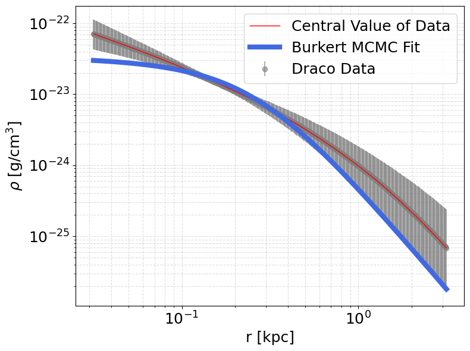
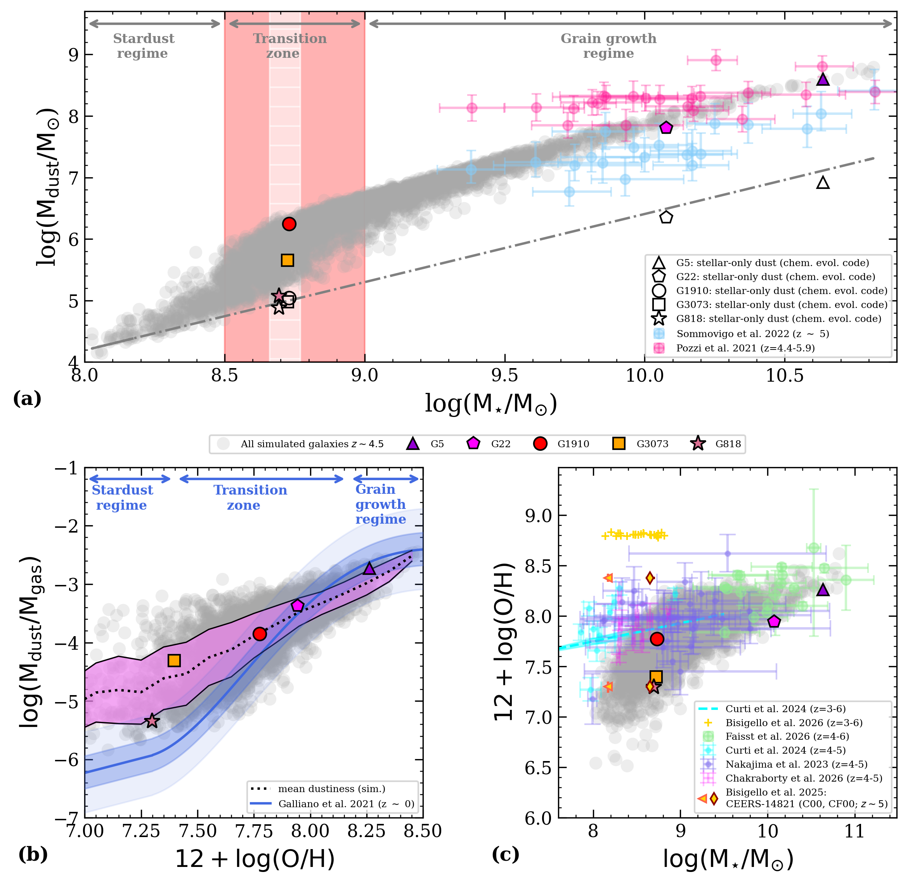

# arXiv Digest — 2026-11-02

- **Interest file used:** interests/2026.10.md (fallback — no 2026.11.md exists yet)
- **Categories pulled:** astro-ph.CO, astro-ph.EP, astro-ph.GA, astro-ph.HE, astro-ph.IM, astro-ph.SR, cs.LG, stat.ML, physics.data-an, hep-ph
- **Papers scanned:** 333 (91 astro-ph + 242 from extras: cs.LG, stat.ML, physics.data-an, hep-ph)
- **After first filter:** 17 candidates reviewed with full text
- **Final selected:** 16 papers across 4 tiers

---

## Tier 1 — Highly relevant

### [MAGIKS: Multimodal Alignment and Gravitational-Wave-Conditioned Interaction for Kilonova Search](http://arxiv.org/abs/2610.41119v1)

Bingzhou Gao, Weichangfeng Guo, Jingqi Zhang et al.
**Primary category:** astro-ph.HE | also: astro-ph.IM

MAGIKS reframes kilonova counterpart identification as **query-conditioned gallery retrieval**, combining GW parameters and sky maps with optical light curves via a **time-aware supervised contrastive objective** and dual cross-attention. On simulated BNS/NSBH mergers with realistic contaminants it ranks the true counterpart first for **39.8% of queries at gallery size 5000**, versus 4.8%/0.2% for optical-only/localization-only baselines. On a GW170817-like counterfactual it reaches **87.3%/95.7% top-1/top-10 retrieval**, with its matching score responding coherently to all five tested GW parameters.

*Recall@1, Recall@10, and MRR versus gallery size for MAGIKS and baselines, showing MAGIKS's growing advantage as the candidate pool scales up.*

---

### [FOMO-Z. Optimal galaxy classification, photometric redshifts, and reconstruction of population distributions](http://arxiv.org/abs/2610.40875v1)

G. F. Lesci
**Primary category:** astro-ph.CO | also: astro-ph.GA

FOMO-Z is a fully **interpretable, assumption-free statistical framework** for galaxy classification and photo-z inference, calibrating selections directly from reference-sample colors with no functional form imposed. Tested against four published background-selection recipes on COSMOS20, it **matches or beats their completeness at fixed purity**, and its redshift-distribution reconstructions track SOM-based KiDS-Legacy results closely. The author positions it as a **computationally cheap, physically transparent alternative to black-box ML** classifiers for Stage IV survey analyses.

*FOMO-Z (red crosses) versus four literature background-selection recipes (black dots) in completeness on COSMOS20, at matched purity.*

---

### [Dark Halos, Intermediate-Mass BH and Nuclear Stellar Clusters in Dwarf Spheroidals](http://arxiv.org/abs/2610.41522v1)

Rojin Bayati, Paolo Salucci
**Primary category:** astro-ph.GA

Using newly inferred halo densities for **three dwarf spheroidals (Draco, Sextans, Ursa Minor)**, the authors confront the **core-cusp problem** directly: the cuspy NFW profile strongly disagrees with the data, while the **cored Burkert profile fits all three well**, with ρ₀ and r₀ scaling with the stellar length scale much as in disk galaxies. Searching the innermost regions, they find **no evidence for a central intermediate-mass black hole or nuclear stellar cluster** in any of the three.

*Draco's dark matter density profile (points) with its best-fit Burkert model (curve), representative of the good fits found for all three dwarfs, in contrast to the disfavored cuspy NFW form.*

---

### [The assembly of dusty galaxies at z≥4: grain growth and the evolutionary origin of the dust-to-stellar-mass scatter](http://arxiv.org/abs/2610.40790v1)

Alessia D'Angelo, Raffaella Schneider, Luca Graziani et al.
**Primary category:** astro-ph.GA

Combining the **dustyGadget** cosmological simulation, a semi-analytical stellar-dust model, and **SKIRT radiative-transfer post-processing**, the authors trace dust-mass scatter among three simulated **z~5 low-mass galaxies (log M*/M⊙~8.7)** with near-identical stellar mass but dust masses spanning **log(Mdust/M⊙)~5.1-6.2**. Stellar dust production alone reproduces only the low-dust branch; **grain growth in a denser, more enriched ISM** is needed to recover the full relation and its scatter. Mock JWST imaging shows the resulting structural diversity is recoverable, but dust continuum stays below current ALMA sensitivity — a concrete prediction for upcoming deep imaging of dwarf-mass high-z galaxies.

*Simulated dust-to-stellar-mass relation showing stellar-dust-dominated, transition, and grain-growth regimes, with the three target galaxies highlighted against ALPINE z~5 data.*

---

### [SEAMLESS Survey: A Closer Look at Seven Local Volume Dwarf Galaxies in Diverse Environments](http://arxiv.org/abs/2610.40765v1)

Burçin Mutlu-Pakdil, Michael G. Jones, David J. Sand et al.
**Primary category:** astro-ph.GA

New **HST imaging resolves individual stars** in seven Local Volume dwarf galaxies (including two new discoveries, M83-dw14 and Centaurus C), yielding **TRGB distances (3.6–6.5 Mpc)**, structural parameters, and star formation histories, plus VLA/GBT HI data. Cen C, among the faintest known isolated dwarfs (M_V=−7.96), matches Leo T in size/luminosity but shows **no detected HI and no recent star formation**, while Ursa Major C's offset HI suggests feedback-driven gas displacement. The sample's broad range of SFHs and quenching states doesn't track simply with environment, pointing to **inhomogeneous reionization, stochastic assembly, and internal feedback** as co-drivers.

---

### [Agentic Systems for Calibrating Cosmological Simulations](http://arxiv.org/abs/2610.40685v1)

Chaipat Tirapongprasert, Matthew Ho
**Primary category:** astro-ph.IM | also: cs.CL

AgenticTuner replaces the optimizer in cosmological simulation calibration with an **LLM acting as the optimizer itself**, proposing each parameter trial while consuming informal, human-readable priors that Bayesian optimization can't use. It reaches **competitive calibration accuracy at a fraction of the CPU cost**, typically adjusting only **2–5 of twelve parameters**, revealing that a small effective parameter set governs the power spectrum. The authors frame this as an early step toward **AI scientists carrying out long-horizon scientific tasks**.

*Per-trial parameter-recovery error across two converged runs, showing the small subset of parameters the agent chose to tune.*

---

### [OASIS I: Spectroscopy of Mini-Quenched and Lulling Galaxies Constrains the Quiet Side of Bursty Star Formation at z>4](http://arxiv.org/abs/2610.41489v1)

Tobias J. Looser, Francesco D'Eugenio, William M. Baker et al.
**Primary category:** astro-ph.GA

Deep 28-hour JWST/NIRSpec PRISM spectroscopy deliberately targets the **quiet side of the bursty star-formation cycle** at z>4, identifying **three mini-quenched and five lulling low-mass galaxies (log M*/M⊙=8.3–8.9)**. Photometry alone is unreliable here — seven of ten photometric candidates turned out to be near/above the main sequence — and the true suppressed fraction (**~29% at z=4–5.5, log M*=8–9.5**) is an order of magnitude above simulation predictions. These phases are long-lived (light-weighted ages **>100 Myr**), making suppressed star formation a common, lasting part of early low-mass galaxy growth.

---

### [Learning Galaxy Kinematics from Spatially Unresolved Spectra](http://arxiv.org/abs/2610.40789v1)

Preston G. Waldrop, Dimitrios Psaltis, Feryal Özel et al.
**Primary category:** astro-ph.GA

A **neural network trained on spatially resolved spectra** learns how galaxy kinematics imprint on integrated line profiles, then infers kinematic parameters from **spatially unresolved (point-source) spectra** — bypassing the need for spatial resolution entirely. It recovers the spin parameter λ_R with **strong fidelity that doesn't degrade at low λ_R**. Because it needs no first-principles spatial-to-spectral mapping, the method opens up kinematic measurement for **millions of unresolved galaxies**, relevant to flagging candidate supermassive black hole binary hosts.

*Predicted versus ground-truth λ_R; predictions track the 1:1 line closely across the full range, including at small λ_R.*

---

## Tier 2 — Adjacent / useful context

### [The Dynamical Mass Profiles of Galaxy Groups - Application to IllustrisTNG-300](http://arxiv.org/abs/2610.41796v1)

Alfie Russell, Rita Tojeiro, Anne-Marie Weijmans
**Primary category:** astro-ph.CO

Using the dwarf-spheroidal workhorse code **Gravsphere** and the Jeans equation, the authors test a rescaling-and-stacking method for recovering dynamical mass profiles of **galaxy groups** in IllustrisTNG-300. Selecting dark-matter substructure by **infall time (>4.3 Gyr ago)** recovers the true profile unbiased out to ~2.5 virial radii; for satellites, selecting **quenched galaxies** works best. All subhalo samples show a **velocity-anisotropy bias** beyond the virial radius — a systematic to quantify before applying the method to real surveys like DESI BGS.

---

### [NGDEEP: Anchoring the Star-Forming Main Sequence at Low Stellar Masses with Ultradeep JWST/NIRISS WFSS](http://arxiv.org/abs/2610.40796v1)

Claire Bolda, Casey Papovich, Lu Shen et al.
**Primary category:** astro-ph.GA

Ultradeep JWST/NIRISS slitless spectroscopy measures Hα/Hβ-based SFRs for **284 low-mass galaxies (log M*/M⊙≳7–8) at 0.5<z<3.5**. The **Hα-based main-sequence scatter (0.35–0.5 dex)** runs higher than the UV-based scatter at z<2.5, attributed to **brief (≲10 Myr) bursts**. FIRE simulations underestimate this scatter by up to **0.25 dex**, suggesting low-mass galaxies are burstier than current simulations capture.

---

### [The multiple origins of spurs in stellar streams: a challenge for dark matter diagnostics](http://arxiv.org/abs/2610.41842v1)

Claire Guillaume, Alicia Rivero, Titouan Le Guillois et al.
**Primary category:** astro-ph.GA

N-body simulations show stream **"spurs"** — long read as dark matter subhalo signatures — form just as readily from a **galactic bar (25% of streams) or galaxy merger (50%)** as from dark matter subhalos (28%), with **indistinguishable morphologies** across mechanisms. This degeneracy undercuts using spurs alone as a **small-halo-counting** dark matter diagnostic unless baryonic perturbers are ruled out. The authors propose a statistical, population-level approach combining morphology and kinematics as a more robust path.

---

### [OASIS II: The Ionized Gas Traces Feedback-Driven Declines into the Quiet Side of Bursty Star Formation at z>4](http://arxiv.org/abs/2610.41490v1)

Tobias J. Looser, Francesco D'Eugenio, William M. Baker et al.
**Primary category:** astro-ph.GA

Following OASIS I, this paper tracks how 54 z>4 galaxies enter suppressed star formation. Lulling galaxies formed **less than a tenth of their mass in the last 100 Myr**, with declines beginning **tens to ~100 Myr before observation** — longer than most simulations predict — while recovery is much faster. Ionization state falls from main-sequence to lulling galaxies at fixed mass, favoring **feedback that expels or starves gas** over passive gas exhaustion.

---

### [OASIS III: Bursty star formation drives observed galaxy sizes at z≥4](http://arxiv.org/abs/2610.41491v1)

William M. Baker, Tobias J. Looser, Francesco D'Eugenio et al.
**Primary category:** astro-ph.GA | also: astro-ph.CO

Using NIRSpec/PRISM spectroscopy and ForcePho sizes for 51 OASIS galaxies, the authors find a clear **anti-correlation between burstiness and half-light size**, independent of mass or redshift. They interpret this as **centrally concentrated starbursts shrinking measured radii**, so burstiness itself regulates observed galaxy sizes — a mechanism that, if active at z>10, could explain the **size bimodality** seen among UV-luminous high-z galaxies.

---

### [Optimizing Prompt Radio Counterpart Searches for Gravitational-Wave Events with the Deep Synoptic Array](http://arxiv.org/abs/2610.40958v1)

Nikita Kosogorov, Max Melching, Gregg Hallinan et al.
**Primary category:** astro-ph.HE | also: astro-ph.IM

The authors build a GW follow-up simulator for the upcoming **Deep Synoptic Array** and train a **reinforcement-learning (PPO) pointing policy** against a peak-tracking baseline. The two perform comparably overall, but the **RL policy wins on broad, multimodal localizations** where peak-tracking's field of view misses most of the probability. Validated on real DSA prototype antennas, the system projects **~20 mJy ms** fluence sensitivity for neutron-star-merger radio counterparts.

---

## Tier 3 — Outside my area but notable

### [Hints of self-interacting dark matter from strong gravitational lensing](http://arxiv.org/abs/2610.40766v1)

Daniel Gilman, Kalliopi Petraki, Thomas Pignard et al.
**Primary category:** astro-ph.CO | also: hep-ph

An analysis of **29 quadruply-imaged quasars** finds halo densities consistent with **gravothermal core collapse**, a hallmark SIDM prediction rather than collisionless CDM. Interpreted via **elastic Yukawa scattering**, favored models have **dark matter masses of 20–80 GeV** and cross-sections of **10²–10⁴ cm²/g at 10 km/s**. The authors further motivate a **neutrinophilic scalar dilepton mediator**, tying the lensing evidence to a specific dark-sector particle candidate.

---

## Tier 4 — Meta-research about the field

### [Demographics and growth of the astronomy and astrophysics community](http://arxiv.org/abs/2610.41535v1)

Jürgen Knödlseder
**Primary category:** astro-ph.IM

Mining 200 years of **ADS** records, this study estimates roughly **100,000 astronomers active in 2025**, dominated by early-career researchers. The community has grown **exponentially at 4.3%/year over 50 years**, accelerating to **5.1%/year** over the last decade, driven by China (13%/year) and India (10%/year). If trends hold, **China and India will host the largest national astronomy communities by 2029 and 2043**.
