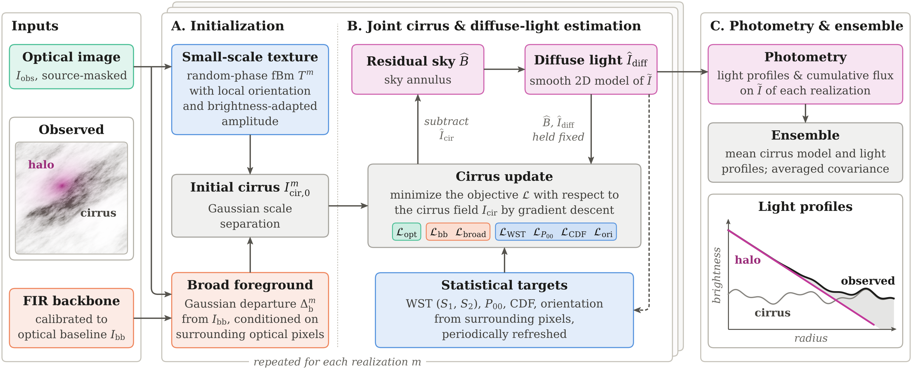
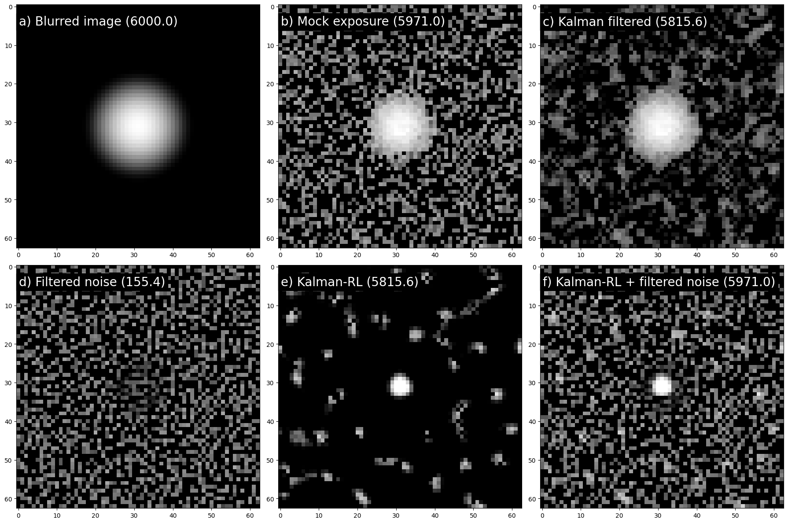
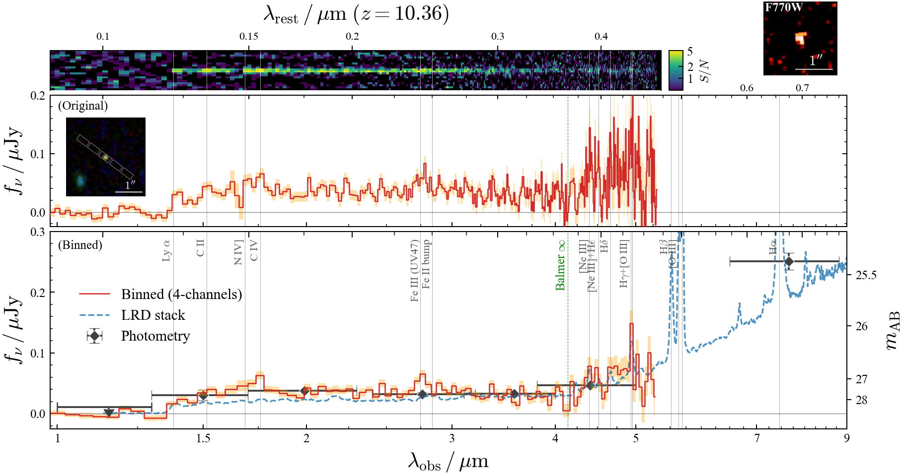

# arXiv Digest — 2026-11-03

- **Interest file used:** interests/2026.10.md (fallback — no 2026.11.md exists yet)
- **Categories pulled:** astro-ph.CO, astro-ph.EP, astro-ph.GA, astro-ph.HE, astro-ph.IM, astro-ph.SR, cs.LG, stat.ML, physics.data-an, hep-ph
- **Papers scanned:** 794 (150 astro-ph new/cross + 644 from extras)
- **After first filter:** 35 candidates reviewed with full text
- **Final selected:** 20 papers across 4 tiers

---

## Tier 1 — Highly relevant

### [Physically Motivated Stellar Populations for Galaxies at Cosmic Dawn with a Temperature-Dependent IMF](http://arxiv.org/abs/2611.01595v1)

Gibson B. Bowling, Charles L. Steinhardt, Lachlan J. Hobart et al.
**Primary category:** astro-ph.GA | also: astro-ph.CO

The authors build **SSPT**, a new simple-stellar-population library computed with a **temperature-dependent stellar IMF** (hotter gas yields a top-heavier IMF), released as a public CIGALE module, and fit it to 58 spectroscopically confirmed JWST/JADES galaxies at z>8. Using gas temperatures of 45–60 K appropriate for cosmic dawn, the models infer stellar masses **0.3–0.5 dex lower** than standard local-calibrated fits and up to **~2 dex lower** (median 1.26 dex) than literature estimates for the controversial Labbé et al. "impossibly massive" z~8–9 candidates. This resolves the apparent tension between those galaxies' stellar masses and ΛCDM halo baryon budgets without invoking non-standard cosmology.

*Cumulative stellar mass density vs. stellar mass for Labbé et al.'s z~7–10 candidates: standard-IMF masses push several objects into the region requiring more baryons than their halos could supply, while the new temperature-dependent-IMF masses move all points back into the physically allowed region.*

---

### [The Stellar-Mass Dependence of Feedback-Driven Outflows in DESI DR1 Star-Forming Galaxies](http://arxiv.org/abs/2611.02580v1)

Yimeng Tang, Yifei Luo, Conghao Zhou
**Primary category:** astro-ph.GA | also: astro-ph.CO

Combining DESI DR1 spectroscopy with COSMOS2020 photometry for **~1200 star-forming galaxies** spanning 7.9 < log(M*/M☉) < 11.5, the authors test whether the "breathing mode" signature of feedback-driven gas inflow/outflow cycles — predicted by FIRE-2 to drive dark-matter core formation in dwarfs — persists to higher masses. They confirm a **positive correlation between mass-normalized gas velocity dispersion and recent star-formation rate below log(M*/M☉) ≈ 9.8**, consistent with prior dwarf-only observations, but find the correlation **weakens rapidly and becomes consistent with zero above that mass**. This is the first empirical measurement of the characteristic stellar mass at which feedback stops dominating galaxy-scale gas kinematics, giving a direct observational benchmark for core-cusp feedback models.

*Best-fit velocity-dispersion–sSFR slope versus stellar mass: the slope stays roughly constant and positive below log(M*/M☉)~9.8, then declines through zero above it — the paper's central result.*

---

### [An Unusually Clumpy Ultra-Diffuse Galaxy in the Coma Cluster: A Missing Link for Globular Cluster Formation?](http://arxiv.org/abs/2611.01653v1)

Yimeng Tang, Aaron J. Romanowsky, Nobuhiro Okabe et al.
**Primary category:** astro-ph.GA

Using Keck/KCWI integral-field spectroscopy and Subaru/HSC imaging, the authors characterize **Coma-B122**, an ultra-diffuse galaxy hosting **~10 star-forming clumps** (each ~10⁶ M☉, comparable to massive super star clusters) that together contribute roughly a quarter of its luminosity in a ring ~2 kpc from center. Full-spectrum fitting shows that **~12.5% of the diffuse body's stellar mass formed in the last ~300 Myr**, synchronized with clump formation, while asymmetric HI and truncated/extended diffuse light point to **ram-pressure stripping during cluster infall** as the likely trigger. The authors argue B122 may be a present-day analog for how globular-cluster-rich UDGs assemble their GC systems, though whether the clumps themselves survive as GCs remains uncertain.

*Subaru/HSC color image of Coma-B122 showing the bright star-forming clumps embedded in the diffuse body, with the Keck/KCWI field of view and the direction toward the Coma cluster center marked.*

---

### [Statistical Modeling of Foreground Galactic Cirrus for Diffuse Halo Light Measurement](http://arxiv.org/abs/2611.03172v1)

Qing Liu, Henk Hoekstra, Amaël Ellien
**Primary category:** astro-ph.GA | also: astro-ph.IM

The authors present a statistical method that reconstructs the 2D structure of **foreground Galactic cirrus** — a major systematic for ultra-low-surface-brightness measurements — by combining far-infrared dust maps with multiscale structure from the optical image itself, iteratively refining the cirrus, diffuse galaxy light, and sky together. Injection-recovery tests on *Euclid* VIS imaging of Abell 2390 show the cumulative-flux bias from cirrus contamination **drops from 21% to 1%** after correction (RMS scatter from 24% to 1%). Applied to Abell 2390's brightest cluster galaxy, the correction reveals a smoother BCG-plus-intracluster-light profile with a steeper outer slope, demonstrating the method's value for stellar-halo, UDG, and ICL photometry in upcoming deep surveys.

*The cirrus/diffuse-light modeling workflow: the cirrus is initialized from far-infrared data and source-masked optical pixels, then jointly optimized with the residual sky and the diffuse-light model, with photometry averaged over many realizations.*

---

### [Modeling CO Line Luminosity with FIRE simulations: II. Comparison With Observations, CO Luminosity Functions and Redshift Evolution](http://arxiv.org/abs/2611.00368v1)

Doğa Tolgay, J. Richard Bond, Norman W. Murray et al.
**Primary category:** astro-ph.GA

Using FIRE-2 cosmological simulations post-processed with SKIRT radiative transfer and CLOUDY line emission, the authors predict CO(1-0)/CO(2-1) luminosities for hundreds of galaxies at z=0–3, spanning massive star-forming systems down to **low-metallicity dwarfs**. The simulations reproduce the observed CO–SFR relation and a **superlinear CO–metallicity power-law slope** at z=0, and predict that at fixed SFR, **CO(1-0) luminosity drops by roughly an order of magnitude per unit increase in redshift** — a decline traced to falling metallicity rather than redshift itself. At fixed stellar mass, predicted luminosities show no redshift dependence, giving a physically grounded prediction for the faint, low-mass population current CO intensity-mapping surveys cannot yet directly detect.

---

### [foraois: Fast, Flexible Extended Press-Schechter Merger Trees with a General First-Crossing Solver](http://arxiv.org/abs/2611.01580v1)

C. Power, S. Balu
**Primary category:** astro-ph.CO

foraois is an open-source Python framework that separates the linear power spectrum, the collapse barrier, and the merger-tree algorithm when generating Monte Carlo dark-matter halo histories, implementing both the PCH08 branching prescription and a general **Zhang–Hui first-crossing solver** supporting **CDM, warm, and fuzzy dark matter**. Coupled to the Ashvini semi-analytic galaxy-formation model, it computes an illustrative z=0 stellar-to-halo mass relation showing that **WDM and FDM suppress dwarf-scale stellar mass relative to CDM by up to an order of magnitude at halo masses of 10⁹–10¹⁰ M☉** — a direct, if illustrative, prediction for how non-standard dark matter shows up at dwarf-galaxy scales. The authors validate the solver against analytic references and note the WDM/FDM collapse barrier is not yet calibrated, so the suppression should be read as a qualitative forecast rather than a precision one.

*Median z=0 stellar mass vs. halo mass from Ashvini runs on foraois-generated merger trees for CDM, 3 keV WDM, and 10⁻²² eV FDM: WDM/FDM suppress dwarf-galaxy-scale stellar mass by up to an order of magnitude relative to CDM.*

---

### [A JWST/NIRSpec Catalog of Low-Mass Candidates toward NGC 2024 from Multi-component Spectral Modeling](http://arxiv.org/abs/2611.00970v1)

Haomiao Huang, Shu Wang, Xiaodian Chen et al.
**Primary category:** astro-ph.SR

The authors fit JWST/NIRSpec PRISM spectra of 78 sources toward the obscured, crowded star-forming region **NGC 2024** with a multi-component spectral-modeling framework that combines atmospheric models with dust and ice opacities to disentangle photospheric light from circumstellar and foreground extinction. Most spectra favor extra **large-grain H₂O-ice opacity** over a baseline small-grain dust model; combined with evolutionary-model mass estimates, this yields **46 candidate low-mass/substellar members**, 27 background sources, and 5 uncertain cases, with members showing systematically lower surface gravities than the background population. Notably, **23 of the 46 candidates lie above the youngest available pre-main-sequence isochrones**, which the authors attribute to the cluster's extreme youth and to systematics in the evolutionary tracks themselves — directly relevant to isochrone-based stellar population modeling.

*Effective temperature vs. bolometric luminosity for the 78 fitted sources, with pre-main-sequence isochrones (0.5–10 Myr) overplotted — candidate members separate from background stars and several lie above the youngest isochrones.*

---

### [Contrastive Astromer: Two-Stage Contrastive Representation Learning for Astronomical Light Curve Classification](http://arxiv.org/abs/2611.00150v1)

Justin Minggan Wei, Pavlos Protopapas, Guillermo Cabrera-Vives
**Primary category:** astro-ph.IM | also: cs.CV

The authors adapt the pretrained ASTROMER 2 light-curve transformer with a **two-stage contrastive learning** scheme — unsupervised on unlabeled MACHO curves, then supervised on labeled Alcock curves — without altering the encoder architecture. On a held-out set of 600 variable stars, the resulting frozen representations reach **macro-F1 = 0.7943** with 500 labeled examples per class, beating a reproduced finetune-and-classify baseline by **5.1 percentage points**, with the largest relative gains at the smallest label budgets. Embedding-space diagnostics show the supervised stage measurably tightens class clusters and improves class separation beyond the unsupervised stage alone.

*The two-stage pipeline: augmented light-curve views pass through the shared encoder to produce a representation that is first trained contrastively on unlabeled data, then refined with supervised contrastive learning on labeled data.*

---

### [Recovering Missing Degrees of Freedom in Simulation-Trained Field-Level Generative Models](http://arxiv.org/abs/2611.02627v1)

Masato Shirasaki, Shiro Ikeda
**Primary category:** astro-ph.CO | also: cs.LG

The authors show that **variance shrinkage** in simulation-trained generative models — continuous normalizing flows used for cosmological field-level inference — diagnoses missing effective degrees of freedom, and introduce **physics-informed latent corrections** to the flow's generative dynamics that recover a substantial fraction of the lost realization-to-realization variability without any additional training simulations. In a weak-lensing field-level inference test, the dominant recovered latent mode behaves as an **effective growth-amplitude nuisance parameter** that is actively exploited during posterior inference, shifting in opposite directions for hydrodynamic vs. source-redshift distribution shifts. The latent-enhanced model shows measurably **improved robustness to out-of-distribution shifts** relative to the baseline flow, offering a general strategy for diagnosing and correcting missing physics in simulation-based inference.

*(a) The latent-enhanced flow recovers most of the variance lost by the baseline flow; (b) the dominant latent mode shifts oppositely for hydrodynamic vs. source-redshift distribution shifts, showing it is actively used during inference.*

---

### [Anomaly-ranked confirmation slows new-class learning](http://arxiv.org/abs/2611.03250v1)

Argyro Sasli, Michael Coughlin
**Primary category:** astro-ph.IM | also: cs.LG

Testing five benchmarks spanning astronomy (Gravity Spy gravitational-wave glitches), medicine, and computer vision, the authors show that **the examples an anomaly detector ranks highest are not the best examples for teaching a classifier the new class** — confirming the top-ranked members gives lower recognition than confirming the same number of random members in three of the five systems (e.g., Gravity Spy recognition after 10 confirmations drops by **Δ = −0.17**). Handing subsequent example-selection to the newly promoted classifier recovers **63–72% of this gap** in two systems, and swapping nearby known classes for distant ones cuts the median confirmations needed for 80% recognition **from 4.3 to 1.6**. This separates "what reveals a new class" from "what teaches its extent" — directly relevant to how time-domain surveys should prioritize spectroscopic follow-up of anomalous transients.

*Recognition after n confirmations under random, highest-anomaly-ranked, and lowest-ranked selection: detector-selected confirmations consistently underperform random selection across all three tested systems.*

---

### [The Agentic Observer Hackathon: Autonomous Decision-making in Simulated Astronomical Surveys](http://arxiv.org/abs/2611.01988v1)

Haosong Wang, Ting Tan, Yao Li et al.
**Primary category:** astro-ph.IM

The authors present the **Agentic Observer Hackathon**, a community challenge in which autonomous decision systems manage a simulated multi-object astronomical survey — choosing pointings, assigning targets, and setting exposures while responding to instrument faults and shifting priorities. **102 teams** submitted systems; the leading entries **combine numerical exposure-planning optimizers with language models** that interpret operational logs and support longer-horizon decisions, outperforming two baseline strategies by a wide margin on held-out evaluation campaigns. The released simulator, reference strategies, and scoring framework give the field a reusable testbed for comparing autonomous survey-operations agents.

*The three highest-ranked systems mapped onto four decision steps, colored by whether a language model, a team-trained model, or rule-based optimization does the work at each step — illustrating the diversity of winning architectures.*

---

### [Forecasting the Ambient Solar Wind With a Physics-Informed Learned Inner Boundary: Part I-Differentiable Inverse Reconstruction From Solar Images](http://arxiv.org/abs/2611.01310v1)

Enrico Camporeale, Andong Hu, Prateek Mayank et al.
**Primary category:** physics.space-ph | also: astro-ph.SR

The authors pose the unobserved solar-wind speed at the inner heliospheric boundary as an inverse problem, training a neural network on solar images while **differentiating through a reduced heliospheric transport solver** that propagates the boundary speed out to near-Earth measurements. The reconstruction achieves **ROC AUC = 0.879** for identifying wind above 600 km/s, beating 27-day recurrence (0.802) and linear regression (0.850), with most of the skill traced not to network flexibility but to **correctly modeling the speed-dependent travel time**. The authors report that **~57% of the hourly wind-speed variance remains unexplained** by any model class tested, concluding — notably self-critically — that further progress needs new observational inputs rather than more complex models.

*The inverse-reconstruction pipeline: a shared network maps solar-image features to the inner-boundary wind speed, which a differentiable solver propagates to Earth, with the loss gradient flowing back through the solver into the network weights.*

---

## Tier 2 — Adjacent / useful context

### [Stellar wind variability in OB stars and its effect on mass-loss determinations](http://arxiv.org/abs/2611.03363v1)

Raman K. Prinja
**Primary category:** astro-ph.SR | also: astro-ph.GA

This review surveys UV spectroscopic evidence that **OB-star winds are pervasively structured**, not the smooth, spherical outflows assumed by classical radiative-driving theory. Discrete absorption components, narrow absorption components, and wind-modulated X-ray variability point to **large-scale, photosphere-rooted structures** that can bias mass-loss-rate determinations from P-Cygni-profile fitting by up to an order of magnitude depending on assumed wind clumping. The review highlights millimeter/radio continuum observations as the most promising path to constraining the **radial stratification of wind clumping**, which is essential for the reliable empirical mass-loss rates that feed stellar evolution and population-synthesis models built on hot, young stars.

---

### [See you again: an 80° NGC 5466 stellar stream and its constraints on the Galactic dark halo mass](http://arxiv.org/abs/2611.02653v1)

Di Bai, Yong Yang, Jing-Kun Zhao et al.
**Primary category:** astro-ph.GA

Combining Gaia DR3 with DESI Legacy Imaging and Pan-STARRS photometry, the authors trace the tidal stream of globular cluster **NGC 5466 across 80° on the sky**, finding a leading-tail deviation consistent with LMC-induced perturbation. Fitting 308 high-confidence member stars against orbit models, they constrain the Milky Way's dark-matter halo **flattening (q = 1.08 ± 0.07)** and its **enclosed mass within 50 kpc (4.59 M_sun, +0.48/-0.37 ×10¹¹)**, along with an LMC mass of roughly 9.6×10¹⁰ M☉ — halo-mass constraints that feed directly into predictions for the Milky Way's dwarf-satellite population.

*Weighted stellar density map around NGC 5466 revealing the full 80° extent of the tidal stream, built from a modified matched-filter search of Gaia/DESI/Pan-STARRS photometry.*

---

### [Aperture Photometric Accuracy of Point-spread-function-deconvolved Astronomical Images](http://arxiv.org/abs/2611.01670v1)

Shen Zhang, Lei Wang, Yachong Diao et al.
**Primary category:** astro-ph.IM

The authors develop **FiDNoBa**, which applies a low-pass pre-filter (best: a **Kalman filter**) before Richardson–Lucy deconvolution and backfills both the filtered-out noise and discarded negative pixels to enforce flux conservation. Across isolated point sources, blended Sérsic galaxies, and a crowded stellar field, **Kalman-filtered RL with negative-backfilling** gives the lowest relative flux deviation in nearly every test — roughly **0.05–0.85% for point sources and ~5% in the crowded field** — recovering 58 sources versus 36 for traditional PSF-fitting photometry there. Applied to JWST/NIRCam and VST/OmegaCAM data, it gives robust photometry for faint and crowded sources, positioning the method as a more generally reliable alternative to plain RL deconvolution.

*Step-by-step demonstration of the FiDNoBa pipeline (Kalman-filtered RL deconvolution plus noise backfilling), with each panel's total flux labeled, showing how backfilling recovers flux that plain RL biases away.*

---

### [Reimagining computational quantum research with AI scientists](http://arxiv.org/abs/2611.02833v1)

Yuxuan Du, Hanqing Zhao, Xinbiao Wang et al.
**Primary category:** quant-ph | also: cs.AI

The authors build **OmniQ**, an expert-audited benchmark converting 60 published computational-quantum-science papers into executable reproduction tasks, and evaluate 5 LLM-powered AI-scientist systems plus 6 agent harnesses on reproducing each paper's reported result. They find current AI scientists **frequently fail to reproduce published results**, and that **18 of the 60 papers contain genuine inconsistencies** between text, code, and figures that even expert review cannot fully resolve. Building on this, they develop **Residual Agents**, a self-improving agent that distills expert-verified workflow repairs into reusable experience, **raising one model's success rate from 68% to 85%** while matching a far more expensive frontier-model agent at roughly a third of the inference cost.

*Reproduction success rate plotted against inference cost per task for each AI-scientist system; the Residual Agents approach sits on the Pareto frontier, achieving high success at much lower cost than comparably capable systems.*

---

### [FiDeR: Denoising Astronomical Images at the Observational Resolution](http://arxiv.org/abs/2611.01657v1)

Lei Wang, Bin Li, Lin Nie et al.
**Primary category:** astro-ph.IM

FiDeR denoises astronomical images while preserving the observational PSF by running finite **Richardson–Lucy iterations** on the source-plus-background image, then deriving a reconvolution kernel from the measured response of a calibration point source at a matched background-to-source flux ratio. Tested against six standard denoisers on simulated stellar and mixed stellar–galaxy fields, it reaches **peak SNRs of 46.7 and 44.9 dB** at backgrounds of 10 and 20 counts/pixel with sub-percent aperture-flux errors, though BM3D achieves higher structural similarity. On JWST NIRCam data it cuts core and combined-region RMSE by roughly **53% and 38%** relative to BM3D, with the authors noting PSF preservation is only approximate for faint sources and residual noise correlations must be propagated into downstream uncertainty estimates.

---

## Tier 3 — Outside my area but notable

### [EMBER: A Little Red Dot Candidate at $z_{\rm spec}=10.36$ in the Seed Black Hole Era](http://arxiv.org/abs/2611.00195v1)

Takumi S. Tanaka, Hollis B. Akins, John D. Silverman et al.
**Primary category:** astro-ph.GA

Using NIRSpec/PRISM spectroscopy from the JWST EMBER program, the authors spectroscopically confirm a little red dot (LRD) candidate at **z_spec = 10.361**, the highest-redshift LRD with a measured spectroscopic redshift to date, corresponding to a cosmic age under 500 Myr. The redshift rests on a clear Lyman-α break plus several tentative emission-line features reinforced by a spectral-stacking test, and the source shows the characteristic **V-shaped continuum with a turnover near the Balmer limit** consistent with — though not uniquely diagnostic of — an actively accreting black hole in its earliest seed-growth phase. Without a confirmed broad Balmer line, the authors treat the LRD interpretation as the most plausible but still provisional explanation, pending deeper MIRI follow-up.

*JWST/NIRSpec PRISM spectrum of the candidate, showing the Lyman-α break and the characteristic V-shaped continuum turnover, compared against a stack of 274 lower-redshift little red dots.*

---

### [A temporally clustered gravitational wave pair and a Type IIb supernova](http://arxiv.org/abs/2611.00440v1)

Sheng Yang, Ting-Wan Chen, Weichangfeng Guo et al.
**Primary category:** astro-ph.HE

An archival search for coincidences between public LIGO-Virgo gravitational-wave triggers and classified stripped-envelope supernovae turned up two marginal GW candidates, S190910d and S190910h, separated by just **7.1 hours**, whose 3D sky localizations and distances both overlap with the Type IIb supernova SN 2019rsq. Monte Carlo null tests put this coincidence at a **null probability of 7.6×10⁻⁵**, and independent re-analyses recover both as signal-like, with S190910d favoring a strongly asymmetric ~34+3 M☉ system and S190910h a low-mass ~2.5+1.3 M☉ binary. The authors propose a **fragmenting collapsar accretion disk** as a single framework that could produce both mergers hours apart during one stellar-collapse episode — if correct, the first evidence that multiple compact-object mergers can accompany a single core collapse rather than occurring eons later.

*Sky localizations of the two GW candidates (90% credible regions) overlapping at the position of SN 2019rsq, with their independent distance posteriors also consistent with a common distance matching the supernova's redshift.*

---

## Tier 4 — Meta-research about the field

### [Change the Funnel, Not Who May Submit: Engineering Peer Review for the Flood](http://arxiv.org/abs/2611.01076v1)

Mikhail L. Arbuzov, Lee Mosbacker, Sisong Bei
**Primary category:** cs.LG | also: cs.CY

Facing NeurIPS's **30,709 submissions in 2026** and roughly 184,000 expert review-hours, the authors build a decision-engineering simulation calibrated against two real NeurIPS double-review experiments to test proposed fixes. Submission limits (per-author caps, past-acceptance gating) are shown to save little reviewing load, barely improve placement accuracy, and fall disproportionately on new authors. Instead they propose a **staged funnel** — an AI gate screens unready papers, then author-contributed peers rank short AI-drafted summaries by sorting, with only the top ~30% receiving full reviews — which, simulated at scale, needs **a little over half of today's expert hours** while raising the acceptance rate of genuine top-decile papers from 74% to 95.5%.

*Where papers of each true-quality tier land under today's funnel versus the staged funnel: the staged design accepts far more genuine top-decile papers and promotes nearly all top-0.5% papers to spotlight/oral, versus today's funnel.*
