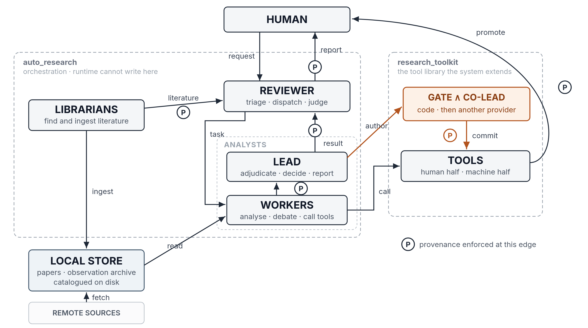
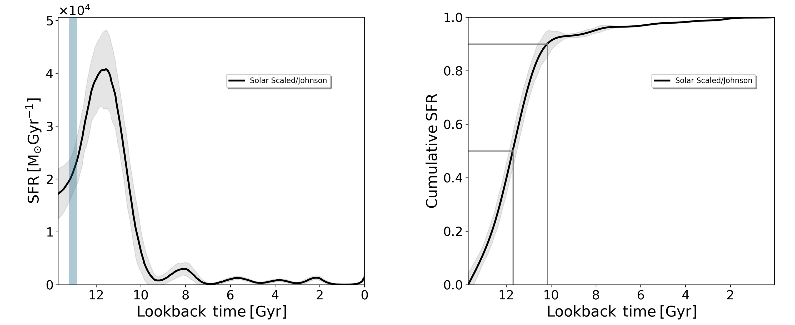
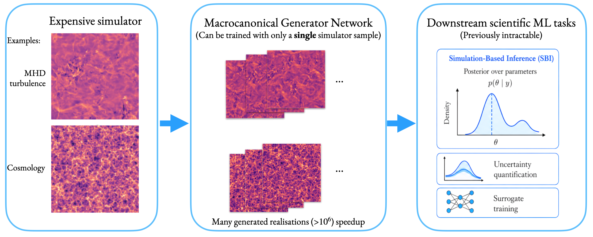
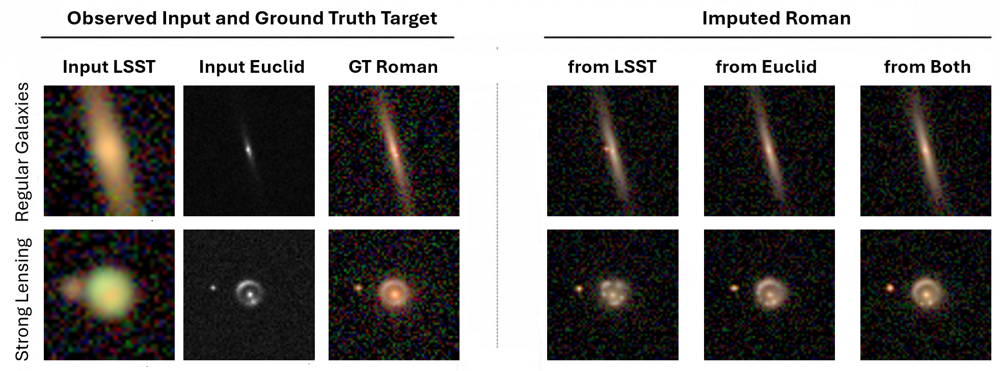
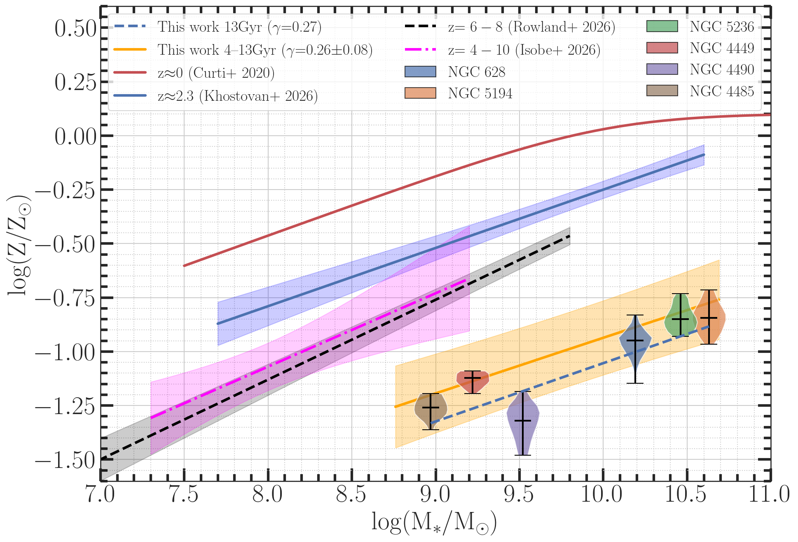
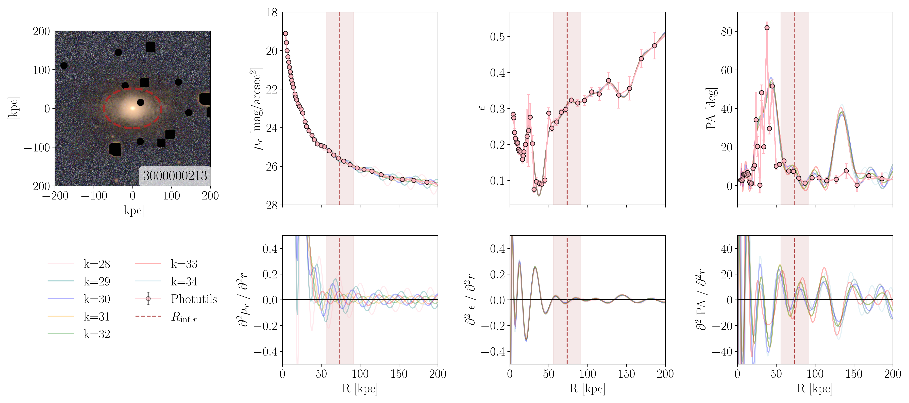
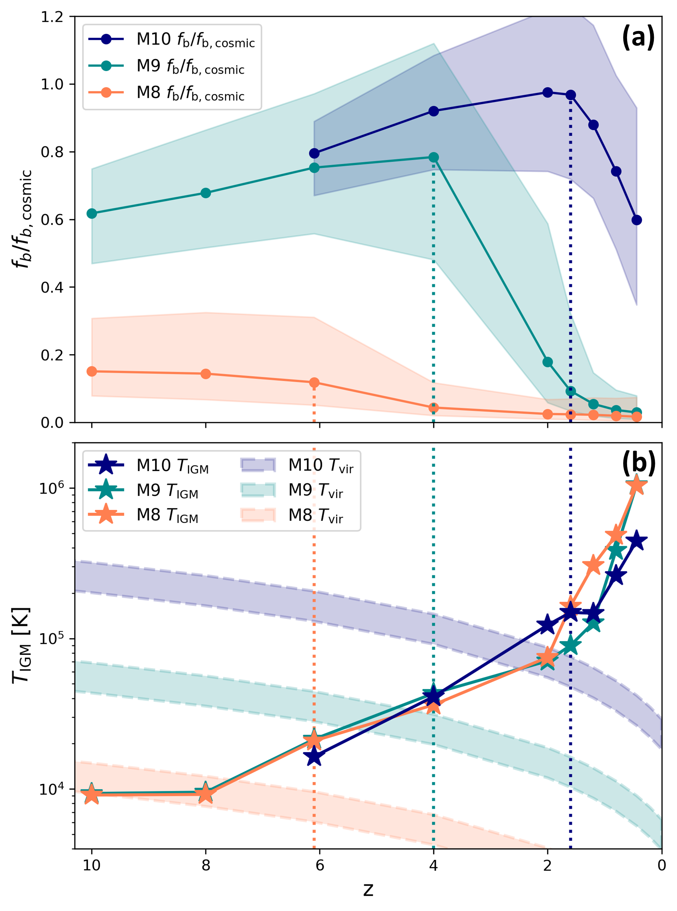
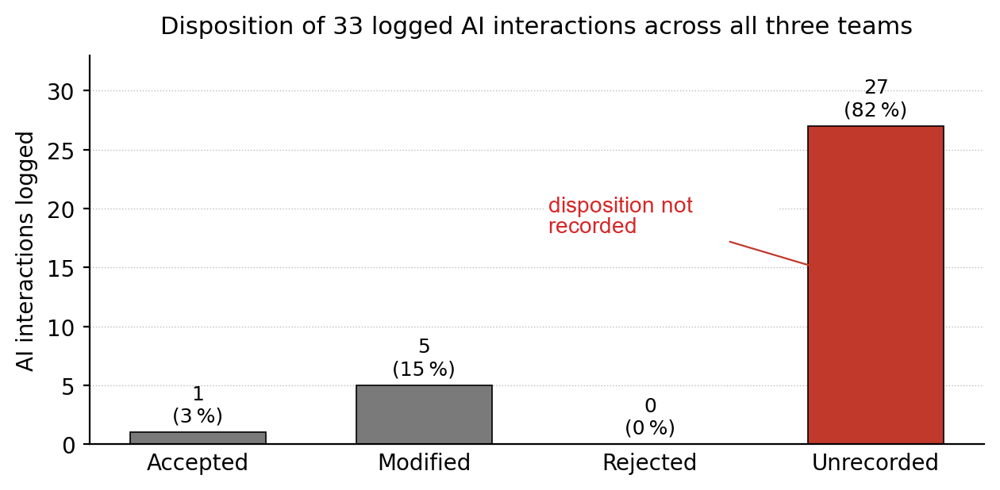

# arXiv Digest — 2026-11-04

- **Interest file used:** interests/2026.10.md (fallback — no 2026.11.md exists yet)
- **Categories pulled:** astro-ph.CO, astro-ph.EP, astro-ph.GA, astro-ph.HE, astro-ph.IM, astro-ph.SR, cs.LG, stat.ML, physics.data-an, hep-ph
- **Papers scanned:** 396 (89 astro-ph primary + 307 from extras)
- **After first filter:** 37 candidates reviewed with full text
- **Final selected:** 20 papers across 4 tiers

---

## Tier 1 — Highly relevant

### [A semi-autonomous multi-agent pipeline for high-energy astrophysics research with enforced provenance and verifiable self-extension](http://arxiv.org/abs/2611.05251v1)

Fang Zhou
**Primary category:** astro-ph.IM | also: astro-ph.HE

Presents **auto_research**, a multi-agent LLM pipeline for IXPE X-ray polarimetry analysis that is allowed to **write its own analysis tools**, subject to a two-stage check (an automatic gate plus cross-provider code review) before a human promotes a tool to the trusted toolkit. A provenance validator only accepts a reported number if it traces back to a recorded tool output, the original request, or a cited paper location. The pipeline **reproduced all 14 published Cyg X-1 polarization quantities within 3σ** and **caught 64 of 65 planted code defects**; with weaker backing models it still recovered 12/14 quantities and correctly flagged the rest as unmeasured rather than fabricating them.

*The six-role agent team (reviewer, librarians, analyst workers, lead, coder, co-lead), with provenance-enforced edges marked "P" showing how a request is turned into a verified, source-traceable result.*

---

### [Tidal Evolution of Satellite Dwarf Galaxies. I. Tidal Tracks of Stellar Mass and Structure](http://arxiv.org/abs/2611.04208v1)

Feihong He, Fangzhou Jiang
**Primary category:** astro-ph.GA

Runs **480 idealized N-body simulations** of two-component (dark matter + stars) satellite dwarfs orbiting a Milky-Way-mass host to map how stellar mass, size, surface density, and velocity dispersion evolve under tidal stripping. Derives simple fitting functions showing that **stellar compactness sets the half-mass stripping scale** ($f_{1/2}\propto(r_{\rm eff}/r_{\rm vir})^{1.4}$), while the Sérsic index and inner dark-matter cusp slope govern late-stage mass loss and size response. Provides a practical empirical framework for modeling satellite dwarf structural evolution, to be applied to ultra-diffuse and dark-matter-deficient dwarfs in a planned Paper II.

*Stellar mass remaining versus scaled bound mass for dwarfs of varying initial compactness: more compact dwarfs are shielded by surrounding dark matter and lose half their stars only after much deeper stripping.*

---

### [3D dark matter map of the JWST COSMOS-Web field using diffusion-based generative priors](http://arxiv.org/abs/2611.03786v1)

Diana Scognamiglio, Brandon Zhao, Katherine L. Bouman et al.
**Primary category:** astro-ph.CO | also: cs.LG

Combines a physical weak-lensing forward model with a **diffusion-based Bayesian generative prior** learned from cosmological simulations to reconstruct the **3D matter distribution** across 20 lens planes to $z\simeq2$ in the JWST COSMOS-Web field (0.54 deg², 121 galaxies/arcmin² source density), **doubling the redshift reach of prior HST-based 3D maps**. Posterior sampling recovers non-Gaussian structure and quantifies reconstruction uncertainty, revealing overdensities tied to independently-detected clusters that earlier 2D lensing maps missed. Null tests and comparisons to simulations confirm consistency with fiducial ΛCDM.

*Posterior-mean matter overdensity shown in five redshift slices (z = 0.13–1.25), with known galaxy clusters marked, illustrating how the same angular footprint resolves into distinct structures at different line-of-sight distances.*

---

### [A detailed star formation history of the distant Milky Way satellite Canes Venatici I: An old dwarf spheroidal forming most of its stars after reionisation](http://arxiv.org/abs/2611.05274v1)

Pedro Pérez-García, Carme Gallart, Matteo Monelli et al.

**Primary category:** astro-ph.GA

Uses the **deepest HST/ACS color-magnitude diagram to date** for the dwarf spheroidal CVnI (reaching ~2 mag below the old main-sequence turnoff) with state-of-the-art CMD fitting to derive its star formation history. Finds a single star formation episode **peaking at 11.8 Gyr ago** and persisting until ~10.4 Gyr, with **[Z/H] = −2.4 to −1.5 dex** — a delayed, extended burst relative to similarly-sized Milky Way satellites that typically form in one quick burst. Argues the delay reflects the galaxy's halo mass crossing a redshift-dependent critical threshold for sustaining star formation, compounded by supernova feedback.

*Star formation rate history, peaking at 11.8 Gyr ago, and cumulative star formation showing 90% of CVnI's stellar mass formed by roughly 10 Gyr ago, with the reionization epoch marked for context.*

---

### [Macrocanonical Generator Networks: Data-Efficient Neural Surrogates for Amortized Physics Simulation](http://arxiv.org/abs/2611.05157v1)

Niall Jeffrey, Benjamin D. Wandelt
**Primary category:** cs.LG | also: astro-ph.CO

Introduces **macrocanonical generator networks**, neural surrogates that match multiscale wavelet-phase-harmonic statistics of a target physical field in expectation rather than per-sample, preserving realistic sample-to-sample fluctuations unlike microcanonical synthesis. Trained on **as few as a single realization** of MHD turbulence or Quijote cosmic-web slices, an identity-initialized residual generator reproduces held-out statistics and runs **six orders of magnitude faster** than the reference N-body simulator. Pretraining a dark-energy inference pipeline on synthetic fields this way improves validation log-likelihood from −0.93 to −1.69 before any real simulation is used, unblocking simulation-based inference when the real simulation budget is insufficient.

*Macrocanonical generators turn one or a few expensive MHD-turbulence or cosmic-web simulation outputs into large ensembles of statistically faithful new realizations, unlocking downstream tasks like simulation-based inference that are intractable with the simulator alone.*

---

### [COSMIO: A Benchmark for Cross-Survey Modality Imputation](http://arxiv.org/abs/2611.04139v1)

Dichang Zhang, Yixuan Shao, Jiaqi Deng et al.
**Primary category:** astro-ph.IM | also: cs.CV

Introduces **COSMIO**, a benchmark of forward-rendered, aligned multi-survey observations across **LSST, Euclid, and Roman** for imputing an object's appearance in a survey where it wasn't observed. A minimal asynchronous diffusion baseline achieves the lowest error on regular galaxies, but all methods **degrade sharply on zero-shot imputation of rare strong-gravitational-lens systems**, whose arc-like structure fragments into point sources — a failure that propagates to downstream lens-classification performance. The results establish cross-survey imputation of rare, scientifically valuable objects as a distinct and still-unsolved problem for next-generation imaging surveys.

*For an ordinary edge-on disk galaxy the imputation model preserves morphology across surveys, but for an out-of-distribution strong lens the arc is not preserved and fragments into compact point sources.*

---

### [Surface Nitrogen enrichment from the LMC to the Early Universe: the roles of rotation, overshooting and mass loss](http://arxiv.org/abs/2611.03798v1)

Gautham N. Sabhahit, Jorick. S Vink
**Primary category:** astro-ph.SR | also: astro-ph.GA

Using a grid of **MESA models of very massive stars (40–200 M⊙)**, disentangles how rotation, convective overshooting, and wind mass loss each bring nitrogen-rich core material to the surface. Overshooting enriches the surface only abruptly, once winds strip the envelope into the nitrogen-rich layer, whereas **modest rotation (~90 km/s) drives a gradual, continuous enrichment** that persists even at low metallicity, where winds and overshooting shut off. A synthetic LMC population built from the observed rotational-velocity distribution, with modest rotation and overshooting, **reproduces the observed nitrogen-enriched fraction** without the large core-boundary-mixing efficiencies otherwise required — a prescription directly relevant to interpreting nitrogen-rich high-z galaxies like GN-z11.

*A population-synthesis model combining modest stellar rotation with modest convective overshooting reproduces the observed fraction of nitrogen-enriched massive stars in the LMC as a function of luminosity.*

---

### [Mass-Metallicity Relation of the Fossil Disk in Six Nearby Galaxies using JWST RGB Stars](http://arxiv.org/abs/2611.03961v1)

Avinash Ck, Divakara Mayya, Alessandro Bressan et al.
**Primary category:** astro-ph.GA

Using JWST/NIRCam color-magnitude diagrams of resolved red giant branch stars in six nearby galaxies, derives the first mass-metallicity relation of **fossil stellar disks**, fitting against **PARSEC isochrones** (4 and 13 Gyr) to recover stellar mass and metallicity. The fossil-disk relation follows a power law with index **γ ≈ 0.26**, matching the slope of gas-phase mass-metallicity relations measured across redshift, and the recovered metallicities closely match galaxies observed directly at **z > 8**. Shows that JWST/NIRCam resolved-star photometry can deliver near-field-cosmology constraints on early chemical enrichment at a precision not previously possible.

*The fossil-disk mass-metallicity relation recovered from resolved RGB stars (13 Gyr) has the same power-law slope as gas-phase relations measured from z≈0 out to z=4–10, and its metallicities match those seen directly at z>8.*

---

### [Probing the Faint Outskirts of Star-Forming Galaxies with 1<z<9 Using Stacked Images](http://arxiv.org/abs/2611.04605v1)

Cheng Jia, Enci Wang, Yangyao Chen et al.
**Primary category:** astro-ph.GA

Using deep JWST/NIRCam imaging from CEERS, JADES, and PRIMER stacked across **14,812 face-on disk galaxies at 1<z<9**, traces surface-brightness and color profiles out to 2–4 effective radii. The **outer light scale length beyond $2R_e$ follows a mass- and redshift-dependence nearly identical to the conventional mass–size relation**, with little wavelength dependence, suggesting the extended light shares an origin with the inner galaxy rather than tracing a distinct ex-situ stellar-halo component. Low-mass galaxies at z>2.5 show a weak outer color-gradient reversal, hinting at an outside-in growth mode at early times.

*The outer-light scale length follows a mass–redshift trend nearly identical to the galaxy mass–size relation, with weak wavelength dependence — evidence the extended light shares the same origin as the inner galaxy rather than a distinct accreted component.*

---

### [Isophotal signatures of the brightest cluster galaxy - intracluster light transition](http://arxiv.org/abs/2611.03803v1)

Giulia Golini, Sarah Brough, Louisa Canepa et al.
**Primary category:** astro-ph.GA

Combining deep imaging of low-redshift (z<0.1) and HSC (0.2<z<0.4) clusters with the Horizon-AGN and Hydrangea cosmological simulations, builds an automated, **non-parametric second-derivative method** to locate the BCG–ICL transition. Across all four datasets finds a **common inflection radius at 60–85 kpc** (scatter 20–40 kpc) appearing simultaneously in surface brightness, ellipticity, and position-angle profiles. Larger transition radii track fainter surface brightness but show no dependence on global cluster properties, positioning the method for systematic use with Euclid and LSST.

*The method applied to a simulated cluster: polynomial fits to the surface-brightness, ellipticity, and position-angle profiles (top) and their second derivatives (bottom) pin down a single transition radius, marked by the dashed ellipse on the image.*

---

## Tier 2 — Adjacent / useful context

### [De Rham cohomological architectures for PINNs and PDEs with topological holes](http://arxiv.org/abs/2611.05276v1)

Andrew Gracyk
**Primary category:** cs.LG | also: math.NA

Standard physics-informed neural networks fail outright on domains with topological holes because they cannot represent the nonzero closed-path circulation such domains require. Parameterizes the PDE solution as a **1-form via the Hodge–Morrey–Friedrichs decomposition**, connecting it to de Rham cohomology, and trains the PINN loss on this parameterized form instead of the scalar field directly. On the **Aharonov–Bohm effect** — a topologically nontrivial problem the author notes is essentially absent from the PINN literature — and a battery of other hole/pole/void problems, the construction converges correctly where a vanilla PINN completely fails to recover the known closed-form circulation.

*A Hodge-de Rham PINN (top) converges to the correct solution on an annular domain with a topological hole while a vanilla PINN (bottom) fails completely, unable to represent the nonzero closed-loop circulation the true solution requires.*

---

### [Ermakov--Based embeddings as a parameter-free layer for physics-informed neural networks](http://arxiv.org/abs/2611.03964v1)

Roberto Bernal-Jaquez, Roberto Romero Huerta, Alexander Schaum
**Primary category:** cs.LG

For PDEs with time-dependent coefficients, embeds the classical **Ermakov–Pinney scale function ρ** — obtainable in closed form from initial data alone — directly into a PINN's input layer as a parameter-free architectural feature, unifying linear diffusion, diffusion in a time-dependent trap, and the quantum oscillator with time-dependent frequency under one construction. Careful ablations show the gain is uneven: in the diffusion-in-a-trap family the time-reparametrization alone fails and the amplitude prefactor is what matters, yielding a **40.8× accuracy improvement**, while in the time-dependent oscillator family a quadratic phase factor is essential for a **5.7× gain**. The authors are explicit that the advantage disappears when the reduced solution has no fixed point to extrapolate toward, giving an unusually honest account of where the idea does and doesn't help.

---

### [Graph-Localized Coverage for Conformal Prediction on Inductive Graphs](http://arxiv.org/abs/2611.04066v1)

Jinwen Xu, Qin Lu, Georgios B. Giannakis
**Primary category:** cs.LG | also: stat.ML

Introduces **GLocalCP**, an online conformal-prediction framework for inductive node/edge classification that augments a global coverage threshold with a kernel-based local correction, using an uncertainty-adaptive nonconformity score built from **MC-dropout mutual information**. Proves a pathwise $O(N^{-1/2})$ marginal calibration bound without exchangeability assumptions, plus an explicit graph-localized calibration guarantee for the exact-kernel variant. Across seven node-classification and seven edge-prediction benchmarks, marginal coverage can look fine while local reliability varies sharply by neighborhood; GLocalCP **cuts this graph-localized calibration gap by 76–97%** relative to the best native baseline while shrinking prediction-set size and leaving marginal coverage essentially unchanged.

---

### [Spin Spherical Fourier Neural Operators: Efficient Equivariant Learning for Vector and Spin Fields on the Sphere](http://arxiv.org/abs/2611.04389v1)

Kevin Mulder, Matthew A. Price, Eirini Leftaki et al.
**Primary category:** cs.CV | also: astro-ph.IM

Extends spherical Fourier neural operators to **fields of any spin** (e.g. CMB polarization, weak-lensing shear) via lifted spherical convolutions that are **exactly rotationally equivariant to machine precision (~$10^{-15}$)**, using far fewer parameters than prior group-convolution approaches (50k vs. 2M on spherical MNIST). On a new full-sky weak-lensing mass-mapping benchmark, the spin-equivariant UNet **reduces reconstruction error by 37.9% with 13.4% fewer parameters** than a scalar baseline, better recovering non-Gaussian tails of the convergence field.

*Reconstructed convergence residuals: the scalar network leaves large-scale structure in its errors, while the spin-equivariant network's residual is noise-like.*

---

### [Unsatz: Evaluating Scientific Discovery Without a Given Ansatz](http://arxiv.org/abs/2611.03713v1)

Ethan Ji, Wei Wang, Yizhou Sun
**Primary category:** cs.AI | also: cs.LG

Introduces **Unsatz, a benchmark of 80 simulated systems across 20 domains** where an LLM agent must construct its own model structure — not just fit parameters — by buying experiments and proposing candidate equations, then scored on held-out generalization. Classical equation-discovery methods (SINDy, grammar search, PySR) solve almost none of the worlds even though a fitter solves most once given the true structure, confirming that **finding model structure, not estimating parameters, is the bottleneck**. Among nine LLM agents, the best general-purpose model solves 48 of 80 worlds; systems containing hidden states are especially hard, with agents often correctly detecting how many latent variables exist but still failing to model how they evolve.

---

### [Tiny Galaxies, Mighty Nitrogen: Linking Chemical Anomalies to Compact Galaxies at High Redshift using JWST/JADES](http://arxiv.org/abs/2611.03799v1)

Urvi Thakurdesai, Xihan Ji, Yuki Isobe et al.
**Primary category:** astro-ph.GA

Stacking JWST/NIRSpec spectra from JADES, compares morphologically compact versus extended galaxies at 4<z<7 and finds the compact population enhanced by **~0.7 dex in log(N/O)** and ~0.5 dex in log(C/O) relative to extended systems, pushing them into the super-solar N/O regime occupied by known nitrogen-enhanced galaxies and second-generation Milky Way globular-cluster stars. The compact stack also shows systematically **higher star-formation-rate surface density**, linking the chemical anomaly to intense, spatially concentrated star formation rather than a universal high-z property.

*The compact high-z galaxy stack sits in the super-solar N/O regime alongside known nitrogen-enhanced galaxies and second-generation globular-cluster stars, a ~0.7 dex gap above the extended stack.*

---

### [Revisiting the Missing Baryon Problem: Baryon Redistribution Across Halo Evolution](http://arxiv.org/abs/2611.03814v1)

Changjo Seo, Seyoung Jeon, Emanuele Contini et al.
**Primary category:** astro-ph.GA

Using a high-resolution cosmological zoom-in simulation with merger trees and gas tracer particles, traces 65 individual halo baryon-fraction histories and finds an **N-shaped three-phase evolution**: early cold-accretion growth, a supernova-feedback-driven suppression phase, and late recovery via hot-mode accretion in massive halos. In the low-mass regime, suppression onset tracks the point where **the surrounding IGM temperature exceeds the halo virial temperature**, and scatter at fixed halo mass correlates with proximity to cosmic-web filaments. Shows that population-level baryon-fraction statistics at fixed redshift obscure the time-resolved physics actually driving dwarf- to group-scale baryon cycling.

*In low-mass halo samples (M~10⁸–10¹⁰ M⊙), baryon-fraction suppression sets in once the surrounding IGM becomes hotter than the halo's own virial temperature, tying dwarf-halo baryon content directly to environmental heating.*

---

## Tier 3 — Outside my area but notable

### [The formation of the first cosmic structures in hybrid Milgromian cosmology](http://arxiv.org/abs/2611.03770v1)

Tomas Ondro, Nikolaos Samaras
**Primary category:** astro-ph.CO

Runs RAMSES/Phantom-of-RAMSES hydrodynamical simulations comparing ΛCDM to a **hybrid MOND cosmology with an ~11 eV/c² sterile neutrino as hot dark matter**, which fits the Planck CMB third peak while letting MOND govern structure growth. The hybrid models produce an **excess of matter power over ΛCDM at all collapse scales for z≲1**, but the same neutrino free-streaming needed to match the CMB also delays the formation of the first bound structures — in tension with the early massive galaxies JWST has found. Exposes a genuine internal trade-off in MOND-based cosmologies between matching the CMB and matching early galaxy formation.

*The hybrid neutrino+MOND models' matter power spectrum exceeds the standard ΛCDM prediction across all collapsing scales at late times — the paper's central tension.*

---

### [Towards Self-consistent Modeling of Quasi-Stars and their NLTE Spectra: Implications for Little Red Dots](http://arxiv.org/abs/2611.03819v1)

Jake B. Hassan, Rosalba Perna, Mitchell C. Begelman et al.
**Primary category:** astro-ph.SR | also: astro-ph.CO

Coupling a non-polytropic MESA quasi-star structure model with **NLTE radiative transfer**, computes the first self-consistent quasi-star spectra, finding NLTE effects **increase Balmer absorption depths by 35–55%** relative to LTE. Comparing to JWST "Little Red Dot" spectra, model continua broadly agree in shape for quasi-star masses of **~10⁵–10⁷ M⊙**, but fail to reproduce the strong emission lines LRDs typically show — the first quantitative spectroscopic test of quasi-stars as supermassive-black-hole-seed progenitors.

*A 10⁶ M⊙ quasi-star model's continuum broadly matches observed Little Red Dot spectra when unattenuated, but dust attenuation worsens the match and the model still lacks the emission lines LRDs typically show.*

---

## Tier 4 — Meta-research about the field

### [We Ran a Research Sprint With AI. The AI Worked. The Research Didn't](http://arxiv.org/abs/2611.03946v1)

Anush Sankaran, Arijit Banerjee
**Primary category:** cs.AI

Ran a **100-minute instrumented research sprint** with twelve researchers in three independently-operating teams given access to several AI coding/chat assistants, logging every AI interaction alongside a parallel fully-autonomous drafting pipeline. Of **33 logged AI interactions, only one was explicitly accepted and 27 (82%) had no recorded disposition**, evidence for a "consumption bottleneck" where generation outpaces team-visible evaluation; a second failure mode, "AI-induced research silos," emerged when private human–AI sessions displaced shared decision-making. All three teams converged on the same two failure patterns independently despite no shared communication channel, leading the authors to propose **"Human-AI-Human" collaboration** — AI mediating shared context and inspectable collective evaluation — as a falsifiable design agenda rather than a demonstrated fix.

*Disposition of the 33 logged AI interactions across the sprint: one accepted, five modified, zero rejected, and 27 left unrecorded — the "logging collapse" the authors read as a symptom of evaluation lagging generation.*
