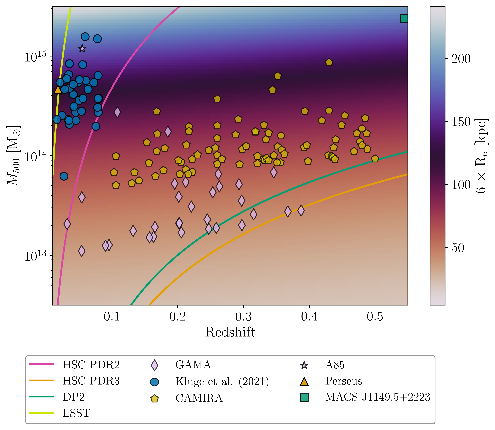
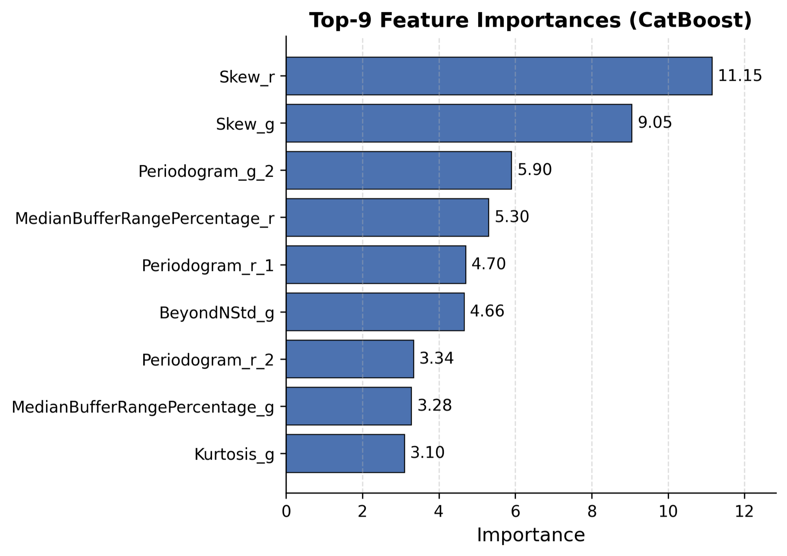
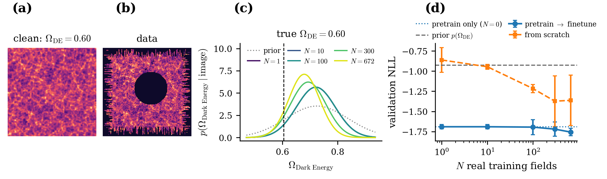
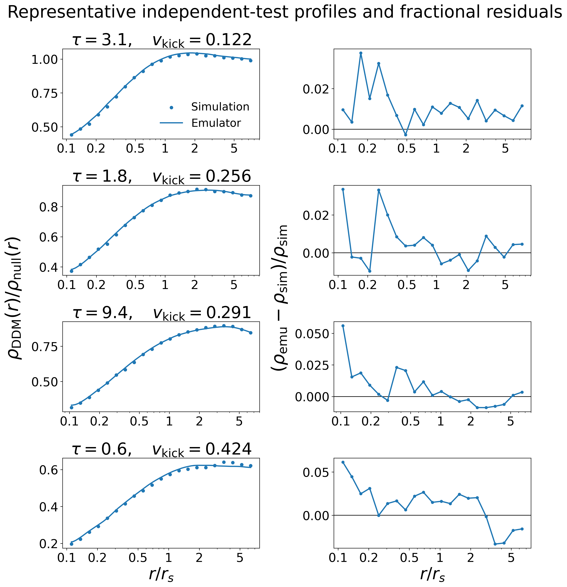
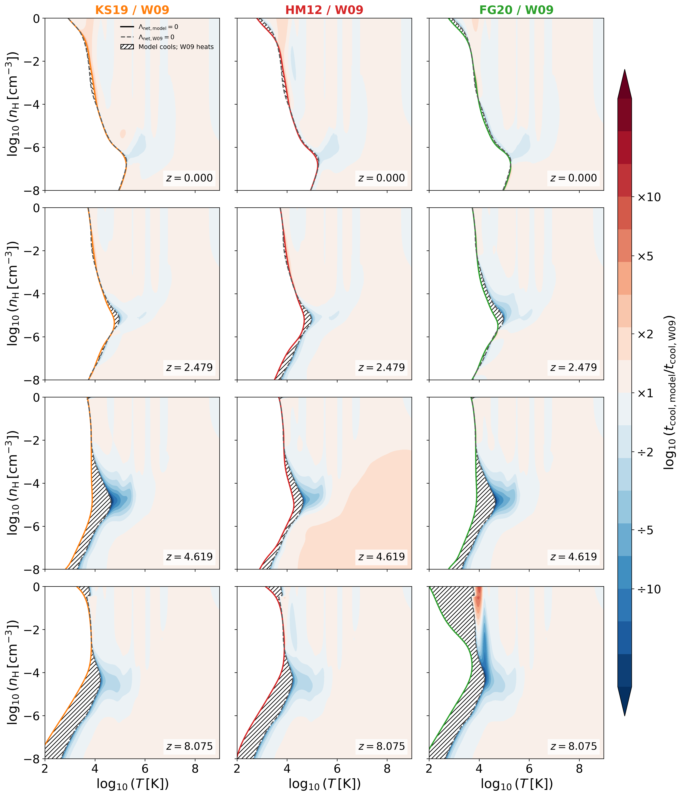
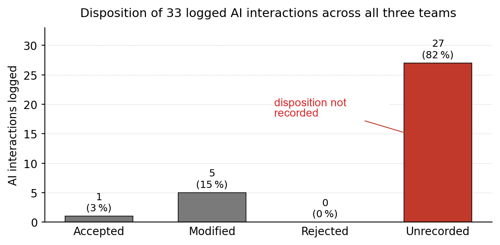

# arXiv Digest — 2026-11-05

- **Interest file used:** interests/2026.10.md (fallback — no 2026.11.md exists yet)
- **Categories pulled:** astro-ph.CO, astro-ph.EP, astro-ph.GA, astro-ph.HE, astro-ph.IM, astro-ph.SR, cs.LG, stat.ML, physics.data-an, hep-ph
- **Papers scanned:** 411 (101 astro-ph new/cross + 310 extras-only, after deduplication across categories)
- **After first filter:** 24 candidates reviewed with full text
- **Final selected:** 20 papers across 3 tiers

---

## Tier 1 — Highly relevant

### [The PAU Survey: Self-supervised image denoising for flux-preserving photometry](http://arxiv.org/abs/2611.05447v1)

J. Chen, M. Eriksen, D. Navarro-Gironés et al.
**Primary category:** astro-ph.IM | also: astro-ph.GA

Standard Noise2Void denoising of low-SNR PAUS narrow-band images systematically **underestimates faint-galaxy fluxes** (flux ratio peaking at $R_f\simeq0.36$ for $i_{AB}\sim22$–23). The authors fix this with a **bounded-output network plus LoRA fine-tuning on flux-aware losses**, which restores the flux ratio to $R_f\simeq0.98$–1.03 and cuts repeated-exposure scatter to **$\sigma_{68}=0.529$**. On real spectroscopically-matched data, the denoised D4000 spectral-break index shows **33–37% less scatter**, with no loss of the physical break signal. The result is a general lesson: image-quality metrics alone cannot certify a denoiser for quantitative photometry.

*Residual distribution of the D4000 spectral break index (PAUS minus spectroscopic LEGA-C) before (red) and after (blue) the flux-aware denoising; the scatter tightens from $\sigma_{68}=0.308$ to 0.265 with no shift in the median offset.*

---

### [Spectroscopy-informed Deep Learning Searches for Photometric Little Red Dots in JWST Surveys](http://arxiv.org/abs/2611.06026v1)

Chenxuan Zhang, Huanian Zhang, Qingwen Wu

**Primary category:** astro-ph.GA

A cross-modal classifier is trained on **matched NIRCam imaging and NIRSpec/PRISM spectra** but needs only imaging at inference, reaching **recall 0.92 / precision 0.79** on held-out Little Red Dots (LRDs) — well above an imaging-only CNN (recall 0.84). Applied to spectroscopically observed galaxies previously labeled non-LRD, it recovers **35 new candidates**, 10 of 13 with usable H$\alpha$ spectra showing the expected broad component. Scaled to public JWST surveys it yields **357+5+18 new candidates** across 32 fields, extending past the color cuts that define current LRD samples.

*UMAP projection of the model's 128-dimensional image embeddings: spectroscopically confirmed LRDs (red stars) cluster separately from the broader high-redshift galaxy population, with partial overlap hinting at unrecognized LRDs hiding among "non-LRD" labels.*

---

### [Mock CSST NUV-NIR imaging of TNG50 galaxies with resolved stellar populations](http://arxiv.org/abs/2611.05875v1)

Jing Tang, Ran Li, Yang Chen et al.

**Primary category:** astro-ph.GA

A new pipeline samples **individual stars from TNG50 simulation particles via TRILEGAL**, models dust attenuation with SKIRT radiative transfer, and forward-models the result into realistic 7-band CSST mock images (PSF, sky background, instrumental noise included). Applied to a spiral and a **dwarf irregular galaxy (TNG860672, 735,525 stars, ~2.9 kpc field of view)**, the truth-matched catalogs are designed as a testbed for future completeness and photometric-recovery studies of resolved stellar populations — directly the kind of dataset needed before CSST flies.

*Mock CSST NUV and i-band images of the simulated dwarf irregular galaxy TNG860672 at 1 Mpc, resolving individual stars down to ~48.5 pc scales in the zoomed panels.*

---

### [The dwarf galaxy NGC 185: the flagship of Andromeda's dwarf galaxies for the study of evolved multiple stellar populations](http://arxiv.org/abs/2611.06547v1)

Paolo Ventura, Chiara Ventura, Richard D'Souza et al.

**Primary category:** astro-ph.GA

Using horizontal-branch, red-clump, and AGB stars instead of the (unreachable) main-sequence turn-off, this work reconstructs the **star formation history of the dwarf elliptical NGC 185** out to 10–15 Mpc distances. The key calibration — **RGB mass loss of $0.22\,M_\odot$** — lets the red-clump luminosity function trace star formation over the last **~7 Gyr**, consistent with an independent SFH from Geha et al. 2015. AGB carbon stars descending from $1$–$1.5\,M_\odot$ progenitors are identified via circumstellar dust, closing the loop between stellar evolution models and an observed dwarf galaxy's enrichment history.

*Reconstructed total (top) and cumulative (bottom) star formation rate of NGC 185 from its evolved stars (red), matching an independent determination from Geha et al. 2015 (grey band) without needing the main-sequence turn-off.*

---

### [The impact of Population III stars on the elemental enrichment of ultra-faint galaxies in the FIRE-3 zoom-in simulations](http://arxiv.org/abs/2611.05589v1)

Pratik J. Gandhi, Earl P. Bellinger, Marla Geha et al.

**Primary category:** astro-ph.GA

FIRE-3 zoom-in simulations of **ultra-faint dwarf galaxies** show that early Population III enrichment alone cannot explain their observed iron abundances — models with only Pop III feedback leave scatter down to **[Fe/H]~-6**, well below the Local Group floor. The missing ingredient is **later-time iron enrichment from metallicity-dependent white-dwarf supernovae combined with extended post-Pop III star formation histories**, which brings simulated ultra-faints into agreement with Local Group observations. This echoes the recent EDGE-Inferno result and reframes what Rubin/Roman/Euclid discoveries of new faint dwarfs will actually be testing.

*Stellar mass-iron metallicity relation for simulated ultra-faint galaxies (colored, by Pop III model variant) against observed Local Group galaxies (grey); only models with white-dwarf supernova feedback reproduce the observed relation.*

---

### [How sky subtraction scales affect Intracluster light measurements](http://arxiv.org/abs/2611.05467v1)

Giulia Golini, Sarah Brough, Mireia Montes et al.

**Primary category:** astro-ph.GA

A short but pointed note: comparing the **sky-subtraction grid scales** of current and future surveys against the expected physical extent of intracluster light (6 effective radii) shows that **HSC-PDR3 and the LSST DP2 pipeline risk oversubtracting ICL in galaxy groups/clusters at essentially all redshifts**, while HSC-PDR2's coarser grid only affects the most nearby, massive clusters ($z<0.1$, $M_{500}\gtrsim10^{14.1}M_\odot$). The **full 10-year LSST survey will offer the safest low-surface-brightness regime**, a direct, practical caveat for anyone drawing diffuse-light conclusions from current data releases.

*Halo mass-redshift plane showing where each survey's sky-subtraction scale risks oversubtracting a diffuse intracluster-light envelope; HSC-PDR3 and LSST DP2 risk biasing ICL at nearly all redshifts, while the full 10-year LSST survey will be safest.*

---

### [3D dark matter map of the JWST COSMOS-Web field using diffusion-based generative priors](http://arxiv.org/abs/2611.03786v1)

Diana Scognamiglio, Brandon Zhao, Katherine L. Bouman et al.

**Primary category:** astro-ph.CO | also: cs.LG

Combining a physical weak-lensing forward model with a **diffusion-based Bayesian generative prior** trained on cosmological simulations, this reconstructs the **3D dark matter distribution across 20 lens planes to $z\simeq1.92$** — doubling the redshift reach of prior HST-based 3D maps — from deep JWST COSMOS-Web imaging. The method recovers galaxy clusters invisible to earlier 2D weak-lensing maps and passes extensive null tests (128 randomized-shape nulls, PSF-leakage checks, consistency with held-out non-fiducial cosmologies). It's a clean demonstration of **simulation-based inference** solving a genuinely ill-posed inverse problem in cosmology.

*Redshift slices of the reconstructed 3D matter overdensity across the COSMOS-Web field; orange crosses mark clusters already known from HST weak lensing, green triangles mark new clusters detected only in this JWST-based 3D reconstruction.*

---

### [Feature-Based and Deep Learning Methods for Astronomical Light Curve Classification](http://arxiv.org/abs/2611.04664v1)

V. Baymakanov, Kh. Khamitov, A. Raimova et al.

**Primary category:** cs.LG | also: astro-ph.IM

A rigorous head-to-head on ~40,000 ZTF variable stars finds that **classical feature-based classifiers (CatBoost: 0.907 accuracy) comfortably beat deep networks trained directly on raw light curves** (best unaugmented LSTM: only 0.609 accuracy) — a useful counterpoint to default "just use a neural net" instincts. Three new **physically-motivated, real-observation-only augmentations** (random windows/bins/subsampling) close much of the gap, pushing the best augmented LSTM to 0.763. The authors conclude feature engineering is near saturation while deep learning here remains **data-limited**, motivating self-supervised pretraining on large unlabeled surveys.

*The nine light-curve features CatBoost relies on most for variable-star classification; a classifier built on these hand-engineered features still beats every deep network trained on raw light curves.*

---

### [Spin Spherical Fourier Neural Operators: Efficient Equivariant Learning for Vector and Spin Fields on the Sphere](http://arxiv.org/abs/2611.04389v1)

Kevin Mulder, Matthew A. Price, Eirini Leftaki et al.

**Primary category:** cs.CV | also: astro-ph.IM

Extends spherical Fourier neural operators to fields of **any spin** (CMB polarization, weak-lensing shear) with **rotational equivariance exact to machine precision ($10^{-15}$)**. On a new weak-lensing mass-mapping benchmark built with GLASS and Euclid-like shape noise, the spin-aware network **cuts reconstruction MSE by 37.9% with 13.4% fewer parameters** than a scalar-channel baseline, and on global wind forecasting cuts MSE 44.9% with 34.9% fewer parameters. This is exactly the kind of **physically-informed, astronomy-motivated architecture** that constrains the right symmetries into the network rather than hoping the data teaches them.

*Weak-lensing mass-mapping residuals (true minus reconstructed convergence) for the spin-equivariant network versus a scalar-channel baseline; the scalar model's residual still traces large-scale structure it failed to recover, while the spin model's residual is noise-like.*

---

### [Macrocanonical Generator Networks: Data-Efficient Neural Surrogates for Amortized Physics Simulation](http://arxiv.org/abs/2611.05157v1)

Niall Jeffrey, Benjamin D. Wandelt

**Primary category:** cs.LG | also: astro-ph.CO

A new generative framework trains from **as few as 1–10 real simulation fields** (MHD turbulence, Quijote cosmic web) without memorizing — unlike WGAN-GP, flow-matching, or DDPM baselines, which all collapse to the training field at $N=1$. Once trained it emits fresh fields **$10^6\times$ faster than the reference N-body simulator**. Most strikingly, pretraining a simulation-based-inference pipeline on its synthetic fields alone improves the validation log-likelihood for the dark-energy fraction $\Omega_{DE}$ from $-0.93$ to $-1.69$ **before a single real simulation is used** — a concrete route around simulator-throughput bottlenecks in cosmological inference.

*Simulation-based inference of the dark-energy fraction from 2D density maps: a model pretrained on the generator's synthetic fields (no real simulations) already beats a from-scratch baseline, improving validation log-likelihood before a single genuine N-body simulation is used.*

---

### [Object-independent evaluation of small-data astronomical image classifiers: architecture, representation, and acquisition shortcuts](http://arxiv.org/abs/2611.06484v1)

Eraldo Pereira Marinho

**Primary category:** astro-ph.IM | also: cs.CV

A sharp methodological check on small-dataset astronomical CV: splitting by **physical object**, not image, three architectures reach 0.77–0.87 balanced accuracy classifying galaxies/clusters/nebulae on 73 unseen objects. But **metadata-only controls with no pixels at all reach 0.72–0.74**, and masking out the central object still leaves 0.61–0.80 — meaning acquisition settings and catalogue context alone carry most of the signal. The paper's conclusion is the real contribution: **high held-out accuracy is not by itself evidence a model learned the intended morphology**, and small-data CV evaluations need explicit shortcut controls to mean anything.

*Held-out balanced accuracy per architecture/representation, with two pixel-free metadata-only controls as dashed reference lines; the controls alone reach 0.72–0.74, showing part of any classifier's "generalization" could come from non-morphological shortcuts.*

---

## Tier 2 — Adjacent / useful context

### [Dynamics of self-gravitating halos with decaying dark matter](http://arxiv.org/abs/2611.05474v1)

Anna Bencke, Marc Kamionkowski, Annika H. G. Peter et al.

**Primary category:** astro-ph.GA | also: astro-ph.CO

N-body simulations of halos made of **decaying dark matter** (particle decays to a slightly lighter daughter plus a kick) show that short lifetimes and large kick velocities drive **core formation**, with the halo's enclosed mass deficit scaling as $M_{ap}/M_{ap,0}\approx1-2.2\,v_{kick}^2$. A **PCA + Gaussian-process emulator**, trained on 100 simulations, reproduces any relaxed density profile in the parameter grid to **~1% accuracy** at negligible cost, and the authors explicitly flag Rubin/Euclid/Roman's ability to resolve inner density slopes of thousands of dwarf galaxies as the observational payoff.

*Emulator predictions (lines) versus simulated density profiles (points) for independent test halos, with fractional residuals; the PCA+Gaussian-process emulator reproduces simulated core formation to ~1% accuracy at negligible computational cost.*

---

### [Living near filaments: How environment shapes age profiles in low-mass galaxies](http://arxiv.org/abs/2611.06632v1)

Elisa A. Tau, Diego Pallero, Rory Smith et al.

**Primary category:** astro-ph.GA

In IllustrisTNG-50, **11.1% of low-mass galaxies ($10^9$–$10^{10}M_\odot$)** show a U-shaped radial stellar-age profile — young in the center, old in the middle, young again outside. These galaxies are overwhelmingly **central, low-mass-halo systems sitting close to cosmic filaments** (median 265 kpc) and far from groups (median 7,903 kpc), the opposite pattern to galaxies without the feature. The authors argue **filament-driven gas starvation** shapes this profile, while smooth accretion in group environments washes it out — the trend survives a mass-bias check across both mass subsamples.

*Distance to the nearest galaxy group versus distance to the nearest cosmic filament for low-mass galaxies with (left) and without (middle) a U-shaped stellar age profile; galaxies with the U-shaped feature sit close to filaments but far from groups.*

---

### [Unsupervised Neural Operators for Rotating Relativistic Stars: High-Fidelity Equation of State Inference and Pulsar Spin Evolution at Scale](http://arxiv.org/abs/2611.05790v1)

Anarya Ray

**Primary category:** astro-ph.HE | also: cs.LG

A **DeepONet trained fully unsupervised** (physics-only PDE residual loss, no solution labels) replaces the iterative numerical solver for rotating neutron-star structure, hitting **mass/radius errors of 0.14%/0.03%** with a **1283× speed-up**. The payoff is scientific, not just computational: ignoring rotation (or using approximate second-order corrections) **excludes the true equation of state at >90% confidence** in regions where the full solver does not — a concrete demonstration that physics-informed neural operators can change an inference's conclusion, not just its runtime.

*Recovered equation-of-state pressure-density posteriors from simulated mass-radius data; ignoring stellar rotation excludes the true equation of state at >90% confidence in regions where the full rotating solver does not.*

---

### [Unsatz: Evaluating Scientific Discovery Without a Given Ansatz](http://arxiv.org/abs/2611.03713v1)

Ethan Ji, Wei Wang, Yizhou Sun

**Primary category:** cs.AI | also: cs.LG

A new benchmark makes an LLM agent **construct a model's structure itself** — which variables exist, which are hidden, how they interact — via priced experiments, rather than handing it a fixed equation library. The best of nine agents (GPT 6 Astra) solves **48 of 80 hidden systems**; strikingly, given the *true* structure a classical fitter solves only 27/40 deterministic worlds, showing structure search, not parameter estimation, is the real bottleneck. Agents reliably detect that latent states exist (69/162 correctly counted) but **rarely get their dynamics right** (19/162 full solves) — they find the variables but not the mechanism.

*One benchmark "world": two measurable populations that compete only through two hidden nutrient resources invisible to the agent, who must infer this structure from priced experiments alone before being scored.*

---

### [$\Phi$asmaNet: A Staged Spectral Token-Refinement Architecture for Fast Gravitational-Wave Signal-to-Noise Ratio Prediction](http://arxiv.org/abs/2611.05309v1)

Ioannis Tsioulis, Anastasios Tefas, Nikolaos Stergioulas

**Primary category:** cs.LG

A compact (~732k-parameter) attention architecture with staged spectral refinement **predicts gravitational-wave detection SNR directly from binary parameters**, reaching **99.39% accuracy ($R^2=0.9998$)** in the detection-relevant regime, at **~120,000 evaluations/second** on one GPU versus direct waveform calculation. The intended use is computing **selection effects in GW population inference**, where every source in a large synthetic catalogue needs its detectability checked — a routine but expensive step that this surrogate makes essentially free.

---

### [She Sees Shells by the Stellar Shore: A Kinematic View of NGC 253's Stellar Halo](http://arxiv.org/abs/2611.05493v1)

Katya Gozman, Eric F. Bell, Richard D'Souza et al.

**Primary category:** astro-ph.GA

Resolved-star spectroscopy of 225 AGB stars in NGC 253's stellar halo — the **first such kinematic substructure detection outside the Local Group**, and only the fourth ever in a Milky Way-mass galaxy — recovers velocities for 89 stars. A **spectral-clustering analysis, validated against random shuffles**, separates a major-axis population at $v\sim167\,$km/s (likely in-situ outer disk) from a minor-axis/SW population at $v\sim-34\,$km/s coincident with a known shell, consistent with a **recent accretion event**.

*Spatially coherent velocity clusters identified among NGC 253's halo stars, with the clustering's silhouette score exceeding that of randomly shuffled velocities — evidence the structure is real, tracing a mix of in-situ and recently accreted stellar populations.*

---

### [Euclid Quick Data Release (Q1). Refining the strong lens sample with Space Warps crowd-sourced science](http://arxiv.org/abs/2611.06667v1)

Euclid Collaboration, P. Holloway, A. Verma et al.

**Primary category:** astro-ph.GA

Citizen-science grading of Euclid Q1 strong-lens candidates, combined via Bayesian skill-weighted posteriors, achieves a **7× purity improvement** over the original researcher-only sample and, applied on top of ML-ranked candidates, retains **85% of true lenses at 85% purity** — still beating a machine-learning model **retrained specifically on Q1 lenses**. Extrapolated to the full Euclid DR1 footprint, this projects **~12,500 grade-A/B strong lenses**, a notable data point in the ongoing ML-vs-human question for survey-scale classification.

*Number of true strong-lens candidates recovered as more top-ranked systems are inspected: citizen-science ranking versus two machine-learning rankings — even after retraining, the ML models do not yet outperform the citizen-science refinement step.*

---

### [Net Cooling Tables for Cosmological Simulations under Multiple UV/X-ray Background Models](http://arxiv.org/abs/2611.06360v1)

Laura Di Federico, Klaus Dolag, Ildar Khabibullin et al.

**Primary category:** astro-ph.GA

New CLOUDY-based radiative cooling/heating tables for three modern UV/X-ray background models extend the widely-used Wiersma et al. 2009 framework to 13 elements and a broader helium grid. The practical warning: models agree at $z=0$, but **cooling-time estimates diverge by up to a factor of ~10–11 by $z\simeq4.6$** near the thermal-equilibrium boundary, and the models even **disagree on the sign of net heating/cooling over ~10% of the diffuse density-temperature plane by $z\simeq8.1$** — exactly the regime relevant to early dwarf-galaxy gas physics.

*Cooling-time ratio between the new UVB-dependent tables and the widely used Wiersma et al. 2009 tables across the diffuse density-temperature plane; differences are modest at z=0 but reach a factor of ~10 near the thermal-equilibrium boundary by z~4.6.*

---

## Tier 4 — Meta-research about the field

### [We Ran a Research Sprint With AI. The AI Worked. The Research Didn't.](http://arxiv.org/abs/2611.03946v1)

Anush Sankaran, Arijit Banerjee

**Primary category:** cs.AI | also: cs.LG

A 100-minute pilot research sprint with three independent teams found that of **33 logged AI interactions, 82% had no recorded evaluation at all** — generation outpaced the team's capacity to vet it, a **"consumption bottleneck."** Despite no shared communication channel, all three teams independently converged on the same two failure modes (the bottleneck, plus private "AI-induced research silos"), and a parallel fully-autonomous pipeline produced a complete draft with zero in-session human evaluation. The authors propose **"Human-AI-Human"** collaboration — team-visible evaluation checkpoints — as a falsifiable design fix, relevant to anyone using AI assistants for actual research work rather than toy demos.

*Disposition of the 33 AI interactions logged during the research sprint: only one was explicitly accepted and five modified, while 82% received no recorded evaluation — AI output outpaced the team's capacity to vet it.*
