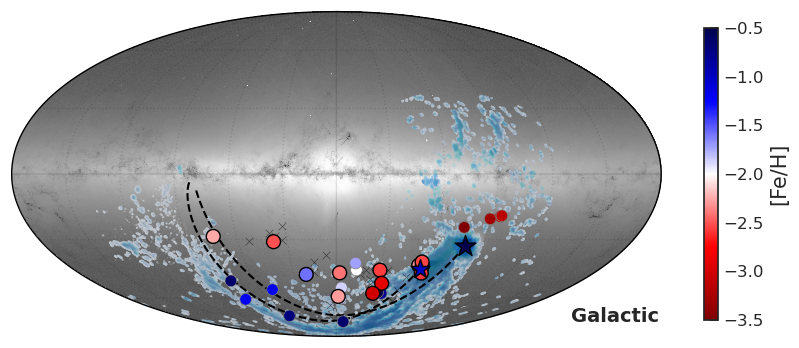
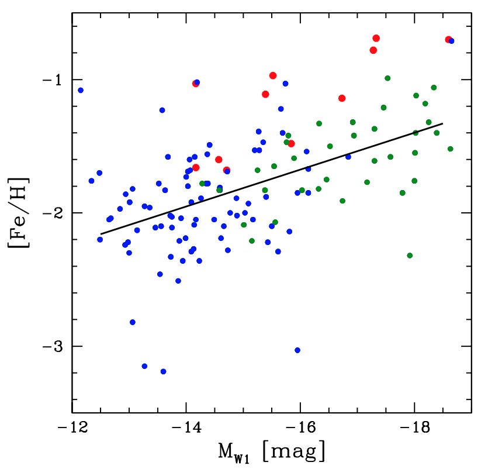
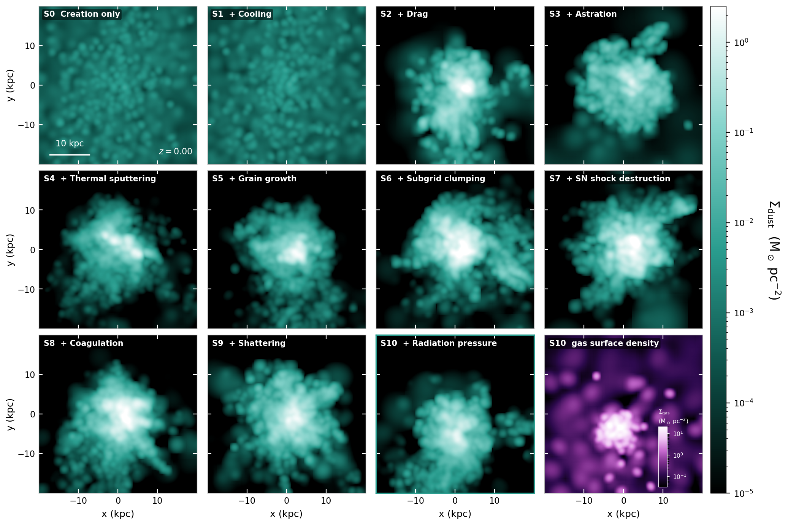
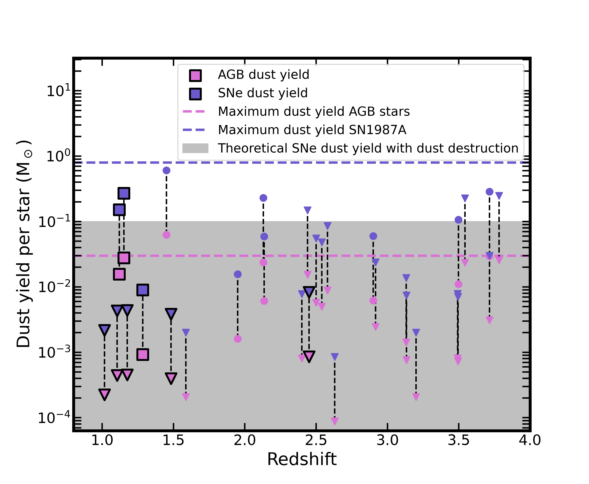
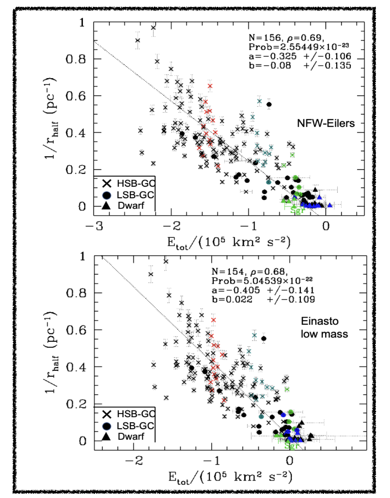

# arXiv Digest — 2026-11-06

- **Interest file used:** interests/2026.10.md (fallback — no 2026.11.md exists yet)
- **Categories pulled:** astro-ph.CO, astro-ph.EP, astro-ph.GA, astro-ph.HE, astro-ph.IM, astro-ph.SR, cs.LG, stat.ML, physics.data-an, hep-ph
- **Papers scanned:** 368 (106 astro-ph new/cross + 262 from extras)
- **After first filter:** 16 candidates reviewed with full text
- **Final selected:** 12 papers across 3 tiers

---

## Tier 1 — Highly relevant

### [Is Morphology All You Need? Quantifying Imprints of Past Star Formation in the Present-Day Morphologies of Galaxies](http://arxiv.org/abs/2611.07373v1)

Juan Pablo Alfonzo, Kartheik G. Iyer, Masayuki Akiyama et al.
**Primary category:** astro-ph.GA

Introduces Katachi-PRIME, which feeds vision-transformer embeddings of SDSS *gri* image cutouts into a normalizing-flow-based implicit likelihood inference pipeline to produce full posteriors for six galaxy physical parameters. Morphology alone matches or beats 5-band photometric SED fitting in precision and **substantially breaks the classical age–dust–metallicity degeneracy**, for example cutting the age–dust correlation coefficient from -0.37 to -0.15. The imaging model can also reconstruct a galaxy's star-formation history from its present-day image and color alone **back to 10 Gyr** for main-sequence and quiescent populations, though starburst and green-valley galaxies resist reconstruction, revealing a "morphological memory" that fades fastest for the most actively evolving systems.

*Population-level posteriors of age, dust, and metallicity from the image model (red) versus 5-band photometry model (blue): morphology visibly shrinks the classic degeneracy ellipses between these parameters.*

---

### [GetGaia 2.0: automatic membership and systemic motions of stellar systems with Gaia](http://arxiv.org/abs/2611.07227v1)

Andrés del Pino
**Primary category:** astro-ph.GA | also: astro-ph.IM

A public, fully automated Python tool that downloads Gaia data around any stellar system and separates its members from the Milky Way foreground with an expectation-maximization model using full astrometric covariances, the color-magnitude diagram, sky position, and line-of-sight velocities when available. Validated on synthetic dwarf-galaxy catalogs with **90–100% purity**, it is run "blind" (position only) on Gaia DR3 to recover systemic proper motions for **55 Local Group dwarf galaxies and 93 globular clusters** at ≥3σ significance, matching published values to a median of 0.032 and 0.009 mas/yr respectively — a ready-made pipeline for systemic kinematics ahead of Gaia DR4.

*The GetGaia 2.0 pipeline: from target resolution and data retrieval, through the EM membership model, to systemic motion and structural-parameter outputs, with a side track correcting for local Gaia reference-frame systematics.*

---

### [SHARP(ening the) view of unresolved globular clusters in ultra diffuse galaxies](http://arxiv.org/abs/2611.06966v1)

Marco Mirabile, Michele Cantiello, Benedetta Di Francesco et al.
**Primary category:** astro-ph.IM | also: astro-ph.GA

A science-case study for NEXUS, the near-infrared multi-slit spectrograph planned for ELT/SHARP, showing it can obtain radial velocities and stellar-population spectra for globular clusters (GCs) in **ultra-diffuse galaxies (UDGs) out to 60–70 Mpc**. Exposure-time calculations show NEXUS reaching the GC luminosity-function turnover (M_V ≈ -7.5) with adequate signal-to-noise in as little as **5 minutes at Virgo's distance and ~5 hours for Centaurus/Hydra I**, compared to the >6 hours current MUSE/VLT observations need just to approach that depth at Hydra I. Independent GC-count and GC-dynamical-mass estimates at this reach would let the survey test whether UDGs are "failed" massive galaxies, puffed-up dwarfs, or tidally stripped debris — competing formation channels that current facilities cannot distinguish for GC-poor systems.

---

### [The Pristine survey XXXI. A stream offset from the Stream: very metal-poor stellar debris trailing 100° from the LMC-SMC system](http://arxiv.org/abs/2611.07563v1)

Akshara Viswanathan, Kim A. Venn, Julio F. Navarro et al.
**Primary category:** astro-ph.GA | also: astro-ph.SR

Gemini/GHOST spectroscopy of 33 very metal-poor red-giant candidates confirms **12 new members of the Magellanic Stellar Stream**, spanning [Fe/H] = -1.6 to -3.1, selected by their orbital energy and angular momentum and verified with Monte Carlo orbit integrations in a time-dependent Milky Way–LMC potential. Combined with 15 literature members, the full 27-star sample reveals a striking **~20° spatial offset between the metal-poor stellar stream and the HI gas stream**, even though the stars' proper motions and high orbital energies still tie them dynamically to the Clouds — evidence that the stellar and gaseous tidal debris of the LMC-SMC interaction were stripped through different mechanisms or at different epochs.

*Magellanic Stellar Stream members (colored by metallicity) overlaid on the Gaia stellar density map and HI gas-stream contours: the very metal-poor members sit well offset from the gas, while more metal-rich literature members trace it closely.*

---

## Tier 2 — Adjacent / useful context

### [The 10 Mpc Volume](http://arxiv.org/abs/2611.07284v1)

R. Brent Tully, Gagandeep S. Anand, Helene M. Courtois et al.
**Primary category:** astro-ph.GA

A volume-complete census of every galaxy within 10 Mpc using HST tip-of-the-red-giant-branch distances and WISE-based stellar masses, finding stellar and group mass concentrated in a handful of dominant halos with a **gap in the halo mass function near 10^12 M_⊙** that may be in tension with ΛCDM predictions. Among dwarfs, metallicity declines with luminosity as **[Fe/H] = -3.90 - 0.14 M_W1**, with gas-poor dwarf spheroidals systematically more metal-rich than star-forming dwarf irregulars at fixed luminosity. The survey also singles out **KKR 18**, a dwarf whose color-magnitude diagram shows almost no old red-giant population — unique among 240 nearby dwarfs with HST imaging — implying the bulk of its stars formed within just the last few Gyr.

*Metallicity versus absolute W1 magnitude for Local Volume dwarfs: gas-poor dSphs (red) sit systematically above the gas-bearing dIrr/Sdm sequence (green/blue) at fixed luminosity.*

---

### [Survey of Surveys Data Release 3. Homogenised stellar parameters across nine spectroscopic surveys](http://arxiv.org/abs/2611.07936v1)

A. Avdeeva, E. Pancino, A. Turchi et al.
**Primary category:** astro-ph.SR | also: astro-ph.GA

Uses XGBoost quantile regression to place effective temperature, surface gravity, and [Fe/H] from **nine major spectroscopic surveys** (APOGEE, GALAH, LAMOST, Gaia RVS, RAVE, DESI, Gaia-ESO, SEGUE) onto one common, externally-validated scale, cutting the median GALAH–APOGEE temperature offset from **44.5 K to 6.2 K** and delivering calibrated parameters with asymmetric uncertainties for **10.13 million stars**. As a demonstration, the homogenized catalogue confirms a rapidly rotating, **metal-poor tail of thin-disc-like stars extending down to [Fe/H] ≈ -1.5**, a population thought to preserve signatures of the earliest phase of Milky Way disc formation.

*Rotational velocity versus [Fe/H] for the full sample (grey) with the dynamically-selected thin-disc-like subsample (violet) extending well below the canonical thin-disc metallicity floor.*

---

### [CosmicGrain: An On-the-fly Dust Physics Module](http://arxiv.org/abs/2611.07190v1)

E. Huscher, K. Finlator
**Primary category:** astro-ph.GA

Introduces CosmicGrain, a Gadget-4 module that evolves dust as **explicit superparticles** responding to each grain's own local gas conditions rather than a passive tracer field, letting growth, sputtering, shattering, and radiation pressure act heterogeneously across the grain population. An 11-rung "physics ladder" run on a Milky Way-mass halo shows **gas-dust drag alone boosts dust retention by roughly 100×**, while every other individual process changes the halo's dust budget by only 10–30%, with thermal sputtering and clumping-enhanced grain growth ultimately setting the surviving dust-to-metal ratio. The code and its superparticle approach offer a physically-incorporated route to connecting galaxy-scale dust observables to resolved ISM physics in future simulations.

*Dust surface density around the simulated halo across all 11 rungs of the physics ladder: essentially no dust survives without gas-dust drag (S0–S1), while destruction and growth channels reshape its distribution at later rungs.*

---

### [Dust Survival in Lensed Quiescent Galaxies at z>1 Depends on How They Quench](http://arxiv.org/abs/2611.07237v1)

Sarah Bodansky, Katherine E. Whitaker, Gourav Khullar et al.
**Primary category:** astro-ph.GA

ALMA Band 6 continuum observations of 13 strongly-lensed quiescent galaxies at z ≈ 1–2.5 find dust-to-stellar-mass ratios spanning **more than two orders of magnitude**, with higher-redshift, more recently-quenched systems consistent with harsh AGN-driven dust destruction and lower-redshift systems consistent with milder destruction or regrowth. Two galaxies exceed the maximum dust yield expected from AGB stars or Type II supernovae alone, pointing to **TP-AGB dust production and grain regrowth** sustained by extended star-formation histories rather than freshly-quenched residual dust.

*Dust yield per star required to explain the observed dust mass via AGB stars or Type II supernovae alone, for this sample (black) and literature quiescent galaxies: two galaxies exceed the theoretical single-channel limits.*

---

### [SDSS-V LVM: Spatial Resolution Effects on Diagnostic Diagrams in the Magellanic Clouds](http://arxiv.org/abs/2611.08336v1)

A. Z. Lugo-Aranda, Lesly C. Castañeda, H. J. Ibarra-Medel et al.
**Primary category:** astro-ph.GA

Degrades SDSS-V Local Volume Mapper integral-field data of the SMC and LMC from **17–19 pc native resolution down to 272 pc** to test how coarsening affects standard ionized-ISM diagnostics (BPT, WHAN, WHaD). Lower resolution blends compact HII regions into the diffuse ionized gas, inflating its measured Hα flux by **more than an order of magnitude** at the coarsest scales, with the SMC's clumpier ISM showing significant effects already at ~42 pc versus ~272 pc for the more spatially coherent LMC. The results argue that **sub-50 pc resolution** is needed to recover the true diversity of ionized-gas conditions in low-metallicity dwarf galaxies — a caution for interpreting unresolved diagnostics of more distant dwarfs in Rubin- and Euclid-era data.

---

### [A Machine Learning Approach to Coupling Photoionization & Multi-Frequency Radiation Hydrodynamics](http://arxiv.org/abs/2611.07162v1)

Sergei Dyda, Randall C. Dannen
**Primary category:** astro-ph.HE | also: astro-ph.GA

Trains random-forest models on photoionization code (XSTAR) outputs to predict the line-driving force multiplier from local gas ionization, optical depth, and the shape of the irradiating spectrum, then embeds this ML surrogate directly in the Athena++ radiation-hydrodynamics code to simulate line-driven winds. The ML models **reproduce the force multiplier more accurately than standard trilinear-interpolation tables while needing less training data**, and letting the surrogate respond to the evolving local spectral energy distribution — rather than a fixed irradiating spectrum — measurably changes the simulated wind's mass flux and outflow velocity. The approach offers a general recipe for embedding otherwise-expensive microphysics as fast ML surrogates inside large dynamical simulations.

---

### [Unveiling the Origins of Local Group Galaxies with ELT-SHARP: An Overview of Science Cases](http://arxiv.org/abs/2611.06963v1)

Hai-Feng Wang, Guan-Yu Wang, Peng Yang et al.
**Primary category:** astro-ph.IM | also: astro-ph.GA

A science-case overview for SHARP, the planned near-infrared multi-mode spectrograph for the ELT, spanning the Galactic bulge, disc, halo substructure, and the dynamics of dwarf galaxies and globular clusters. For the latter, it highlights an existing structural relation in which a system's **inverse half-light radius correlates with its total orbital energy** across both dwarfs and globular clusters, and argues that SHARP's near-infrared sensitivity and adaptive-optics-assisted resolution could extend such dynamical-heating diagnostics to dust-obscured, crowded Local Group systems that current facilities cannot resolve.

*Inverse half-light radius versus total orbital energy for high- and low-surface-brightness globular clusters and dwarf galaxies, color-coded by their likely accreted progenitor (Kraken, Gaia-Sausage-Enceladus, Sagittarius).*

---

## Tier 4 — Meta-research about the field

### [MapHub: Daily Relevance Heatmaps of New arXiv Preprints for a Research Community](http://arxiv.org/abs/2611.07174v1)

Kaili Cao, Camille Avestruz, Feige Wang
**Primary category:** astro-ph.IM

Describes MapHub, a tool in which an LLM (Claude Opus) scores every new astro-ph and cs.AI preprint against **portfolios built from each research-group member's own publication record**, publishing the results as a daily relevance heatmap rather than serving one reader at a time. In blind tests, reading papers in MapHub's ranked order recovered about **70% of a rater's own top 10% of interesting papers** after reading only 10% of the day's listing, roughly double a TF-IDF text-matching baseline, at a cost of just minutes of daily reading per person. The authors caution that portfolios drawn from publication records can miss a researcher's newer interests not yet reflected in their papers, and that the scores measure fit to a portfolio rather than paper quality.
