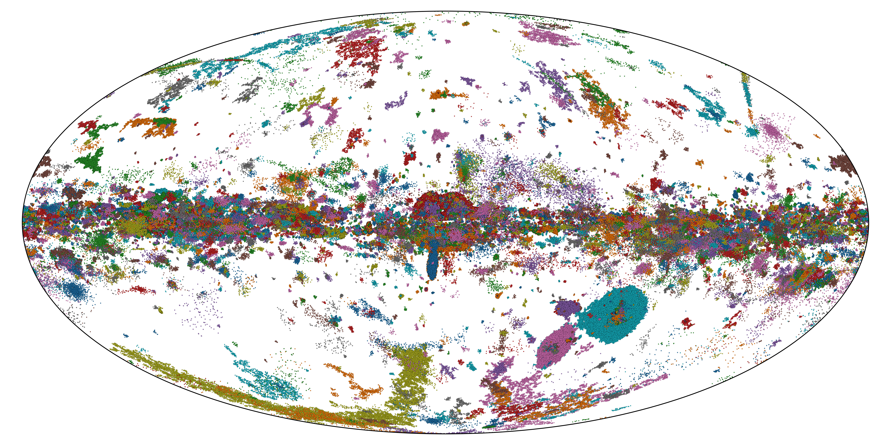
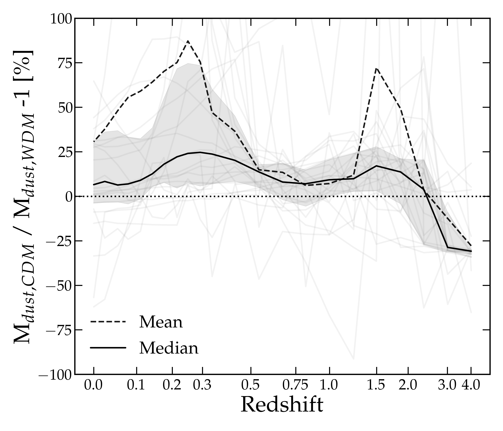
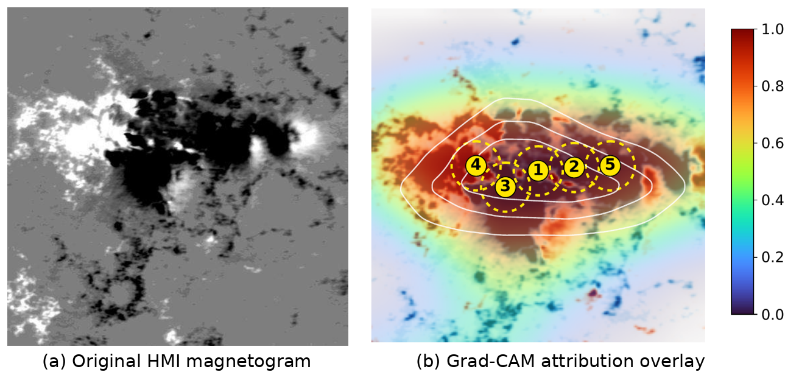
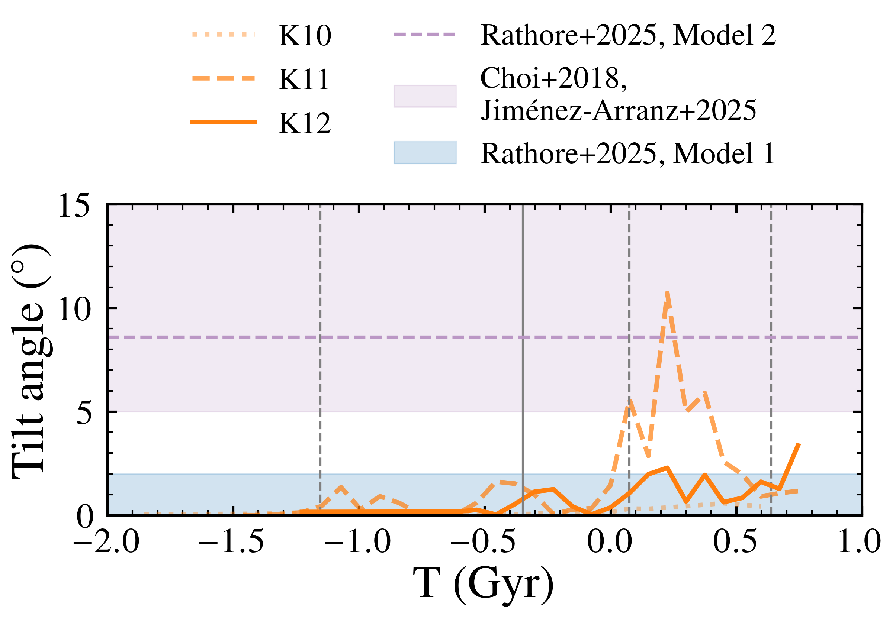

# arXiv Digest — 2026-11-10

- **Interest file used:** interests/2026.10.md (fallback — no 2026.11.md exists yet)
- **Categories pulled:** astro-ph.CO, astro-ph.EP, astro-ph.GA, astro-ph.HE, astro-ph.IM, astro-ph.SR, cs.LG, stat.ML, physics.data-an, hep-ph
- **Papers scanned:** 713 (125 astro-ph new/cross + 588 from extras)
- **After first filter:** 20 candidates reviewed with full text
- **Final selected:** 18 papers across 3 tiers

---

## Tier 1 — Highly relevant

### [A DOLPHOT/Euclid Study of the Resolved, Faint Outer Milky Way Globular Cluster AM-1](http://arxiv.org/abs/2611.10127v1)

Daniel R. Weisz, Alessandro Savino, Andrew E. Dolphin et al.
**Primary category:** astro-ph.GA | also: astro-ph.IM

Builds and publicly releases a **Euclid-specific module for DOLPHOT v2.1**, with empirical PSF models for VIS/NISP built entirely from public Q1 data, and applies it to the faint, distant (**D ≈ 120 kpc**) Milky Way globular cluster AM-1. The new photometry reaches **5σ depths of I_E, Y_E, J_E, H_E = 27.1, 25.3, 25.5, 25.3**, resolving the cluster **~1 mag below the main-sequence turnoff** — a factor of **~9 more sources** than the public Euclid MER catalog, which is essentially empty in the same region. CMD fitting confirms an old (**10.6 Gyr**), intermediate-metallicity (**[Fe/H] ≈ -1.0**) population, demonstrating Euclid's resolved-star potential for faint Local Volume systems.

*Side-by-side CMDs of AM-1 from the new DOLPHOT/Euclid pipeline versus the public Euclid MER catalog: DOLPHOT recovers ~9× more stars and reaches a magnitude below the main-sequence turnoff, where the MER catalog is essentially empty.*

---

### [FAIR Universe Weak Lensing ML Uncertainty Challenge: Dataset and Cosmological Inference Competition](http://arxiv.org/abs/2611.10228v1)

Biwei Dai, Po-Wen Chang, Erwan Allys et al. (François Lanusse — high-value co-author)
**Primary category:** astro-ph.CO | also: cs.CV

The FAIR Universe collaboration built a NeurIPS 2025 benchmark of **101 cosmologies × 256 realizations** of simulated HSC-like weak-lensing convergence maps, with systematics (AGN feedback, redshift-distribution shift) marginalized in to force genuine uncertainty-aware inference. Winning entries combined **Vision Transformer and EfficientNetV2 architectures with physics-informed feature integration**, optimal-transport augmentation, and one AI-agent-driven inference pipeline, roughly **doubling the score of a power-spectrum MCMC baseline (11.48 vs 4.58)**. Across nearly all submissions, posterior **coverage stayed close to the nominal 1σ level (~0.66–0.71)**, showing systematics-robust uncertainty quantification is achievable at this scale.

*Breakdown of final-submission methodology categories: CNN-based architectures dominate, with simulation-based inference, Vision Transformers, and AI-agent-assisted pipelines each appearing in a handful of entries.*

---

### [The hierarchical structure of the Milky Way I. A model-agnostic clustering of 1 billion stars in 5D](http://arxiv.org/abs/2611.10548v1)

William H. Oliver, Tobias Buck

**Primary category:** astro-ph.GA

Oliver & Buck apply **AstroLink, a model-agnostic hierarchical density-based clustering algorithm**, directly to the 5D astrometric space of **over 1 billion Gaia DR3 stars**, correcting for selection effects via distance contraction and feature scaling rather than assuming a Galactic model. At a significance threshold of **S = 3.8σ**, it recovers **7410 clusters** spanning open/globular clusters, stellar streams, and dwarf-galaxy-scale overdensities, with compact systems matching external catalogues well while extended structures are often fragmented. The run completes in **~80 minutes on 48 CPU cores**, roughly **150× faster** than the ~8-day HDBSCAN runtime previously reported for a comparable Gaia sample.

*All-sky positions of stars assigned to the 7410 recovered clusters, colour-coded by hierarchy label — revealing compact clusters, diffuse streams, and composite disc/bulge structure across the Galaxy.*

---

### [Dust in cold and warm dark matter in a suite of zoom-in simulations of Milky Way analogues](http://arxiv.org/abs/2611.12047v1)

Adam Ussing, Robert Mostoghiu Paun, Darren Croton et al.

**Primary category:** astro-ph.GA

A suite of **24 CDM vs. 3.5 keV WDM zoom-in hydrodynamical simulation pairs** of Milky Way analogues, post-processed with Powderday, tests whether dust properties can discriminate dark matter models. CDM consistently shows **a median 6.6% (mean 30%) higher dust mass at z=0**, peaking at **25% around z ≈ 0.25**, but dust-structure and z=0 scaling-relation differences are **not statistically significant** given sample stochasticity. Satellite mass functions show Magellanic-Cloud-mass dwarfs are rare across the suite, consistent with the observed rarity of MW-LMC/SMC-like systems.

*CDM consistently out-dusts WDM by 5–25% between z≈2 and z=0, peaking near z≈0.25, though the z=0 confidence interval still includes zero difference.*

---

### [Amortized Opacity Marginalization Improves C/O Interval Calibration for Brown-Dwarf Retrievals](http://arxiv.org/abs/2609.01665v3)

Kellen Heraty

**Primary category:** astro-ph.IM | also: astro-ph.EP

Builds a **neural posterior estimator (NPE)** for brown-dwarf C/O retrieval that marginalizes opacity-list systematics *during simulation* (randomized continuous Fourier opacity fields plus discrete line-list swaps) rather than via costly repeated retrievals. On held-out perturbed spectra, the marginalized network reaches **82.4% nominal-90% C/O interval coverage versus 43.3% for a standard NPE**, isolating the gain to opacity-induced miscalibration. Applied to real **JWST NIRSpec G395H spectra of 14 late-T/Y dwarfs**, a mask-augmented version recovers **C/O = 0.53 for benchmark T8 dwarf 2MASS J0415-0935**, matching the literature value that every fixed-opacity control network excludes.

*Retrieved C/O for 14 real JWST brown dwarfs: the mask-augmented, opacity-marginalized ensemble brackets the literature benchmark value for T8 dwarf J0415, which the fixed-opacity control misses.*

---

## Tier 2 — Adjacent / useful context

### [What observations are needed to advance our theoretical understanding of galaxy formation at high redshift?](http://arxiv.org/abs/2611.10102v1)

H. Katz, R. S. Somerville, R. Schneider et al.
**Primary category:** astro-ph.IM | also: astro-ph.GA

A JWST Genesis Initiative theory-community white paper (101 signatories) arguing current galaxy-formation models **cannot yet predict galaxy structure, star-formation history, or black-hole mass from first principles** because subgrid physics remains observationally under-constrained. It identifies five priority observational needs: direct **Pop III star detection**, the **UV-luminosity-function faint-end turnover** (a direct dwarf-galaxy feedback diagnostic), standardized galaxy scaling relations with well-defined selection functions, resolving why early bright galaxies outnumber pre-JWST predictions, and the physical driver of quenching in massive galaxies.

---

### [Classical Cepheids in the 4MOST era I: Methodology for 4MOST variable stars and NLTE abundance gradients in the Milky Way](http://arxiv.org/abs/2611.10132v1)

R. Albarracín, M. Bergemann, N. Storm et al.
**Primary category:** astro-ph.GA

Develops a **Payne artificial neural network trained on NLTE synthetic spectra** to derive atmospheric parameters and abundances of 17 elements for Classical Cepheids ahead of the 4MOST 4MIDABLE-HR survey, validated on 975 archival spectra of 415 variable stars. NLTE abundances stay **consistent across pulsation phase** while LTE values show biases of **up to ~0.5 dex in oxygen**. The resulting radial gradients show the **[Fe/H] gradient flattens beyond R_GC ~ 15 kpc**, with an inner-disk slope of **-0.062 dex/kpc**, and deliver the first NLTE gradients for Co, Ni, Y, and Eu.

*Galactocentric [Fe/H] and [M/H] gradients for the Cepheid sample: a broken-linear fit shows the gradient flattening beyond R_GC~15 kpc, fitting the data better than a single linear slope.*

---

### [Scalable early warning for binary neutron-star mergers in third-generation gravitational-wave detectors](http://arxiv.org/abs/2611.10133v1)

Martin Gerini, Rodrigo Tenorio, Davide Gerosa
**Primary category:** gr-qc | also: astro-ph.HE

Replaces template-bank matched filtering with a **CNN operating on short-time Fourier transforms** to search for BNS early-warning signals in next-generation (Einstein Telescope-class) detectors. Across signal durations from ~25 minutes to ~6 hours, the network matches matched-filtering sensitivity **using 10⁴ fewer templates (10³ vs 10⁷)**, achieving **at least 86% of the matched-filtering sensitivity distance** in every configuration tested. This cuts per-template evaluation cost from minutes to **microseconds**, making real-time early-warning alerts for multi-messenger follow-up tractable at 3G-detector data rates.

---

### [SWXAI: A Unified Multimodal Explainability Library for Space Weather Forecasting and Heliophysics](http://arxiv.org/abs/2611.10861v1)

Benedict Antonio Mervyn, Anli Ji, Manolis K. Georgoulis et al.
**Primary category:** cs.LG | also: astro-ph.SR

Introduces **SWXAI, a single Python interface unifying explainable-AI methods across image, time-series, and tabular heliophysics data** (Grad-CAM/Integrated Gradients for magnetograms, occlusion-based attribution for flare time series, SHAP/LIME for tabular event catalogs), bridging PyTorch, scikit-learn, and aeon backends behind one API. Benchmarked against hand-written baselines, **SWXAI cuts the code needed to produce an explanation by 83–91%** while reproducing identical attributions with **under 2 ms of runtime overhead**. The design is domain-agnostic, so the same interface could plug into any other heterogeneous-modality interpretability workflow.

*Grad-CAM attribution overlay on an HMI active-region magnetogram, highlighting the top-5 spatial regions the model weighted most heavily in its flare prediction.*

---

### [Impact of the large scale environment on the baryonic scaling relations of disc galaxies: Insights from the GASP survey](http://arxiv.org/abs/2611.10910v1)

C. Bacchini, A. Marasco, B. Vulcani et al.
**Primary category:** astro-ph.GA

Using MUSE kinematics for 81 well-inclined discs from the GASP survey (field, group, and cluster members under varying ram-pressure stripping), the authors find **no significant environmental dependence in the stellar or total-baryonic Tully-Fisher and angular-momentum relations** (slopes consistent with tidal-torque theory), including for S0/S0a galaxies, matching the "faded spiral" formation scenario. Only the **gas-only angular-momentum relation shows a ~0.16 dex low offset for ram-pressure-stripped discs**, traced to enhanced star-formation-driven gas mass rather than kinematic disturbance.

---

### [Tidally-induced vertical asymmetries in the LMC bar and disk](http://arxiv.org/abs/2611.10979v1)

Shuyu Wang, Marie Schölch, Mercè Romero-Gómez et al.
**Primary category:** astro-ph.GA

Using seven N-body simulations from the KRATOS suite, the authors apply a **persistent-homology-based bar classification** to show that Small Magellanic Cloud pericentric passages induce warping and buckling in the LMC bar and disk. The induced bar tilt (**up to 10.7°**) matches observed LMC bar tilts and is consistent with **a most recent SMC passage 210–300 Myr ago**. Validation against *Gaia* DR3 data confirms the **observed m=1 vertical asymmetry is not an astrometric artifact**.

*Simulated LMC bar tilt angle over time tracks the observed ~8.6° tilt within ~300 Myr of the simulated SMC collision, pinning the interaction to the literature's 150–300 Myr window.*

---

### [Is Dark Energy Inhomogeneous?](http://arxiv.org/abs/2611.11094v1)

Oem Trivedi, Abraham Loeb
**Primary category:** astro-ph.CO

Motivated directly by **dark-matter-deficient galaxies**, the authors build a phenomenological framework distinguishing genuine dark-energy deficiency regions from ordinary matter voids via nonlinear expansion and density-momentum correlations. A **10% dark energy deficiency suppresses void expansion by ~2.7%**, producing **peculiar-velocity residuals of 60–100 km/s over 30–50 Mpc**; a 20% deficiency over hundreds of Mpc could **contribute to the H0 tension**. They propose tests using DESI, Rubin, and void catalogues.

*Schematic of the proposed test: how a dark-energy-deficient void's expansion suppression, peculiar-velocity signature, and isotropy constraints combine to probe dark energy homogeneity and its link to the local H0 anomaly.*

---

### [The Connection between Halo Assembly History and the Stellar Distribution II: A Radially Stratified Fossil Record of Past Halo Mass](http://arxiv.org/abs/2611.12470v1)

Shuo Xu, Song Huang, Conghao Zhou et al.
**Primary category:** astro-ph.GA | also: astro-ph.CO

Using a halo-mass-complete sample from the **IllustrisTNG-300** hydrodynamical simulation, the authors show the stellar mass profile of massive central galaxies is a **radially stratified fossil record of halo assembly history**: present-day stellar mass at different galactocentric radii correlates with past halo mass, with the correlation peak shifting from **z≈1.0 in the inner 10 kpc to z≈0.7 in the outer 100–150 kpc**. The in-situ channel carries the early-epoch memory of the inner galaxy, while the ex-situ (accreted) channel carries the radial peak-shift — making the outer stellar halo a better tracer of past massive-progenitor halos than present-day satellite richness.

*The stellar-mass profile of massive central galaxies encodes a stratified fossil record of halo assembly: correlation with past halo mass peaks at progressively later epochs moving from the inner 10 kpc to the outer 100–150 kpc.*

---

### [The Brown Dwarf Desert is a Mass-Ratio Desert: Astrometric Demographics of 63,254 Stars](http://arxiv.org/abs/2611.12881v1)

William Thompson, Alexandre Bouchard-Côté, Dori Blakely et al.
**Primary category:** astro-ph.EP | also: astro-ph.SR

A joint hierarchical model applied to Hipparcos/Gaia astrometry of **63,254 stars** measures planetary and stellar companion occurrence across **M-to-B-type hosts on 3–94 yr orbits**. The brown dwarf desert is shown to be a fixed **mass-ratio feature at q ≈ 2%**, independent of host mass — a fixed-companion-mass desert is excluded. Occurrence above vs. below the desert trends oppositely with metallicity, supporting **two distinct, mass-scaling formation channels** separated by mass ratio rather than absolute mass.

*Companion occurrence vs. mass ratio in five host-mass bins: the desert minimum sits at a nearly universal q≈2% from M dwarfs to B stars, showing mass ratio, not companion mass, is the physically meaningful boundary.*

---

## Tier 3 — Outside my area but notable

### [Causal Discovery Bench: Can LLMs Autonomously Conduct Effective Experiments?](http://arxiv.org/abs/2611.09934v1)

Zhuoyang Liu, Ning Peng, Ming Shen et al.
**Primary category:** cs.LG | also: cs.AI

Introduces Causal-Discovery-Bench, a sandbox where LLM agents must buy observations and interventions under a finite budget to recover the true causal parents of an outcome. Across 3,802 episodes from 13 models, **94.5% of agents' errors trace to never running a controlled experiment**, not to misreading evidence already collected. A **125× larger budget raises exact recovery from 17% to 78%**, but agents still run almost no controlled contrasts; capping the sample size an agent may buy in one purchase instead **raises recovery from 21% to 64%**, showing the fix is taking a decision away from the agent rather than improving its judgment.

*Exact recovery vs. budget by toolbox, controlled experiments per episode, and where errors shift as budget grows — more budget moves failures from "never tested" to "tested without control," rather than closing the gap.*

---

### [Improving Analytic Constants via Interpretable AI-Guided Lean Proof Refinement](http://arxiv.org/abs/2611.10961v1)

Rahul Saha, Alan Li, Anton Xue et al.
**Primary category:** cs.AI

An LLM agent iteratively tightens **partially-formalized Lean proof blueprints** — human-readable dependency graphs of lemmas — to improve bounds on mathematical constants without re-deriving whole proofs. For **Grothendieck's constant**, the agent obtains an explicit numerical improvement over **Krivine's 1977 bound**; for Korenblum's constant it improves the 2025 bound from 0.3554 to **0.356565**. The interpretable blueprint structure lets humans inspect exactly how local agent edits propagate to the final verified theorem.

---

### [PIA: Agentic Physics-Informed Runtime Anomaly Detection](http://arxiv.org/abs/2611.11009v1)

Ali Mohammadi Ruzbahani, Abbas Yazdinejad, Hadis Karimipour
**Primary category:** cs.LG | also: cs.AI

An LLM agent **writes its own physics residuals** (pump characteristics, mass balances, controller logic) for cyber-physical anomaly detection, then refines each candidate against normal operating data in an evaluation workbench before deployment. On the **BATADAL water-distribution attack benchmark**, the method reaches **F1 = 0.878 versus 0.504 for the strongest of six baselines**, stays robust to sensor spoofing, and **names the attacked component for every detected attack**. Ablations show that **testing hypotheses against data, not just the plant description, drives the gain** (up to 0.28 F1).

*PIA's pipeline: an LLM agent proposes physics-residual detectors from a plant description, tests them against normal-operation data in an evaluation workbench, and deploys the refined, human-readable detector.*

---

### [Little Red Dots from Primordial Black Holes: Non-Gaussianity and Accretion Evade μ-Distortion Constraints](http://arxiv.org/abs/2611.12861v1)

Shyam Balaji, Bryce Cyr, Sarah R. Geller et al.
**Primary category:** astro-ph.CO | also: hep-ph

Performs the first comprehensive Bayesian exploration of **non-Gaussian primordial power-spectrum enhancements** that could seed JWST's "Little Red Dots" — early supermassive black holes of **≳10⁶ M☉ at z≳4** — as primordial black holes while respecting COBE/FIRAS μ-distortion limits. Both lognormal and cut-power-law spectral templates can seed the observed population and evade μ-distortion bounds for **|f_NL| = O(1)** once standard Eddington-limited accretion is included, with a **bimodal preference for both positive and negative f_NL** depending on accretion duty cycle — a striking resolution to the early-SMBH-seed puzzle using CMB spectral-distortion physics.
