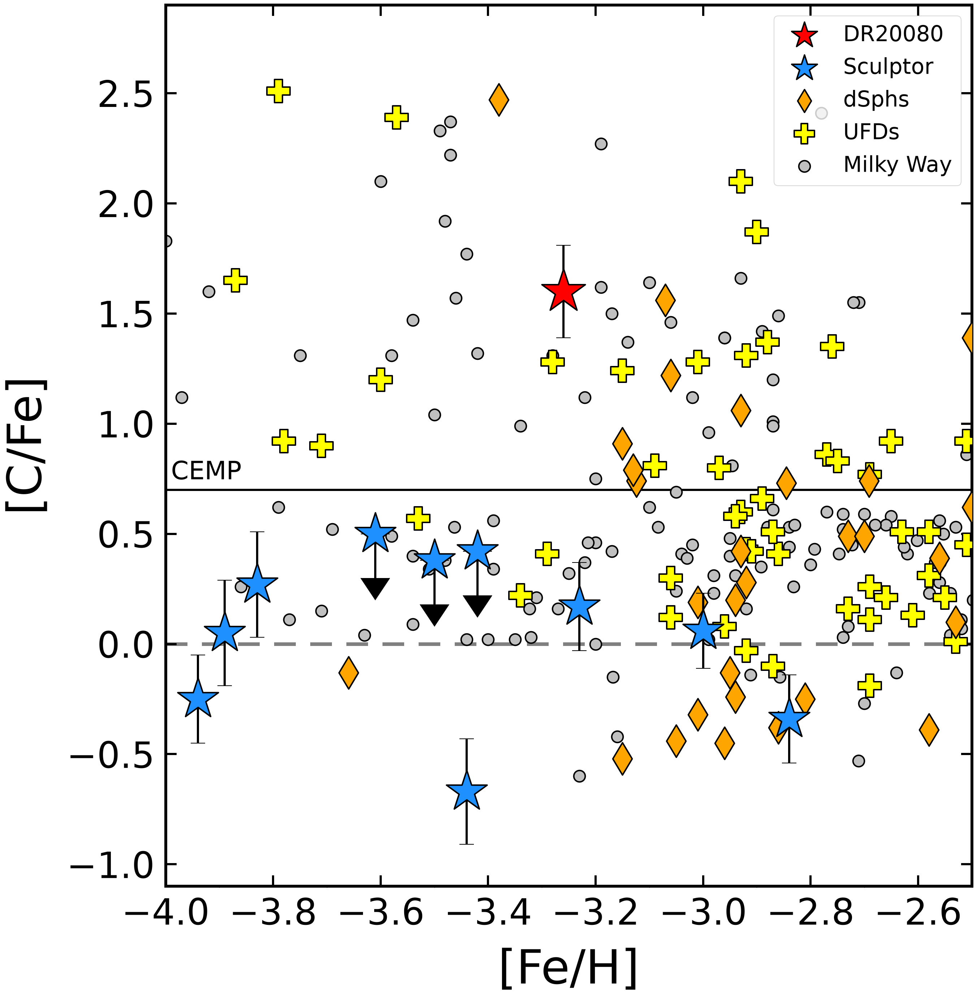
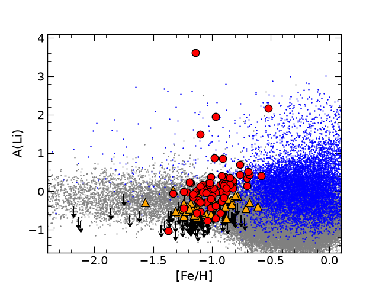
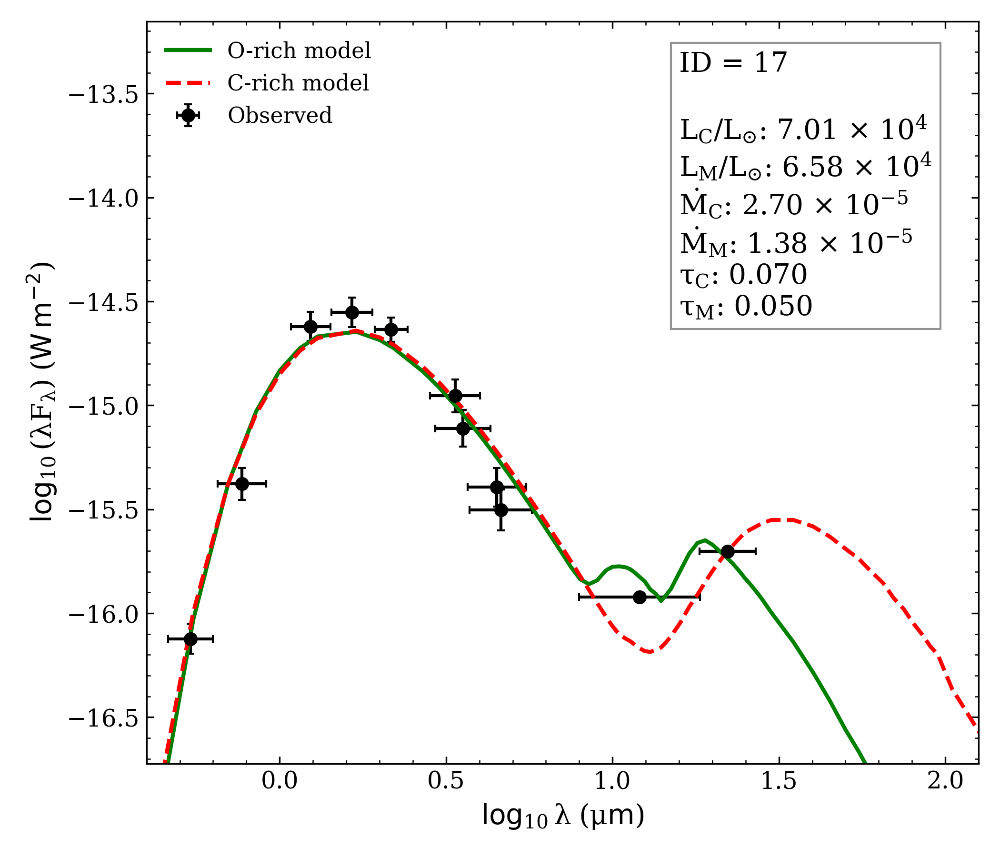

# arXiv Digest — 2026-11-11

- **Interest file used:** interests/2026.10.md (fallback — no 2026.11.md exists yet)
- **Categories pulled:** astro-ph.CO, astro-ph.EP, astro-ph.GA, astro-ph.HE, astro-ph.IM, astro-ph.SR, cs.LG, stat.ML, physics.data-an, hep-ph
- **Papers scanned:** 382 (110 astro-ph + 272 from extras: 235 cs.LG + 28 stat.ML + 3 physics.data-an + 44 hep-ph; raw total 420 before deduping 38 cross-listed overlaps)
- **After first filter:** 14 candidates reviewed with full text
- **Final selected:** 12 papers across 3 tiers

---

## Tier 1 — Highly relevant

### [Imaging exoplanets below the telescope stability limit](http://arxiv.org/abs/2611.13257v1)

Rodrigo Ferrer-Chavez, Jason J. Wang, Katherine L. Bouman et al.
**Primary category:** astro-ph.EP | also: astro-ph.IM

FLIP replaces empirical reference-PSF subtraction with a fully differentiable, physics-based model of the JWST/NIRCam optical system, using automatic differentiation to fit millions of wavefront and detector parameters directly against the science image instead of a library of reference stars. On real on-sky coronagraphic data this gives **sensitivity 2-15 times better than standard KLIP** reduction, and yields **the first image of 51 Eridani b at 4.3 μm**, a CO₂-sensitive wavelength where the planet was previously undetected with standard pipelines. The gains are largest exactly where reference stars are poorly matched in time, showing that physics-based, autodiff-driven PSF modeling can **surpass the stability limits of the telescope itself** rather than being bound by them.

*KLIP vs. FLIP PSF subtraction on three JWST/NIRCam targets. FLIP recovers 51 Eridani b in the F430M filter at SNR = 6.3 (a non-detection with KLIP) and shows markedly cleaner companion morphology across all targets.*

---

### [SHINE: Shear inference environment - Generative forward modelling for radio weak gravitational lensing](http://arxiv.org/abs/2611.14301v1)

Ezequiel Centofanti, Benjamin Remy, Emma Ayçoberry et al. (François Lanusse)
**Primary category:** astro-ph.IM

SHINE infers cosmic shear for next-generation radio weak-lensing surveys (e.g. SKA) directly from interferometric visibilities, using a fully differentiable JAX forward model that simulates galaxy morphology, the shear transformation, and the radio interferometer's response rather than measuring galaxy shapes explicitly. With a simple parametric galaxy model the recovered shear is **biased by more than 10σ**, because the model cannot represent real galaxy morphology; swapping in **a decoder trained on real HST COSMOS images** removes this bias, recovering the shear to within 2σ for 10,000 simulated radio galaxies. A fast MAP point-estimate variant matches the full posterior at a fraction of the sampling cost, pointing toward **shear inference at SKA survey scale**.

*Shear posterior recovered from 10,000 simulated radio galaxy visibilities using a parametric galaxy model (violet, strongly biased) versus the autoencoder-based generative model trained on real COSMOS images (orange, unbiased); the black cross marks the true shear.*

---

### [Dwarf galaxy simulations with stellar-core mass- and metallicity-dependent core-collapse supernova explosion energies](http://arxiv.org/abs/2611.14437v1)

Natalia Lahén, Kiril Maltsev, Thorsten Naab, Hans-Thomas Janka
**Primary category:** astro-ph.GA

This paper implements a new core-collapse supernova explosion-energy prescription — calibrated to 3D CCSN simulations and dependent on stellar core mass and metallicity — in the SPHGal galaxy-evolution code, then runs isolated low-metallicity (0.1 Z☉) dwarf galaxy simulations to test its effect on the baryon cycle. The new model produces **2.7 times more stellar-mass black holes** and an IMF-averaged explosion energy of just **0.33 B, a third of the canonically assumed 1 B**, because many intermediate-mass progenitors now fail to explode. The reduced feedback energy raises the star formation rate and star-cluster formation efficiency and, crucially, drives **mass-loading factors below unity** — gas is removed by star formation rather than outflows, better matching observed dwarf galaxies than the "canonical" 1 B feedback typically assumed in galaxy simulations.

*Outflow mass-loading factor (outflow rate / star-formation rate) over 1 Gyr for five dwarf-galaxy feedback models; the new variable-energy CCSN model (darkest line) sits below a loading factor of 1 (dashed), unlike the canonical 1 B models.*

---

### [Learning a model of non-stationary nuisances with non-local correlations for object detection](http://arxiv.org/abs/2611.14479v1)

Olivier Flasseur, Eric Thiébaut, Loïc Denis, Samuel Thé
**Primary category:** astro-ph.IM

For detecting faint exoplanets in high-contrast imaging, where a strong spatially correlated speckle "nuisance" from the host star swamps the planet signal, the authors propose an **unsupervised sparse precision-matrix model of the nuisance**, learned via a pivoted sparse Cholesky factorization rather than the fixed local-covariance blocks used by methods like PACO. On 13 real SPHERE datasets the method matches or beats the supervised deep-learning detector deep PACO, reaching a **true positive rate of 0.78 at a false-discovery rate of 0.005** (vs. 0.75 for deep PACO) with no labeled training data, and an unsupervised leave-one-out model-selection criterion picks a model complexity close to what a supervised search would choose.

*Detection maps around the host star for cADI, PCA, PACO, deep PACO and the proposed method on real SPHERE data; the unsupervised sparse-precision approach matches the supervised deep PACO detector at low false-discovery rate.*

---

### [High-precision abundance analysis of a unique CEMP-no star in Sculptor](http://arxiv.org/abs/2611.13115v1)

Francisco Cuadra, Ása Skúladóttir, Romain Lucchesi et al.
**Primary category:** astro-ph.SR | also: astro-ph.GA

The authors present the first detailed high-resolution (VLT/UVES) chemical-abundance analysis of a carbon-enhanced metal-poor, barium-normal (CEMP-no) star in a classical dwarf spheroidal, DR20080 in Sculptor, at **[Fe/H] = -3.26**, deriving abundances for 17 elements plus 4 upper limits with full NLTE corrections. Its abundance pattern — including a **[Si/O] ratio pointing to Population III enrichment** — is best matched by a two-progenitor Pop III supernova model: a dominant **43 M☉ faint supernova (E = 0.6×10⁵¹ erg)** plus a secondary 19.4 M☉ hypernova, distinct from the patterns seen in CEMP-no stars in the Milky Way halo or ultra-faint dwarfs. The result suggests CEMP-no chemistry depends on host-galaxy environment and makes DR20080 a strong candidate direct descendant of the first stars.

*[C/Fe] vs. [Fe/H] for DR20080 (red star) compared with metal-poor stars in Sculptor, other dSphs, ultra-faint dwarfs and the Milky Way halo; the horizontal line marks the CEMP threshold.*

---

### [The chemical DNA of the Magellanic Clouds -- VII. The lithium abundance in the Small Magellanic Cloud and the discovery of 4 lithium-rich stars](http://arxiv.org/abs/2611.13104v1)

A. Mucciarelli, M. Palla, C. T. Nguyen et al.
**Primary category:** astro-ph.SR | also: astro-ph.GA

Using VLT/FLAMES spectroscopy of 209 post-RGB-bump giants in the Small Magellanic Cloud, the authors measure lithium abundance A(Li) at this scale in a dwarf galaxy for the first time, detecting the Li line at >5σ in 32% of stars and finding **a large star-to-star scatter in A(Li) at [Fe/H] > -1.4 dex** that measurement error alone cannot explain. The scatter is attributed to a combination of **mass- and metallicity-dependent thermohaline mixing** and nova enrichment that, due to the SMC's lower star-formation efficiency, is predicted to raise A(Li) at lower [Fe/H] than in the Milky Way — consistent with a measured rise across three SMC globular clusters, from upper limits in 6-10 Gyr clusters to **A(Li) ~ +0.3 dex in the 1.5 Gyr cluster NGC 419**. The authors also report **the first four low-mass lithium-rich giants found in the SMC**.

*A(Li) vs. [Fe/H] for the SMC sample (red circles: secure detections; black arrows: upper limits) compared with Milky Way post-RGB-bump stars from GALAH DR4 (small points); the SMC population sits at systematically lower metallicity than the Milky Way comparison sample.*

---

## Tier 2 — Adjacent / useful context

### [Dust in Stellar Populations: Grid-Based and Bayesian Spectral Energy Distribution Fitting of AGB Stars with SEDust and MCM-SEDust](http://arxiv.org/abs/2611.13881v1)

Hamidreza Mahani, Atefeh Javadi, Amirhossein Rabiee
**Primary category:** astro-ph.GA

This paper reviews the four ingredients of stellar population synthesis (IMF, isochrones, spectral libraries, dust) and presents two complementary pipelines, SEDust and MCM-SEDust, for fitting DUSTY radiative-transfer models to the SEDs of dust-enshrouded AGB stars — the former via **χ² minimization on a precomputed grid**, the latter via **on-the-fly MCMC sampling** that yields full posteriors and captures degeneracies the grid approach misses. Applied to a star in IC 10, the two methods **agree on luminosity to within 2-7%** but differ by up to a factor of ~2 in derived mass-loss rate, showing that similar optical depths and luminosities do not guarantee consistent mass-loss estimates. The pipelines aim to connect star-by-star circumstellar dust modeling to the dust budgets assumed in galactic chemical evolution and SPS models.

*Example best-fitting SED for an AGB star in IC 10 from the grid-based SEDust pipeline, showing observed photometry (points) against the best-fitting DUSTY model (curve).*

---

### [AdjointFlow: Accelerating Scientific Inverse Problems with Physics-Based Transport](http://arxiv.org/abs/2611.13389v1)

Ethan Hanold, Nicholas M. Boffi, Qin Li, Leonardo Zepeda-Núñez
**Primary category:** cs.LG

AdjointFlow is a generative framework for scientific inverse problems that, instead of starting from Gaussian noise like standard diffusion/flow models, **initializes the generative transport from a data-dependent, adjoint-based estimate** of the target and trains a noise-free velocity field that stays well-behaved as the target posterior becomes sharply concentrated. Tested on inverse scattering, seismic imaging, and black-hole VLBI imaging (reconstructing images from sparse, noisy closure-phase and closure-amplitude measurements), it **matches or improves on diffusion-based baselines on 5 of 7 benchmarks** with far fewer integration steps, and an optional inference-time refinement step reaches state-of-the-art accuracy everywhere it is applied, **up to five orders of magnitude faster than plug-and-play methods**. For black-hole imaging, it recovers both simple ring-like structures and more complex accretion-disk morphology from a simple ring-shaped physical initialization.

*Reconstructed black-hole images at 3% visibility coverage from AdjointFlow versus diffusion-based baselines; AdjointFlow recovers both simple rings and more complex accretion-disk shapes from a ring-shaped physical initialization.*

---

### [Extracting Published Discussions of 13,616 Galaxies with Language Models](http://arxiv.org/abs/2611.13118v1)

Nolan Koblischke, Jo Bovy
**Primary category:** astro-ph.IM | also: astro-ph.GA

The authors use **GPT-5.5 agents in a terminal-based (Codex) harness** to read 156,006 arXiv astro-ph papers and extract substantive discussions (not just catalog mentions) of individual galaxies, running **20 concurrent agents for ~71 hours** at a cost of about $12,600. The pipeline extracts **44,332 galaxy discussions containing 85,314 verbatim quotes from 18,641 papers**, resolves sky coordinates for 98.2% of them by combining programmatic NED lookups with further agentic search, and groups them into 13,616 distinct galaxies published as the public GalaxyWiki database. A manual audit of 120 records found correct galaxy identification and verbatim-matched quotations in 118 of 120 cases, and the dataset has already been reused for literature checks on anomaly-detected galaxies and for training an astronomy vision-language model.

*GalaxyWiki brings together published discussions of individual galaxies: the number of papers discussing a selection of galaxies (left), and an auto-generated two-sentence summary with source quote and citation for NGC 4650A (right).*

---

### [Contrastive Discovery: Open-Ended Scientific Discovery over Competing Explanations](http://arxiv.org/abs/2611.14514v1)

Ziang Liu, James J. Kim, Yijia Dai, Jennifer J. Sun

Most LLM scientific-discovery agents test a single hypothesis against its negation, so a rejection tells them an explanation is wrong but not what replaces it; Contrastive Discovery instead scores each experiment by **how it redistributes belief across a full "contrast set" of mutually exclusive, collectively exhaustive explanations**, with one of its six evaluation domains being **SDSS galaxy data**. Across the six tabular datasets, **89% of the pointwise candidates with the largest belief shifts turn out to be mere rejections**, and reusing the exact same evidence under a contrast set resolves 73% of those to a specific alternative; when contrast sets instead guide the agent's search from the start, it **resolves 67% more questions under the same experiment budget**. In a blinded study, 38 human experts agreed with the system's chosen explanation on 78% of resolved questions, supporting explicit competing explanations as a way to get more scientific mileage from the same evidence.

*Number of scientific questions resolved as a function of experiment budget K, averaged over six datasets (including SDSS galaxy data): Contrastive Discovery (solid) resolves far more questions than pointwise surprisal, largely through corrective resolutions (shaded gap) that pointwise baselines only ever record as rejections.*

---

## Tier 3 — Outside my area but notable

### [Discovering Equations for the Thermodynamics of South Asian Monsoon Precipitation](http://arxiv.org/abs/2611.14401v1)

Savannah L. Ferretti, Jane W. Baldwin, Michael S. Pritchard, Tom Beucler
**Primary category:** cs.LG | also: physics.ao-ph

To understand how the vertical thermodynamic structure of the lower troposphere shapes South Asian monsoon precipitation, the authors train neural networks on 21 years of reanalysis data to compress the full vertical profile into a handful of interpretable features, then use **symbolic regression to distill those features into closed-form equations**. The best equation explains **1.5 times more precipitation variance than the standard buoyancy diagnostic** while recovering about 85% of the full neural network's skill using **roughly a thousand times fewer parameters**, and it reveals that moisture and instability act as competing, rather than additive, predictors, with the heaviest rain over ocean occurring when near-surface warmth and moisture coincide. The resulting equations largely reproduce expected convective physics without that physics being imposed during training — a template for turning opaque neural climate emulators into testable, physically interpretable constraints.

---

### [Adaptive catalyst discovery emerges from composable scientific intelligence](http://arxiv.org/abs/2611.13536v1)

Wentao Li, Qilong Cai, Qi Lei et al.
**Primary category:** cs.LG

CatAI is a **physics-grounded, modular AI framework for catalyst discovery** that learns 1.8 million structure-property relations and organizes them into 30 reusable physicochemical encoders, which task-specific models then draw on to guide catalyst design for a given reaction and objective. Beyond beating comparison models by **7.8% lower task-averaged prediction error** on benchmarks, the system was validated experimentally: it identified a confined-pocket catalyst with **9 times the activity of the commercial benchmark** for an industrial polymer-synthesis reaction, and separately guided autonomous closed-loop optimization to a Cu-based geminal-atom photocatalyst that outperforms the traditional Ni-based system for C-O coupling. The wet-lab-validated gains make this a notable demonstration of AI-guided autonomous experimentation in chemistry.
