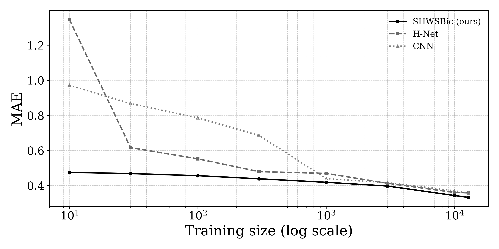
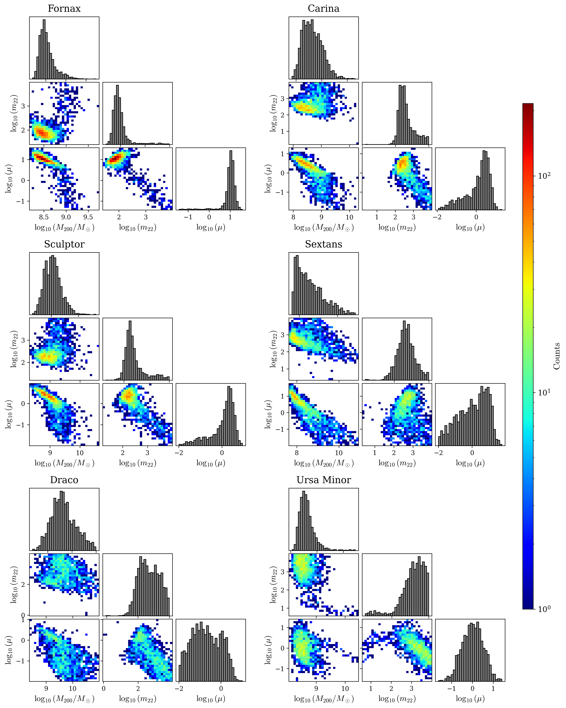
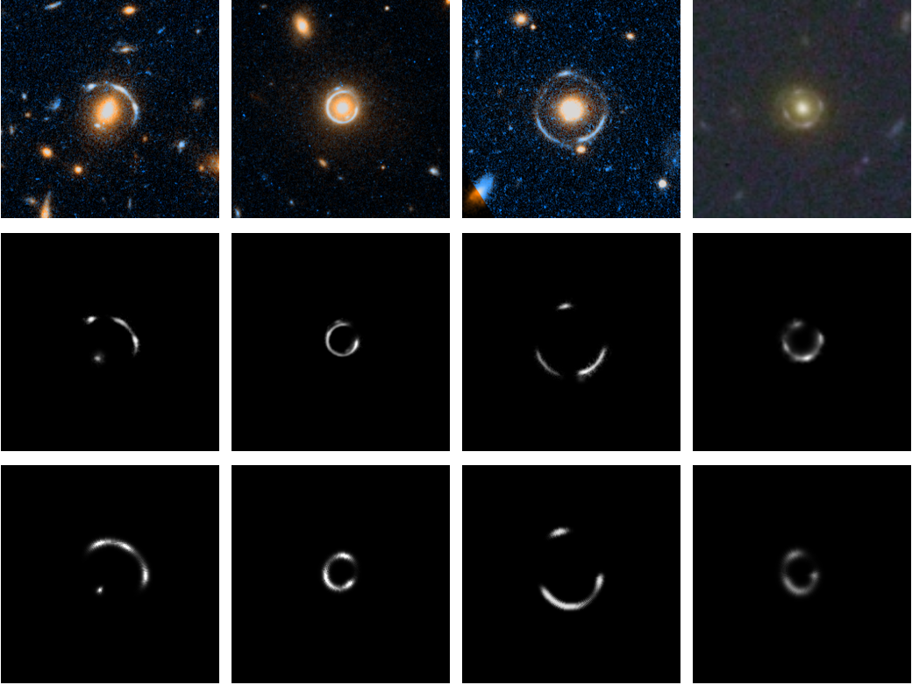
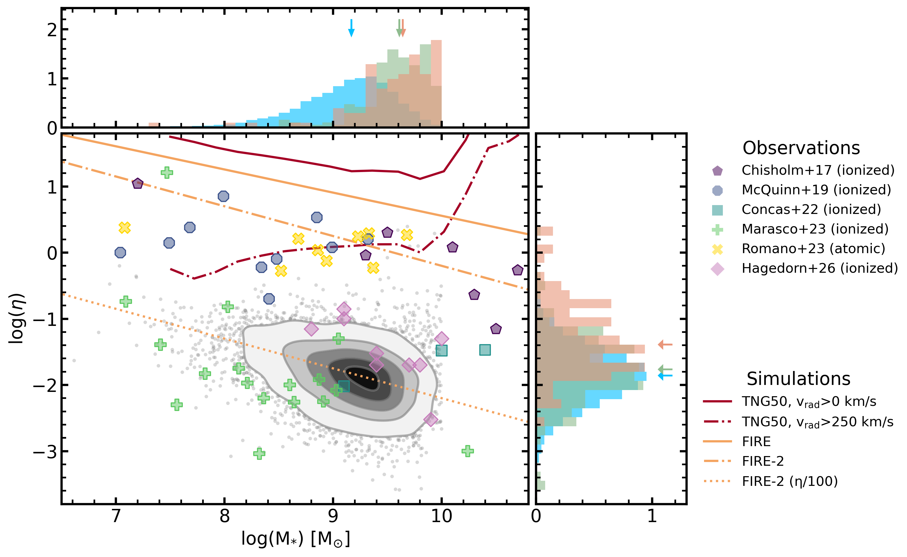
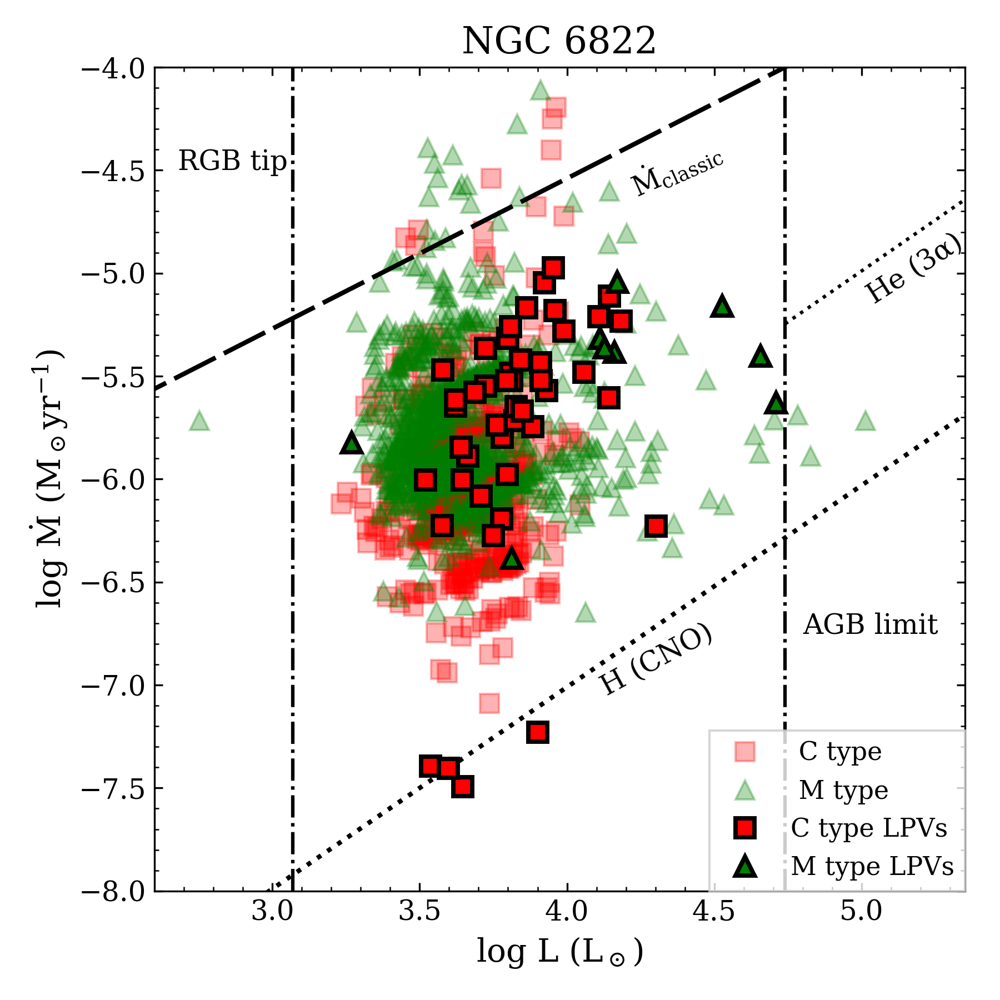
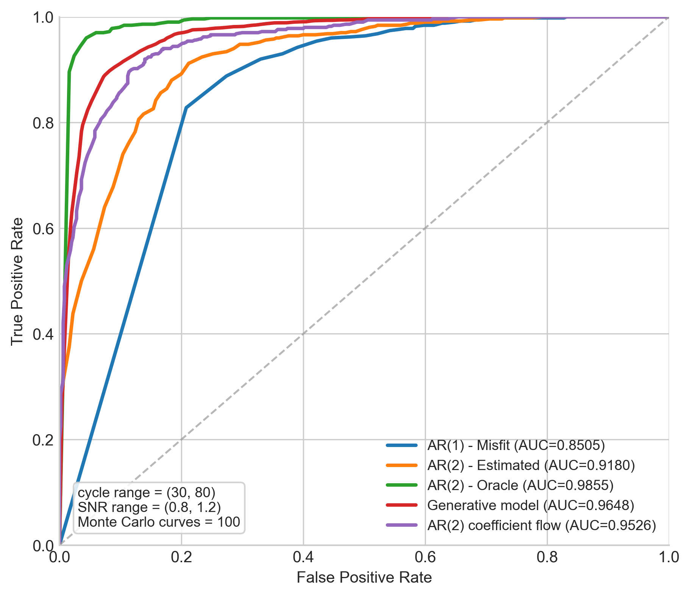
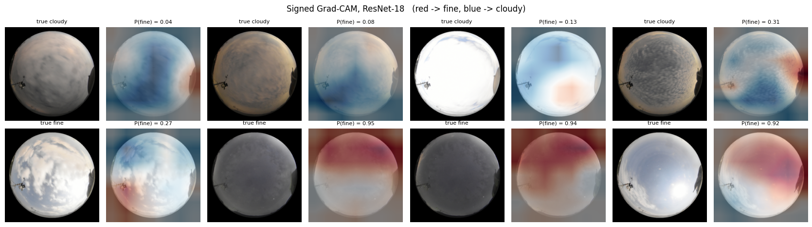

# arXiv Digest — 2026-11-13

- **Interest file used:** interests/2026.10.md (fallback — no 2026.11.md exists yet)
- **Categories pulled:** astro-ph.CO, astro-ph.EP, astro-ph.GA, astro-ph.HE, astro-ph.IM, astro-ph.SR, cs.LG, stat.ML, physics.data-an, hep-ph
- **Papers scanned:** 681 (258 astro-ph new/cross + 423 from extras)
- **After first filter:** 27 candidates reviewed with full text
- **Final selected:** 20 papers across 4 tiers

---

## Tier 1 — Highly relevant

### [Dark matter alters dwarf galaxy sizes and morphologies](http://arxiv.org/abs/2611.14638v1)

Akaxia Cruz, Robel Geda, Alyson Brooks, et al.
**Primary category:** astro-ph.CO | also: astro-ph.GA

Using novel **cosmological zoom simulations with baryons**, the authors compare dwarf galaxy evolution across cold dark matter and two self-interacting dark matter (SIDM) models. They find that **the co-evolution of dark matter core size and stellar half-light radius** differs systematically between cosmologies, and the relationship depends on morphology (irregular vs. disk). This establishes **galaxy size as a statistical probe of dark matter particle properties**, directly relevant to upcoming wide-field surveys like LSST.

*Half-light radius tracks dark matter core size differently in each cosmology — CDM galaxies sit on a near-vertical relation, SIDM on a near 1:1 relation — a potential observational discriminant between dark matter models.*

---

### [Beyond classification: regressing physical merger properties using solid harmonic wavelet bispectrum](http://arxiv.org/abs/2611.14630v1)

Alex Brown, Georgios Exarchakis, Mathilda Avirett-Mackenzie, et al.
**Primary category:** astro-ph.IM | also: astro-ph.GA

The authors apply the **solid harmonic wavelet scattering bispectrum** — a fixed, physically-motivated transform with built-in invariances — as an interpretable alternative to CNNs for galaxy mergers. Rather than just classifying merger/non-merger, the method **regresses merger mass ratio and time since merger simultaneously**, with **~0.33 dex uncertainty in mass ratio and ~0.66 Gyr in merger time**, outperforming a benchmark CNN while needing far fewer training samples and staying robust to noise.

*The wavelet-feature regressor reaches low error with far fewer training examples than the CNN baseline needs, showing the sample-efficiency gain from built-in physical invariances.*

---

### [Probing Ultralight Higher-spin Dark Matter using Stellar Kinematics of Dwarf Galaxies](http://arxiv.org/abs/2611.17204v1)

Praniti Singh, JiJi Fan, Savvas M. Koushiappas, et al.
**Primary category:** astro-ph.GA | also: hep-ph

Using **stellar velocity dispersions of six classical Milky Way dwarf galaxies**, the authors test whether ultralight dark matter (ULDM) carries nonzero spin, which predicts a more diffuse soliton core than scalar ULDM. Fitting a **generalized halo profile with three spin-sensitive parameters** in a Bayesian framework, they find **particle masses $m \gtrsim 3\times10^{-21}$ eV**, and while Fornax mildly prefers a denser-than-scalar core, **no galaxy yet rules out the more diffuse higher-spin cores**.

*Combining posteriors from all six dwarf galaxies, the inferred ULDM particle and halo masses are consistent across systems, with no galaxy's core density ruling out diffuse higher-spin cores.*

---

### [CosmoSim: Lens-parameter estimation of the Einstein Cross NGC 6505 using machine learning](http://arxiv.org/abs/2611.14678v1)

Ben David Normann, Oda Hjemli, Hans Georg Schaathun

**Primary category:** astro-ph.CO

The authors validate **CosmoSim**, an open-source gravitational-lens simulator, by training a CNN purely on synthetic images to estimate lens/source parameters, then applying it to **21 real images of 19 strong lenses** from Euclid and AGEL. For the benchmark Einstein Cross NGC 6505, the **ML-based reconstruction matches or outperforms the literature lens model**, and across the ensemble **predicted Einstein radii agree with catalogued values to within a mean relative difference of 0.08–0.19**.

*Four representative real lens systems, from raw survey image through foreground-light decontamination to the final ML-driven reconstruction, showing realistic recovered arc structure.*

---

### [Euclid Data Release 1 (DR1). ECLIPSE B: Discovery pipeline overview](http://arxiv.org/abs/2611.15886v1)

Euclid Collaboration, P. Holloway, A. Verma, et al.
**Primary category:** astro-ph.GA | also: astro-ph.CO

This paper details the multi-stage pipeline used to find the **15,000 high-grade strong-lens candidates in Euclid DR1**: a catalogue cut, an **ensemble of five machine-learning models**, a two-stage citizen-science search (4.5 million classifications from ~300,000 volunteers), and expert grading, against over 68 million candidate objects. The combined approach reaches a measured completeness of **$0.73^{+0.08}_{-0.15}$ for grade-A lenses**, and the authors show that **researcher grading itself is a source of systematic bias**, which they calibrate for.

---

### [galpy with differentiable, accelerated backends: galactic dynamics in jax and PyTorch](http://arxiv.org/abs/2611.14614v1)

Jo Bovy

**Primary category:** astro-ph.IM | also: astro-ph.GA

Bovy extends galpy, the standard Python galactic-dynamics library, with **jax and PyTorch backends** that make its potentials, orbit integration, and distribution functions **GPU-accelerated and differentiable** end-to-end, from a force evaluation to samples drawn from a distribution function. On a GPU, batched orbit and stream calculations run **one to five orders of magnitude faster** than a single CPU core, and the paper demonstrates the new capability by fitting a Galactic potential to a hypervelocity star and learning an inverse action-angle transformation with a neural network trained *through* galpy. Notably, **an AI coding agent wrote essentially all of the code** under the author's direction, with the paper describing how correctness was established — a live case study in agent-assisted scientific software development.

*Throughput of a force evaluation versus number of points: the GPU backends overtake a single CPU core once the batch is large enough to amortize transfer cost, reaching up to five orders of magnitude speedup on an H100.*

---

### [The full Gaia colour-magnitude diagram with white dwarfs reveals a declining Milky Way star formation history](http://arxiv.org/abs/2611.17337v1)

K. Sysoliatina, Akash Vani

**Primary category:** astro-ph.GA | also: astro-ph.SR

The authors build CALOMERA, a chemo-dynamical population-synthesis framework that jointly fits the **non-degenerate and white-dwarf populations self-consistently** against $7.98\times10^6$ Gaia DR3 stars, replacing earlier white-dwarf-only calibrations that **over-predicted WD counts by 81%**. The calibrated model matches observed CMD star counts to within 3% and recovers a Milky Way **star formation history that peaks early and declines exponentially, with two recent bursts at τ≈2.4 and 0.5 Gyr**. Three independent WD cooling libraries (Montréal, BaSTI, LPCODE) give comparably good fits, and the framework is extended to predict Galactic L/T/Y brown-dwarf counts in deep JWST fields.

*The model's recovered initial-final mass relation, initial mass function, and star formation history (solid blue, with 1–3σ bands) compared against independent literature determinations — showing where the joint WD+non-degenerate calibration lands relative to prior single-population fits.*

---

### [A statistical study of ionized outflows in low-mass galaxies from DESI DR1](http://arxiv.org/abs/2611.15884v1)

Michael Romano, Amélie Saintonge, Chiara Circosta, et al.
**Primary category:** astro-ph.GA

Using [OIII] and Hα from DESI DR1, the authors identify **~5800 dwarf galaxies ($\log(M_*/M_\odot)\lesssim10$) with robust ionized-outflow signatures**, the largest such statistical sample to date. The measured **mass-loading factors span η = 0.001–1 (median ~0.01)**, systematically **1–2 dex lower than cosmological simulations predict**, suggesting the ionized phase traces only a minor fraction of the true outflow mass. Outflow velocities exceed the escape velocity in ≥80% of composite/AGN hosts versus ~40% of star-forming galaxies, and **mass-loading factor correlates positively with specific star-formation rate**, pointing to burstiness as a key regulator of feedback efficiency in the baryon cycle of low-mass galaxies.

*Mass-loading factor versus stellar mass for the DESI dwarf sample (grey contours) against literature observations and cosmological simulation predictions (TNG50, FIRE, FIRE-2) — the observed outflows sit well below simulated expectations across the full mass range.*

---

### [A giant dark matter core extending far beyond the stars of a dwarf galaxy](http://arxiv.org/abs/2611.15528v1)

Qinwei Yuan, Yong Shi, Xin Li, et al.
**Primary category:** astro-ph.GA

Combining MUSE Hα kinematics with multi-resolution MeerKAT HI from the MHONGOOSE survey, the authors derive an extended rotation curve for the gas-rich dwarf galaxy UGCA 320 and find it is poorly fit by a cuspy NFW profile but well described by cored models, with an **inner density slope γ = 0.36 ± 0.12**. The best-fit core radius is **7.62 ± 0.80 kpc — roughly four times the stellar half-light radius**, far larger than typically seen in dwarf galaxies and larger than standard stellar-feedback core formation is expected to produce. The result sits more comfortably with **self-interacting dark matter (SIDM)** than with warm/fuzzy dark matter or baryonic-feedback explanations, posing a challenge to the standard CDM core-formation picture.

*UGCA 320's core radius (red star) compared against the stellar mass and $R_c/R_e$ distribution of other low-mass SPARC galaxies — it is a clear outlier, with a core several times larger relative to its stellar body than any comparison galaxy.*

---

### [Mitigating variance shrinkage in multi-task galaxy property inference from imaging data via statistical manifold alignment](http://arxiv.org/abs/2611.16598v1)

Zhijian Luo, Jianzhen Chen

**Primary category:** astro-ph.GA | also: astro-ph.IM

The authors introduce ViTMultiTask, a **vision transformer with task-specific tokens** that infers redshift, stellar mass, $D_n4000$, and Hδ_A jointly from Subaru HSC five-band imaging, trained against DESI spectroscopic labels. They show that standard point-wise losses induce **"variance shrinkage"** — predictions collapse toward the mean, destroying bimodal structure and heavy tails — and fix this with a **multi-scale maximum mean discrepancy (MMD) loss** that aligns the predicted and observed joint distributions in RKHS. The MMD-regularized model recovers the true parameter distributions' shape while keeping point-estimate RMSE within 3.5% of the unconstrained baseline, directly addressing a failure mode that matters for any downstream population-level inference (e.g. stellar mass functions).

*1D kernel density estimates of predicted vs. true parameter distributions: without MMD (blue dashed), predictions collapse into artificially narrow, truncated peaks, while the MMD-regularized model (red) reproduces the observed spread, multimodality, and tails.*

---

### [Euclid Data Release 1 (DR1). Pushing back the borders of the invisible with Euclid. Discovery of fifteen resolved low-surface-brightness stellar systems from the Milky Way to the Local Volume](http://arxiv.org/abs/2611.16025v1)

Euclid Collaboration, M. Gatto, S. Rusterucci, et al.
**Primary category:** astro-ph.GA

Using an isochrone-filtering technique on ~1900 deg² of the Euclid Wide Survey DR1, the team resolves **15 stellar systems into individual stars for the first time**, five of them genuinely new discoveries (three in the Milky Way halo, two beyond the Local Group). Highlights include **Ursa Minor II**, one of the least luminous stellar systems known (~40 M_sun), and **Eridanus V**, straddling the globular-cluster/ultra-faint-dwarf boundary at ~550 M_sun. Twelve systems lie in the M81 group at 3–5.5 Mpc, three of them reaching **mean surface brightness μ_V ~ 28 mag/arcsec² — a regime essentially unexplored at these distances** — demonstrating Euclid's reach for low-surface-brightness science from the Galactic halo to the Local Volume in one homogeneous survey.

---

### [Mass Loss Rates of Evolved Stars in Isolated Dwarf Galaxies](http://arxiv.org/abs/2611.15948v1)

Narges Rostami, Hamidreza Mahani

**Primary category:** astro-ph.GA

Using SEDust, an automated SED-fitting pipeline, the authors derive mass-loss and dust-production rates for AGB stars in the isolated dwarf irregular galaxy NGC 6822, finding a **total AGB mass-loss rate of (3.7 ± 1.1) × 10⁻³ M_sun/yr**. Integrated over 10 Gyr at this rate, AGB stars would produce only **~2 × 10⁵ M_sun of dust — short of the 2.7 × 10⁵ M_sun observed by Herschel**, implying AGB stars alone cannot account for the galaxy's present-day dust budget and that **additional dust sources, such as ISM grain growth, are required**.

*Mass-loss rate versus luminosity for oxygen-rich (green) and carbon-rich (red) AGB stars in NGC 6822, against the theoretical single-scattering limit for dust-driven winds — most stars fall well below the limit, consistent with moderate wind efficiency.*

---

### [Discrete Supernovae and the Limits of Continuous Models in Low-Mass Dark Matter Halos](http://arxiv.org/abs/2611.15335v1)

C. Power, S. Balu

**Primary category:** astro-ph.GA | also: astro-ph.CO

Using a one-zone model, the authors show that the standard galaxy-formation approximation of **continuous, IMF-averaged supernova energy injection** breaks down in low-mass halos, where a **single discrete supernova can unbind 1.5–2.7× the available gas**. Because continuous feedback acts ~4 Myr after star formation begins while the first real supernova takes ~10 Myr, discrete models produce a **stellar mass excess that depends strongly on halo mass: 135% at 10⁷ M_sun, 15% at 10⁸ M_sun, negligible by 10⁹ M_sun** (at z=5). Matching the expected energy per unit stellar mass between the two treatments does **not** guarantee equivalent feedback outcomes — a cautionary result for any dwarf-galaxy simulation relying on IMF-averaged feedback prescriptions.

*Stellar mass excess from discrete vs. continuous feedback as a function of halo mass and gas-retention assumption — the excess is large and halo-mass-dependent at the low-mass end, vanishing by ~10⁹ M_sun.*

---

### [ViViViT: a Video-to-Video Vision Transformer for Cosmological Lightcone Reconstruction](http://arxiv.org/abs/2611.14617v1)

Federico Semenzato, Alvise Raccanelli, Michele Liguori

**Primary category:** astro-ph.IM | also: astro-ph.CO

Introduces **ViViViT**, a vision transformer that recasts cosmological lightcone reconstruction as a video-to-video translation problem, factorizing attention across transverse frames and along the radial (cosmic-time) direction. Trained to recover the **underlying matter density field from 21cm neutral hydrogen simulations** across $z\in[7.66,16.00]$, it preserves spectral power and phase alignment within a few percent of the ground truth up to the Nyquist scale. It **outperforms a convolutional 3D U-Net baseline** across two- and three-point statistics, marking a step toward field-level architectures that natively respect cosmic time.

*ViViViT reconstructs finer density structure than the U-Net baseline on a held-out lightcone slice, with reconstructed and target density fields sharing a common color scale.*

---

### [A Mechanistic Interpretability Study of an Astronomy Foundation Model](http://arxiv.org/abs/2611.15653v1)

Rachel C. Zhang, Alberto Bietti, Wes Gurnee, et al.
**Primary category:** cs.LG | also: astro-ph.IM

Presents the first **causal mechanistic interpretability study of an astronomy foundation model**, AION-1, probing why combining imaging with photometry improves redshift prediction over photometry alone. The **multimodal advantage localizes almost entirely to the first of the encoder's twelve blocks**, where one attention head dominates linear decoding of spatial extent yet can be ablated with negligible effect (the information reappears one layer later), while a different single head is **causally necessary for most of the dust-attenuation advantage**. None of the astrophysically motivated hypotheses tested explain what that head actually computes.

*Layerwise linear-probe R² for ten galaxy properties across the encoder's depth, showing redshift- and extent-related decodability peaking early while dust parameters stay weakly decodable throughout.*

---

## Tier 2 — Adjacent / useful context

### [Anatomy of LyC Escape in MEGATRON](http://arxiv.org/abs/2611.15931v1)

Nicholas Choustikov, Harley Katz, Taysun Kimm, et al.
**Primary category:** astro-ph.GA | also: astro-ph.CO

Using the **MEGATRON suite of zoom radiation-hydrodynamic simulations**, the authors show feedback physics jointly sets UV source counts, Lyman-continuum escape fractions, and reionization history, driven by a **timing competition between starburst onset and LyC escape**. They identify **electron density from the [OII] λλ3727 doublet as a candidate observational diagnostic of escape fraction**, noting UV-slope-based calibrations can overpredict escaping ionizing luminosity by up to two orders of magnitude.

---

### [Moving Beyond the DRW Model: Learning Quasar Variability with Generative Models](http://arxiv.org/abs/2611.15040v1)

Nadav Bojan Sellam, Kevin Park, Alex Bronstein, et al.
**Primary category:** astro-ph.GA | also: cs.AI

Quasar periodicity searches (e.g. for SMBH binaries) and variability classifications typically rely on the **damped random walk (DRW)** as a null-hypothesis noise model, which is known to be incomplete and can bias significance estimates. The authors introduce **Nullasar**, a generative model trained with **flow matching** that learns quasar light-curve statistics directly from data without assuming any parametric noise form. When the true variability follows a more flexible AR(2) process, Nullasar **outperforms a fitted DRW/AR(2) null (AUC 0.96 vs. 0.85–0.92), approaching the oracle (AUC 0.99)**, because the DRW/AR(2) fit absorbs genuine periodic signal as noise.

*ROC curves for periodicity detection under true AR(2) variability: Nullasar (red) and the AR(2)-coefficient flow (purple) both beat a per-light-curve AR(2) fit (orange) and the mis-specified AR(1) null (blue), approaching the oracle bound (green).*

---

### [Sky Monitor AI: classifying night-sky conditions from an observatory all-sky camera with a CNN ensemble, label-free sky types and exact evidence maps](http://arxiv.org/abs/2611.14987v1)

Muhammad Waqas

**Primary category:** astro-ph.IM

Builds **Sky Monitor AI**, a CNN ensemble classifying all-sky camera frames as clear or cloudy for small observatories, trained on 8,806 frames from 32 nights. A **validation-selected ensemble reaches 86.7% accuracy (AUC 0.924)**, with moonlight the dominant difficulty. Its key contribution is explainability: for networks ending in global average pooling, the **decision decomposes exactly into local logits**, giving gradient-free, pixel-level evidence maps showing the network attends to genuine sky structure rather than shortcuts.

*Signed Grad-CAM evidence maps (red = evidence for clear, blue = for cloudy) across overcast, moonlit, broken-cloud and mislabelled frames.*

---

## Tier 3 — Outside my area but notable

### [A self-shadowing black hole accretion disk at sub-Eddington luminosities](http://arxiv.org/abs/2611.14626v1)

M. Armas Padilla, T. Muñoz-Darias, J. Sánchez-Sierras, et al.
**Primary category:** astro-ph.HE

Multiwavelength spectroscopy of a black hole X-ray binary outburst reveals a **self-shadowing accretion disk at only ~0.2 L_Edd** — well below where such shielding geometries were thought to appear. As luminosity drops, the spectrum flips from cool recombination lines to a hot, featureless, highly irradiated state as shielding collapses, corroborated by simultaneous X-ray spectra. The result suggests **self-shadowing disks may be common at sub-Eddington luminosities**, with direct consequences for inferred black hole spins and X-ray polarization measurements.

*Schematic of how a vertically extended inner disk shields the outer disk at high luminosity, and how that shielding collapses as luminosity drops.*

---

## Tier 4 — Meta-research about the field

### [Auditing AI peer reviewers: a benchmark on real scientific papers](http://arxiv.org/abs/2611.17052v1)

Íñigo Zubeldia, Boris Bolliet, Francisco Villaescusa-Navarro, et al.
**Primary category:** cs.CL | also: astro-ph.IM

Builds a benchmark injecting objective, localizable errors into real astrophysics and ML preprints to audit **LLM-based peer review**, testing twelve reviewer systems including a new multi-agent reviewer, Skepthical. **Choice of base model matters most** — frontier LLMs differ by about 50 percentage points in total error detection on identical prompts — and scaffolding like Claude Code or citation retrieval helps mainly where it supplies what the base model can't. Skepthical's citation-detection lead is large on astrophysics but disappears on ML, where base models already know the literature; most systems keep false-positive rates under 10%.

*Error detection rate by severity, error type and model family on the astrophysics and ML corpora, showing base model choice driving most of the spread.*
