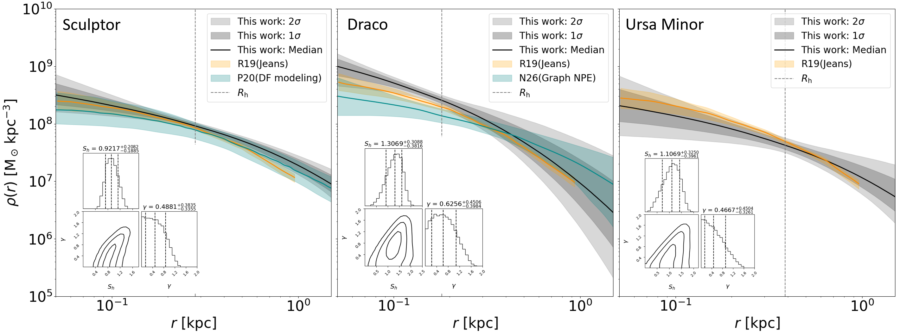
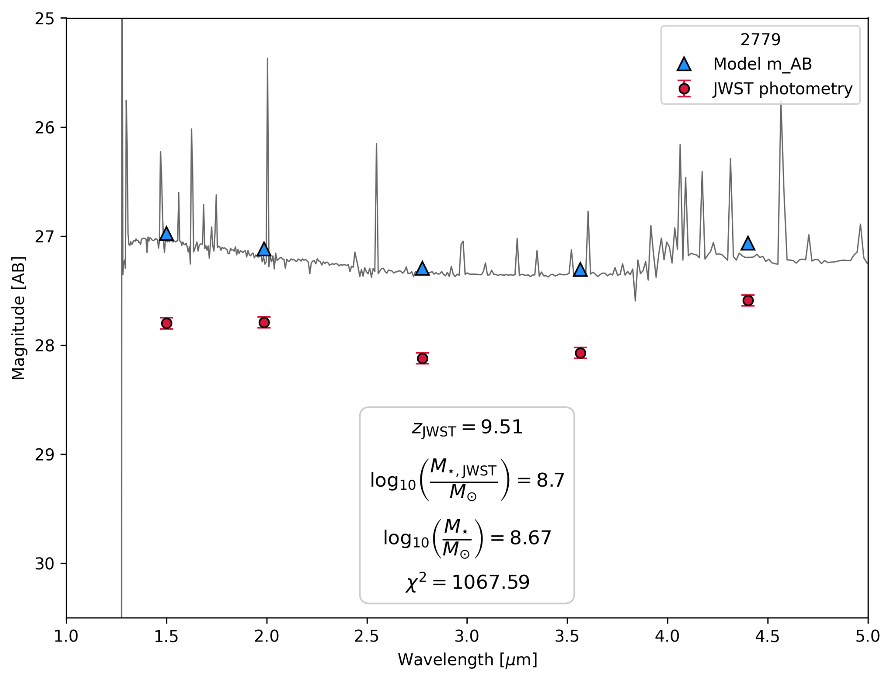
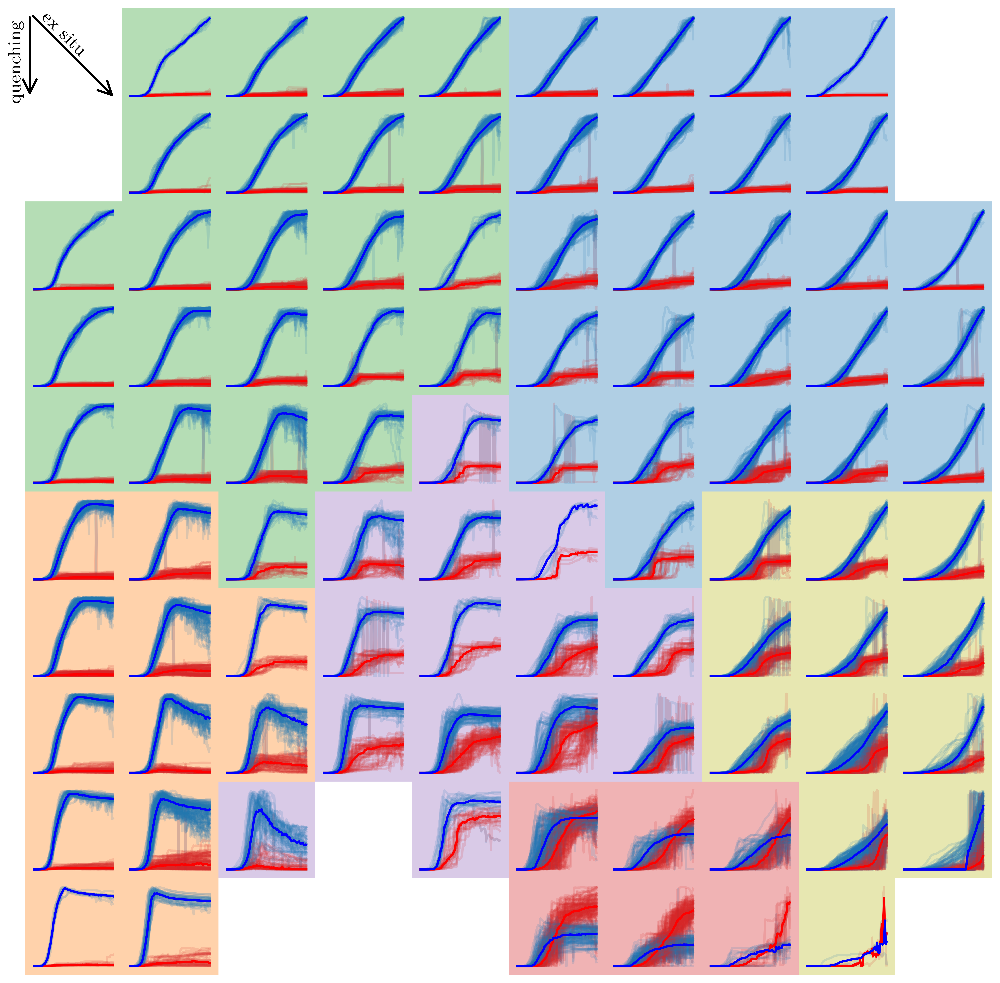
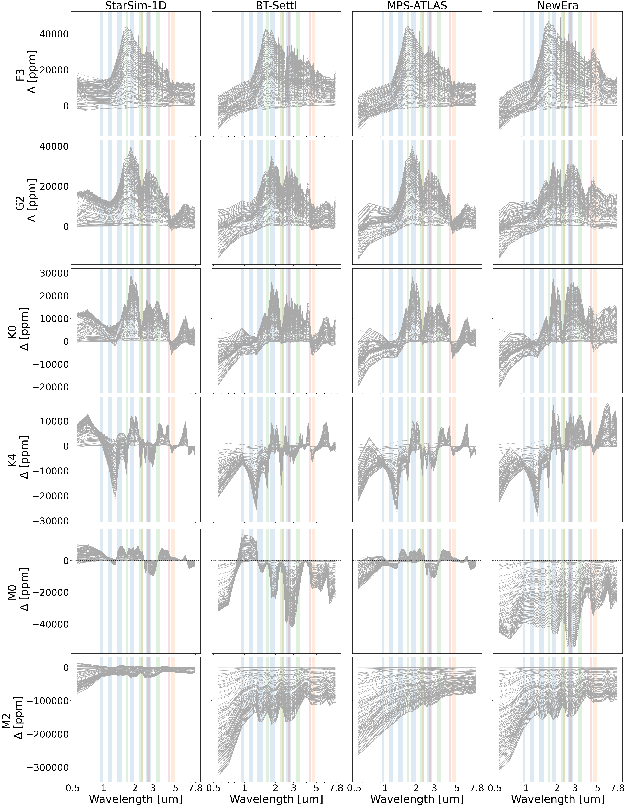

# arXiv Digest — 2026-11-16

- **Interest file used:** interests/2026.10.md (fallback — no 2026.11.md exists yet)
- **Categories pulled:** astro-ph.CO, astro-ph.EP, astro-ph.GA, astro-ph.HE, astro-ph.IM, astro-ph.SR, cs.LG, stat.ML, physics.data-an, hep-ph
- **Papers scanned:** 293 (184 astro-ph new/cross + 109 from extras)
- **After first filter:** 17 candidates reviewed with full text
- **Final selected:** 16 papers across 3 tiers

---

## Tier 1 — Highly relevant

### [Euclid Data Release 1 (DR1). Enhancing deep-learning models: the impact of image processing and training data selection for strong-lens detection](http://arxiv.org/abs/2611.17420v1)

Euclid Collaboration: M. Fogliardi, P. Holloway, S. Schuldt et al.
**Primary category:** astro-ph.CO | also: astro-ph.GA

The Euclid Collaboration presents a systematic **ablation study of deep-learning strong-lens finders** for the DR1 ECLIPSE search, testing a **Zoobot-based ConvNeXt CNN** across training-set composition, VIS-only vs. pseudo-RGB input, hard-negative mining, and two-stage (simulation-then-real) training. The ensemble of VIS-only and pseudo-RGB branches recovers **79.1% of known DR1 lenses at a fixed inspection budget of ~68,000 candidates**, beating either branch alone by 6-11%. The dominant performance driver is **negative-sample curation** (hard negatives from citizen-science rejects), not architecture choice, with Stage-0 pretraining alone improving high-recall performance by up to 84%.

*Schematic of the two-stage training strategy (simulation-based pretraining followed by fine-tuning on real Euclid lenses) used for the ConvNeXt-based lens-finding models.*

---

### [Precise Deep-Learning Reconstruction of Galaxy Cluster Mass Maps and Substructures from Optical Observations](http://arxiv.org/abs/2611.18487v1)

Atulit Srivastava, Weiguang Cui, Daniel de Andres et al.
**Primary category:** astro-ph.CO | also: astro-ph.IM

A **multi-encoder U-Net**, trained purely on mock HST-like images from The Three Hundred simulations, is validated for the first time on **21 real CLASH galaxy clusters**, reconstructing projected total mass maps from optical imaging alone. The predicted maps **agree with independent lensing and X-ray mass profiles to within ~0.1-0.2 dex** and recover the expected power-law subhalo mass function (slope ≈ -0.91), while resolving **~1.5-2× more low-mass substructure** than lensing-based reconstructions. This establishes a fast, photometry-only alternative to lensing for mapping cluster dark matter.

*Side-by-side comparison for merging cluster MACS J0416−2403: the HST image, the lensing-derived mass map, and the U-Net-predicted mass map, showing the network recovers cluster structure directly from imaging.*

---

### [Euclid Data Release 1 (DR1). AstroVink-TREX: Automated strong gravitational lens segmentation as input for mass modelling pipelines](http://arxiv.org/abs/2611.17894v1)

Euclid Collaboration: S. H. Vincken, N. E. P. Lines, J. W. Nightingale et al.
**Primary category:** astro-ph.IM | also: astro-ph.GA

**AstroVink-TREX** couples a **pre-trained vision-transformer encoder with a parallel CNN branch** to automatically separate lens light, source light, and contaminants into three flux maps for strong-lens systems — replacing what was previously a fully manual step in Euclid's modelling pipeline. Trained on only 377 hand-modelled systems by reusing a detection network's learned features, it now drives automated setup for the entire **15,000+-candidate DR1 ECLIPSE catalogue**. In expert validation across ~3,000 inspected systems, **only 39 lens models (1.3% of the sample) fail because of a segmentation error**, showing automated segmentation no longer bottlenecks lens modelling at survey scale.

*Example DR1 systems showing the observed image, the network's predicted lens/source/contaminant segmentation, and how each output feeds directly into the PyAutoLens modelling pipeline.*

---

### [Beyond the Inner Slope γ: A Schwarzschild-based Probe of the Core-Cusp Problem in the Milky Way Dwarf Spheroidal Galaxies](http://arxiv.org/abs/2611.17835v1)

Rin Miyazaki, Masashi Chiba, Shunichi Horigome
**Primary category:** astro-ph.GA

The authors build a **spherical Schwarzschild orbit-superposition framework** for dwarf spheroidal dark matter profiles, using a **mixture density network trained on unbinned stellar velocities** to smooth the line-of-sight velocity distribution and avoid binning artifacts. Applied to Sculptor, Draco, and Ursa Minor, the **logarithmic density slope at the half-light radius S_h is robust to prior choice** (e.g. S_h = 0.92⁺⁰·²¹₋₀.₁₉ for Sculptor) while the asymptotic inner slope γ is not, showing γ alone is an unreliable cusp/core diagnostic. Inferred slopes broadly agree with **FIRE-2 ΛCDM predictions**, though current uncertainties can't yet distinguish ΛCDM from SIDM.

*Inferred dark matter density profiles for Sculptor, Draco, and Ursa Minor (this work, gray) compared against three previous dynamical-modeling methods, with inset posteriors on S_h and γ.*

---

### [The ISM-CGM Transition of a Star-forming Dwarf Galaxy Resolved in Ionized Gas Emission](http://arxiv.org/abs/2611.17480v1)

Chloe Neufeld, Pieter van Dokkum, Imad Pasha (Van Dokkum: flagged high-value author)
**Primary category:** astro-ph.GA

Using Keck/KCWI and KCRM, the authors spatially resolve ionized gas in dwarf galaxy **UGC 6578 (M* = 10^7.8 M_sun)** out to ~0.1 R_vir, reporting the **first detection of a sharp ISM-CGM transition below M*/M_sun < 10^8**: the Hα surface brightness profile breaks from exponential to a shallow power law at **0.033 R_vir**. BPT diagnostics show the inner CGM is **ionized by the galaxy's own star formation**, not shocks or the UV background, and a kinematically distinct low-metallicity clump is identified as a possible direct detection of ongoing gas accretion. This is a pilot study for the upcoming BRIDGES survey.

*Hα surface brightness vs. radius, showing the break from an exponential ISM profile to a shallow CGM power law — the first such ISM-CGM transition resolved at this low a stellar mass.*

---

### [Hydrodynamic and photoionization analysis of a Cosmic Dawn dwarf galaxy based on a JWST-inferred star formation history](http://arxiv.org/abs/2611.17582v1)

B. Melekh, S. Chudyk, I. Koshmak
**Primary category:** astro-ph.GA

The authors couple hydrodynamics with photoionization modeling, evolving **BPASS stellar population synthesis** through a superwind bubble and surrounding nebula for Cosmic Dawn dwarf galaxy "2779" from z ≈ 29.5 to 9.5, using a JWST-derived star formation history. **Lyman-continuum escape turns on near z ≈ 20**, with a non-monotonic evolution in f_esc and X-ray luminosity per SFR, and **including diffuse nebular ionizing radiation can push the effective escape fraction above 1**. The final model spectrum reproduces the shape of the **observed JWST SED at z = 9.51**, though the normalization requires revisiting the inferred stellar mass — relevant to whether dwarf galaxies alone could drive reionization.

*Model spectral energy distribution vs. observed JWST NIRCam photometry for galaxy 2779 at z=9.51, testing whether the photoionization+hydrodynamic model reproduces the data.*

---

### [Unsupervised learning reveals a small number of galaxy formation pathways in IllustrisTNG](http://arxiv.org/abs/2611.17559v1)

C. Alvarez-Fernandez, H. Dominguez Sanchez, J. Vega-Ferrero et al.
**Primary category:** astro-ph.GA

Applying **UMAP dimensionality reduction** to the star-formation histories of ~10,000 TNG50/TNG100 galaxies followed by **k-means clustering**, the authors find the 2D UMAP embedding **cleanly orders galaxies by quenching state and ex-situ mass fraction** without those properties being used as inputs. Clustering yields **six distinct evolutionary pathway groups** that map onto systematic differences in morphology, angular momentum, and merger history, occupying distinct regions of the SFR-mass and mass-size planes — suggesting the diversity of galaxy formation histories collapses onto a small number of characteristic pathways.

*Star formation histories averaged within each cell of the UMAP embedding, colored by dominant k-means cluster, showing quenching degree and ex-situ mass fraction as the two main gradients across the learned representation.*

---

### [Model Choice or Model Bias? How stellar spectral libraries and activity modelling choices influence Ariel spectra — I. Forward model](http://arxiv.org/abs/2611.18107v1)

N.-E. Nèmec, A. Thompson, Ò. Porqueras-León et al.
**Primary category:** astro-ph.EP | also: astro-ph.IM

The authors systematically compare **three 1D stellar spectral libraries (BT-Settl, PHOENIX NewEra, MPS-ATLAS)** against **3D MHD stellar atmosphere spectra** as ground truth, computing facular/spot contamination spectra for six spectral types (F3-M2) across the full Ariel wavelength range. **Library choice — especially the faculae treatment — introduces systematic biases exceeding Ariel's ~20 ppm Tier 3 sensitivity threshold** for most spectral types, and these biases **align with H2O, CO2, CO, and CH4 absorption bands**, making them indistinguishable from genuine atmospheric signals at Ariel's precision.

*Spectral differences between each 1D library and the 3D-MHD ground truth, with molecular absorption bands (H2O, CO2, CO, CH4) shaded — showing library-driven biases land directly on top of the atmospheric features Ariel is meant to measure.*

---

### [Effects of Environment on the Star Formation Histories and Shapes of Simulated Galaxies](http://arxiv.org/abs/2611.17427v1)

Francisco J. Mercado, Brian A. Giraud Calderon, Jorge Moreno et al.
**Primary category:** astro-ph.GA

Using the **FIREbox cosmological volume simulation** (1720 resolved galaxies, M* = 5×10^6-5×10^11 M_sun), the authors quantify environment via a continuous tidal **Perturbation Index (PI)** and show that below **10^10 M_sun, galaxies in stronger tidal environments formed earlier and are measurably rounder** (larger minor-to-major axis ratio) at fixed stellar mass. A partial-correlation analysis shows this environment-shape link is **largely explained by formation time**, not halo mass, below 10^10 M_sun — the testable prediction being that **dwarf galaxies in denser environments should appear rounder in projection**, tracking stellar population age.

---

## Tier 2 — Adjacent / useful context

### [Improved Bounds on the Dark Matter-Neutrino Cross Section using LSBGs](http://arxiv.org/abs/2611.17922v1)

Akari Suezaki, Shunsaku Horiuchi
**Primary category:** hep-ph | also: astro-ph.GA

The authors derive new constraints on **dark matter-neutrino scattering** using core-collapse supernova neutrinos transferring energy into dark matter halos, converting cusps to the observed flat cores in **Low Surface Brightness Galaxies**. Correcting a double-counting issue in prior methods (which weakens the Fornax dSph bound by ~50×), the LSBG-based analysis yields **σ_νχ < 8.5×10⁻²⁵ cm² for m_χ = 1 GeV**, roughly three orders of magnitude stronger than their revised Fornax limit and competitive with the diffuse supernova neutrino background bound.

---

### [Augmenting Galaxy Catalogues using Machine Learning in the FLAMINGO Simulations](http://arxiv.org/abs/2611.17425v1)

Elliot Scott, Marika Asgari, Joop Schaye et al.
**Primary category:** astro-ph.CO

The authors use an **Extremely Randomized Trees** model (for centrals) and a **Gaussian Process emulator with built-in feature selection** (for satellites) to populate dark-matter-only halos with galaxy properties learned from matched hydrodynamical FLAMINGO runs. Applied to the **2.8 Gpc FLAMINGO-10k** volume, the resulting mock catalogue reproduces the **stellar mass function, stellar-mass-halo-mass relation, and 2-point correlation functions to within 0.1 dex** of the calibrating hydro simulation — a cheap route to large mock galaxy catalogues for clustering/cosmology analyses.

---

### [SN Progenitors of SNRs in OB Associations in the LMC. I. Assessment of Methodology Using N63A](http://arxiv.org/abs/2611.17665v1)

Yuka Terada, You-Hua Chu
**Primary category:** astro-ph.SR | also: astro-ph.GA

Using LMC supernova remnant N63A and its OB association LH83 as a testbed, the authors evaluate how well **color-magnitude diagrams built with MIST isochrones** can recover massive-star progenitor masses, finding the extinction-corrected B vs. U-B CMD most reliable while **CMD-based masses run 8 ± 7 M_sun below HR-diagram-based masses** from the same tracks. Isochrone fitting suggests most LH83 massive stars formed 7-15 Myr ago, complicating progenitor-mass inference from the present-day mass function; combining stellar lifetimes with the bubble-size-mass relation points to a **~25-30 M_sun progenitor**.

---

### [Calibrated Period-Luminosity Relations for Mira variables in the Large Magellanic Cloud in the Vera C. Rubin Observatory zy-band Photometric Systems](http://arxiv.org/abs/2611.17628v1)

Chow-Choong Ngeow, Anupam Bhardwaj
**Primary category:** astro-ph.SR | also: astro-ph.GA

The authors derive the **first empirical zy-band period-luminosity relations** for 85 oxygen-rich LMC Mira variables, calibrated directly against **Rubin Observatory DP2** photometry, finding a break in the PL relation near a 300-day period. Extending the search to Miras in **three Local Group dwarf galaxies (IC 1613, NGC 6822, Sagittarius Dwarf Irregular)**, they obtain a first distance modulus for an NGC 6822 Mira (**μ = 23.32 ± 0.24 mag**, consistent with the literature), setting up Mira-based distances for dwarfs once full LSST cadence arrives.

---

### [bihalofit-JAX: A Differentiable Code for the Nonlinear Matter Bispectrum and its Projected Statistics](http://arxiv.org/abs/2611.18281v1)

Alexander Roskill, Matteo Zennaro
**Primary category:** astro-ph.IM | also: astro-ph.CO

The authors present **bihalofit-JAX**, a fully **differentiable JAX reimplementation** of the BiHalofit nonlinear matter bispectrum fitting formula, computing **10,000 bispectrum triangles in ~1-2 ms per cosmology** — one to three orders of magnitude faster than existing codes, and matching the original to better than 0.02%. Because it's differentiable, the authors demonstrate **gradient-based (NUTS) inference** against the standard gradient-free `emcee` sampler on a toy inference problem, showing the speed and differentiability jointly enable new large-scale-structure inference pipelines.

---

### [Observations of stellar feedback: tracers, diagnostics, measurements, and physical interpretation](http://arxiv.org/abs/2611.17592v1)

Anna F. McLeod
**Primary category:** astro-ph.GA

This review reframes **stellar feedback measurement as an inference problem**, organized around four "axes of ignorance": observational diagnostics are indirect, **stellar population synthesis models must be ground-truthed** before being used to infer feedback quantities, high-redshift JWST observations may require re-calibrating nearby-universe assumptions, and feedback is environment-dependent. The review's central argument is that feedback measurements are only interpretable when **explicitly contextualized** — by mechanism, gas phase, environment, and spatial/temporal scale — and that progress requires matched tracers and scales across systems rather than more isolated single-system measurements.

---

## Tier 3 — Outside my area but notable

### [Hierarchical Bayesian physics-augmented neural networks for populations of hyperelastic laws: specimen variability and uncertainty from scarce, noisy data](http://arxiv.org/abs/2611.17892v1)

Vincent C. Scholz, Phaedon-Stelios Koutsourelakis
**Primary category:** cs.CE | also: cs.LG, stat.ML

Outside astronomy (soft-tissue biomechanics), but methodologically sharp: the authors build a **hierarchical Bayesian physics-augmented neural network** that learns a population of physically-admissible (polyconvex) material laws from only a handful of noisy specimens per individual, using **variational inference** to jointly separate measurement noise from true specimen-to-specimen variability. Tested on synthetic populations and real aortic tissue, it **predicts new, untested specimens with calibrated credible intervals** and correctly assigns healthy vs. aneurysmal cohorts — a directly transferable template for hierarchical, physics-constrained uncertainty quantification over populations of noisy, scarce measurements (e.g., stellar or galaxy population modeling).
