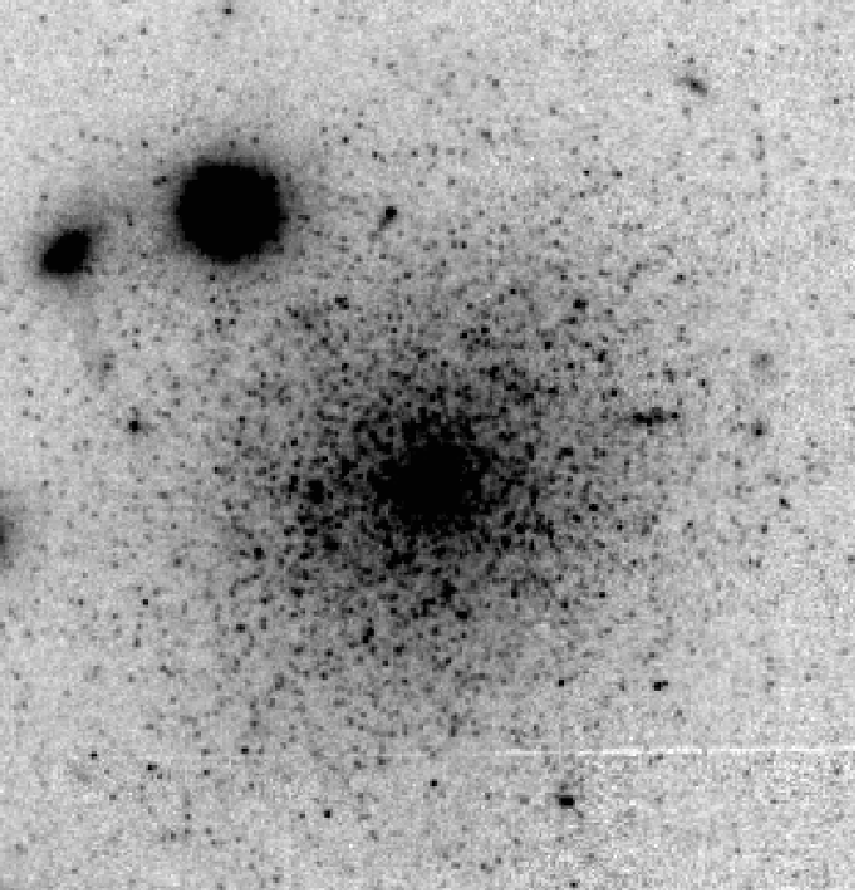
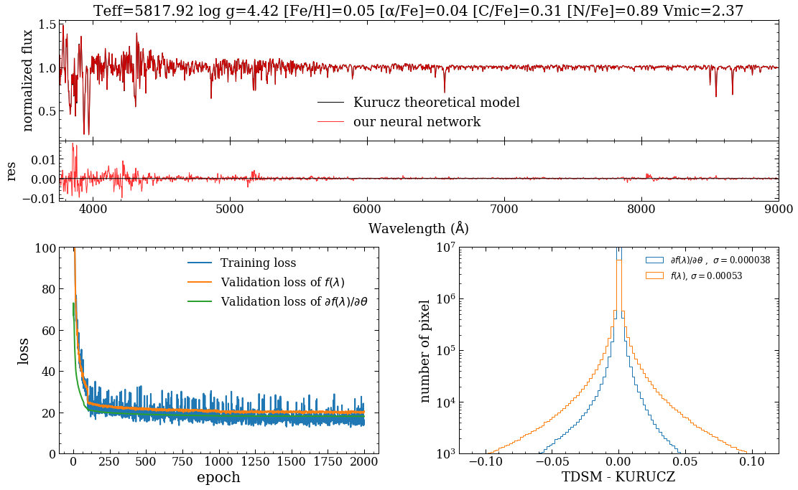
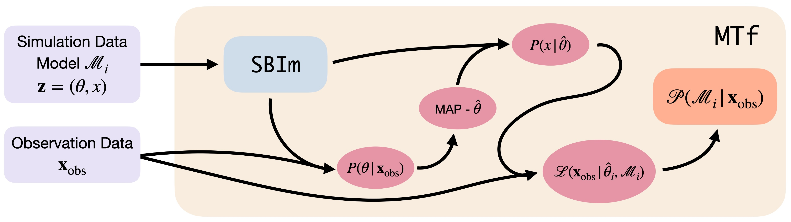
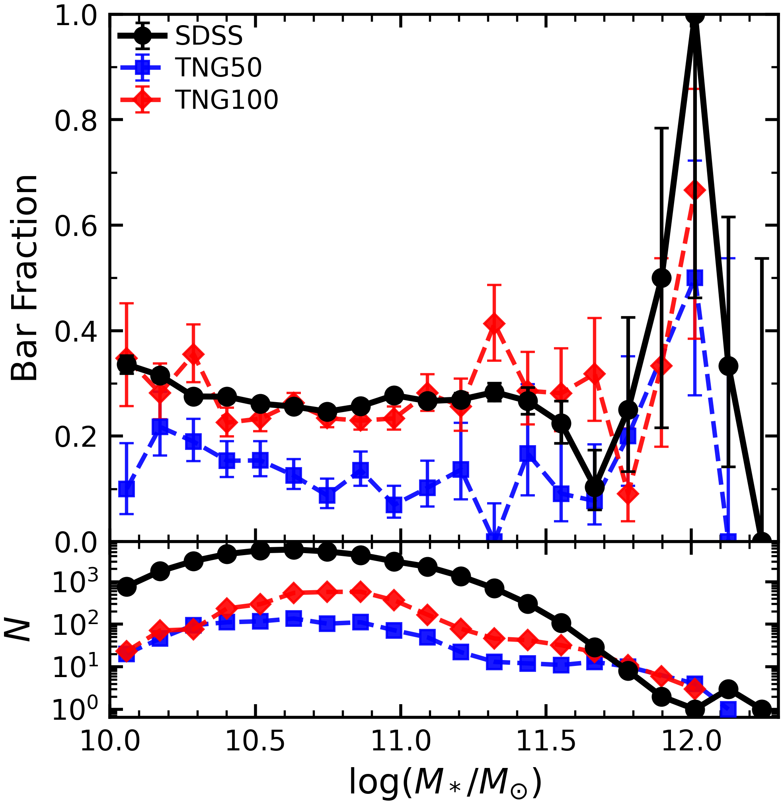
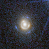
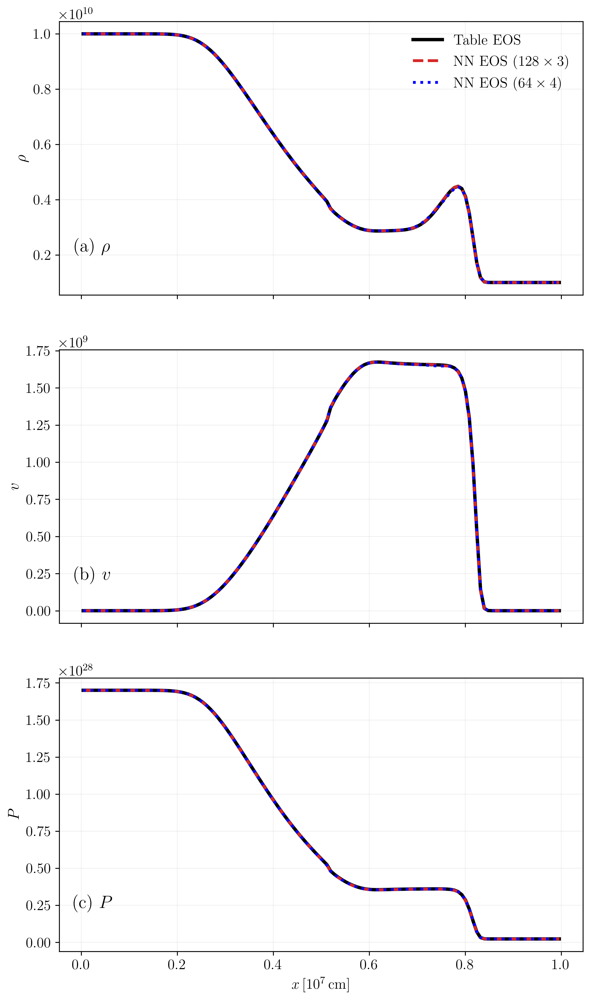

# arXiv Digest — 2026-11-17

- **Interest file used:** interests/2026.10.md (fallback — no 2026.11.md exists yet)
- **Categories pulled:** astro-ph.CO, astro-ph.EP, astro-ph.GA, astro-ph.HE, astro-ph.IM, astro-ph.SR, cs.LG, stat.ML, physics.data-an, hep-ph
- **Papers scanned:** 658 (114 astro-ph + 544 from extras)
- **After first filter:** 19 candidates reviewed with full text
- **Final selected:** 14 papers across 4 tiers

---

## Tier 1 — Highly relevant

### [Interpreting JWST UV luminosity functions and angular correlation functions via a "universal language" for high-redshift galaxies](http://arxiv.org/abs/2611.18850v1)

Ivan Nikolić, Andrei Mesinger, Steven G. Murray
**Primary category:** astro-ph.GA | also: astro-ph.CO

Nikolić, Mesinger, and Murray build a "universal language" for high-redshift galaxy populations: a chain of conditional distributions linking halo mass, stellar mass, star-formation rate, and UV magnitude, with priors drawn from five independent hydrodynamic simulations (FLARES, FIRE, ASTRID, SERRA, First Light). Fitting this framework jointly to **JWST UV luminosity functions and angular correlation functions at z≈6–12**, they find that adding clustering data tightens the scatter around the stellar-to-halo-mass relation to **σ_SHMR = 0.35 dex** (down from 0.45 dex using UV LFs alone). The inferred star-forming main sequence corresponds to **a star-formation timescale of about one halo dynamical time**, with SFMS scatter dominating the total UV-magnitude stochasticity at fixed halo mass. Extrapolated to z≈15–28, the model predicts UV luminosity functions **orders of magnitude below photometric JWST candidate estimates**, arguing against those candidates lying at such extreme redshifts.

*The inferred stellar-to-halo-mass relation from combining JWST UV luminosity functions with angular clustering, with its 68%/95% credible intervals; adding clustering data tightens the scatter relative to UV-LF-only fits.*

---

### [Orion I: Discovery of an Isolated dE,N Galaxy at 60 Mpc](http://arxiv.org/abs/2611.19631v1)

W. E. Harris, T. Carleton, R. Ortiz et al.
**Primary category:** astro-ph.GA

Harris et al. report the serendipitous discovery of **Orion I**, a small, resolved stellar system found in deep JWST NIRCam imaging of the lensing cluster MACS J0454.1-0300, previously unresolved in HST imaging of the same field. Color-magnitude diagrams and a tip-of-the-red-giant-branch distance place the object at **d ≈ 60 Mpc**, identifying it as a structurally normal **nucleated dwarf elliptical (dE,N) galaxy**. Its association with any known galaxy group remains ambiguous without a direct redshift measurement. The authors argue the discovery shows that **deep JWST lensing-cluster imaging can resolve such small stellar systems out to d≲100 Mpc**, motivating systematic searches of the growing JWST archive for similar serendipitous dwarfs.

*NIRCam F150W cutout of Orion I, resolved into individual stars against the foreground cluster field — the imaging depth that revealed its dwarf-galaxy nature.*

---

### [Model-Driven Stellar Spectroscopy with the Total Differential Spectral Model (TDSM): Framework and Its Application to 11 Million LAMOST Low-Resolution Spectra](http://arxiv.org/abs/2611.20633v1)

Lanya Mou, Maosheng Xiang, Haibo Yuan et al.
**Primary category:** astro-ph.GA

Mou et al. introduce **TDSM (Total Differential Spectral Model)**, a physically motivated neural-network emulator that reproduces both the flux and its first-order parameter derivatives of ab initio Kurucz stellar spectra, achieving **0.05% pixel-wise flux precision** across 3000–45,000 K at LAMOST's resolution (R≈2000). Applying TDSM to **11 million LAMOST DR10 spectra**, they derive eight stellar labels for 8 million stars spanning the full parameter range, including hot and cool stars poorly covered by existing data-driven catalogs. After external calibration, internal precision reaches **~47 K in T_eff and 0.11 dex in log g** at S/N=50. The public catalog is pitched as a broader-coverage alternative to data-driven LAMOST pipelines for Galactic archaeology and rare stellar populations.

*TDSM's spectral emulation of a solar-like star compared to the Kurucz model, with training/validation loss curves and a flux-residual scatter of σ=0.00053 — the emulation fidelity underlying the model's parameter precision.*

---

### [From Non-parametric Statistics to Images: Generating Galaxy Morphologies](http://arxiv.org/abs/2611.19211v1)

Quanfeng Xu, Mi Chen, Renhao Ye et al.
**Primary category:** astro-ph.GA

Xu et al. introduce **Flow-VAE**, a conditional normalizing-flow + VAE framework that generates galaxy images directly conditioned on five non-parametric morphological statistics (concentration, asymmetry, smoothness, Gini, and M20) rather than smooth analytic profiles. A Gaussian mixture model completes unspecified descriptors and flags whether a requested combination lies within the training distribution, trained on **240,000 DESI Legacy Imaging Survey r-band images**. Remeasuring the conditioning statistics from generated images shows **96.62–99.97% recovery for reconstruction and 87.81–99.83% for single-parameter generation**, with degrading fidelity in poorly-sampled joint conditions. This closed-loop validation quantifies, for the first time, how faithfully a generative model's outputs satisfy prescribed non-parametric morphology constraints.

*Controlled sampling of real galaxy images shows how each of the five conditioning statistics maps onto visual structure — e.g. concentration from diffuse to centrally concentrated light, and smoothness from smooth to clumpy/structured.*

---

### [A COMPASS to the Galaxy: Joint nucleosynthetic yield set comparison and parameter inference in Galactic chemical evolution](http://arxiv.org/abs/2611.21175v1)

Berkay Günes, Giuseppe Viterbo, Sven Buder et al.
**Primary category:** astro-ph.GA | also: cs.LG

Günes et al. present **COMPASS**, a simulation-based inference framework that couples a conditional score-based diffusion model with a transformer to jointly learn the posterior and the likelihood for Galactic chemical-evolution models, enabling amortized parameter inference together with likelihood-based model comparison across competing nucleosynthetic yield sets. Applied to 40 combinations of AGB/CC-SN yield tables and 69 high-precision HARPS stellar abundances, COMPASS favors a hybrid **NuGrid + IllustrisTNG** yield prescription and infers an IMF high-mass slope of **α_IMF = -2.65 ± 0.02** and a **SN Ia normalization of log(N_Ia) = -2.81 ± 0.02**. The model's attention weights are shown to track physically meaningful abundance features, giving interpretable support for the inferred parameters.

*Schematic of the COMPASS pipeline: a transformer-based diffusion model trained on chemical-evolution simulations estimates both the posterior and the likelihood, enabling joint parameter inference and Bayesian ranking of competing yield sets.*

---

### [The LAMOST Galaxy Parameter Catalog (LAGC): Stellar Populations, Kinematics, and Emission Lines of Galaxies in the LAMOST Spectroscopic Survey](http://arxiv.org/abs/2611.20917v1)

Jia-Feng Lu, Shi-Yin Shen, Qian Liu et al.
**Primary category:** astro-ph.GA

Lu et al. present the LAMOST Galaxy Parameter Catalog (LAGC), an automated pipeline that simultaneously fits **283,691 LAMOST galaxy spectra** for stellar populations, kinematics, and emission lines. The method works in equivalent-width space to sidestep LAMOST's uncalibrated continuum, paired with a **machine-learning model of the wavelength-dependent instrumental line-spread function** for unbiased kinematics. Bootstrap uncertainties are validated against repeat observations and cross-checked against SDSS, confirming the measurements are reproducible and well-calibrated. The authors pitch the pipeline as a **reusable blueprint for the next generation of fiber-fed spectroscopic surveys**.

*An ML-predicted line-spread-function model conditions the stellar+gas template fit in equivalent-width space, yielding simultaneous stellar-population, kinematic, and emission-line measurements with bootstrap uncertainties.*

---

## Tier 2 — Adjacent / useful context

### [Mock Observations: Morphological Analysis of Galactic Bars in IllustrisTNG Simulations](http://arxiv.org/abs/2611.19884v1)

Jun-Yu Gong, Weipeng Lin, Weishan Zhu et al.
**Primary category:** astro-ph.GA

Gong et al. build an image-based mock-observation pipeline that generates synthetic SDSS r-band images from the IllustrisTNG100 and TNG50 simulations and applies the same segmentation, classification, and isophotal-fitting framework used on real SDSS galaxies to measure bar statistics. For massive face-on late-type galaxies, they find bar fractions of **26.7% (SDSS), 25.0% (TNG100), and 13.4% (TNG50)**, with TNG100 broadly matching SDSS except at the highest masses and TNG50 systematically under-producing bars. They trace part of this discrepancy to differences in bulge concentration between the simulations and real galaxies. The results argue that **matched observational conditions and analysis methodology**, not just simulation physics, are essential for fair simulation–observation comparisons of galaxy structure.

*Bar fraction vs. stellar mass for SDSS, TNG100, and TNG50; TNG100 tracks the observed trend over most of the mass range but TNG50 under-produces bars throughout.*

---

### [Euclid Data Release 1 (DR1). Double-source-plane lens candidates](http://arxiv.org/abs/2611.20166v1)

Euclid Collaboration: T. Li, N. E. P. Lines, P. Holloway et al.
**Primary category:** astro-ph.GA

The Euclid Collaboration searched the **1900 deg² Euclid DR1** footprint for galaxy-scale double-source-plane lenses (DSPLs), combining **machine-learning lens-finding models** with citizen-science and expert visual inspection, followed by lens modeling. They identify **84 DSPL candidates (80 new)**, of which **11 form a "Gold" sample** with robust dual-image lens models, while the remaining 73 "Silver" candidates need spectroscopy or higher-resolution imaging to confirm. Even taking all 84 as genuine, the yield falls below the ~90–200 systems forecast from earlier Euclid and LensPop predictions, implying **many more DSPLs remain undetected in DR1**. DSPLs are valuable because their two Einstein radii simultaneously probe dark-matter substructure and the dark-energy equation of state independent of H₀.

*A newly discovered double-source-plane lens in Euclid DR1 (VIS/Y/J color composite) — two concentric sets of lensed arcs from sources at different redshifts behind the same foreground galaxy.*

---

### [Tracing the Luminosity Evolution of Globular Cluster Systems with JWST: MACS J1149.5+2223 at z=0.544](http://arxiv.org/abs/2611.20358v1)

Jessica M. Berkheimer, Rogier A. Windhorst, William E. Harris et al.
**Primary category:** astro-ph.GA

Berkheimer et al. use deep JWST/NIRCam imaging (F115W/F150W/F200W) of the massive cluster **MACS J1149.5+2223 at z=0.544** to identify **1,202 unresolved compact-source candidates**, extending the JWST globular cluster luminosity function (GCLF) sample to this epoch. Because the observed luminosity function only samples the bright side of the expected turnover, the authors fix the turnover magnitude by extrapolation from Abell 2744 and MACS 0417 and fit a bright-side dispersion of **σ = 1.71 mag** (dropping to 1.47 mag when excluding the 67 brightest sources). Comparison with PARSEC simple stellar population models shows the elevated compact-source luminosities are consistent with the expected fading of younger stellar populations toward the present day, extending the emerging JWST sequence of GC luminosity evolution across cosmic time.

*The observed luminosity function only samples the bright side of the expected turnover; fitting with the turnover fixed at m₀=33.66 gives a bright-side dispersion σ=1.71 mag, broader than typical present-day globular cluster systems.*

---

### [Neural Surrogates for Tabulated Nuclear Equations of State in Core-Collapse Supernova Simulations](http://arxiv.org/abs/2611.19400v1)

Youhei Masada, Jin Matsumoto, Tomoya Takiwaki
**Primary category:** astro-ph.HE | also: astro-ph.IM

Masada, Matsumoto, and Takiwaki replace the memory-hungry tabulated Lattimer–Swesty nuclear equation of state used in core-collapse supernova (CCSN) hydrodynamics with a compact neural-network surrogate that predicts pressure, sound speed, and adiabatic index from density, energy, and electron fraction. The surrogate reconstructs the EOS's nonlinear structure, including phase-transition behavior, and when coupled directly to a Godunov-type solver reproduces shock-tube and Tolman–Oppenheimer–Volkoff equilibrium solutions with **hydrodynamic errors at the ~10⁻³ level**. Critically, the authors show that **lower regression error does not guarantee better hydrodynamic fidelity** — direct downstream validation is needed to select a surrogate, not training loss alone. A **~1.3×10⁴-parameter network cuts the EOS's memory footprint from ~160 MB to ~100 KB (~1500×)** while staying numerically stable through collapse, bounce, and 300 ms of post-bounce evolution.

*Shock-tube density, velocity, and pressure profiles from the original LS220 table versus the fiducial and compact neural surrogates: the solutions are visually indistinguishable, with relative L1 errors at the 10⁻³ level or below.*

---

### [Gaia as a 0.1 arcsec point-source survey across the sky: dynamical scene reconstruction from one-dimensional scans](http://arxiv.org/abs/2611.21510v1)

Sahar Shahaf, David W. Hogg, Kareem El-Badry et al.
**Primary category:** astro-ph.IM | also: astro-ph.GA

Shahaf et al. develop a forward-modeling method to recover close, blended companions from Gaia's one-dimensional scan windows, triangulating per-window detections across scan angles (a Radon-transform-like backprojection) before jointly fitting positions, fluxes, and relative motions. In simulations, the method resolves companions **below the ~100 mas width of Gaia's line-spread function**, reaching **~0.1 mas astrometric precision** for a 75 mas-separation companion. The authors quantify detection limits of roughly **3–7 magnitudes of contrast at 40–150 mas separation** depending on primary brightness, and show a small LSF color-model error can bias positions by several times the quoted uncertainty. The method could extend Gaia-based companion censuses once DR4's windowed data are released.

*Detection limit and positional uncertainty versus separation and flux ratio for primaries of G=14, 16, 18: brighter primaries push the detectable-companion contrast higher, and LSF color-model errors can bias positions beyond their quoted uncertainty, especially near the brightest primary.*

---

## Tier 3 — Outside my area but notable

### [Independent interferometric observable confirms black hole shadow in M87*](http://arxiv.org/abs/2611.20418v1)

Samuel Lai, Nithyanandan Thyagarajan, O. Ivy Wong et al.
**Primary category:** astro-ph.IM | also: astro-ph.GA

Lai et al. apply **GenDIReCT**, a generative diffusion-based VLBI imaging algorithm conditioned on calibration-independent closure invariants, to all public EHT M87* data without any hand-tuned priors or image initialization. Across multiple epochs and fields of view, the method consistently and autonomously recovers a compact ring with diameter **42.2 ± 1.5 μas**, implying a black hole mass of **(6.5±0.5)×10⁹ M_☉** at an inclination of ~20° — in excellent agreement with the EHT Collaboration's original, hand-tuned reconstructions. The result is an independent, prior-free cross-validation of the famous 2019 black hole shadow image, resolving prior claims that the ring morphology was an artifact of imaging choices.

*Median GenDIReCT reconstructions from the three highest-quality EHT epochs recover a consistent ~40 μas ring independent of the assumed field of view, confirming the M87* shadow without manually imposed image priors.*

---

### [SciResearch-Eval: Autonomous Experimental Agents with Calibrated Uncertainty](http://arxiv.org/abs/2611.21541v1)

Brian T. Weston, Alondra Torres Contreras, Aldair E. Gongora
**Primary category:** cs.AI | also: cs.LG

Weston, Torres Contreras, and Gongora introduce **SciResearch-Eval**, the first benchmark to combine agent-designed experiments, a deliberately flawed or under-resolved physics simulator, and proper scoring of calibrated uncertainty intervals against exact ground truth. Agents must infer a material's thermal properties by designing up to four heating experiments and fitting a heat-conduction simulator that may be missing real physics (a glued joint, temperature-dependent conductivity, radiation). At default settings, most frontier models **report confidently wrong values when the simulator lacks physics** — only two of nine tested models stay well-calibrated — and a reasoning-effort ablation shows this is correctable in the newest models only at **maximum reasoning effort, using roughly 10× more compute**, while older and open-weight models never recover it.

*Fraction of held-out tasks where each model's stated 95% interval contained the true value; an honest model lands near 95%. When the simulator is missing real physics, only two of nine models stay near that mark at default effort — most are confidently wrong.*

---

## Tier 4 — Meta-research about the field

### [Demographic dynamics of the Japanese astronomy and astrophysics publication community during 1996-2025](http://arxiv.org/abs/2611.20357v1)

Hideaki Fujiwara
**Primary category:** astro-ph.IM

Fujiwara analyzes **23,274 publications** and **9,910 unique Japan-affiliated authors** in major astronomy journals from 1996–2025 using Scopus bibliometric data, tracking the demographic evolution of the Japanese astronomy and astrophysics community. The active author population grew from 576 to 1,998 over the period, while a newly defined **Community Renewal Rate (CRR)** — the fraction of active authors absent from the community over the preceding 5 years — fluctuated between **21% and 33%**, indicating persistent turnover even as the field expanded nearly fourfold. An order-of-magnitude comparison shows incoming graduate students can explain less than half of this renewal, pointing to returning authors, mobility, and cross-field entry as significant additional contributors.

*The 5-year Community Renewal Rate fluctuated between about 21% and 33% from 2001–2025, consistently above the entry rate — indicating persistent turnover even as the community grew nearly fourfold.*
