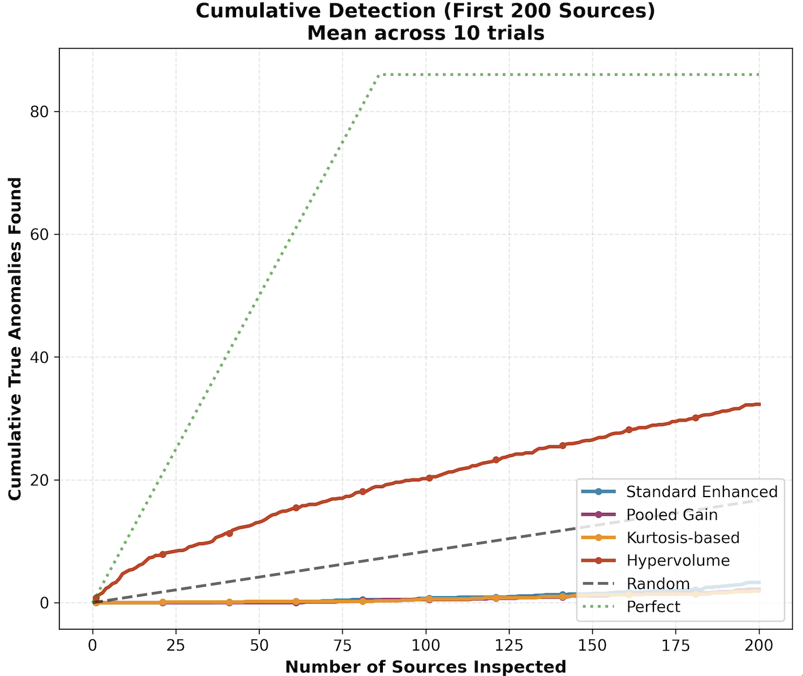

# arXiv Digest — 2026-11-18

- **Interest file used:** interests/2026.10.md (fallback — no 2026.11.md exists yet)
- **Categories pulled:** astro-ph.CO, astro-ph.EP, astro-ph.GA, astro-ph.HE, astro-ph.IM, astro-ph.SR, plus extras cs.LG, stat.ML, physics.data-an, hep-ph
- **Papers scanned:** 351 unique after deduplication (140 astro-ph new/cross + 211 from cs.LG + 59 from stat.ML/physics.data-an/hep-ph, from 410 raw announcement entries)
- **After first filter:** 18 candidates reviewed with full text
- **Final selected:** 18 papers across 3 tiers

---

## Tier 1 — Highly relevant

### [Spectro-Spatial Survey Fusion](http://arxiv.org/abs/2611.21798v1)

Georgios N. Vassilakis, Miles Cranmer, Vasily Belokurov

**Primary category:** astro-ph.CO | also: astro-ph.IM

Adapting **Gaussian splatting from computer vision**, the authors represent the sky as a sum of adaptive spatial Gaussians carrying spectra from a shared learned dictionary, fitting 400 SDSS exposures and 800 fiber spectra **jointly through each instrument's own forward operator**. The joint fit reproduces source-selected image flux to within **2% in every band** and correctly predicts withheld SDSS spectra/images, plus zero-shot HSC imaging and DESI spectra that never entered the fit. Because spectral information is shared through a common dictionary across all components, the field can be queried for a spectrum anywhere in the imaged area, even where no fiber was placed — a genuinely novel adaptation of a CV rendering technique to multi-survey data fusion.

*Observed SDSS g-band mosaic (left) versus the field's rendered prediction (right) across the full 84′×84′ COSMOS region, with a zoomed inset showing an edge-on galaxy and neighboring sources reproduced without any fixed morphological template.*

---

### [Improving Early Detection of Scientifically Interesting Radio Sources Using Enhanced Isolation Forest](http://arxiv.org/abs/2611.21674v1)

Pfunzo Thavhana, Clement Nyirenda, Michelle Lochner

**Primary category:** astro-ph.IM | also: cs.LG

The authors test four enhanced Isolation Forest variants for ranking 1,031 extended MeerKAT radio sources represented by a 52-dimensional feature set built from **BYOL self-supervised embeddings** plus PCA, against expert scientific-interest ratings. The Pooled Gain variant gives the best early-ranking performance, with **P@10 = 0.600** (six of the top ten ranked sources are expert-validated anomalies) and the highest Average Precision (**AP = 0.201**), while Standard Enhanced and Kurtosis-based reach the top ROC AUC of 0.677. The results support feature-aware anomaly ranking as a practical front end for human-in-the-loop discovery pipelines like ASTRONOMALY on SKA-scale radio surveys.

*Cumulative count of expert-validated scientifically interesting sources found among the top 200 ranked candidates, showing how quickly an astronomer following the Pooled Gain ranking encounters genuine anomalies versus a random ordering.*

---

### [FastSpecFit: Spectrophotometric Modeling of 38 Million Extragalactic Targets from the Dark Energy Spectroscopic Instrument Second Data Release](http://arxiv.org/abs/2611.22914v1)

John Moustakas, Jeremy Buhler, Dirk Scholte et al.

**Primary category:** astro-ph.GA

FastSpecFit forward-models each DESI spectrum jointly with its broadband photometry, convolving **stellar-population-synthesis and emission-line templates** at each fiber's native resolution, and fits a typical spectrum in **~0.1 s of single-core time**, scaling to tens of millions of objects. The code measures stellar velocity dispersions, non-parametric star-formation histories, stellar masses, SFRs, dust attenuation, and fluxes/EWs for 46 emission lines, with uncertainties from Monte Carlo resampling, validated against independent codes. The paper releases the resulting value-added catalog for **38 million extragalactic targets at 0<z<4** from DESI DR2, plus a companion photometry-only catalog.

*FastSpecFit's fit to a low-redshift (z=0.081) BGS galaxy: observed broadband photometry and DESI spectrum against the best-fitting stellar continuum and emission-line model, with the DESI fiber footprint overlaid on an image cutout — illustrating the joint photometric+spectroscopic fit underlying the whole catalog.*

---

### [A transformer analysis lowers the energy threshold and improves the sensitivity of a compact imaging atmospheric Cherenkov telescope](http://arxiv.org/abs/2611.23047v1)

Elli Jobst, David Paneque, Lukas Heinrich

**Primary category:** astro-ph.IM

A **video vision transformer** that processes raw camera waveforms, rather than the standard image-parameter pipeline, lowers the energy threshold of a simulated 5 m Cherenkov telescope from **0.73 TeV to 0.18 TeV** with realistic LST-1-like photomultipliers. The gain comes because the transformer extracts useful signal from events with only **~35 photoelectrons**, versus the ~200 needed by the standard analysis before image cleaning. A 4 m dish analyzed with the transformer is already more sensitive at all energies than a 5 m dish using the standard pipeline, showing that **analysis method can matter as much as mirror area**.

*Differential point-source sensitivity in one hour versus energy for the standard analysis (red) and the transformer analysis (blue) at three photodetector efficiencies, compared with LST-1 and MAGIC; lower curves are better, and the transformer curves reach fainter fluxes at low energy across all three detector configurations.*

---

### [oMEGACat-JWST I.: Project description and photometric data release](http://arxiv.org/abs/2611.23150v1)

Maximilian Häberle, Callie Clontz, Massimo Griggio et al.

**Primary category:** astro-ph.GA | also: astro-ph.SR

The team presents oMEGACat-JWST, a deep NIRCam/NIRISS photometric and astrometric catalog of **ω Centauri — the likely stripped nucleus of an accreted dwarf galaxy** — extending the HST-based oMEGACat project to the near-infrared with **~677,000 sources**, including over 86,000 new detections below HST's limit. Astrometric precision reaches **0.5% of a NIRCam pixel (0.15 mas)** for bright stars, and the color-magnitude diagrams clearly resolve the split between the primordial-helium and helium-enriched subpopulations, sensitive to light-element (CNO) variations among faint stars. Combined with existing HST data, the catalog sets up multi-wavelength subpopulation analyses and improved kinematics for the cluster's central fast-moving stars, relevant to its putative intermediate-mass black hole.

*Color-magnitude diagrams for all three observed fields, overlaid with isochrones for the primordial-helium (Y=0.25) and helium-enriched (Y=0.4) populations: both match the upper main sequence well but fail to reproduce the broader color spread seen below the main-sequence knee.*

---

## Tier 2 — Adjacent / useful context

### [RevolIACT: a longitudinally distributed array of compact AI-driven Cherenkov telescopes for the time-domain sub-TeV sky](http://arxiv.org/abs/2611.23069v1)

David Paneque, Elli Jobst, Lukas Heinrich et al.

**Primary category:** astro-ph.IM

Building on the companion transformer-analysis result above, this paper asks whether an array of **compact, AI-driven Cherenkov stations** could close the temporal-coverage gap left by the two-site Cherenkov Telescope Array Observatory, since each CTAO site can observe any source for only a few hours per night. A fourteen-station layout distributed in longitude would provide **three to four times CTAO's temporal coverage**, averaged over the sky and the observed Fermi-GBM gamma-ray bursts, and could observe most sources around the clock for about two months per year. The concept depends on the transformer analysis recovering useful sensitivity from smaller, cheaper telescopes rather than on reductions in mirror area alone.

*Annual fraction of time a source is observable as a function of declination, for a single site, the two CTAO sites, and the proposed RevolIACT array with ten, twelve, and fourteen stations — more stations substantially raise the fraction of the year with continuous coverage.*

---

### [Euclid DR1 Legacy Science on Ultracool Dwarfs: Halpha activity, kinematic age and rotation of M7--L1 dwarfs from DESI DR1, SPHEREx and Euclid](http://arxiv.org/abs/2611.21896v1)

Ramarao Tata, Eduardo L. Martín, Hervé Bouy et al.

**Primary category:** astro-ph.SR | also: astro-ph.GA

Using 8,939 M7-or-later dwarfs from DESI DR1, the authors show that the rising fraction of late-M dwarfs with detectable Hα near the stellar-substellar boundary is driven mostly by a **fading optical continuum acting on weakening emission**, not by younger populations: the active fraction at a fixed equivalent-width threshold rises by **28 percentage points from M7 to M9**, while at a fixed Hα-to-bolometric-luminosity threshold it instead falls by 23.5 points. SPHEREx and photometric bolometric fluxes agree to within 0.03 dex, and joint fits imply M8 emission is intrinsically **0.12–0.15 dex weaker** than at M7. New Euclid NISP spectra for 152 M7–L1 dwarfs test the optical spectral-type scale, and Euclid VIS imaging resolves three previously unknown close binaries.

---

### [The meaning of Milky Way mass estimates in the presence of the LMC](http://arxiv.org/abs/2611.21732v1)

Leandro Beraldo e Silva, Gurtina Besla, Nicolás Garavito-Camargo et al.

**Primary category:** astro-ph.GA

Using N-body MW+LMC simulations, the authors show that the recent infall of the LMC biases standard dynamical mass estimators of the Milky Way's halo, but the bias is structured enough to exploit: stellar-halo regions crossed longest ago by the LMC trace the **total MW+LMC mass**, while regions it has not yet reached retain the cleanest memory of the **pre-infall MW mass**. A radial-velocity-only estimator recovers the total MW+LMC mass to **≲5% out to 200 kpc** without any reflex-motion correction, and subtracting estimates from opposite octants recovers the LMC's own mass profile to ~20%. Applied to DESI-MWS DR1 blue horizontal-branch stars, this gives **M(r<60 kpc) ≈ 7.5×10¹¹ M⊙** for the combined system.

---

### [A PhEW Good Simulations: I. Galaxy Properties](http://arxiv.org/abs/2611.21716v1)

Lisiyuan Yang, Neal Katz, Evan Scannapieco et al.

**Primary category:** astro-ph.GA

This suite of cosmological simulations uses the **PhEW subgrid model**, which analytically tracks mass, metal, momentum, and energy exchange between stellar-feedback-driven winds and the circumgalactic medium using an algorithm calibrated on high-resolution cloud-crushing simulations. Without any AGN feedback, the simulations reproduce observed **stellar mass functions and stellar-mass–halo-mass relations at z≳1**, along with the HI, H₂, and metallicity–stellar-mass relations, suggesting AGN feedback may matter less for galaxy growth than commonly assumed below z~1. Notably, galaxy properties are **robust to changes in resolution and simulation volume without retuning wind parameters**, which the authors attribute to PhEW's physically motivated treatment of wind–CGM mixing.

---

### [Non-monotonic Age-metallicity Relations Across the Galactic Disk Revealed by APOGEE Red Clump Stars](http://arxiv.org/abs/2611.22091v1)

Chun Wang, Yang Huang, Haibo Yuan

**Primary category:** astro-ph.GA

Using APOGEE red clump stars and open clusters with precise ages, the authors find the Galactic disk's age-metallicity relation (AMR) is nearly **independent of radius and height for stars older than ~6–8 Gyr**, implying rapid, well-mixed early chemical enrichment, but becomes **non-monotonic for younger stars**: [Fe/H] first declines toward younger ages, bottoms out around 3–4 Gyr, then rises again, with an additional metallicity peak at **~1.5–2 Gyr in the outer disk (R>11 kpc)**. A toy chemical-evolution model combining **two episodes of metal-poor gas infall with radial migration** reproduces this pattern, pointing to episodic accretion rather than continuous local enrichment as the driver of the young disk's chemistry.

---

### [Diverse Stellar Components Resolved by JWST in the Massive Galaxy SPT0311-58](http://arxiv.org/abs/2611.21761v1)

Briana Wirag, Jack E. Birkin, Justin S. Spilker et al.

**Primary category:** astro-ph.GA

New JWST NIRCam and MIRI imaging resolves the stellar components of **SPT0311-58**, a clumpy dusty starburst pair at **z=6.9**, combined with HST and ALMA data for the most complete picture yet of this protocluster core. The system has a total stellar mass of **M* = 3.2×10¹¹ M⊙** and SFR of **1.5×10³ M⊙/yr**, comparable to z>6 quasars despite showing no AGN signature, and well above the z=6–8.5 Lyman-break galaxies and FLARES-simulation galaxies used for comparison. The authors argue SPT0311-58 is a plausible, if unusually extreme, progenitor of the massive quiescent galaxies later seen at lower redshift in the EXCELS survey.

*Stacked NIRCam detection image with ALMA 160 μm contours (top left) and an RGB composite combining NIRCam and MIRI filters: most of the dust-obscured component SPT0311-58W is visible only in the MIRI bands, while a spatial offset between NIRCam and MIRI emission in SPT0311-58E points to differential dust extinction.*

---

### [The Lives and Deaths of Red Supergiants](http://arxiv.org/abs/2611.22233v1)

Emma R. Beasor

**Primary category:** astro-ph.SR | also: astro-ph.HE

This review argues that measured **red supergiant (RSG) mass-loss rates are considerably weaker** than the prescriptions still used in most stellar evolution codes, meaning single stars in the RSG mass range should retain their hydrogen envelopes and die as Type II-P supernovae — consistent with the observed progenitor luminosity distribution once sample size and systematics are accounted for. This leaves the observed rate of **stripped-envelope supernovae** unexplained by winds alone, pointing instead to binary interaction, while narrow circumstellar-medium signatures in early SN spectra still demand some late, eruptive mass-loss episodes shortly before core collapse. The author lays out concrete observational tests — a confirmed massive Type II-P progenitor, a direct RSG eruption detection, or a null result from LSST monitoring — that could resolve the single-star/binary tension.

---

### [Improved compensation for missing high-order aberrations with multi-frame blind deconvolution and phase diversity techniques](http://arxiv.org/abs/2611.22753v1)

G. B. Scharmer

**Primary category:** astro-ph.IM

Phase-diversity and multi-frame blind deconvolution (PD/MFBD) image restoration can only fit a limited number of individual wavefront aberration modes, leaving **uncompensated high-order seeing residuals** that bias the inferred point-spread function and degrade reconstructed solar images. The author derives a new **averaged high-order modulation transfer function**, obtained by analytically averaging the high-order part of the MTF over Gaussian-distributed Kolmogorov-turbulence aberrations, that needs only a single free parameter. Tested against earlier compensation schemes, the new approximation **recovers correct Strehl ratios more accurately** at negligible added computational cost, directly improving the fidelity of PD/MFBD-reconstructed images from 4 m-class solar telescopes.

---

### [ASAS-SN Rates V: Tidal Disruption Event Volumetric Rates and Luminosity Functions by Optical Spectroscopic Type, X-ray Luminosity, and Host-Galaxy Properties](http://arxiv.org/abs/2611.21731v1)

Dhvanil D. Desai, Jason T. Hinkle, Benjamin J. Shappee et al.

**Primary category:** astro-ph.HE | also: astro-ph.GA

Using 21 tidal disruption events from ASAS-SN (2014–2024) with injection-recovery completeness corrections, the authors measure a total local volumetric TDE rate of **log₁₀(R) = 2.32⁺⁰·¹⁵₋₀.₂₃ yr⁻¹Gpc⁻³**, and find TDEs are **overrepresented by a factor of 15 in post-starburst host galaxies** relative to matched controls. Hydrogen+helium-dominated TDEs account for the bulk of the rate, X-ray-bright and X-ray-faint events share indistinguishable luminosity functions (supporting viewing-angle unification), and the rate scales as **M_BH^(−0.25)**, consistent with a roughly flat black-hole mass function. Extrapolating this rate to higher luminosities is broadly consistent with the rates of luminous ambiguous and extreme nuclear transients, tentatively supporting a TDE origin for those events.

---

### [Baryonification V: Thermal Sunyaev-Zel'dovich maps from dark-matter-only lightcones](http://arxiv.org/abs/2611.21733v1)

Michael Kovač, Andrina Nicola, Jozef Bucko et al.

**Primary category:** astro-ph.CO

The authors present an efficient baryonification-based pipeline to paint realistic **thermal Sunyaev-Zel'dovich (tSZ) maps onto dark-matter-only N-body lightcones**, calibrated to the FLAMINGO hydrodynamical simulations' gas mass fractions and pressure profiles. Painting the calibrated pressure profiles onto halos reproduces FLAMINGO's tSZ power spectrum to within **5% for 500≲ℓ≲3000** in both weak and strong AGN-feedback scenarios, and a full-sky Nside=4096 Compton-y map from ~3.5×10⁷ halos costs only **~190 CPU-hours** on top of an existing N-body run. This makes correlated weak-lensing + tSZ simulation suites computationally tractable for simulation-based inference pipelines targeting Euclid, LSST, Roman, and the Simons Observatory.

---

### [Current Accretion State versus Black Hole Mass: Imprints on Multiphase Gas in IllustrisTNG](http://arxiv.org/abs/2611.22044v1)

Xiaoxia Zhang, Taotao Fang, Shulan Yan et al.

**Primary category:** astro-ph.GA | also: astro-ph.HE

Extending a previous black-hole-mass/cold-gas correlation study, the authors show in 5,089 IllustrisTNG100 central galaxies at z=0 that the Eddington ratio λ_Edd — tracing the *current* accretion state — correlates positively with **warm gas in star-forming galaxies (ρ≈0.6–0.7)**, even after controlling for black hole mass and other gas phases. Strikingly, the λ_Edd–cold-gas correlation **flips sign**, from negative in star-forming galaxies (ρ≈−0.32) to positive in quenched ones (ρ≈0.40), a reversal that survives the same controls. The authors conclude that cold gas mainly tracks *integrated* black hole growth while warm gas in star-forming galaxies tracks the *instantaneous* accretion state, implying the gas-black hole connection is both phase- and galaxy-type dependent.

---

## Tier 3 — Outside my area but notable

### [Neutron-Rich Disks, Nickel-Rich Ejecta: Can Direct-Horizon Collapsars Explain Early $r$-Process Enrichment?](http://arxiv.org/abs/2611.21788v1)

Danat Issa, Ore Gottlieb

**Primary category:** astro-ph.HE | also: astro-ph.GA, astro-ph.SR

The first **3D GRMHD simulations with neutrino transport** of "direct-horizon collapsars" — very massive stars collapsing straight into a black hole surrounded by a massive accretion disk — reveal a fundamental tension: extreme accretion rates (≳10 M⊙/s) let the disk **neutronize to Yₑ≈0.1–0.25**, but the strong magnetic fields needed to actually eject that neutron-rich gas also drain the disk and lift its electron degeneracy. The resulting ejecta carry **~0.1–0.3 M⊙ of r-process nuclei but only ~10⁻⁵–10⁻⁴ M⊙ of lanthanides**, alongside **1–4 M⊙ of ⁵⁶Ni**, favoring a luminous ⁵⁶Ni-powered transient (plus a powerful GRB) over the lanthanide-rich "super-kilonova" predicted by earlier semi-analytic models. The implied Eu/Fe ratios suggest these rare events could be prompt, low-metallicity contributors to early r-process enrichment, comparable in heavy-element yield to a single neutron-star merger.

---

### [Shocks and Trails in the Circumgalactic Medium Driven by Runaway Supermassive Black Holes](http://arxiv.org/abs/2611.21738v1)

Kung-Yi Su, Claude-André Faucher-Giguère

**Primary category:** astro-ph.GA | also: astro-ph.HE

Using controlled hydrodynamic simulations, the authors show that the **kpc-wide bow shock and 60 kpc linear trail** recently discovered around runaway supermassive black hole candidate **RBH-1** cannot be produced by the black hole's gravity alone — a sustained wind is required, and reproducing the observed shock implies the wind is either **currently active or shut off less than ~3 Myr ago**. A modest **2×10⁷ M⊙ black hole accreting at just 1% of the Eddington rate** could plausibly power the required wind, while a star cluster carried along with the black hole struggles to supply the needed mass and momentum flux under a standard IMF. The trail's morphology further bounds the ambient CGM's turbulence to **σ₁D ≲ 30 km/s**, making runaway-SMBH trails a novel, if rare, probe of the diffuse circumgalactic medium's kinematics.
