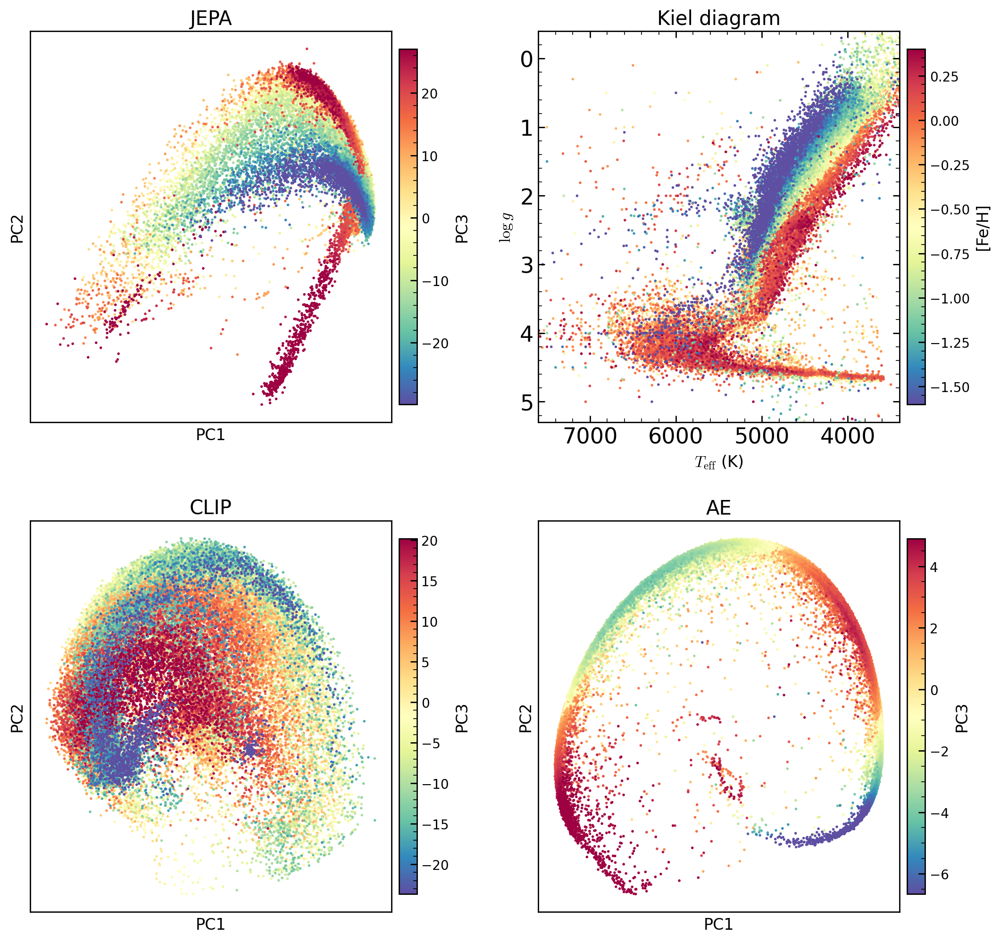
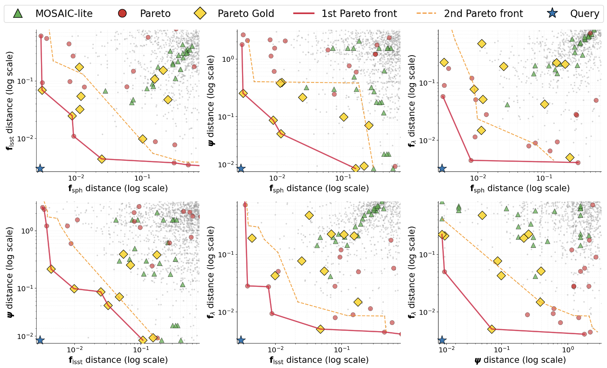
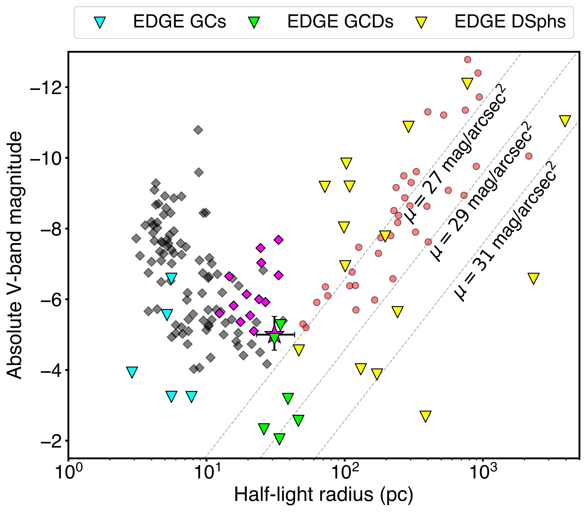
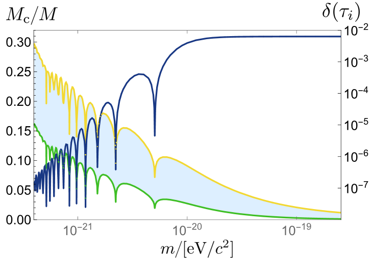

# arXiv Digest — 2026-11-19

- **Interest file used:** interests/2026.10.md (fallback — no 2026.11.md exists yet)
- **Categories pulled:** astro-ph.CO, astro-ph.EP, astro-ph.GA, astro-ph.HE, astro-ph.IM, astro-ph.SR, cs.LG, stat.ML, physics.data-an, hep-ph
- **Papers scanned:** 354 (95 astro-ph new/cross + 259 from extras)
- **After first filter:** 19 candidates reviewed with full text
- **Final selected:** 18 papers across 4 tiers

---

## Tier 1 — Highly relevant

### [JEPA for astronomy: multi-survey spectral alignment puts stellar parameters on the leading principal axes](http://arxiv.org/abs/2611.23492v1)

Xiaosheng Zhao, Rosemary F. G. Wyse, Yuan-Sen Ting et al.
**Primary category:** astro-ph.GA | also: astro-ph.IM

Zhao et al. compare contrastive (CLIP) vs. non-contrastive (JEPA) alignment objectives for stellar-spectra embeddings across four surveys (Gaia XP, LAMOST, DESI, APOGEE), holding the architecture fixed. **JEPA, which never pushes stars apart**, makes the embedding's leading principal components linearly legible: PC1–PC2 recover an analog of the **Kiel diagram** and PC3 tracks **[Fe/H]**, while CLIP's version is diluted and an unaligned autoencoder shows no such ordering. Linear ridge regression on JEPA embeddings reaches **R²=0.79 for [α/Fe] at N=10,000 labels**, versus 0.58 for the unaligned baseline, with the gain growing as more surveys are added. Applied to **8 million Gaia XP giants**, the trained embedding recovers the Milky Way's known thin/thick-disk and accreted-population chemical structure from label-free alignment alone.

*Comparing the leading principal components across the three alignment strategies shows that **JEPA alone recovers a clean, Kiel-diagram-like structure** colored by [Fe/H], while CLIP's version is diluted and the unaligned autoencoder shows no ordering at all.*

---

### [Searching the Pareto Front: Multi-Objective Retrieval for Heterogeneous Scientific Modalities](http://arxiv.org/abs/2611.23639v1)

Song Young Oh, Nesar Ramachandra, Bin Xia et al.
**Primary category:** cs.AI | also: astro-ph.IM

Oh et al. propose ParetoFuse, a multimodal retrieval method for galaxy data that keeps each modality's embedding distance as a separate objective rather than collapsing them into one learned space, selecting candidates via **Pareto dominance** across modalities. Against a foundation-model (MOSAIC-lite) kNN baseline on a galaxy retrieval task spanning star-formation histories, spectra, and multi-wavelength photometry, the foundation model wins on embedding-space proximity, but ParetoFuse's "Pareto Gold" refinement better preserves **modality-specific distance structure** that scientists can inspect, and its nearest neighbor is **8% closer to the query in raw physical units** (spread 0.128 vs. 0.139) despite no shared training. The result argues embedding-space compactness and raw-data fidelity are not the same thing for scientific retrieval.

*Pairwise 2D views of a query's modality-specific distances show that **Pareto-optimal candidates differ from the foundation model's nearest neighbors**, illustrating how multi-objective retrieval surfaces different, modality-aware trade-offs than a single learned embedding space.*

---

### [Discovery of HEC14: an ultra-faint stellar system in M31's outer halo at the globular cluster-dwarf galaxy boundary](http://arxiv.org/abs/2611.24685v1)

Joanna D. Sakowska, David Martínez-Delgado, Massimiliano Gatto et al.
**Primary category:** astro-ph.GA

Sakowska et al. report the discovery of **HEC14**, an ultra-faint stellar system in M31's outer halo, found by visual inspection of PAndAS survey images and confirmed with deep GTC imaging. Its color-magnitude diagram shows an old (>10 Gyr), metal-poor red giant branch and blue horizontal branch at a best-fit distance of **912 kpc**, with **M_V ≈ -5.00** and half-light radius **r_h ≈ 31 pc**, placing it in the size-luminosity gap between globular clusters and dwarf galaxies ("extended cluster" regime). The authors note HEC14's size and luminosity **match predictions from the EDGE dwarf-galaxy simulations for dark-matter-rich "globular-cluster-like dwarfs"** that formed before reionization, making it a candidate test case for whether DM-dominated dwarfs can masquerade as compact star clusters.

*On the luminosity-size plane, HEC14 falls within the region EDGE dwarf-galaxy simulations predict for dark-matter-rich **"globular cluster-like dwarfs"**, distinct from pure globular clusters and ordinary dwarf spheroidals.*

---

### [automodel: A Skill for Agentic Model Discovery](http://arxiv.org/abs/2611.24347v1)

Marco Virgolin, Harry Desmond, Ester Bergantin et al.
**Primary category:** cs.AI | also: astro-ph.GA

Virgolin et al. introduce **automodel**, a portable "agent skill" that gives general-purpose coding agents (Claude Code, Codex) a four-phase recipe — setup, baseline, iterate, finalize — for discovering or improving scientific models, tested across five domains including astrophysics. In the astrophysics case study, agents searching for compact analytic forms of the galaxy **stellar mass function** found one that **beats the literature-standard Bernardi fit by 36.5 nats in description length** while using fewer operators (19 vs. 23) and simultaneously improving the likelihood — a genuine accuracy gain, not just a complexity trade-off. The result positions general-purpose coding agents, guided only by a natural-language methodology, as a viable alternative to domain-specific symbolic-regression pipelines for genuine hypothesis generation and testing.

*On the description-length vs. complexity Pareto front for the galaxy stellar mass function, **functions discovered by automodel beat the literature Bernardi and Saunders forms** while using far fewer parameters than exhaustive symbolic regression.*

---

## Tier 2 — Adjacent / useful context

### [Towards modelling redshift uncertainties in the photometric void size function](http://arxiv.org/abs/2611.24642v1)

Pierre Boccard, Giovanni Verza, Giulia Degni et al. (co-authored by high-value author Gideon McFarland)
**Primary category:** astro-ph.CO

Boccard, Verza, Degni et al. extend the theoretical void size function to account for **photometric redshift uncertainties**, modeling line-of-sight smearing as an anisotropic damping of the density-field variance within the excursion-set/peak-theory formalism. Tested on AbacusSummit halo lightcones with mock Gaussian photo-z scatter, the damped model **reproduces the measured variance suppression to 1%** and matches the suppressed void abundance for **σ_z ≤ 0.015 and voids larger than 40 h⁻¹ Mpc** once the barrier parameters are recalibrated. This is presented as a first step toward extracting cosmological constraints from void counts in upcoming photometric surveys like **Rubin LSST and Euclid**.

---

### [Interpretable attention-based neural posterior estimation for fast radio burst cosmology](http://arxiv.org/abs/2611.24542v1)

Tian-Yang Sun, Ji-Guo Zhang, Wan-Peng Sun et al.
**Primary category:** astro-ph.CO | also: astro-ph.HE

Sun et al. build an **attention-based neural posterior estimator (AttNPE)** that compresses an FRB catalog's dispersion measures into a learned summary and uses a conditional masked autoregressive flow to infer seven cosmological and host-galaxy parameters jointly, replacing an MCMC likelihood that otherwise takes **72.8 hours per catalog**. AttNPE's posteriors agree closely with MCMC on both simulated and real FRB catalogs, generating **5×10⁴ posterior samples in 0.036 s** — roughly a **million-fold speedup**. The authors inspect attention weights directly rather than treating the network as a black box, finding FRBs at **intermediate redshift (0.3 ≤ z < 0.7)** dominate the inference for the current observed sample.

---

### [Map-Level Inference of Primordial Gravitational Waves from the CMB with Spherical Neural Networks](http://arxiv.org/abs/2611.24939v1)

Anto I. Lonappan, Adrian E. Bayer, Brian Keating et al.
**Primary category:** astro-ph.CO | also: astro-ph.IM

Lonappan et al. train a **spherical graph convolutional network** to infer the tensor-to-scalar ratio r directly from multifrequency CMB B-mode maps on the cut sky, with no intermediate power-spectrum estimation. Against a bandpower likelihood trained on the same simulations, the network **reduces the RMSE on r by a factor of 1.3** and gives **68% intervals 1.2× narrower**, with well-calibrated uncertainties away from r=0. The authors probe the network with **saliency maps**, showing it learns — without being told — to **favor the deepest sky regions and cleanest frequency channels**, though both methods remain tied to the foreground model used in training.

*Saliency maps show the trained network **autonomously learns to weight the deepest, lowest-noise regions of the sky and the cleanest frequency channels**, without ever being given the survey depth.*

---

### [NEXONN: Advancing the NEXOTRANS Exoplanet Atmospheric Retrieval Framework with Transformer-Based Neural Posterior Estimation for JWST Transmission Spectroscopy of WASP-39b](http://arxiv.org/abs/2611.23818v1)

Tasneem Basra Khan, Liton Majumdar, Mithun Patra et al.
**Primary category:** astro-ph.EP | also: astro-ph.IM

Khan et al. extend the NEXOTRANS exoplanet retrieval framework with **NEXONN**, a transformer-conditioned normalizing flow that replaces nested-sampling Bayesian retrieval with near-instant, uncertainty-calibrated posterior inference for JWST transmission spectra. Benchmarked against PyMultiNest on simulated and real **WASP-39b** JWST observations (0.6–12 μm), NEXONN's posteriors achieve a mean **80% overlap with the reference retrievals** and recover consistent parameters (e.g., **C/O = 0.82** vs. 0.80), with coverage tests confirming calibrated uncertainties. Once trained, retrieval completes in seconds, aimed at enabling **population-level studies** of exoplanet atmospheres as JWST data volume grows.

---

### [Thermodynamics of gas giants accreting via shocks: the role of molecular hydrogen dissociation](http://arxiv.org/abs/2611.24615v1)

Bingjie Zha, Zhuo Chen
**Primary category:** astro-ph.EP

Zha & Chen couple radiation-hydrodynamic shock simulations to long-term planetary evolution by training a **physics-informed neural network (PINN)** on 1,000 first-principles simulations of the accretion shocks that form gas giants, then using its predicted post-shock entropy and temperature as boundary conditions for MESA evolution. The PINN predicts **higher post-shock temperatures than the canonical "cold-start" model**, with a sharp entropy jump where **H₂ dissociates near 2000 K**, and planets evolved with these conditions reach **intrinsic luminosities 4–10× higher**. This also implies much stronger magnetic fields for young gas giants (up to **~500 G for a 3 M_J planet**), tightening the link between formation thermodynamics and the observables used to interpret directly-imaged young exoplanets.

*Planets evolved with PINN-derived, physically realistic shock boundary conditions reach **substantially higher intrinsic luminosities and magnetic field strengths** than the standard "cold-start" assumption over the first 5 Myr.*

---

### [Geodesic-informed neural networks for testing spacetimes with S2](http://arxiv.org/abs/2611.24370v1)

Prajwal Hassan Puttasiddappa, Dennis Fremstad, Abdolali Banihashemi et al.
**Primary category:** gr-qc | also: astro-ph.GA

Puttasiddappa et al. introduce the **Geodesic-Informed Neural Network (GINN)**, a differentiable orbit model for testing alternative spacetimes using the S2 star's orbit around Sgr A*, where a neural network constrained by the geodesic equation represents the orbital phase while conserved quantities and the metric are computed exactly. Rather than sampling a posterior via MCMC, GINN obtains parameter estimates, **uncertainties, and Bayesian evidence from a single optimization**, reproducing an exact geodesic solver's results across six spacetimes. Applied to real S2 data, GINN finds **M = (4.32±0.22)×10⁶ M_☉** with no spacetime significantly favored over Schwarzschild, demonstrating a fast, differentiable alternative to sampling-based tests of strong-field gravity.

---

### [LEMUR: A Searchable Web Archive of Deep Chandra Images of Galaxies and Galaxy Clusters](http://arxiv.org/abs/2611.24937v1)

Carter L. Rhea, Julie Hlavacek-Larrondo, Marine Prunier et al.
**Primary category:** astro-ph.GA | also: astro-ph.IM

Rhea et al. present **LEMUR**, a public archive of uniformly reduced, deep Chandra X-ray images for **2,569 galaxies and clusters** (138.8 Ms of exposure), making archival X-ray data usable without specialized reduction expertise. The archive provides a **morphological similarity search using AstroCLIP foundation-model embeddings**, applied far outside AstroCLIP's optical training domain, and the authors validate that this out-of-domain embedding still captures real physics: nearest neighbors **share cool-core cluster status 73% of the time**, versus **51% expected by chance**. This demonstrates pretrained astronomical foundation models can organize archival observations by morphology even across completely different imaging modalities than they were trained on.

*AstroCLIP embeddings trained only on optical images still identify physically meaningful X-ray neighbors — the relaxed, cool-core cluster **Abell 2029's nearest neighbors are other bright, centrally-peaked cool-core clusters**, despite the model never having seen Chandra data.*

---

### [Cross-Dataset Inference of Central-Satellite Classification and Host Halo Masses from Galaxy neighbours with Machine Learning](http://arxiv.org/abs/2611.24803v1)

Alice Chen, Camille Avestruz, Niayesh Afshordi et al.
**Primary category:** astro-ph.GA

Chen et al. train XGBoost models on **IllustrisTNG** galaxy neighbor distances and stellar masses to classify galaxies as **centrals or satellites** and estimate host halo mass, then test cross-simulation robustness on **EAGLE** after a simple stellar-mass domain-alignment step. On TNG100 the classifier reaches **purity=completeness=0.97** and halo-mass regression reaches **r²=0.98**; after alignment and transfer to EAGLE, performance drops only modestly (**r²=0.91** for true centrals), with misclassified satellites systematically underpredicting their true host halo mass. The results show survey-accessible observables combined with domain-aligned, simulation-trained models can recover the galaxy-halo connection to **r² ≥ 0.85** even across different hydrodynamic simulations.

---

### [Zippers and Twisters II: The lopsidedness of satellite systems around local massive galaxies emerges from a shifting cosmic web landscape](http://arxiv.org/abs/2611.23849v1)

Janvi P. Madhani, Charlotte Welker, Sneha Nair et al.
**Primary category:** astro-ph.GA

Madhani et al. use the high-resolution hydrodynamic simulation **NewHorizon** to trace the origin of **lopsidedness in luminous dwarf satellite distributions** around massive galaxies, finding over **25% of systems show statistically significant lopsidedness** incompatible with dark-matter-only expectations. They show this is **inherited from the anisotropic network of cosmic filaments** feeding each halo: the richest satellite hemisphere aligns with the side hosting the most filaments, and ongoing filament mergers ("**zippers**") funnel satellites onto one side without requiring any galaxy mergers. The work argues lopsidedness is primarily a signature of the evolving cosmic web, and calls for higher hydrodynamic resolution in simulations used to model it.

---

### [Deep Multiwavelength Constraints on the Host Galaxies and Black-Hole Growth of Dwarf AGNs](http://arxiv.org/abs/2611.24698v1)

Wei Leong Tee, W. N. Brandt, Zhibo Yu et al.
**Primary category:** astro-ph.GA

Tee, Brandt, Yu et al. use ultra-deep Chandra data with JWST/HST imaging to study **56 X-ray-detected dwarf galaxies** (M_* < 3×10⁹ M_☉) out to **z≈4**, comprising 31 AGN and 25 inactive dwarfs, probing black-hole growth at the low-mass end of galaxy-halo coevolution. They find **no significant difference in local environment or morphology** between active and inactive dwarfs, suggesting dwarf AGN activity does not require major mergers, and infer a **positive cosmic evolution of black-hole accretion** — both AGN fraction and accretion rate rise toward higher redshift and stellar mass. Many dwarf AGN show only weak optical/IR signatures, with hard X-ray colors hinting at **increasing obscuration at z>2**, supporting growth via largely **stochastic or secular processes** rather than mergers.

---

### [Cosmological structure formation in ultralight dark matter](http://arxiv.org/abs/2611.24509v1)

K. Korshynska, A. I. Yakimenko, Y. Revaz et al.
**Primary category:** astro-ph.GA

Korshynska et al. derive, for the first time, a **fully analytical equation for the time evolution of density perturbations** collapsing into dark matter halos composed of **ultralight bosons**, using a time-dependent variational approach within the excursion-set-like halo-formation picture. The analytic solution tracks how halo size and density evolve through formation, separating the roles of background expansion, quantum pressure, and initial overdensity, and yields predictions for the **ratio of core mass to total halo mass** as a function of boson mass — directly relevant to whether ultralight dark matter produces the **cored density profiles** often invoked to explain dwarf-galaxy dynamics in place of cuspy CDM halos.

*The analytic model predicts how the **core-to-total halo mass ratio depends on the ultralight boson's particle mass**, bracketing the range between energy-equipartition and fully-virialized-core assumptions — directly relevant to the dwarf-galaxy core-cusp discrepancy.*

---

## Tier 3 — Outside my area but notable

### [An inspiral of a star inside a common envelope with its giant companion](http://arxiv.org/abs/2611.23470v1)

Viraj Karambelkar, Kishalay De, Karel D. Temmink et al.
**Primary category:** astro-ph.SR

Karambelkar, De, Temmink et al. report the first-ever direct observation of a stellar inspiral inside a **common envelope**, via the transient AT 2025abao in the Andromeda Galaxy — a ~7 M_☉ AGB star whose ~0.7 M_☉ companion spiraled through its shared convective envelope over a **seven-year gradual brightening**, the first direct detection of the frictional-drag energy dissipation theorized to drive common-envelope evolution. The subsequent merger ejected roughly **10% of the stellar envelope at ~10× the escape speed**, letting the authors empirically constrain the common-envelope efficiency parameter to **0.01 ≲ α ≲ 0.4** — a quantity previously only inferred indirectly from compact-binary population statistics. This multi-survey characterization opens a path to directly mapping common-envelope outcomes as upcoming time-domain surveys catch more such events in progress.

*The multiband light curve spanning the quiescent progenitor (2005–2015), a decade-long precursor brightening, and the final eruption traces the entire common-envelope inspiral and merger of AT 2025abao in real time — the first such event ever directly observed.*

---

## Tier 4 — Meta-research about the field

### [Integrating AI Coding Agents Into Scientific Research](http://arxiv.org/abs/2611.23334v1)

Rory Barnes
**Primary category:** cs.SE

Barnes examines how AI coding agents (e.g., Claude Code, Codex) change **eleven aspects of generating, verifying, and reproducing** numerical results in scientific software, then proposes the **PROOF Ladder** — a six-level scale rating AI-assisted computational experiments by provenance, reproducibility, openness, oversight, and falsifiability. These ideas are packaged into **vaibify**, an open-source tool that sequesters coding agents in Docker containers while giving researchers a GUI to prompt, monitor, and drive a project up the PROOF Ladder to Level 3 (reproducible). The paper argues that as agents shift the bottleneck from writing code to **verifying** it, researchers need an explicit framework for communicating how much to trust agent-generated scientific results.

---

### [Benchmarking LLM abilities on postdoc-level natural science problems](http://arxiv.org/abs/2611.24321v1)

Alina Avanesyan, Alexey Boldyrev, Liqun Deng et al.
**Primary category:** cs.AI

Avanesyan, Boldyrev, Deng et al. introduce **STEMBench**, a benchmark of twelve postdoc-level research problems in high-energy physics, astrophysics, and neuroscience, each scored by its **own field's actual figure of merit** rather than a generic answer key, anchored by a no-domain-knowledge baseline and an expert reproduction of a published method. Across eight frontier LLMs, **task-level wins and domain-level leadership dissociate** — a model winning five of twelve tasks still leads no domain's mean score — and in a high-effort setting, at least one model's mean **exceeds the expert anchor on seven of twelve tasks**, with the remaining five clustered around uncertainty estimation and causal inference. The benchmark directly probes **how much of scientific research LLMs can currently substitute for versus merely assist**.
