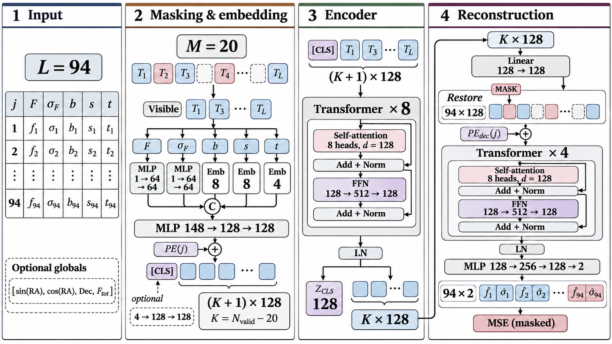
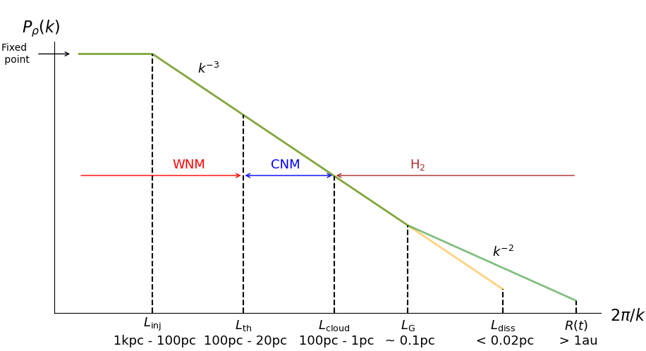
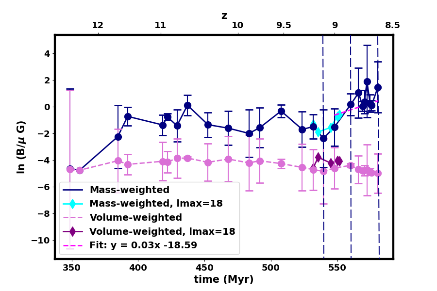
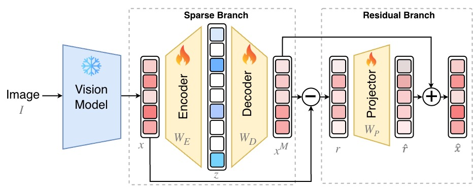
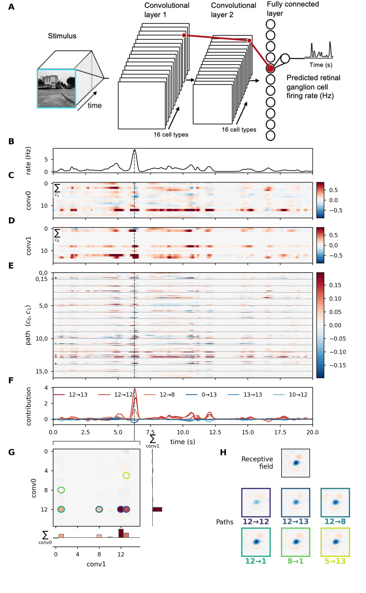
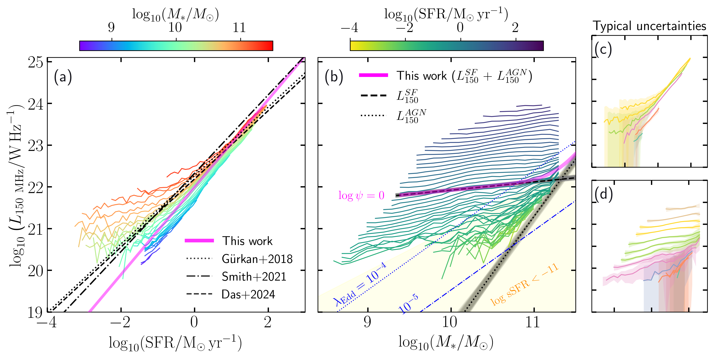

# arXiv Digest — 2026-11-20

- **Interest file used:** interests/2026.10.md (fallback — no 2026.11.md exists yet)
- **Categories pulled:** astro-ph.CO, astro-ph.EP, astro-ph.GA, astro-ph.HE, astro-ph.IM, astro-ph.SR, cs.LG, stat.ML, physics.data-an, hep-ph
- **Papers scanned:** 358 (105 astro-ph new/cross + 267 from extras; 14 papers overlapped both groups)
- **After first filter:** 31 candidates reviewed with full text
- **Final selected:** 20 papers across 2 tiers

---

## Tier 1 — Highly relevant

### [EuclidFM: Foundation Model for Compact Photometric Survey Representation](http://arxiv.org/abs/2611.25080v1)

Reyhaneh Vojoudi Salmani, Mahsa Berahman, Saeed Ansarifard et al.
**Primary category:** astro-ph.IM | also: astro-ph.CO

A masked-autoencoder Transformer learns compact **128-dimensional embeddings** of heterogeneous Euclid Quick Data Release 1 photometry for 90,258 sources, reconstructing withheld fluxes and uncertainties from available measurements. The embeddings encode morphology and photometry: point-like sources cluster together (**12.4 vs 4.3 similarly-classified neighbours** among their 15 nearest, relative to randomization), and frozen-embedding linear models predict VIS magnitudes with **correlations of 0.954–0.980**. A classifier built on the embeddings also flags **1,150 quasar candidates**, though only a minority have confirmed AGN counterparts, showing purity still needs work. EuclidFM demonstrates a reusable, self-supervised representation for downstream survey analyses where photometric coverage varies source to source.

*The EuclidFM masked-autoencoder architecture: unmasked flux/error measurements and categorical metadata are fused into a single embedding per source, later used to reconstruct withheld fluxes.*

---

### [SlotFlow-GB: A Neural Framework for Trans-Dimensional Inference of Overlapping Galactic Binaries](http://arxiv.org/abs/2611.26057v1)

Niklas Houba, Giovanni Giarda, Davide Piras
**Primary category:** astro-ph.IM | also: cs.LG, gr-qc

SlotFlow-GB produces, in a single forward pass, a full **trans-dimensional posterior** over both the number and parameters of overlapping Galactic binaries in simulated LISA data, with no need to fix the source count in advance. On year-long simulations with up to ten binaries, the inferred source count is off by **at most one in 94% of scenes**, and the learned per-source parameter posteriors are well calibrated (**50% intervals contain truth 53–56% of the time, 90% intervals 92–94%**). The whole evaluation, including sampling, takes just **41 ms per frequency band** on a single GPU. This amortized approach could seed faster global-fit pipelines for the millions of Galactic binaries LISA is expected to detect.

*Learned eight-dimensional posterior for one binary in a crowded seven-source scene (black = truth, red = reference MCMC): the network recovers the frequency to within 3 nHz and reproduces the amplitude–inclination and polarization–phase degeneracies.*

---

### [Low-Latency Alerts of Massive Black Hole Binaries in LISA](http://arxiv.org/abs/2611.26411v1)

Rahul Srinivasan, Lorenzo Copparoni, Chantal Pitte et al.
**Primary category:** gr-qc | also: astro-ph.IM

TRUFFLE is a simulation-based-inference pipeline that delivers continuously updated, calibrated posteriors for massive black hole binaries in LISA data as a signal evolves toward merger, handing off between an early-warning network (days out) and a near-merger network (hours out) for telescope-pointing-ready sky localization. Tested on **10⁶ injected signals**, one-dimensional coverage deviates from nominal by **at most 1.2%**, and a worked example tracks a reference binary's chirp-mass precision tightening from an unconstrained prior at 32 h before merger to **0.04 dex at 4 h**. Network posteriors agree with parallel-tempered MCMC in location and correlations but are conservatively wider, especially in sky position, where importance-sampling efficiency falls from **27% to 0.2%** as merger approaches. The pipeline turns neural inference (seconds) plus likelihood reweighting (~5 minutes) into an alert-ready tool for electromagnetic follow-up scheduling.

*Posteriors from the neural network (blue), importance-sampled correction (orange), and parallel-tempered MCMC (green) agree closely for a source near the LISA constellation plane shortly before merger, validating the network's sky localization.*

---

### [Sherlock 'Chrones: The Curious Case of NGC 6791 and Asteroseismic Targets Therein Reveals Mixing Length Dependence on Evolutionary Stage](http://arxiv.org/abs/2611.25306v1)

Eliza Frankel, Meridith Joyce, Jamie Tayar et al.
**Primary category:** astro-ph.SR | also: astro-ph.GA

Using asteroseismic constraints on individual stars in the open cluster NGC 6791 and the globular cluster M92, the authors build custom isochrones with varying **convective mixing length** ($\alpha_{\rm MLT}$) and find the best-fitting value **decreases monotonically with evolutionary phase**, dropping by **18%** between the main-sequence turnoff and the upper red giant branch in NGC 6791. This single-cluster variation is comparable to the full literature spread in $\alpha_{\rm MLT}$ across *different* clusters, calling single-valued mixing-length fits into question, and the trend agrees with expectations from higher-fidelity 3D convection simulations. The result argues for building more flexibility into the mixing-length treatment used in isochrones for stellar population modeling.

*Gaia photometry of NGC 6791 with isochrones spanning mixing lengths of 1.30–2.10 overlaid, unaligned (left) and pinned to the main-sequence turnoff (right): no single mixing length fits the whole sequence equally well.*

---

### [Eigenspectra of Poisson-sampled stellar population models: Statistical fingerprints of cool giant stars in unresolved early-type galaxies](http://arxiv.org/abs/2611.26421v1)

Anastasia Gvozdenko, Russell J. Smith
**Primary category:** astro-ph.GA

The authors apply PCA to Poisson-resampled realizations of stellar-population-synthesis spectra to isolate the statistical signature of individual luminous cool giant stars in the unresolved light of old galaxies, finding that **>99% of the sampling variance** is captured by just the first two principal components across all ages and metallicities tested. The **leading eigenspectrum matches a late-M giant** dominated by TiO bandheads, and its eigenvalue tracks whether a realization happens to contain a few very bright RGB/AGB-tip stars or many fainter ones. Demonstrated here on synthetic spectra, the method is designed to be applied directly to multi-spectrum IFU data to probe uncertain ingredients of stellar population models — giant-branch temperature, IMF — in a purely data-driven way.

*For a 10 Gyr, solar-metallicity population in the I-band, the first two PCA components (right) capture nearly all of the Poisson-sampling variance (left); the leading eigenspectrum has the form of a late-M giant.*

---

### [From a mass invariant in a gravo-turbulent medium to the characteristic mass of the star-forming cores](http://arxiv.org/abs/2611.26162v1)

Pierre Dumond, Gilles Chabrier, Jérémy Fensch et al.
**Primary category:** astro-ph.GA

The authors identify a **time-invariant mass scale** in self-gravitating turbulent gas, set purely by the large-scale normalization of density fluctuations and Larson's scaling relations, and show with high-resolution simulations that it stays constant as collapse proceeds down to the first hydrostatic core. Combined with a statistical model of the multiphase, self-gravitating ISM, this invariant predicts the **characteristic mass of the prestellar core mass function** — and hence the stellar IMF's characteristic mass — successfully reproducing values from Milky Way-like regions to massive early-type galaxies and high-mass star-forming regions. The result offers a first-principles explanation for the long-standing puzzle of **IMF/CMF universality** across very different galactic environments, grounded in turbulence and gravity alone rather than empirical calibration.

*Schematic of the collapse process in density power-spectrum space: as gravity pulls gas from the turbulence injection scale down to the first core radius, the identified mass invariant stays fixed, setting the characteristic core mass.*

---

### [Magnolia: a highly magnetized galaxy at redshift $z\simeq9$](http://arxiv.org/abs/2611.25937v1)

Evangelia Ntormousi, Andrea Pallottini, Mahsa Kohandel et al.
**Primary category:** astro-ph.GA

From the new MAGNA SERRA suite of radiation-magnetohydrodynamic cosmological zoom-in simulations, the authors present Magnolia, a **few×10⁸ M☉ stellar-mass galaxy at z≈9** (hosted in a ~10¹¹ M☉ halo) that develops a strongly coherent magnetic field of **a few μG** (plasma β≈0.1) within just **~40 Myr**, driven by large-scale compression and shear rather than classical dynamo action. This challenges the standard expectation that early galaxies should be essentially unmagnetized, matching recent dust-polarization detections of strong fields at z≈2.6 and 5.6. Because Magnolia sits squarely in the **dwarf-galaxy mass range**, the result is a direct new prediction for how magnetic fields could shape the ISM physics and observables of early low-mass galaxies.

*Mass- and volume-weighted magnetic field strength in Magnolia versus cosmic time: the field amplifies by orders of magnitude over roughly 40 Myr, reaching several μG around z≈8.6.*

---

### [On the feasibility of using [Eu/$\alpha$] to identify accreted and in-situ extragalactic globular clusters](http://arxiv.org/abs/2611.26424v1)

Anastasia Gvozdenko, Michael A. Beasley, Katja Fahrion et al.
**Primary category:** astro-ph.GA

Using a homogeneous set of high-resolution integrated-light abundances for **28 globular clusters** (21 extragalactic, 7 Galactic), the authors test whether the chemical ratio **[Eu/α]** — previously calibrated only on the Milky Way — can separate in-situ from accreted globular cluster populations elsewhere in the Local Group. It works well: metal-rich M31 GCs show uniformly low **[Eu/Si]≈−0.4** (in-situ-like), lower-metallicity M31 GCs cluster near **[Eu/Si]≈+0.4** (accreted-like) at larger galactocentric radii, and **dwarf-galaxy GC systems split between the two depending on dwarf mass**, with the lowest-mass dwarfs hosting primarily in-situ GCs. The result validates [Eu/α] as a broadly applicable discriminator for extragalactic archaeology, including specifically in the low-mass dwarf-galaxy regime.

*[Eu/Si] versus [Fe/H] for globular clusters in the Milky Way and Local Group dwarf galaxies, compared to the in-situ (red) and accreted (blue) relations calibrated on the MW: the dwarf-galaxy GCs separate cleanly along the same sequences.*

---

### [Who Moved My $Z$ Boson? Revealing Resonance Features Inside a Neural Network](http://arxiv.org/abs/2611.26291v1)

Kevin Alberto Urquía Calderón, Midori Kato, Inar Timiryasov et al.
**Primary category:** hep-ph | also: cs.LG

Applying mechanistic-interpretability techniques to ShellFlow, a generative model trained only to reproduce LHC muon-pair kinematics (never told which muons come from a resonance), the authors discover internal features that represent the **Z, J/ψ, and Υ resonances** on their own. Adding a gradient-derived steering vector to one network block lets them **shift the fitted Z-boson mass peak between ~80 and 105 GeV**, and removing the feature instead broadens the peak — all while the rest of the invariant-mass spectrum stays essentially unchanged. A generative physics model trained purely on kinematics thus spontaneously learns physically meaningful, surgically editable internal representations of particle resonances, a clean proof-of-concept for gradient-based interpretability that could transfer directly to astronomical generative or simulation-based-inference models.

*Dimuon invariant-mass spectrum from ShellFlow: adding the discovered Z-boson steering vector at different strengths (blue to green) shifts the Z-peak location while leaving the J/ψ, Υ peaks and the rest of the spectrum essentially untouched.*

---

### [Separating Interpretability and Reconstruction in Sparse Autoencoders](http://arxiv.org/abs/2611.25165v1)

Anh Tien Nguyen, Dimitris Samaras, Mahdi S. Hosseini
**Primary category:** cs.LG

Standard sparse autoencoders force a single sparse code to handle both reconstruction fidelity and interpretability — goals that aren't guaranteed to align. DualSAE splits these roles explicitly: a Sparse Branch captures the dominant **semantic** content as an interpretable sparse code, while a plug-in Residual Branch absorbs the **non-semantic** leftover, with a decorrelation loss keeping the two branches' contributions distinct. Across vision and language encoders, this yields mean relative gains of **~29% in reconstruction fidelity and ~34% in interpretability (monosemanticity score)**, with downstream benefits for topic modeling, hypothesis generation, and LLM steering — a direct, practical instance of embedding-space-constraining, interpretability-built-in network design.

*DualSAE's architecture: a Sparse Branch learns an interpretable sparse code for the input's semantic content, while a Residual Branch separately captures the remaining non-semantic information, and the two recombine to reconstruct the feature.*

---

### [Auditing Learned Dynamics in Weather Models](http://arxiv.org/abs/2611.25119v1)

Skylar Gu, Christina Last
**Primary category:** cs.LG

The authors use sparse-autoencoder features from DeepMind's GraphCast weather model to test whether a feature's causal importance for forecast skill requires it to correspond to a recognizable physical quantity — it does not: ablating a feature locked only to the model's computational mesh raises **+48h geopotential-height RMSE by 19%**, more than ablating physically-labeled features. The reverse also holds: suppressing convection- and vorticity-associated features weakens predicted tropical-cyclone intensification, while amplifying them at a tuned strength **improves minimum-sea-level-pressure forecast error by a median of 42–51%** across seven real storms, without over-deepening any of them. This separates "interpretable and physical" from "causally load-bearing," demonstrating targeted causal intervention as a practical tool for auditing — and steering — a physical-science foundation model.

*Restoring the convection or vorticity feature to its storm-free state removes most of a tropical cyclone's predicted deepening, while amplifying the same features at the right strength substantially lowers minimum-sea-level-pressure forecast error.*

---

### [Revealing Pathway Interactions in Network Computations with Complete Path Contribution](http://arxiv.org/abs/2611.26101v1)

Shenghua Liu, Youssef Faragalla, Surya Ganguli et al.
**Primary category:** cs.LG | also: q-bio.NC

The authors introduce Complete Path Contribution, a method that exactly decomposes a network's output into the contributions of every individual input-to-output causal pathway, rather than only pairwise unit/layer interactions, with an efficient algorithm that finds the **k strongest paths without enumerating all of them**. Applied to an interpretable model of the mouse retina, the method reveals how **dynamic receptive fields emerge from excitatory–inhibitory path interactions** between cell types — recovering a retinal ganglion cell's instantaneous receptive field from just **3 of 256 possible paths (r=0.95)**. On an MNIST classifier it also finds that many "silent" neurons with near-zero net contribution actually hide strong, nearly-cancelling excitatory and inhibitory paths — a genuinely new, scalable tool for mechanistic interpretability of constrained, physically-grounded networks.

*Path contributions through a CNN fit to mouse retinal ganglion cell responses: just three of the network's 256 possible channel-pair paths (circled) reconstruct the cell's instantaneous receptive field with r=0.95 against the full model.*

---

### [TwinLab-Bench: Evaluating AI Scientists in Agentic Twins of Real Labs](http://arxiv.org/abs/2611.26248v1)

Yang Wan, Linchao Zhu
**Primary category:** cs.AI | also: cs.CL

TwinLab-Bench evaluates AI agents on **self-designed experiments** — not just executing a given workflow or choosing among predefined measurements, but proposing and running their own — across **52 tasks** spanning physical-science, life-science, and engineering laboratories. Each task has a dedicated "TwinLab" agent that grounds the environment, executing whatever experiment the tested agent designs and scoring its final report against hidden real laboratory records, which the authors show nearly eliminates fabricated readings and inconsistent repeated answers compared to an ungrounded language model. Even the strongest tested model (Claude Fable 5.2) averages only a **score of 45.0 out of 100**, showing that genuinely autonomous scientific experiment design — agents forming and testing their own hypotheses, not just assisting — remains hard for frontier models.

*TwinLab-Bench sits at the far end of two axes relative to prior science benchmarks: how much of the experimental method the agent itself must design, and how close the test environment is to a real laboratory.*

---

## Tier 2 — Adjacent / useful context

### [The OGLE Collection of Variable Stars. Over 1.3 Million Human-Verified Eclipsing and Ellipsoidal Binaries in the Milky Way](http://arxiv.org/abs/2611.25024v1)

I. Soszyński, M. Głowacki, M. A. Urbanowicz et al.
**Primary category:** astro-ph.SR

This release of the OGLE collection catalogs **1,330,024 eclipsing and ellipsoidal binary systems** in the Galactic bulge and disk — nearly **three times** the size of the previous edition — combining OGLE-II, -III, and -IV photometry spanning up to **28 years** per object, with classifications based on expert visual inspection of the light curves. The catalog updates orbital periods and other parameters for previously known systems and highlights selected rare and unusual systems. While not a new scientific result in itself, a binary-star dataset of this scale and quality is a substantial resource for calibrating binary templates and systematics in stellar population synthesis work.

---

### [Top-heavy Initial Mass Functions are not enough at cosmic dawn](http://arxiv.org/abs/2611.25027v1)

Andrea Ferrara, Pratika Dayal
**Primary category:** astro-ph.GA

Testing whether a metallicity-dependent, top-heavy stellar IMF can explain the puzzling excess of UV-bright galaxies at cosmic dawn, the authors self-consistently track the resulting changes in UV emission, supernova feedback, metal enrichment, and dust production relative to a fixed Salpeter IMF. The top-heavy IMF boosts intrinsic UV luminosity by a factor of **~2.8–4.7**, but enhanced supernova feedback and dust attenuation claw most of that back, leaving a net boost of only **~1.2–1.4× (about 0.3 mag)** for the halo masses relevant to the brightest observed galaxies — and semi-analytic UV luminosity functions differ by **less than 0.5 dex** between the two IMFs at z≈11–17. A top-heavy IMF therefore cannot, on its own, explain the bright-galaxy excess, though the predicted **2–6× difference in pair-instability supernova rates** offers a cleaner test for high-mass stellar populations at these epochs.

*Decomposition of the top-heavy IMF's net UV boost at z=14: the intrinsic stellar-population boost (blue) is substantially cancelled by stronger supernova feedback (orange) and, in massive halos, dust attenuation (purple), leaving only a modest total boost (black).*

---

### [Influence of variable IMF on the dynamical black hole mass estimates in massive ETGs](http://arxiv.org/abs/2611.25035v1)

Avinash Chaturvedi, Sabine Thater, Davor Krajnović et al.
**Primary category:** astro-ph.GA

Using MUSE and SINFONI integral-field data and triaxial Schwarzschild orbit modelling for five massive early-type galaxies, the authors test how letting the stellar IMF — and hence the stellar mass-to-light ratio — vary radially changes dynamical black hole mass estimates. All five galaxies show **bottom-heavy IMFs in their centres that lighten with radius**, and accounting for this radially-varying M*/L lowers the inferred black hole mass by up to **83% (NGC 3923)** and **11% (IC 4329)** relative to assuming a constant M*/L, with upper limits for the other three galaxies shifting in either direction. The result shows that IMF/stellar-population systematics are not a second-order correction but can dominate the uncertainty budget of dynamically-measured black hole masses.

---

### [Ram Pressure Is Unable to Strip All Phases of the Interstellar Medium out of Spirals Falling into Galaxy Clusters](http://arxiv.org/abs/2611.25049v1)

Guillermo Tenorio-Tagle, Sergio Martínez-González
**Primary category:** astro-ph.GA

Using 3D hydrodynamic simulations of dense interstellar clouds embedded in a hot flow, the authors separate the effect of the direct ram-pressure shock from turbulent viscous stripping (TVS) driven by Kelvin–Helmholtz instabilities at the cloud–ICM interface. At cloud densities of **10² cm⁻³** the transmitted shock compresses and deforms the cloud but produces only weak deceleration, and at **10³ cm⁻³** it is even less effective — in both cases it is **TVS, not the shock itself, that continuously strips gas and builds the characteristic trailing filamentary wake** seen in jellyfish galaxies. This clarifies the actual stripping mechanism acting on the densest, coldest gas phase as galaxies move through hot cluster/group media — relevant to the baryonic processes shaping gas content and star formation in low-mass satellites, including dwarfs.

*Density and temperature evolution of a dense cloud embedded in a hot flow at four times: turbulent viscous stripping, not direct shock compression, continuously peels gas from the cloud surface into a trailing wake.*

---

### [Model-Based Low-Order Wavefront Sensing and Control with a Fully Physical Digital Twin on MagAO-X](http://arxiv.org/abs/2611.25423v1)

M. Mars, S. Y. Haffert, J. R. Males et al.
**Primary category:** astro-ph.IM

The authors build a fully physical, differentiable digital twin of MagAO-X's focal-plane low-order wavefront sensor, calibrated against both laboratory and on-sky data, to correct the residual low-order aberrations and tip-tilt jitter that cause stellar leakage in high-contrast coronagraphic imaging. The non-linear digital-twin reconstruction achieves residual wavefront floors of **~6–7 nm**, compared to **~11 nm for a standard linear reconstructor**, and the same framework transfers across different coronagraph and wavelength configurations. On-sky, it reaches performance close to the atmospheric noise floor while still enabling a fast, interpretable linear reconstructor for stable **kHz-speed closed-loop control** — a clean example of a physically-informed, differentiable model directly improving a real astronomical instrument.

---

### [Chemical Cartography Across Time: The Age-Dependent Chemical Structure of the Milky Way with a Homogeneous Sample of 580,000 Giants from Five Surveys](http://arxiv.org/abs/2611.26550v1)

Jeff Shen, Neige Frankel, David W. Hogg et al.
**Primary category:** astro-ph.GA

Placing **~580,000 giant stars** from five major spectroscopic surveys onto one self-consistent scale of abundances, distances, and ages, the authors trace how the Milky Way disk's radial metallicity gradient has evolved with stellar age. They find a **"U-shaped" age dependence**: the gradient is shallow for the youngest stars, steepens to a maximum of **~−0.07 dex/kpc at intermediate ages (5–6 Gyr)**, then flattens toward zero for the oldest stars — a pattern driven almost entirely by the low-α (thin-disk) population, while the [Mg/Fe] gradient stays weak (**<~0.01 dex/kpc**) at all ages. The trend is consistent with inside-out disk formation, in which the star-forming gas's metallicity gradient has flattened over roughly the last 6 Gyr.

*The Milky Way's radial [Fe/H] gradient as a function of stellar age: it steepens from the youngest stars to a maximum around 5–6 Gyr, then flattens again for the oldest populations, tracing the disk's inside-out formation history.*

---

### [Every galaxy is a radio source: a stellar-mass dependent minimum 150 MHz luminosity identified in the LoTSS Deep Fields](http://arxiv.org/abs/2611.26618v1)

Shravya Shenoy, Daniel J. B. Smith, Martin J. Hardcastle et al.
**Primary category:** astro-ph.GA

Combining the deepest-ever wide-field **150 MHz** LOFAR mosaics with Prospector-derived star-formation rates and stellar masses for **113,228** near-infrared-selected galaxies, the authors uncover a **stellar-mass-dependent minimum radio luminosity that is independent of star-formation rate**, most visible in low-specific-SFR galaxies at $L_{150} \sim 10^{20}$–$10^{22}\,\mathrm{W\,Hz^{-1}}$. This non-stellar radio emission is consistent with pervasive, low-level black hole accretion (**Eddington ratios of $10^{-5}$–$10^{-4}$**), implying weak AGN activity is essentially universal and continuous rather than episodic. A two-component model combining star-formation- and accretion-driven emission reproduces the observed trends, and shows such weak AGN can meaningfully bias radio-based star-formation-rate estimates if left unaccounted for.

*Median 150 MHz radio luminosity versus SFR (left) and stellar mass (right): at low specific SFR, luminosity flattens to a mass-dependent floor rather than continuing to track star formation, revealing a pervasive weak-AGN contribution.*
