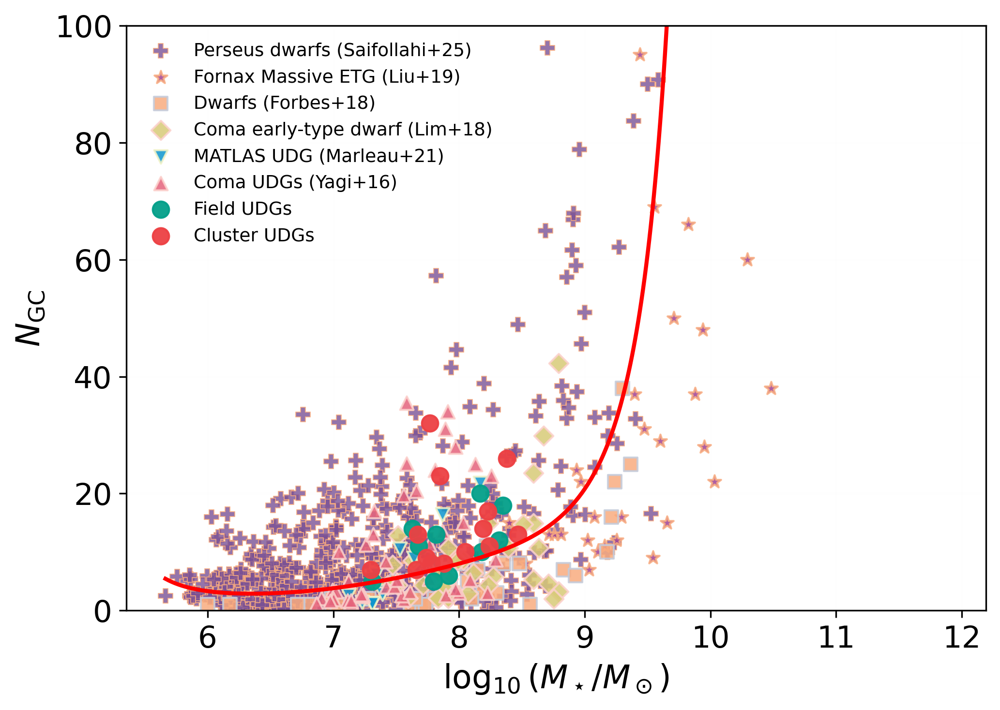
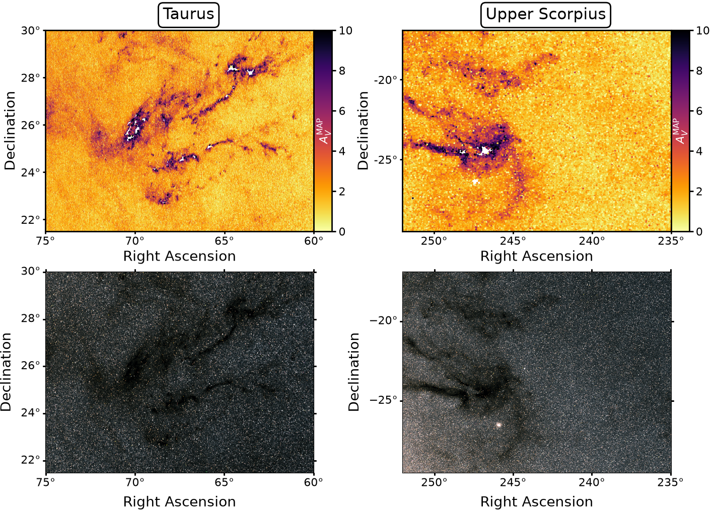
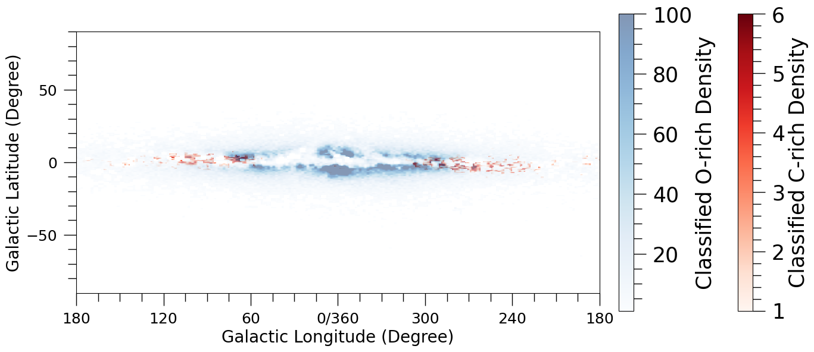
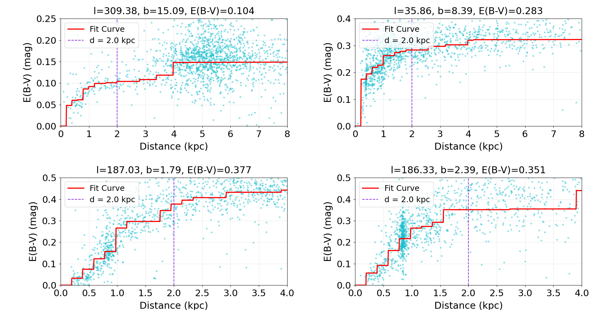
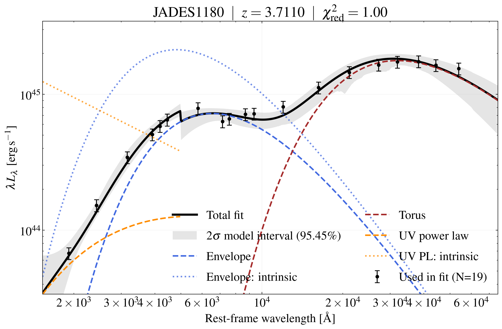

# arXiv Digest — 2026-11-23

- **Interest file used:** interests/2026.10.md (fallback — no 2026.11.md exists yet)
- **Categories pulled:** astro-ph.CO, astro-ph.EP, astro-ph.GA, astro-ph.HE, astro-ph.IM, astro-ph.SR, cs.LG, stat.ML, physics.data-an, hep-ph
- **Papers scanned:** 288 (72 astro-ph new/cross + 216 from extras)
- **After first filter:** 22 candidates reviewed with full text
- **Final selected:** 19 papers across 3 tiers

---

## Tier 1 — Highly relevant

### [Ultra-diffuse Galaxies in the Kilo-Degree Survey: Globular Cluster Systems in Cluster and Field Environments](http://arxiv.org/abs/2611.27441v1)

Hao Su, Nicola R. Napolitano, Rui Li et al.
**Primary category:** astro-ph.GA

Using a dedicated detection pipeline on **545 ultra-diffuse galaxy (UDG) candidates** from KiDS, the authors identify 24 UDGs with robust globular cluster (GC) systems and use the GC luminosity function to get distances and sizes. Group/cluster UDGs have **higher GC specific frequencies than field UDGs** at fixed luminosity, and GC-rich UDGs sit on the **upper envelope of the $N_{\rm GC}$–$M_\star$ relation**, implying higher halo masses at fixed stellar mass. The pattern supports **efficient early GC formation followed by suppressed or quenched star formation** as the origin of GC-rich UDGs, framing them as an extension of the dwarf-galaxy population rather than a distinct class.

*Number of globular clusters vs. stellar mass for the UDG sample compared to literature dwarfs and UDGs; cluster-associated UDGs (upper envelope) carry disproportionately rich GC systems relative to their stellar mass.*

---

### [Characterising stellar photometry with invertible neural networks: Joint inference of stellar parameters and extinction](http://arxiv.org/abs/2611.27342v1)

Victor F. Ksoll, Isabelle Joncour, Prasanta Gorai, Ralf S. Klessen

**Primary category:** astro-ph.SR

The authors train a **conditional invertible neural network (cINN)** on PARSEC stellar evolutionary models to jointly infer full posteriors over **extinction and stellar parameters** ($A_V$, $T_{\rm eff}$, $\log g$, luminosity, mass, age) from Gaia+2MASS photometry. On synthetic data the method recovers $A_V$ to **0.16 mag** and $\log T_{\rm eff}$ to **0.07 dex**, and applied to Taurus and Upper Scorpius it recovers extinction maps that match known cloud structure, though with a **systematic 0.5–0.7 mag overestimate** relative to Gaia XP-spectra-based studies, likely from unmodeled photometric/distance uncertainties. This is a direct, **simulation-based deep-learning** route to posteriors for large photometric surveys.

*cINN-derived extinction maps for Taurus and Upper Scorpius (top) next to Gaia "colour of the sky" images of the same fields (bottom); the recovered extinction structure tracks the real dust clouds.*

---

### [An early interaction between the Sagittarius dwarf and the Milky Way I: Fossil signatures in the phase-space structure of the disc](http://arxiv.org/abs/2611.27898v1)

Payel Das, Jason A. S. Hunt

**Primary category:** astro-ph.GA

Four controlled $N$-body+hydro simulations of a Milky-Way-like host test whether a **single early ($5$–$7$ Gyr ago) passage of a Sagittarius-like dwarf** can leave a lasting fossil in the disc. Stars old enough to predate the encounter are **permanently thickened and dynamically hotter** ($\Delta\sigma_z$ up to **+5.4 km/s**) than in an isolated control, while younger stars are unaffected, and the heating scales with satellite mass/speed as the **impulse approximation** predicts to ~20%. The inferred perturber mass ($\sim0.7$–$1\times10^{11}\,M_\odot$) matches independent estimates for an early Sagittarius encounter, making Sagittarius the most plausible culprit.

*Vertical velocity dispersion of thin-disc stars vs. age for the isolated host and three satellite runs; the three satellite-perturbed discs diverge sharply from the host above ~6 Gyr, with the most massive satellite departing first and most.*

---

### [Kinetic Sunyaev Zel'dovich Velocity Reconstruction Using Vision Transformers](http://arxiv.org/abs/2611.26822v1)

Sophie Coulombe, Matthew C. Johnson

**Primary category:** astro-ph.CO

The authors build a **Vision Transformer** pipeline for kSZ velocity reconstruction, tiling full-sky HEALPix maps into $256\times256$-pixel patches and training with curriculum learning (from no primary-CMB contamination to the physical level) plus fine-tuning on FLAMINGO simulations. The fine-tuned ViT **outperforms the standard quadratic estimator** on both the FLAMINGO hydrodynamical maps and a signal-to-noise metric ($2.6\times10^5$ vs. $6.3\times10^4$ without CMB), evidence that the network **exploits non-Gaussian correlations** the quadratic estimator cannot use, though the authors caution they cannot yet rule out overfitting given only one simulation volume.

*Correlation coefficient between true and reconstructed radial velocity in FLAMINGO data, with the primary CMB included; the fine-tuned ViT (purple) clearly beats the quadratic estimator (red) and the un-fine-tuned ViT (blue) across scales.*

---

### [Fast and accurate large-volume Lyman-$α$ forest mocks with three-dimensional U-Net trained on IllustrisTNG and FLAMINGO](http://arxiv.org/abs/2611.27151v1)

Bhaskar Arya, Soumak Maitra, Shadab Alam

**Primary category:** astro-ph.CO

A **3D U-Net field-level emulator** maps density/velocity fields directly to Lyman-$α$ forest flux, trained on small simulation volumes and tested on much larger, independent ones (training on 110 cMpc TNG, testing on 300 cMpc; training on 1 cGpc FLAMINGO, testing on 2.8 cGpc). The emulator reproduces the **1D power spectrum to ~3–5%** and the **bispectrum to ~4–5%**, versus **17–65% errors for the standard FGPA** approximation, and the connected **trispectrum**—never targeted in training—is still recovered to 10–16%. This gives a practical route to large-volume, high-fidelity Lyman-$α$ mocks for upcoming spectroscopic surveys.

*Flux PDF (left) and 1D power spectrum with ratios to the hydrodynamical truth (right) for the TNG and FLAMINGO test volumes; the U-Net (solid) tracks the hydro reference far more closely than the FGPA approximation.*

---

### [A High-Resolution Stellar Extinction Map of M31 from PHAT and PHAST Photometry](http://arxiv.org/abs/2611.26952v1)

Mingxu Sun, Bingqiu Chen, Yuxi Wang, Jian Gao, Yuhui Chen, Wenyuan Cui

**Primary category:** astro-ph.GA

Building a stellar template library from **PARSEC stellar evolution models**, the authors match ~65 million RGB/CHEB/EAGB stars in HST PHAT+PHAST photometry to derive individual-star $A_V$ and assemble an adaptive-resolution extinction map of M31 reaching **1.61″ (~6 pc)** resolution—roughly 4× finer than previous stellar-based maps. The map resolves **filamentary networks, feedback-driven cavities, and spur structures** on giant-molecular-cloud scales and agrees in large-scale morphology with independent dust-emission and ground-based stellar maps, while a comparison with the Draine et al. dust-emission map shows **differences that cannot be captured by a single scaling factor**.

*Stellar-traced extinction map of M31 at up to 1.61" resolution, resolving the spiral-arm structure and fine filamentary/cavity features in the interstellar dust.*

---

### [Machine learning reveals new Galactic C-rich and O-rich AGB sources](http://arxiv.org/abs/2611.26701v1)

Tanya Kushwahaa, Mikako Matsuura, Jason A. S. Hunt, Daisuke Kawata, Roger Wesson, Timothy A. Davis

**Primary category:** astro-ph.GA

A two-step **XGBoost classification** pipeline on Gaia DR3 colour/spectroscopic features identifies **304,090 O-rich and 4,227 C-rich AGB stars**, showing that a small high-quality training sample generalizes to a ~140-million-source catalog. O-rich AGB stars **dominate the inner Galaxy** while C-rich AGB stars are more uniformly spread and extend into the outer disc, tracing the **Galactic warp** with a larger amplitude than Cepheids trace it. Vertical scale heights **increase with decreasing stellar mass and age**, and the authors note that some inner-Galaxy C-rich stars may actually belong to the **Sagittarius dwarf galaxy** rather than the bulge.

*Galactic number-density map of ML-classified C-rich (red) and O-rich (blue) AGB stars: O-rich stars concentrate toward the inner Galaxy while C-rich stars spread more uniformly and extend outward.*

---

### [Baryon-Enhanced Strong Lensing Signatures of Self-Interacting Dark Matter Subhalos](http://arxiv.org/abs/2611.27249v1)

Meiwen Yang, Daneng Yang, Siyuan Hou, Yi-Ying Wang, Yiping Shu, Yue-Lin Sming Tsai

**Primary category:** astro-ph.CO

Live-star $N$-body simulations show that **baryons can flip the usual self-interacting dark matter (SIDM) prediction**: instead of suppressing lensing via core formation, compact stellar potentials can weaken the inner velocity-dispersion gradient enough that SIDM subhalos **collapse early and lens more strongly than their cold dark matter counterparts**. Calibrating a baryonic parametric SIDM model against TNG300-1 clusters, the authors find **galaxy-galaxy strong-lensing cross sections 1.4–2.7× larger than CDM**, comparable to the excess inferred observationally, and predict measurably stronger perturbations from luminous cluster satellites — a testable signature conditioned on new dark-matter physics.

*Density profiles and deflection-angle enhancement for a galaxy-hosting SIDM subhalo (BM11.8) after tidal evolution, compared against lens models for the observed luminous perturber G4.*

---

### [Precise Radii of Visual Binaries with Dynamical Masses: $ξ$ Bootis & 70 Ophiuchi](http://arxiv.org/abs/2611.27031v1)

Becky E. Flores, Russel J. White, Gail Schaefer et al.

**Primary category:** astro-ph.SR

CHARA Array interferometry delivers **radii precise to <2.4%** and **temperatures to <1.7%** for the four components of two wide, long-period visual binaries with dynamical masses known to **0.4%**, providing a clean test of stellar evolution models at fixed mass without the confounding tidal effects of close binaries. All **four stellar evolution models (BHAC15, Dartmouth, MIST, PARSEC)** reproduce the measured radii and temperatures within a few $\sigma$ with **no systematic offset**, and critically, these wide pairs show **no radius inflation**, unlike a comparison sample of short-period eclipsing binaries at the same masses — directly implicating **tidal/rotational effects in close binaries**, not the stellar models themselves, as the source of the well-known radius-inflation problem.

*Fractional radius excess over model predictions vs. orbital period: short-period eclipsing binaries (triangles) are systematically inflated, while the wide binaries in this study (circles) match models to within 1–2σ.*

---

### [Physics-Guided Recursive Self-Improvement of Amortized Bayesian Inference Across Physics](http://arxiv.org/abs/2611.27006v1)

Bo Liang, Mingtao Chen, Minghui Du et al.

**Primary category:** physics.comp-ph | also: astro-ph.CO, astro-ph.EP, astro-ph.IM

An **AI agent coupled to a physics simulator autonomously rewrites its own amortized Bayesian inference algorithm**, scored only by importance-weighted likelihood checks (no ground truth), across six fields including **exoplanet orbit fitting, X-ray spectroscopy, and neutron-star equation-of-state inference**. The agent discovers field-specific coordinate systems (e.g., equinoctial orbital elements, shared equation-of-state factorization across stars) and produces posteriors for real observations **in seconds instead of days**, agreeing with converged MCMC chains about as closely as two independent chains agree with each other. This is a genuine instance of an **agent forming and testing its own inference strategy** rather than acting as a coding assistant.

*Schematic of PhyRSI: an AI agent proposes an inference algorithm, scores it against the physical likelihood, revises it until it passes held-out checks, then returns posteriors for real data in seconds.*

---

### [Nearly pristine gas and hard ionizing radiation one billion years after the Big Bang](http://arxiv.org/abs/2611.27979v1)

Takahiro Morishita, Massimo Stiavelli, Tommaso Treu et al.

**Primary category:** astro-ph.GA

Deep JWST spectroscopy of a strongly magnified galaxy at $z=5.725$ (**AMORE6**) detects both He II $\lambda1640$ and $\lambda4686$ at high significance alongside an **extremely low oxygen abundance of $8\times10^{-4}$ solar**, placing it almost **1 dex below the extrapolated mass–metallicity relation** at this epoch. The combination of a hard ionizing field (needing very hot, massive, low-metallicity stars) and near-pristine chemistry is consistent with **conditions resembling primordial (Population III-like) star formation** persisting nearly a billion years after the Big Bang, and suggests a top-heavy IMF if the ionizing source is stellar.

*Mass–metallicity relation showing AMORE6 (red star) sitting ~1 dex below the extrapolated relation for other z>3 galaxies, indicating unusually limited chemical enrichment for its stellar mass.*

---

## Tier 2 — Adjacent / useful context

### [Recovering buoyancy-glitch parameters in low-luminosity red giants from global stellar properties with machine learning](http://arxiv.org/abs/2611.27954v1)

Jiang Chen

**Primary category:** astro-ph.SR

Gradient-boosted tree regressors (XGBoost/LightGBM) trained on 12,580 synthetic red-giant models recover the **buoyancy-glitch location and width to $R^2>0.97$** from just global asteroseismic/stellar properties, though the glitch **amplitude is only moderately recoverable** ($R^2=0.68$), degrading specifically in the evanescent-zone transition identified by prior work. **SHAP analysis** shows $\nu_{\rm max}$ and $T_{\rm eff}$ dominate the predictions, meaning the regressors mostly track evolutionary state rather than genuinely resolving the glitch's localized structural complexity — a useful prioritization tool for large asteroseismic samples like Kepler and PLATO rather than a replacement for dedicated mixed-mode inversions.

*Global SHAP feature importance for the three glitch parameters: ν_max and T_eff dominate, showing the regressors mainly exploit broad evolutionary trends rather than localized interior structure.*

---

### [Precise Interstellar Extinction Estimates for Nearly Ten Million Stars Based on Multiple Spectroscopic Surveys](http://arxiv.org/abs/2611.27773v1)

Bao-Kun Sun, Qiu-Ling Yan, Qing-Guo et al.

**Primary category:** astro-ph.GA | also: astro-ph.IM, astro-ph.SR

Combining LAMOST, APOGEE, GALAH, Gaia-ESO, SEGUE, and DESI spectroscopy with MLP-calibrated stellar parameters, the authors apply the **star-pair method** to ~9.6 million stars to reach **extinction precision of 0.019–0.022 mag**, releasing a public catalog and Python pipeline for querying line-of-sight extinction at any target coordinate and distance. The resulting 3D maps cleanly recover known structures (Taurus, Perseus, Orion, Cygnus X) and show the expected concentration of high-extinction sightlines toward the Galactic plane at larger distances.

*Fitted cumulative E(B-V)-vs-distance profiles for the four highest-stellar-density HEALPix pixels, illustrating the pipeline's line-of-sight extinction reconstruction across different dust columns.*

---

### [Dynamical friction on an extended satellite revisited](http://arxiv.org/abs/2611.26820v1)

Pierfrancesco Di Cintio, Carlo Nipoti

**Primary category:** astro-ph.GA

A systematic comparison of full self-consistent $N$-body, semi-reduced, and reduced simulation schemes for a satellite sinking in a host galaxy shows that **standard Chandrasekhar dynamical friction systematically overestimates orbital decay**, by up to an **order of magnitude** for extended, low-concentration satellites on eccentric orbits with mass ratios $\sim10^{-3}$. More extended satellites at fixed mass experience **weaker drag**, the effect holds in both isotropic and radially anisotropic hosts, and tidal mass loss (rather than self-friction from tidal tails) is the dominant correction needed relative to point-mass theory — directly relevant to inferring real satellite/dwarf orbital histories (e.g. Fornax) from simulations.

---

### [Effects of Preionisation in Radiative Shocks IV. A Spectral Grid Library of fully Radiative Shock Models with Time-Dependent Precursor](http://arxiv.org/abs/2611.26708v1)

Yifei Jin, Knox Long, Ralph Sutherland, Yong Shi

**Primary category:** astro-ph.GA

The authors release **MAPPINGS V**, an updated shock-and-photoionization code with a fully time-dependent, self-consistent precursor calculation, and use it to build a new public spectral library spanning shock velocities of **50–1000 km/s**. Relative to the widely used Allen et al. (2008) MAPPINGS III grid, the new models are **more compact on the BPT diagram** and correct an overestimate of precursor emission in the older models; comparison to SDSS galaxies and supernova remnants in M31/M33 suggests the **[OI]/Hα-BPT diagram best separates shock-dominated sources from star-forming galaxies**.

---

## Tier 3 — Outside my area but notable

### [Little Red Dots at Cosmic Noon: Spectroscopy Reveals Declining Abundance but a Non-Evolving Luminosity Function Shape](http://arxiv.org/abs/2611.26685v1)

Yilun Ma, Daniel J. Lyon, Jenny E. Greene et al. (companion spectroscopic paper: [arXiv:2611.26710](http://arxiv.org/abs/2611.26710v1))

**Primary category:** astro-ph.GA | also: astro-ph.CO

Searching ~20 deg$^2$ of deep HSC imaging and spectroscopically confirming 4 of 24 candidates with Keck/VLT/Magellan, the authors find that the number density of **Little Red Dots (LRDs)** — the extremely abundant, broad-line, compact red population ubiquitous at $z>5$ — has **dropped by a factor of ~35** by cosmic noon ($z\sim2$–2.5) relative to its peak abundance at $z\sim6$. Despite this steep abundance decline, the **characteristic luminosity ($M^*$) of the LRD luminosity function stays flat** across $2<z<5$ and remains well below that of quasars, suggesting only the *abundance*, not the *shape*, of the LRD population evolves — a puzzle for models of their nature (obscured black holes vs. compact stellar systems).

*LRD number density (red) compared to literature measurements across redshift and to the quasar abundance (blue); this work's spectroscopically-calibrated point at z~2.3 sits roughly 35x below the z~6 peak abundance.*

---

### [Hotter than Little Red Dots: Two Quasars with $T\sim10^4\,\mathrm{K}$ blackbody-like continua at $z\sim4$](http://arxiv.org/abs/2611.27856v1)

Kristiphong Boonmee, Kohei Ichikawa, Yuxing Zhong et al.

**Primary category:** astro-ph.GA

Scanning 3,553 archival JWST/PRISM spectra, the authors identify two "**blackbody quasars**" (BBQs) with $\Lambda$-shaped UV-to-optical continua resembling LRDs but with **hotter envelope temperatures (7,600–10,300 K)** and higher luminosities than typical LRDs, alongside hot dust emission and Compton-thin X-ray detections. The objects fit a predicted **transitional phase** in which a cooler, gas-enshrouded accreting black hole (the LRD-like state) is becoming an exposed, hotter quasar — direct observational support for an evolutionary gas-envelope picture of LRDs.

*JWST/NIRSpec spectrum (top) and multi-wavelength SED fit (bottom) for BBQ JADES1180, decomposed into an SMBH envelope blackbody, an AGN dust-torus component, and a UV power law.*

---

### [Agent-guided construction of Feynman integral bases](http://arxiv.org/abs/2611.26688v1)

Pau Petit Rosas, William J. Torres Bobadilla

**Primary category:** hep-ph | also: hep-th

The authors design two verifiable "skills" that let an AI agent (Claude Opus 5.5) work **autonomously for several days** to find bases of Feynman integrals whose differential equations are well-suited to phenomenology — for a two-loop five-point family with 18 elliptic sectors and a two-loop superfamily with a K3 sector. The agent finds bases **free of poles in the dimensional regulator** and at most quadratic in it, and brings the jet-function family to fully **$\varepsilon$-factorized form**, a genuinely novel physics result produced by autonomous agentic search rather than human derivation.

---

### [Weight-space programming and mechanistic interpretability for model editing in particle physics](http://arxiv.org/abs/2611.27079v1)

Raphaël Bonnet-Guerrini, Johann Ioannou-Nikolaides, Troels Petersen

**Primary category:** hep-ph | also: cs.AI, cs.LG, hep-ex

A particle-physics foundation model trained on jets turns out to **violate infrared safety** (a single soft neutral particle flips its classification), and the authors trace the flaw to specific attention heads with sparse autoencoders, then repair it by letting an LLM agent **edit the model's weights directly, without gradients, using only ~50 queries**. The resulting edit changes **far fewer parameters** than fine-tuning or an SAE-based edit, restores all nine classification taggers to their original efficiency, and leaves the rest of the model's behavior **closer to unchanged** than either baseline method — a concrete demonstration of gradient-free, agent-driven model repair guided by mechanistic interpretability.

*UMAP projection of the model's internal jet representations before (left) and after (right) the weight-space repair: soft-photon-contaminated W jets move from a spurious cluster back to their correct W/QCD neighborhood.*
