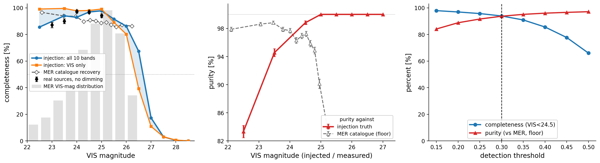
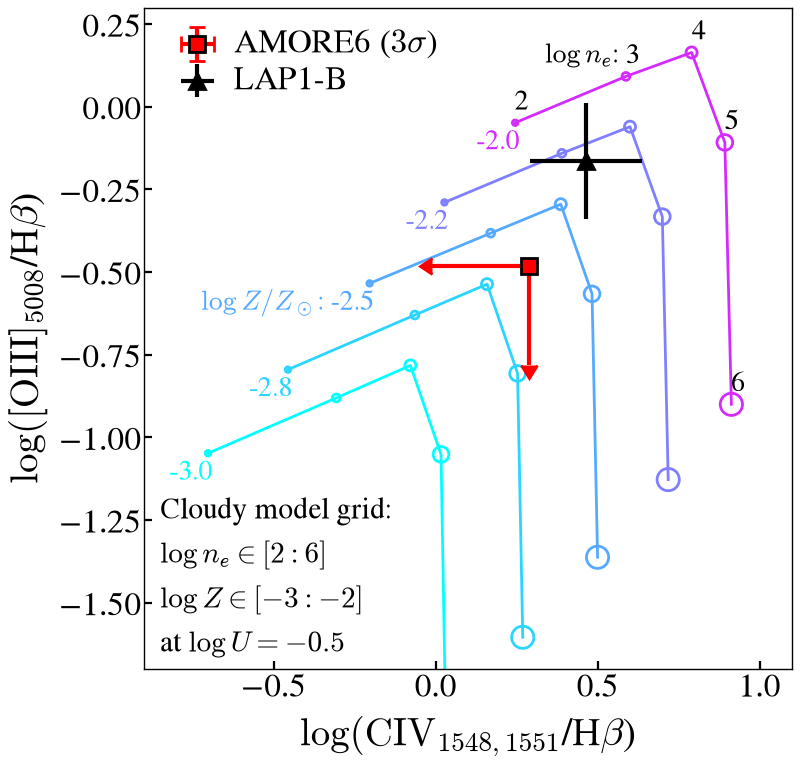

# arXiv Digest — 2026-11-24

- **Interest file used:** interests/2026.10.md (fallback — no 2026.11.md exists yet)
- **Categories pulled:** astro-ph.CO, astro-ph.EP, astro-ph.GA, astro-ph.HE, astro-ph.IM, astro-ph.SR, cs.LG, stat.ML, physics.data-an, hep-ph
- **Papers scanned:** 733 (159 astro-ph across all six sub-categories + 574 from extras: 431 cs.LG, 65 stat.ML, 9 physics.data-an, 69 hep-ph)
- **After first filter:** 27 candidates reviewed with full text
- **Final selected:** 20 papers across 3 tiers

---

## Tier 1 — Highly relevant

### [Interpretable morphology-based marked statistics](http://arxiv.org/abs/2611.31167v1)

Federico Semenzato, Benjamin D. Wandelt, Michele Liguori et al.
**Primary category:** astro-ph.CO

Builds a **rotation-equivariant, interpretable neural marking scheme** that reweights the matter density field using contrastive learning to align marked summaries with cosmological parameters, keeping the transformation physically inspectable rather than a black box. In real-space simulations the learned mark tightens marginalized Fisher constraints on **σ₈ and Ωm by factors of 1.7× and 1.5×** over power spectrum + bispectrum at kmax = 0.3 h/Mpc, and improves a neutrino-mass forecast by 1.5× without retraining. The gain over classical two-point statistics is largest at low kmax, where the density field's own σ8 constraint has already converged.

*Fisher 68%/95% confidence regions in (Ωm, σ8) at kmax=0.3 h/Mpc comparing the learned "Hessian Mark" to the power spectrum, alongside marginalized parameter errors vs. kmax — the mark's advantage is largest at low kmax, where the density field's σ8 constraint has already converged.*

---

### [JAISP: A Joint Rubin-Euclid Foundation Model for Cross-Instrument Source Detection and Astrometry](http://arxiv.org/abs/2611.31204v1)

Shoubaneh Hemmati, George Helou, Yu-Heng Lin et al.
**Primary category:** astro-ph.IM | also: astro-ph.CO, astro-ph.GA

Trains a **self-supervised foundation model** on 10-band Rubin+Euclid imaging by predicting each band from the other nine, then attaches small frozen-encoder heads for detection and astrometry. The fused representation extends point-source detection **≈0.3 mag deeper than VIS alone** (50% completeness at VIS≈26.7) and cuts cross-band astrometric offsets from ~50 mas to **6-10 mas**, exposing a coherent 9-10 mas astrometric concordance offset between the two surveys' independent Gaia registrations.

*Completeness vs. VIS magnitude from source-injection tests shows a ~0.3 mag depth gain from fusing all ten bands versus VIS alone, with companion purity curves confirming the gain isn't spurious.*

---

### [A Tributary of Tucana III? The Sutlej Stellar Stream in DELVE DR3](http://arxiv.org/abs/2611.29794v1)

Elliott S. Burdett, Nora Shipp, Peter S. Ferguson et al.
**Primary category:** astro-ph.GA

Uses deep DECam photometry and **isochrone-based matched filtering** to map the Sutlej stellar stream 2.5-3.5 mag below the main-sequence turnoff, revealing new substructure over an 11°×7° region at 23-33 kpc. The stream's isochrone, distance, and proper motion match the ultra-faint dwarf **Tucana III**, and N-body models show that **Tuc III's pericentric passage, reshaped by a massive LMC flyby, is deep enough to have stripped most of the progenitor** into the observed debris — though the models don't reproduce the discrete overdensities seen in the data.

---

### [The JWST Resolved Stellar Populations Early Release Science Program. X. Cross-Observatory Proper Motion Measurements with HST and JWST](http://arxiv.org/abs/2611.28381v1)

Jack T. Warfield, Nitya Kallivayalil, Sangmo Tony Sohn et al. (co-author Kaia R. Atzberger)
**Primary category:** astro-ph.GA | also: astro-ph.IM

Reports the **first absolute systemic proper motion of a galaxy from combined HST+JWST astrometry**, for the isolated dwarf **WLM**: HST-only gives **(μα*, μδ) = (+0.087±0.019, −0.079±0.017) mas/yr**, the most precise WLM PM yet measured. Cross-instrument HST-to-JWST PMs agree with HST-only to within 1-2σ depending on NIRCam filter, with F090W performing as well as a second ACS epoch at equal baselines, though a residual ~0.05 mas/yr cross-observatory systematic can't be excluded.

---

### [Probabilistic Inversion of Strong Gravitational Lenses with Flow Matching Priors](http://arxiv.org/abs/2611.28983v1)

Tianao Li, Jimena González, Xinfeng Xu et al.
**Primary category:** astro-ph.IM

Introduces **Blind-FlowSGS**, a posterior sampler that swaps a **flow-matching generative prior** (trained on IllustrisTNG galaxy images) in for diffusion models in blind/non-blind strong-lens source-and-mass reconstruction on simulated Euclid data. The flow-matching prior reaches **PSNR 35.4 dB vs. 31-34 dB for diffusion-based baselines**, while cutting sampling steps roughly **4× (212 vs. ~880+ steps)** for comparable or better reconstruction quality.

---

### [Empirical Mass and Radius Relations for Main-sequence Stars from Detached Eclipsing Binaries](http://arxiv.org/abs/2611.28229v1)

D. M. Rowan, C. S. Kochanek.
**Primary category:** astro-ph.SR

Using **234 detached eclipsing binaries**, the authors derive an 8-term empirical polynomial relating spectroscopic parameters to stellar mass and radius, reproducing radii to **3.8% RMS scatter** and masses to 7.7%. Comparing this empirical relation to **MIST and PARSEC evolutionary models** at matched spectroscopic parameters reveals systematic radius errors of several percent — hot stars over-estimated by the models, cool stars under-estimated — with the Sun's own radius over-predicted by only 1.4%.

*Fractional radius differences between the empirical EB relation and MIST/PARSEC as a function of temperature and metallicity: hot stars run ~6% smaller in the EBs than MIST predicts, cool stars ~2% bigger, with the Sun's position marked for reference.*

---

### [Dynamical calibration of a metallicity-dependent stellar mass–luminosity relation from Gaia wide binaries](http://arxiv.org/abs/2611.30393v1)

Yu-Ting Wang, Hans-Walter Rix, Yuan-Sen Ting et al.
**Primary category:** astro-ph.SR | also: astro-ph.GA

Using **10,559 Gaia wide binaries**, dynamically calibrates a metallicity-dependent mass–luminosity relation (MLR) for main-sequence stars from the pairs' relative speeds and separations, reaching **median 2.5% mass precision**. At solar metallicity the MLR agrees with **PARSEC to within 5%**, but **MIST, BaSTI, Dartmouth, and BHAC15 underpredict faint-star masses by 8–22%**, with the metallicity sensitivity **1–2σ stronger than PARSEC predicts**; released as the public `wbmlr` Python package.

*MLR vs. stellar isochrones (PARSEC, MIST, BHAC15, Dartmouth) at three metallicities, showing where each library over- or under-predicts stellar mass at fixed magnitude — the faint-end discrepancy is the paper's main open question.*

---

### [Unresolved binaries from Gaia XP to SPHEREx](http://arxiv.org/abs/2611.29702v1)

Jiadong Li, Hans-Walter Rix, Johanna Müller-Horn et al.
**Primary category:** astro-ph.SR

Fitting **71,000 low-mass stars'** combined Gaia XP and SPHEREx spectra with the J-CaPS emulator (predicting single-star and coeval-binary spectra on an absolute flux scale), the authors detect unresolved binary companions a CMD alone misses, **recovering 86% of CMD-identified binaries and 44% of those CMD cuts miss**. Applied to Gaia DR3 astrometric orbits, the method flags **153 systems whose companions are too faint for their dynamical mass**, clustering at **0.53–0.62 M☉ — typical white-dwarf masses** — pointing to a population of compact, dark companions.

*Dynamically-required companion mass vs. the brightest mass a main-sequence companion could be; points above the shaded region are too dark for their mass, revealing a white-dwarf-mass clump among the dark-companion systems.*

---

### [Performance of attention-based deep-learning models in Shack-Hartmann wavefront sensor measurements](http://arxiv.org/abs/2611.29991v1)

Matias Marambio-Jimenez, Yosuke Minowa, Yoshito Ono et al.
**Primary category:** astro-ph.IM

Benchmarks a custom **Vision Transformer with rotary positional embeddings, register tokens, and a cross-attention decoder** against a U-Net and a classical MAP linear reconstructor for Shack-Hartmann wavefront sensing, trained on **3.5 million simulated turbulent phase/image pairs** modeled on the Subaru pupil. The **ViT achieves the lowest residual phase variance across all subaperture configurations**, beating the U-Net by **~1.5× lower residual variance per mode** at high spatial orders — evidence that attention-based global spatial modeling beats convolutional locality for this task, relevant to next-generation instruments like ULTIMATE-Subaru.

*Residual modal variance per KL mode for the ViT, U-Net, and two MAP reconstructors against the true atmospheric phase; the ViT tracks the ground truth most closely, especially at high spatial orders.*

---

### [On the effect of a redshift- and metallicity-dependent top-heavy IMF on high-redshift UV luminosity functions](http://arxiv.org/abs/2611.31148v1)

Keita Fukushima, Shuya Kitagawa, Akio K. Inoue et al.
**Primary category:** astro-ph.GA

Motivated by JWST's excess of bright z≳10 galaxies, builds SED templates with a **redshift- and metallicity-dependent top-heavy IMF** inside a semi-analytic galaxy model on an N-body simulation. Without dust the top-heavy IMF strongly boosts the bright-end UV luminosity function, but **IMF-dependent metal enrichment and dust attenuation partly offset this enhancement** once dust is self-consistently calibrated at z=7; the model reproduces the observed UVLF at z~10 with **best-fit dust optical depths of only 51% and 21% of fiducial at z=9.7 and 13.0**, though z≳12 remains poorly constrained.

*UV luminosity functions at z = 10, 12, 14 comparing top-heavy-IMF and Kroupa-IMF model predictions (with dust) against observational compilations — the top-heavy model tracks the bright-end excess best at z=10.*

---

### [Deep UV Spectroscopy of an Extremely Metal-Poor Galaxy at z = 5.725](http://arxiv.org/abs/2611.30384v1)

Takahiro Morishita, Massimo Stiavelli, Zhaoran Liu et al.
**Primary category:** astro-ph.GA

Deep X-shooter spectroscopy of the extremely metal-poor galaxy AMORE6 yields a **non-detection of C IV**, breaking a density–metallicity degeneracy from earlier [O III]/Hβ-only data and confirming a genuinely metal-poor (not merely high-density) environment. The narrow, symmetric Lyα line (**σᵥ = 23.2 ± 0.5 km/s**) implies a **dynamical mass of (1–22)×10⁷ M☉**. SED fitting with **Pop III and Pop II stellar libraries** reproduces the UV continuum and Hα EW but **underpredicts the Hβ luminosity by up to 3.7σ** under both libraries, pointing to non-standard recombination conditions or limitations in current extremely-metal-poor stellar population models.

*CIV/Hβ vs. OIII/Hβ line-ratio diagram with the galaxy's 3σ upper limits against photoionization model tracks spanning metallicity and density — the data excludes the high-density/high-metallicity branch, confirming the low-metallicity interpretation.*

---

### [Curvature Mismatch and Local Errors in Galaxy Property Estimation](http://arxiv.org/abs/2611.29224v1)

Austin Lutterbach, Angus Hoy, Jasper Chong et al.
**Primary category:** cs.LG

Shows that part of a linear probe's error on galaxy embeddings comes from the **intrinsic curvature of the embedding manifold itself**, invisible to a linear probe. Using **86,471 AstroPT galaxy embeddings** across five pretrained encoders with catalogue labels (magnitude, redshift, smooth fraction, stellar mass), estimates this curvature via decoder autodiff and confirms it is a real geometric effect, not a least-squares artifact. Correcting the probe's weights to follow local manifold curvature raises held-out **local R² by 0.006–0.010** — a concrete, interpretable fix for systematic errors in galaxy property estimation from learned embeddings.

*The curvature a label-free decoder measures directly from each galaxy's embedding matches the curvature the fitted linear probe effectively relies on, confirming the diagnostic captures real, locally-relevant geometric signal.*

---

## Tier 2 — Adjacent / useful context

### [Euclid Data Release 1 (DR1). Learning machine learning: Investigating the complementarity and biases of strong gravitational lens finding networks on Euclid data](http://arxiv.org/abs/2611.31231v1)

Euclid Collaboration, S. H. Vincken, N. E. P. Lines et al.
**Primary category:** astro-ph.GA

Compares five independently-trained CNNs/ViTs used to build the **ECLIPSE catalogue (>15,000 strong-lens candidates over 1900 deg²)**, finding the networks score candidates very differently and that **combining them recovers 500+ additional calibration-set lenses within a 2000-object inspection budget**. Individual networks show systematic biases toward Einstein radius, compactness, light profile, photo-z, and magnitude — directly informing how networks should be combined for LSST/Roman-scale lens searches.

---

### [The Sensitivity of Gamma-Ray Searches for Dark Matter Annihilation in Milky Way Dwarf Galaxies: the LSST Era and Beyond](http://arxiv.org/abs/2611.31130v1)

Ilumi Chavez, Aditya Ghosh, Chris Kelso et al.
**Primary category:** astro-ph.HE | also: astro-ph.GA

Uses the **BabyBison** Monte Carlo pipeline (cosmological satellite simulations + observational selection functions + joint gamma-ray likelihood) to forecast how LSST's expanded dwarf-galaxy catalog affects dark matter annihilation constraints, finding **typically <20% improvement** from new discoveries alone, since results are dominated by a few high-J-factor systems rather than total satellite count. Projects that a complete Milky Way dwarf census could let Fermi-LAT/APT **probe dark matter masses up to the TeV scale**.

---

### [A Cross-Domain Simulator and Benchmark for Uncertainty Quantification in Global 21-cm Inference](http://arxiv.org/abs/2611.30444v1)

Jacob Tutt, Harry Bevins, James Alvey et al.
**Primary category:** astro-ph.CO

Builds a **differentiable, GPU-accelerated hybrid forward model** combining neural emulation of the cosmological 21-cm signal, physics-informed multi-resolution foreground modeling, and a linear antenna surrogate, cutting simulator evaluation time by **7.2×10⁷×**. Benchmarking with GPU nested slice sampling across 100 injected signals shows **94/100 recovered within their 95% credible interval**, establishing a calibration/coverage benchmark for next-generation samplers and simulation-based inference methods.

---

### [Selection-aware inference of supernova kicks](http://arxiv.org/abs/2611.31123v1)

R. O'Shaughnessy.
**Primary category:** astro-ph.HE | also: astro-ph.SR

Builds a fully **differentiable (JAX) model of binary stellar evolution** through the supernovae that form neutron stars, coupling remnant-mass/kick prescriptions to survival probabilities and selection effects in one auto-differentiable framework. Using synthetic double-neutron-star catalogs, shows that ignoring survey selection biases the inferred **natal-kick distribution** toward parameters far from the true likelihood maximum, and demonstrates joint inference from isolated plus binary neutron-star observations — a template for **selection-aware differentiable population-synthesis inference** generalizable to other compact-object populations.

---

### [On extracting Science information from a large data set of RXTE X-ray binary spectra using KDE technique](http://arxiv.org/abs/2611.29471v1)

Ranjeev Misra, Akash Garg, Aman Kumar et al.
**Primary category:** astro-ph.HE

Uses **rank-ordering plus Kernel Density Estimation**, rather than a black-box classifier, to both classify low-mass X-ray binaries and flag individually unusual spectra. Separates black holes from neutron stars at **~93% accuracy**, comparable to deep learning, while being interpretable enough to flag an accidentally-included neutron star and known black-hole "hyper-soft" states. The method independently flags previously unreported EXO 1745-248 spectra as unique, which turn out to be **relativistic reflection-dominated spectra** with a broad iron line — unusual for a neutron-star system.

*Data-to-power-law ratio for one of the flagged, unique EXO 1745-248 spectra, showing the broad iron line and reflection hump that the KDE method singled out as atypical.*

---

## Tier 3 — Outside my area but notable

### [HEP-Ex-Bench: Evaluating Agentic Performance in High Energy Physics Experiment Data Analyses with Sealed Worlds](http://arxiv.org/abs/2611.28194v1)

Andrzej Novák, Yiyang Zhao, Dolores Garcia et al.
**Primary category:** physics.data-an | also: cs.AI

Introduces **sealed-world benchmarking**: an agent builds an analysis pipeline on a public dataset, and the frozen pipeline is then rerun blind on many hidden "sealed worlds" from full CMS detector simulation with different injected truths, catching memorization and overfitting that literature-value checks miss. Across 11 LLM agents on four CMS-style analysis tasks, the best agent (Gemini 4 Argon) reaches only **60±8% of an expert reference score**, with no open-weight model exceeding 10% and session-to-session variance often exceeding the gap between models.

*Overall agent score as a percentage of the expert reference, with the 68% range from resampling sessions: Gemini 4 Argon leads at 60%, and reliability — not peak skill — is what separates the models.*

---

### [Lorentz symmetry in self-supervised representation learning](http://arxiv.org/abs/2611.31011v1)

Andreas Hermansen, Tobias Golling, Slava Voloshynovskiy.
**Primary category:** hep-ph | also: cs.LG

Combines a **Lorentz-equivariant geometric-algebra transformer** with **LeJEPA** (self-supervised joint-embedding pretraining) on 100M simulated collider jets, with no labels. Enforcing Lorentz symmetry in the latent space — architecturally or via physics-motivated augmentations — drives representation quality: LeJEPA alone beats autoregressive/masked/self-distillation baselines, and the symmetry-constrained architecture adds further gains on probe accuracy and transfer to an independent top-tagging dataset. A clean worked example of pairing **physically-informed architecture with modern self-supervised learning** — a combination the astronomy embedding literature hasn't fully explored.

*The LeJEPA pre-training pipeline: multiple augmented views of each jet are encoded and pulled together in latent space under an invariance loss plus a distributional regularizer.*

---

### [Beyond Accuracy: A Diagnostic Benchmark for Hypothesis-Driven Experiment Planning in LLM Agents](http://arxiv.org/abs/2611.29467v1)

Ryo Kuroki, Amin Mansouri, Philippe Schwaller.
**Primary category:** cs.LG | also: cs.AI

Goes beyond final-answer accuracy to diagnose *how* LLM agents reason through **hypothesis-driven adaptive experiment design**, using kinetic-mechanism identification (20 candidate chemical mechanisms, 5 experiment rounds) as the testbed. Decomposes reasoning into four scored steps — belief update, hypothesis discrimination, experiment design, predictive reasoning — and finds that across ten agents, the strongest beat both Bayesian-optimization and Latin-hypercube baselines but still show a **gap between recognizing the right hypothesis and designing an experiment that actually discriminates it**. A rare case of agents genuinely proposing and testing hypotheses rather than assisting with code, with a reasoning-level diagnostic transferable to other agentic-science settings.

*The agent-environment loop: the agent proposes experimental conditions, the environment returns simulated noisy observations, and a diagnostic framework separately scores exploration behavior and the four reasoning steps.*
