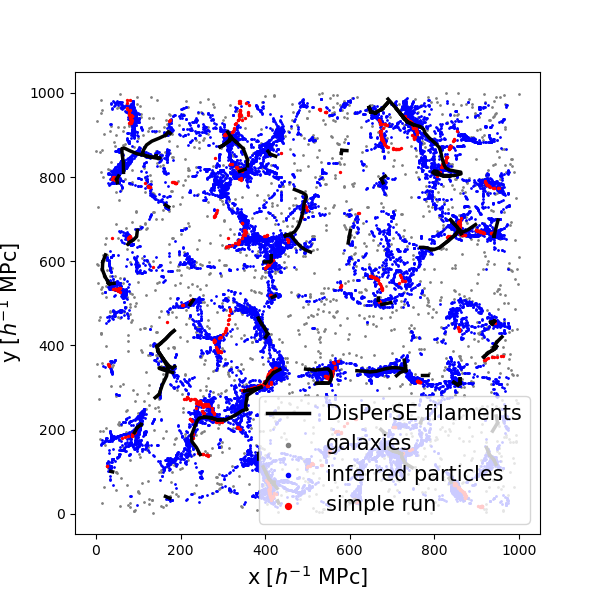
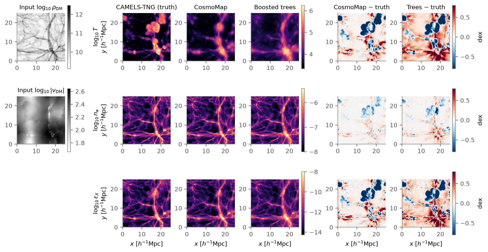
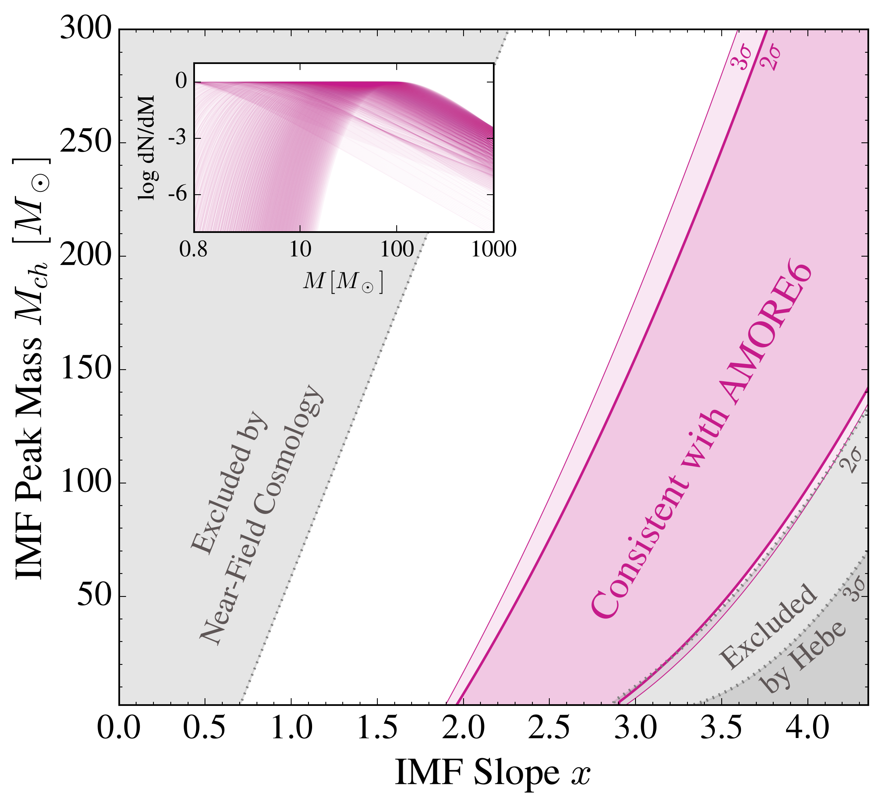
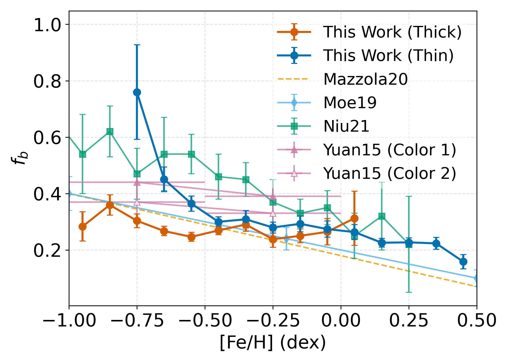
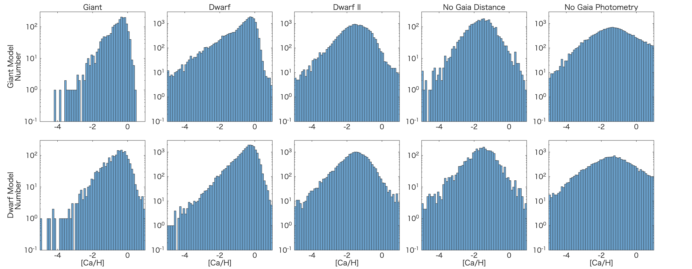
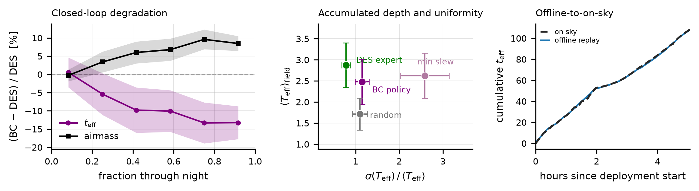

# arXiv Digest — 2026-11-25

- **Interest file used:** interests/2026.10.md (fallback — no 2026.11.md exists yet)
- **Categories pulled:** astro-ph.CO, astro-ph.EP, astro-ph.GA, astro-ph.HE, astro-ph.IM, astro-ph.SR, cs.LG, stat.ML, physics.data-an, hep-ph
- **Papers scanned:** 379 (98 astro-ph new/cross + 281 from extras)
- **After first filter:** 23 candidates reviewed with full text
- **Final selected:** 20 papers across 3 tiers

---

## Tier 1 — Highly relevant

### [Learning to find cosmic filaments with graph neural networks](http://arxiv.org/abs/2611.31494v1)

Alexis Tastet, Daniela Galárraga-Espinosa, Leander Thiele
**Primary category:** astro-ph.CO

The authors train a **flow-matching generative model conditioned by a heterogeneous graph neural network** to transport test particles from galaxy positions onto the cosmic-web filament skeleton, using DisPerSE-identified filaments from Quijote-BSQ HOD mocks as training targets. Unlike the deterministic DisPerSE algorithm, the learned flow **produces a distribution over filament configurations**, giving genuine uncertainty quantification rather than a single point estimate. The reconstructed filaments reproduce the two-point correlation function and DisPerSE's own sensitivity to $\Omega_m$ and $\sigma_8$, and the authors frame this as a first step toward **probabilistic cosmic-web reconstruction directly from sparse galaxy catalogs**.

*Several network realizations (blue) of the recovered filament structure in one test box, with a single realization highlighted in red; the ensemble tracks the DisPerSE target skeleton while also finding plausible additional filaments.*

---

### [CosmoMap: Predicting Hot Gas Temperature and Density from Dark Matter with a Conditioned 3D U-Net](http://arxiv.org/abs/2611.31282v1)

Aman Bhutani, Maggie Lieu
**Primary category:** astro-ph.CO

CosmoMap is a **3D U-Net conditioned via FiLM on six CAMELS cosmological/feedback parameters**, mapping dark matter density and velocity onto gas temperature and electron density. On the IllustrisTNG Latin hypercube it reaches **$R^2 = 0.765$ for $\log T$ and $0.934$ for $\log n_e$**, cutting gradient-boosted-tree baseline error by 22–23%, and a heteroscedastic-likelihood variant (CosmoMap-$\sigma$) gives **per-voxel uncertainties calibrated at 68% coverage**. The model preserves scaling relations, surface-brightness profiles, and most cosmological information in the gas, and its mock X-ray lightcones recover 89% of the brightest sources. Conditioning on simulation parameters, more than architecture, drives most of the gain over simpler baselines.

*True vs. CosmoMap-predicted temperature, electron density, and X-ray emissivity slices through a test box, alongside the gradient-boosted-tree baseline and residuals — CosmoMap recovers fine structure the tree-based baseline smooths over.*

---

### [Symbolic Regression Diagnostics of 1D Lyman Alpha Forest Emulator](http://arxiv.org/abs/2611.31450v1)

Aidan Behmer, Ming-Feng Ho, Camille Avestruz, et al.
**Primary category:** astro-ph.CO

The authors apply **PySR symbolic regression** to distill a black-box Gaussian-process emulator of the Lyman-$\alpha$ forest 1D flux power spectrum (PRIYA suite) into explicit, interpretable equations. They show equations that match the emulator's values well can still have **unfaithful parameter derivatives**, which would corrupt downstream Fisher forecasts — motivating a new **derivative-faithfulness diagnostic**. Adding a derivative-matching (**Sobolev**) loss to the symbolic search recovers faithful equations for **9 of 11 PRIYA parameters at $z=3.6$**, failing only on $h$ and $\epsilon_{AGN}$, whose power-spectrum imprint is weak or degenerate. This establishes symbolic regression as a genuine **interpretability/diagnostic tool** for ML emulators, not just a compression method.

*Slope error of the best-fit symbolic equation per PRIYA parameter under ordinary training (circles) vs. the Sobolev derivative-matching loss (squares); only $h$ and $\epsilon_{AGN}$ remain above the faithfulness threshold once Sobolev is used.*

---

### [JWST/NIRSpec observations of AMORE6 suggest active Pop~III star formation in a self-polluted galaxy](http://arxiv.org/abs/2611.31355v1)

Mirko Curti, Elka Rusta, Stefania Salvadori, et al.
**Primary category:** astro-ph.GA

Deep JWST/NIRSpec spectroscopy of the strongly lensed, extremely faint $z=5.725$ galaxy AMORE6-B detects HeII $\lambda1640$ and $\lambda4686$ alongside weak [OIII] and no other metal lines, giving the **lowest oxygen abundance of any known galaxy of comparable stellar mass** ($12+\log(\mathrm{O/H}) \approx 6.08$). Photoionization modeling favors **metal-free stars with a top-heavy initial mass function**, matching the self-polluted phase of simulated Population III galaxies over ordinary metal-poor populations or very massive stars. A full SED fit implies **$1.3\times10^5\,M_\odot$ of Pop III stars formed in the last 4 Myr**, and the HeII-to-Balmer ratio jointly constrains the Pop III IMF slope and characteristic mass, excluding the most top-heavy IMFs allowed by near-field cosmology.

*Constraints on the Pop III IMF slope and characteristic mass from AMORE6-B's HeII-to-Balmer ratio (pink band), compared against near-field-cosmology and literature exclusion regions; the inset shows the surviving IMFs.*

---

## Tier 2 — Adjacent / useful context

### [Constraining the Binary Fraction and Mass-Ratio Distribution of FGK Dwarfs with Gaia XP Spectra: Metallicity, α-Element, and Age Dependencies](http://arxiv.org/abs/2611.32656v1)

Yinuo Zhang, Zexi Niu, Haibo Yuan, et al.
**Primary category:** astro-ph.SR | also: astro-ph.GA

Using the Stellar Locus Outlier method on synthetic Gaia XP photometry and LAMOST DR9 parameters for **nearly 200,000 FGK dwarfs within 1 kpc**, the authors measure the binary fraction $f_b$ and the high-$q$ mass-ratio slope as functions of metallicity, $\alpha$-abundance, and age. **Higher metallicity drives a steeper (more negative) mass-ratio slope**, favoring low-$q$ systems, while [Mg/H] and [Si/H] anticorrelate with $f_b$ in the thin disk but [Ca/H] correlates positively. Binary fraction rises modestly with age in the thin disk, a trend the authors attribute to underlying chemistry rather than age itself.

*Binary fraction of FGK dwarfs vs. [Fe/H] compared against four literature measurements — this work's trend extends prior constraints to lower metallicity.*

---

### [The Zero Enrichment Rare Objects (ZERO) Survey I: Photometric Calibration of NB395 and Metallicity Estimation](http://arxiv.org/abs/2611.32613v1)

Bowen Huang, Nozomu Tominaga, Masashi Chiba, et al.
**Primary category:** astro-ph.GA | also: astro-ph.IM

The ZERO survey uses Subaru/HSC narrow-band NB395 photometry over 35 deg$^2$ to target metal-poor stars, calibrated against Gaia XP spectra and SDSS Stripe 82 to **0.3% zero-point precision**. A **physics-constrained stellar locus fitting method** converts NB395 photometry into [Ca/H] abundances good to **better than 0.18 dex** down to NB395 $\approx 20$, spanning $-3 \le$ [Ca/H] $\le +0.5$, and the authors show NB395 traces [Ca/H] more directly than [Fe/H]. The catalog delivers [Ca/H] estimates for **61,845 stars**, a foundation for future Galactic-structure and chemical-evolution work.

*[Ca/H] distributions recovered for the five ZERO survey subsamples (Giants, Dwarfs, Dwarf II, and sources lacking Gaia distance/photometry), spanning metal-rich to very metal-poor.*

---

### [The Alma catalog of OB stars. IV. A massive star census of the Magellanic Clouds System](http://arxiv.org/abs/2611.32808v1)

J. A. Molina-Calzada, J. Maíz Apellániz, M. Pantaleoni González
**Primary category:** astro-ph.SR | also: astro-ph.GA

Combines **Gaia DR3 astrometry and photometry** with SIMBAD, HST, and optical/infrared survey data to build the ALS IV catalog of massive stars ($M_i \gtrsim 8\,M_\odot$) across the LMC, SMC, and Magellanic Bridge, using color-magnitude/color-color diagrams, extinction tracks, variability diagnostics, and spectral classifications to recover sources missed by Gaia-only selections. The catalog delivers **51,954 massive star candidates** (36,506 LMC, 15,264 SMC, 184 Bridge), including HST-resolved and literature-only sources recovered in the crowded 30 Dor region. By cross-validating multiple surveys, it substantially **improves completeness in reddened and crowded fields** relative to prior Gaia-only massive-star catalogs, and is offered as groundwork for future Gaia DR4-based extensions.

*The CMD photometric selection boundary used to isolate massive-star candidates in the LMC, SMC, and Bridge, showing the "Certain" and "Pentagon" regions relative to the ~8 M☉ isochrone and the reddening vector for low-to-moderate extinction.*

---

### [Enhanced spatial resolution and performance for N-body simulation of self-interacting dark matter](http://arxiv.org/abs/2611.31364v1)

Moritz S. Fischer
**Primary category:** astro-ph.CO | also: astro-ph.GA

Introduces a new N-body interaction scheme for self-interacting dark matter (SIDM) simulations that replaces the traditional probabilistic kernel-based interaction rule with a **deterministic, time-step- and velocity-dependent interaction distance**, letting particle pairs interact whenever they are closer than this adaptive threshold rather than drawing random numbers. Implemented in the OpenGadget3 code, the scheme **minimizes the interaction distance between scattering particles**, improving spatial resolution of the mean free path without increasing particle count, while also **cutting self-interaction computational cost to just a few percent of the gravity cost**. Tests against analytic solutions and strong-scaling benchmarks confirm the gains, and application to a gravothermally collapsing SIDM halo shows the new scheme better resolves the deep core-collapse phase relevant to **core-cusp predictions** for small-scale structure.

*Gravothermal evolution of an isolated SIDM halo — enclosed mass within 0.15 kpc and total energy versus time — comparing the new interaction scheme (solid) to previous simulations (faint lines), showing the improved resolution of the core-collapse phase.*

---

### [Machine learning enables full Bayesian inference for spinning EMRIs](http://arxiv.org/abs/2611.31916v1)

Bo Liang, Minghui Du, Zhenwei Lyu, et al.
**Primary category:** gr-qc | also: astro-ph.HE

Presents NEBULA-EMRI, a hybrid pipeline that uses **generative neural networks to narrow the full 14-parameter prior** for spinning extreme-mass-ratio inspirals, then hands off to exact-likelihood parallel-tempered MCMC for the final posterior — solving, for the first time, the joint inversion of all 14 parameters of a spinning EMRI from a fully broad prior. For a simulated one-year LISA–Taiji observation, the method measures the **massive black hole's redshifted mass and spin to two parts in 10⁵**, the compact object's mass to **one part in 10⁴**, and the source distance to **0.8%** with sub-square-degree localization, while also revealing a ring of degenerate spin-direction solutions inherent to the problem. The authors note no neural density enters the likelihood itself — the networks only propose search regions, keeping the final inference fully likelihood-based.

*The NEBULA-EMRI framework: data pass through a neural-inference stage that proposes candidate search regions, followed by an exact-likelihood MCMC stage that determines the posterior, with no neural density entering the final inference.*

---

### [ΦasmaNet: A Staged Spectral Token-Refinement Architecture for Fast Gravitational-Wave Signal-to-Noise Ratio Prediction](http://arxiv.org/abs/2611.05309v1)

Ioannis Tsioulis, Anastasios Tefas, Nikolaos Stergioulas
**Primary category:** cs.LG | also: astro-ph.HE

Introduces ΦasmaNet, a compact attention-based neural architecture built around **staged spectral token refinement** (ordered Φ-Stages with a subspace-mixing "Φ-Refractor" module, plus top-down gated feedback) as a surrogate for computing the signal-to-noise ratio of precessing, higher-mode binary black hole waveforms. Using only ~732k parameters, it beats MLP, 1D-ResNet, and Transformer baselines at every training-set size, reaching **100−MAPE = 99.39% (R² = 0.9998)** in the detection-relevant SNR&gt;8 regime, while sustaining **~1.2×10⁵ SNR evaluations/second** on a single GPU — roughly **two orders of magnitude faster** than conventional waveform-based calculation. This throughput makes large-scale gravitational-wave selection-effect studies, which require SNR over millions of injected sources, computationally tractable, and the authors note the staged architecture also transfers well to generic tabular-regression benchmarks.

*ΦasmaNet architecture: a fixed-dimensional input is tokenized and refined through an ordered cascade of attention-based Φ-Stages with Φ-Refractor subspace mixing, followed by gated top-down Φ-Feedback.*

---

### [Hesperos &amp; Eosphoros: A Coupled Differentiable Forced-Photometry Operator and Forward Model for SPHEREx Spectrophotometry](http://arxiv.org/abs/2611.33092v1)

James R. Cheshire IV, Spencer Everett, Richard M. Feder, et al.
**Primary category:** astro-ph.IM | also: astro-ph.CO

Presents Hesperos &amp; Eosphoros, a pair of **GPU-accelerated, differentiable JAX** programs that respectively reimplement SPHEREx's forced-photometry measurement and its image-level forward model, composed so that automatic differentiation propagates survey-systematic responses end-to-end through the full measurement pipeline. Hesperos matches the production Tractor-based pipeline while delivering **~700× higher throughput per node-hour**, and Eosphoros is validated independently against the SPHEREx Sky Simulator and GalSim renders. The composed pipeline is demonstrated by generating **direct density-field response templates ∂(reconstructed density)/∂(systematic amplitude)** for image-level effects like astrometric offsets and survey depth — a capability the authors argue is needed to keep systematic characterization tractable as galaxy-clustering surveys scale up.

*The density-field response template ∂(Δn/n̄)/∂A to the SPHEREx survey-depth systematic, computed end-to-end through the differentiable pipeline for a simulated 2-year wide-field survey, shown across broad redshift bins.*

---

### [The dust attenuation scaling relation in the TNG50 simulation](http://arxiv.org/abs/2611.32592v1)

P. Cataldi, X. Z. Zheng, A. Katsianis et al.
**Primary category:** astro-ph.GA

The authors test whether star-forming galaxies in the **TNG50 cosmological simulation**, post-processed with radiative transfer, reproduce the observed "universal" relation linking infrared excess (IRX) to metallicity, size, and luminosity. Across 7280 simulated galaxies at 0≤z≤4, they find TNG50 matches the relation near z~0.5–1 but is **offset by ≈+0.5 dex at z=0 and ≈−0.25 dex at z≥2**, with the high-z mismatch tracing largely to the simulation's gas-phase metallicities. Varying the dust-to-metal ratio and grain composition shifts the normalization but cannot remove the redshift-dependent offset, pointing to limits in the dust/metallicity modeling rather than the attenuation prescription itself.

---

### [From Historical Schedules to On-Sky Control: Autonomous Scheduling on the 4-m Blanco Telescope](http://arxiv.org/abs/2611.32963v1)

Rachel Hur, Paul Chichura, Alex Drlica-Wagner et al.
**Primary category:** astro-ph.IM

The authors train a **behavior-cloning policy** on six years of Dark Energy Survey scheduling data to replace the DES scheduler's expert heuristics, then deploy it in three escalating regimes: offline expert-state matching, closed-loop simulated rollouts, and real-time autonomous control of the **Blanco 4-m telescope**. In closed-loop rollouts the learned scheduler's data-quality metric t_eff falls **6.9 ± 3.4% below the expert's**, but during a 5.2-hour on-sky run it scheduled 149 exposures at **t_eff = 0.75 ± 0.26**, matching the offline replay with **no additional degradation** on real sky — reported as the **first real-time deployment of a learned autonomous scheduler on a leadership-class observatory**.

*(Left) t_eff and airmass deficit of the learned scheduler vs. the DES expert over a night; (middle) accumulated depth vs. coverage uniformity against heuristic baselines; (right) on-sky cumulative t_eff tracking the offline replay almost exactly.*

---

## Tier 3 — Outside my area but notable

### [Magnetar driven Dainotti relation with up to 56% reduced uncertainties: probing the Expansion History of the Universe](http://arxiv.org/abs/2611.31273v1)

Konstantinos F. Dialektopoulos, Aleksander Łukasz Lenart, Maria Giovanna Dainotti et al.
**Primary category:** astro-ph.CO | also: astro-ph.HE

Long gamma-ray bursts' X-ray plateau emission can standardize distances in the redshift gap between supernovae and the CMB via the Dainotti luminosity-duration relation. Selecting **23 GRBs by requiring a magnetar spin-down model** (rather than generic light-curve quality cuts) cuts the relation's intrinsic scatter by **~41%**, and a new joint light-curve/correlation fitting method pushes the reduction to **~56%**. Combined with supernovae and cosmic chronometers, this magnetar-selected sample gives **H₀ = 69.45 ± 0.32 km/s/Mpc**, a **3–3.5σ tension with both Planck and SH0ES**, establishing magnetar-selected GRBs as a robust high-redshift complement to the distance ladder.

*Marginalized H₀–Ωm posteriors for the magnetar sample from GRB+CC, SNe Ia+GRB, and the full joint fit, showing the progressive tightening of cosmological constraints as probes are combined.*

---

### [Euclid: Discovery of a quasar at z=8.13 hosting a 360-million-solar-mass black hole](http://arxiv.org/abs/2611.31385v1)

J. Wolf, S. Belladitta, D. Yang et al.
**Primary category:** astro-ph.GA

Selected from **Euclid Wide Survey** imaging and confirmed with Keck, HST, LBT, and JWST, J1504+6252 is now the most distant known quasar, with JWST/NIRSpec establishing a systemic redshift of **z = 8.129 ± 0.005**, just **630 Myr after the Big Bang**. Hβ- and MgII-based virial estimators give a black hole mass of **log(M_BH/M_☉) ≈ 8.3–8.9** accreting at a sub-Eddington rate of **λ_Edd = 0.12–0.44**, meaning this hole already assembled hundreds of millions of solar masses while accreting modestly. The authors argue this implies a broader hidden population of already-massive, sub-Eddington black holes at these epochs, rather than reionization-era quasars being a uniquely rapidly-accreting extreme.

*Combined JWST/NIRSpec spectrum of J1504+6252 across three gratings, showing the sharp Lyα break and broad UV/optical emission lines (CIV, MgII, Hβ) confirming its identity as a luminous broad-line quasar at z&gt;8.*

---

### [Parallel and perpendicular: a two-population test with POSSUM radio galaxies confirms hint of CMB birefringence](http://arxiv.org/abs/2611.31411v1)

M. Brüggen, J. Dreismann, P. Trivedi et al.
**Primary category:** astro-ph.CO

Cosmic birefringence — an isotropic rotation of CMB polarization hinting at parity-violating physics — has so far only been measured in the CMB itself. Using **33,298 polarized double-lobed radio galaxies from the POSSUM survey**, the authors add a previously-ignored second population (lobes polarized parallel, not just perpendicular, to the source axis), **doubling the statistical power** of this independent, low-redshift (z~0.5) test. The radio-galaxy measurement, **β = 0.48° ± 0.35°**, agrees in sign and amplitude with the CMB result, and combined with ACT+Planck gives **β = 0.282° ± 0.056°, a 5.0σ detection** of the birefringence signal from an independent astrophysical probe.

*Distribution of the angle between Faraday-corrected polarization and source orientation for all 33,298 radio-galaxy components, with the fitted two-population model decomposed into its standard-perpendicular and newly added parallel peaks.*

---

### [Resolving the Hubble Tension at $0.1\sigma$ with Early Dark Energy: Key Role of the Highest-redshift Galaxies from JWST Observations](http://arxiv.org/abs/2611.32552v1)

Guo-Hong Du, Tian-Nuo Li, Jing-Fei Zhang et al.
**Primary category:** astro-ph.CO

Combining CMB, DESI BAO, and JWST ultraviolet-luminosity-function data within the axion early-dark-energy (EDE) framework, the authors obtain **H₀ = 72.76 ± 1.00 km/s/Mpc**, resolving the Hubble tension with SH0ES to just **0.1σ**. They show the enhanced galaxy abundances JWST finds at z = 11 and 12.5 are the key driver: excluding those bins lowers H₀ by 1–2 km/s/Mpc. The excess early galaxies favor stronger small-scale matter power, accommodated in EDE via a higher primordial spectral index whose correlations with f_EDE push H₀ upward further; allowing that index to run with scale favors **positive running at &gt;4σ**, pushing H₀ to 73.75 ± 1.04 km/s/Mpc, above even the SH0ES central value.

*Marginalized H₀ constraints across the baseline, high-z JWST data-cut, and spectral-running analyses, with tension levels against SH0ES — the running model's H₀ exceeds SH0ES itself.*

---

### [Assessing the total mass of the Planck protocluster candidates with CMB lensing stacking](http://arxiv.org/abs/2611.32282v1)

Tanguy Dusserre, Hervé Dole, Mathieu Langer et al.
**Primary category:** astro-ph.CO

The authors stack ACT CMB-lensing convergence maps at the positions of 1012 Planck high-redshift protocluster candidates to obtain, for the first time, a direct total-mass estimate for the sample. The stacked signal is detected at **12σ significance**, and integrating along the line of sight yields a mean mass of **(6.6 ± 1.4) × 10¹⁴ M_⊙** per protocluster, consistent with simulation expectations. Combined with Planck's redshift constraint of 1.5 &lt; z &lt; 3, this mass **rules out the candidates being already-virialized structures**, strengthening the case that the sample is genuinely composed of forming protoclusters at z ≥ 1.

*Stacked ACT convergence map at the 1012 Planck protocluster positions (left) vs. a null stack over random sky positions (right); a clear central mass overdensity appears only for the real sample, at 12σ significance.*

---

### [Refining the Architecture of the Quadruple Pre-main-sequence System HD 98800: Improved Orbits, Dynamical Masses, and a Transiting Circumbinary Disk](http://arxiv.org/abs/2611.31363v1)

Guillermo Torres, John D. Monnier, Gail H. Schaefer et al.
**Primary category:** astro-ph.SR | also: astro-ph.EP

Using 36 years of radial-velocity monitoring plus new CHARA/VLTI interferometry, the authors refine the orbits of the pre-main-sequence hierarchical quadruple HD 98800 and pin down **dynamical masses for all four stars to ≤2.6% precision**, in good agreement with stellar evolution models. The system's near-edge-on outer orbit is now carrying star Aa directly behind binary B's polar circumbinary disk, and ASAS-SN photometry shows the ingress already complete — the system has dimmed by a full magnitude. The authors map the disk's extinction profile against previously measured gas/dust boundaries and predict that this **transiting circumbinary-disk eclipse, a once-in-a-lifetime event, will last roughly a decade**, offering an unprecedented probe of the disk's structure and composition.

*ASAS-SN g-band light curve of HD 98800 showing the eclipse's ingress: brightness drops through March–April 2026 and bottoms out by May 6, 2026 as binary A is fully occulted by B's circumbinary disk.*

---

### [What You See Is What You Certify: Concept-Based Certificates for Unseen Compositions](http://arxiv.org/abs/2611.31627v1)

Phuc Linh Ngo, Thang Nguyen Duc, Truong Thanh Hung Nguyen et al.
**Primary category:** cs.CV | also: cs.AI

The authors audit whether concept-bottleneck and concept-embedding models' explanations can serve as trustworthy certificates when a class presents an unfamiliar combination of familiar parts. On such unseen compositions, both model types decode the correct concept ontology yet **certify the wrong class 93–94% of the time**, driven by **"cross-concept shortcutting"** — parts inferred from context rather than read locally copy co-occurring values more often than chance. Their reference design, which reads each part from an isolated local crop in its own forward pass, **certifies 52% of unseen images at only 0.4% risk**, versus 14–33% risk for mask-pooled or full-image readers at similar accuracy — though on harder real-world traffic-sign data, isolated reading only lowers certified risk from 99.8% to 67%, showing evidence isolation helps but doesn't fully solve the generalization problem.
