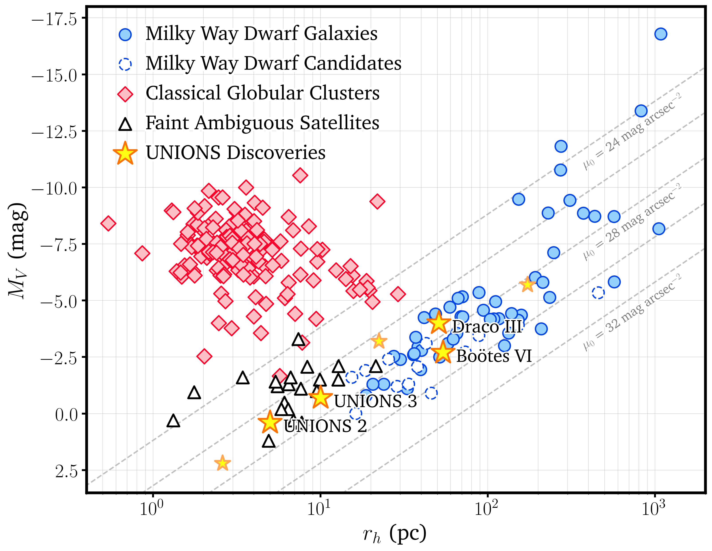
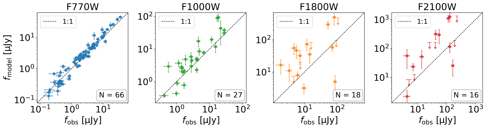
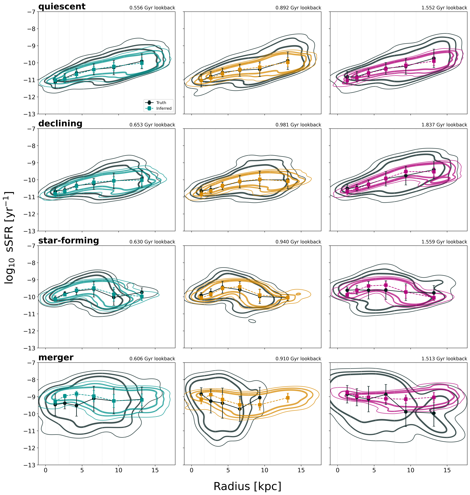

# arXiv Digest — 2026-11-26

- **Interest file used:** interests/2026.10.md (fallback — no 2026.11.md exists yet)
- **Categories pulled:** astro-ph.CO, astro-ph.EP, astro-ph.GA, astro-ph.HE, astro-ph.IM, astro-ph.SR, cs.LG, stat.ML, physics.data-an, hep-ph
- **Papers scanned:** 418 unique (148 from the six astro-ph sub-categories + 355 from extras, pre-dedup; 85 cross-listed overlaps collapsed)
- **After first filter:** 24 candidates reviewed with full text
- **Final selected:** 20 papers across 4 tiers

---

## Tier 1 — Highly relevant

### [Toward Automated Strong-Lens Modeling with Agentic Workflows: An Application to Euclid Q1 Lenses](http://arxiv.org/abs/2611.33363v1)

Xiaoyue Cao, Ran Li, Yunlong Yin et al.
**Primary category:** astro-ph.IM | also: astro-ph.GA

A team of multimodal LLM agents — **Lens-Orchestra** — automates the full strong-lens modeling pipeline end to end: masking contaminants, initializing priors, and diagnosing failed fits with no human in the loop. Run on 185 grade-A Euclid Q1 lens candidates, the workflow completed 149 fits, and independent human review confirmed **140 usable models**, with only **6.0% of completed fits unacceptable**. Recovered Einstein radii match released Euclid Q1 models to a **+0.12% median offset**, and hierarchical inference on the cleanest subsample gives a population mean mass-density slope of **γ = 2.002 ± 0.009**. A dedicated residual-screening agent also independently flagged two candidate low-mass perturbers for follow-up substructure modeling.

*Agent-derived Einstein radii and mass-density slopes agree with the released Euclid Q1 models to within a few percent, and the inferred population of slopes clusters tightly around the isothermal value γ = 2.*

---

### [Scaling and Cross-Simulation Generalization of Graph Neural Networks for Cosmic-Web Classification in CAMELS](http://arxiv.org/abs/2611.34332v1)

Kalash Thakkar, Unnati Shah
**Primary category:** astro-ph.CO | also: cs.LG

Using periodic Delaunay graphs built from galaxy positions in the CAMELS IllustrisTNG, SIMBA, and Astrid suites, the authors test how well graph neural networks classify galaxies into void/sheet/filament/knot cosmic-web environments when trained on one hydrodynamical simulation and tested on another. A **graph Transformer reaches a mean external-test macro-F1 of 0.652**, beating a plain MLP's 0.481 by **0.171**, with voids remaining the hardest class throughout. Classifier performance tracks **galaxy richness and Delaunay edge length** more than the underlying cosmological or feedback parameters, pointing to sparse tracer sampling — not simulation physics — as the main bottleneck for cross-simulation generalization.

*Cross-suite transfer matrices on an independent holdout show models trained on one hydrodynamical simulation generalize reasonably well to the other two, with same-suite scores only modestly ahead of cross-suite transfer.*

---

### [Towards three-dimensional dark matter mapping in the extended solar neighbourhood with Gaia Data Release 3 and deep learning](http://arxiv.org/abs/2611.33660v1)

Yigon Kim, Ho Seong Hwang, Sungwook E. Hong et al.
**Primary category:** astro-ph.GA

Two 3D deep-learning architectures, **VNet and ViT-VNet**, are trained to map the local dark-matter density field directly from stellar kinematics, using Milky Way-like galaxies from the **FIRE-2** cosmological simulation suite as training data. Applied to real Gaia DR3 kinematics, the networks reproduce the large-scale density gradient (while smoothing out small-scale structure) and yield solar-neighborhood dark-matter density estimates of **0.80 and 1.12 GeV cm⁻³** for the two architectures, both **exceeding previous non-local determinations**. The authors flag simulation-to-Gaia domain mismatch as the key remaining systematic ahead of Gaia DR4.

*The deep-learning density estimates sit above essentially all previously reported non-local measurements, with the spread between the two architectures comparable to the existing literature scatter.*

---

### [State of the UNIONS: Four Milky Way companions discovered in a systematic search for northern Local Group satellites](http://arxiv.org/abs/2611.34775v1)

Simon E. T. Smith, Alan W. McConnachie, Thomas de Boer et al.
**Primary category:** astro-ph.GA

A systematic search of UNIONS *gri* photometry turns up **four new Milky Way satellites**: likely ultra-faint dwarf galaxies **Boötes VI and Draco III** (M_V = −2.7 and −4.0, half-light radii ~50 pc), plus two extremely compact, faint systems, UNIONS 2 and UNIONS 3, with no detected giant stars and M_V as faint as **+0.4** at half-light radii as small as **5 pc**. Morphology alone places Boötes VI and Draco III comfortably in the dwarf-galaxy locus of the size-luminosity plane, but **UNIONS 2 and 3 are too faint and compact to classify from imaging alone** — archetypes of the ambiguous ultra-faint satellites that upcoming wide-field surveys will increasingly turn up.

*On the half-light-radius vs. luminosity plane, Boötes VI and Draco III fall within the dwarf-galaxy locus, while UNIONS 2 and 3 are fainter than any known globular cluster yet more compact than confirmed dwarfs.*

---

### [Very fast 2D inversions of Stokes profiles using neural emulators](http://arxiv.org/abs/2611.34458v1)

A. Asensio Ramos, J. de la Cruz Rodriguez, C. Kuckein et al.
**Primary category:** astro-ph.IM

The costly radiative-transfer forward model in spectropolarimetric inversions is replaced with fast, **differentiable neural emulators** trained on synthetic Stokes profiles for several photospheric and chromospheric lines, enabling spatially regularized inversions that also correct for the telescope PSF. The emulators are essentially unbiased, with errors at or below the observational noise level, and **full-field-of-view inversions run in minutes on a single GPU** rather than the hours a classical inversion code needs. Applied to real Hinode and GRIS/CRISP data, the method recovers physically consistent temperature, velocity, and magnetic-field maps, with PSF-aware inversion sharpening the recovered structures.

*Neural-emulator inversion of a real Hinode active-region observation recovers temperature, velocity, and magnetic-field maps, with the PSF-corrected version noticeably sharper than the uncorrected one.*

---

### [Tipping the scales in Blue Jay: Dust energy balance overpredicts MIRI fluxes in dusty galaxies](http://arxiv.org/abs/2611.34802v1)

Benjamin P. Collins, Sirio Belli, Letizia Bugiani et al.
**Primary category:** astro-ph.GA

Using JWST/MIRI photometry for 111 Blue Jay survey galaxies at 1.7 < z < 3.5, the authors test the **dust energy balance assumption** underlying most SED-fitting codes by comparing Prospector model predictions (fit without MIRI) against the observed mid-IR fluxes. They find systematic overprediction ranging from **~10% at 7.7 μm to a factor of ~3 at 21 μm**, worsening with inferred dust attenuation. Adding NIRSpec spectroscopy or the MIRI photometry itself to the fit breaks age–dust–metallicity degeneracies and **lowers inferred infrared luminosities by −0.6 dex** in the dustiest systems, consistent with steeper, SMC-like attenuation or more complex star–dust geometries than the standard energy-balance prescription assumes.

*Observed vs. model-predicted MIRI fluxes per filter: the model tracks observations well at 7.7 μm but overpredicts by up to ~3x at 21 μm, showing where the dust energy balance assumption breaks down.*

---

### [Curvature Mismatch and Local Errors in Galaxy Property Estimation from Image Embeddings](http://arxiv.org/abs/2611.29224v1)

Austin Lutterbach, Angus Hoy, Jasper Chong et al.
**Primary category:** cs.LG | also: astro-ph.IM

Linear probes fit to frozen galaxy-image embeddings inherit **intrinsic curvature from the representation's manifold geometry**, which systematically biases per-galaxy prediction errors. Using a decoder-based estimator of the manifold's second fundamental form across **86,471 galaxies and five pretrained encoders** (ViT-B, DINOv3, CLIP, ConvNeXt, ViT-L), the authors show this curvature helps or hurts local accuracy depending on whether it aligns with the true label's curvature, and that a **local "bend correction" raises held-out local R² by 0.006–0.010**. Probe accuracy is worst for the faintest galaxies, but the authors trace most of that drop to label noise rather than to the probe or embedding itself.

---

## Tier 2 — Adjacent / useful context

### [UNIONS and Euclid: Calibrating point source–galaxy separation for ground-based surveys](http://arxiv.org/abs/2611.34047v1)

G. Thomas, S. E. T. Smith, S. Gwyn et al.
**Primary category:** astro-ph.IM | also: astro-ph.GA

Using 8 deg² of overlapping UNIONS r-band and Euclid imaging, the authors calibrate two star–galaxy separation methods — a curve-of-growth technique and a supervised **neural-network classifier** — against Euclid's superior morphological labeling down to I_E ≈ 26. The curve-of-growth method stays nearly complete (**>95%**) but loses purity quickly beyond r ≈ 22.5, while the **neural-network classifier maintains ≥80% purity to r ≈ 24**, trading off completeness (~50% at similar depth). Both methods already run on UNIONS data with a clear path onto LSST.

*Purity and completeness vs. magnitude for the curve-of-growth method, the neural-network classifier, and SExtractor's stellarity index, showing the neural network's clear purity advantage at faint magnitudes.*

---

### [When precision exceeds fidelity: systematic error quantification for inference with misspecified simulators](http://arxiv.org/abs/2611.33282v1)

M. J. Yantovski-Barth, Hengyue Zhang, Nolan Smyth et al.
**Primary category:** astro-ph.IM | also: astro-ph.GA

The authors introduce **influence maps** — local sensitivities of inferred parameters to data perturbations, estimated cheaply from existing posterior samples — to isolate how each component of a misspecified simulator ensemble biases a result, as an alternative to evidence-weighted model averaging. Applied to supermassive black hole mass inference from multi-resolution ALMA data, they find that at low angular resolution, overly flexible stellar profiles compensate for a shared gas-emissivity misspecification, **biasing log M_BH high by 0.09–0.22 dex (2.5–4.7σ)**. A first-order correction using the influence maps brings the affected models back into cross-observation agreement while preserving the genuine between-model systematic spread (~0.08 dex).

---

### [Photometric Uncertainty Correction for Time-Domain Surveys: Vera C. Rubin Data Preview 2 Case Study](http://arxiv.org/abs/2611.33419v1)

Konstantin Malanchev, Doug Branton, Sandro Campos et al.
**Primary category:** astro-ph.IM

A data-driven method validates and corrects photometric uncertainties in time-domain surveys by whitening light curves of non-variable sources and matching the residual distribution to a standard normal. Applied to **Rubin Observatory Data Preview 2**, the method finds that **bright-source uncertainties are underestimated by up to a factor of five**, corresponding to a magnitude error floor of about **10 mmag** in direct and difference imaging, tightening to ~6 mmag in deeper fields. The corrected uncertainties are released as part of the Rubin DP2 HATS catalogs, directly improving downstream variability detection and distance measurements.

---

### [Beyond the blur: radial binning trumps stellar migration in recovering spatially resolved star formation histories](http://arxiv.org/abs/2611.33326v1)

Charlotte Olsen, Charlotte Welker, Ena Chia et al.
**Primary category:** astro-ph.GA

Using the high-resolution **h277 Milky-Way-mass zoom simulation**, which resolves realistic stellar birth kinematics via non-equilibrium H₂-based star formation, the authors test whether radial stellar migration biases spatially resolved star formation histories reconstructed from photometric SED fitting. They find that **adaptive radial binning, matched to typical spaxel S/N, largely counteracts migration-driven blurring**, recovering median specific-SFR profiles and their radial slopes accurately out to 1.6 Gyr lookback — except right after a major merger, when profiles become unreliable. The recovered *scatter* in sSFR is systematically narrower than the truth, an expected signature of migration smoothing, but relative radial trends remain usable.

*Recovered (colored) vs. true (black) radial sSFR profiles across four evolutionary phases and lookback times: medians match well outside the merger window, though recovered scatter is narrower than truth.*

---

### [Binary mass transfer fossil in the ancient GD-1 stellar stream](http://arxiv.org/abs/2611.33658v1)

Guochao Yang, Sofya Alexeeva, Jingkun Zhao et al.
**Primary category:** astro-ph.SR | also: astro-ph.GA

High-resolution Subaru/HDS spectroscopy of a star in the disrupted **GD-1 stellar stream** reveals the first known **carbon-enhanced, s-process-enriched (CEMP-s) member** of this ancient globular cluster. NLTE abundance analysis of 22 elements, a **low ¹²C/¹³C ratio of 7.4**, and large radial-velocity variations point to **binary mass transfer from a former AGB companion**, with FRUITY nucleosynthesis models best matched by an **AGB progenitor of ~3.0 M☉**. The result shows that binary interaction can leave long-lived chemical fossils even in ancient, tidally disrupted stellar populations.

*Observed abundance pattern of the stream star (circles) vs. best-fit FRUITY AGB nucleosynthesis models at 2.5/3.0/4.0 M☉: the 3.0 M☉ model best reproduces the neutron-capture residuals.*

---

### [NuSrcAgent: An AI Agent for High-Energy Neutrino Source Searches](http://arxiv.org/abs/2611.33324v1)

Bei Zhou, Po-Wen Chang, Kohta Murase
**Primary category:** astro-ph.HE | also: hep-ph

**NuSrcAgent**, the first publicly available AI agent for high-energy neutrino source searches, takes natural-language requests to run full likelihood analyses on public IceCube data, search the literature, and **develop new analysis functions on its own** — such as signal-injection simulations it was not explicitly coded to produce. Validated against NGC 1068 with the 14-year IceTracks-DR2 sample, the agent reproduces IceCube's official result almost exactly (**TS = 29.2, 5.0σ vs. the official 5.1σ**), and is also used to refine background PDFs, reducing residuals and spurious signals in stacking analyses. This moves beyond assistant-style tooling toward an agent that independently sets up, runs, and iterates on a physics analysis.

---

### [The THESAN-ZOOM project: interpreting candidate Population III-enriched absorption systems](http://arxiv.org/abs/2611.34789v1)

Giulia Pruto, Laura Keating, Rahul Kannan et al.
**Primary category:** astro-ph.GA

Using the **THESAN-ZOOM** radiation-hydrodynamic zoom simulations — which include ordinary galaxy formation but no dedicated Population III enrichment channel — the authors test whether candidate **Pop III-enriched absorption systems** seen in JWST/quasar spectra can be explained by standard chemical evolution alone. They find that a single abundance-ratio plane like [Si/O] vs. [C/O] **cannot distinguish Pop III enrichment** from later-population enrichment, and that increasing abundance-ratio scatter at high redshift mimics, but does not fully reproduce, the observed spread. Adding an experimental Pop III stellar model pushes the simulated ratios closer to the observed Pop III-candidate values, suggesting **multi-ratio diagnostics are needed** to make robust Pop III claims.

*Simulated metal abundance-ratio distributions at z=6 vs. observed quasar-absorber measurements: several observed Pop III-candidate points fall within the simulations' ordinary Pop II-only enrichment region.*

---

### [A Genetic Algorithm Approach to Reconstructing Scalar-Tensor Gravity from DESI DR2 Data](http://arxiv.org/abs/2611.34512v1)

Mikel Artola, George Alestas, Dimitrios Efstratiou et al.
**Primary category:** astro-ph.CO | also: gr-qc

Motivated by DESI's hint of dynamical dark energy crossing the phantom divide, the authors use a **genetic algorithm to symbolically evolve scalar-tensor Lagrangians** — reconstructing the nonminimal coupling and scalar potential directly from DESI DR2 BAO, Pantheon+, CMB, and RSD data rather than assuming a functional form in advance. The best reconstruction improves the fit over ΛCDM by **Δχ² = −16.6**, beating the standard CPL parametrization's Δχ² = −10.6, while still satisfying Solar System and BBN constraints. The preferred theory reaches the DESI-favored phantom behavior at z ≳ 0.5 not through an evolving equation of state but through a **time-varying effective gravitational coupling**, settling near w = −1 today.

*Reconstructed equation-of-state parameter from the genetic-algorithm ensemble vs. the standard CPL fit: the GA reconstructions reach DESI's phantom behavior at high z while settling near w = −1 at low redshift, unlike CPL.*

---

### [PINN-Slicer: Exploiting Rotational Symmetry to Solve the Photon Orbit Equation Around a Black Hole](http://arxiv.org/abs/2611.33953v1)

Claire David, Tlotlo Oepeng, Harrison B. Prosper
**Primary category:** cs.CL | also: astro-ph.IM

**PINN-Slicer** is a physics-informed neural network trained on only a thin slice of its domain, using a theory-of-connections ansatz that enforces initial conditions exactly, then deployed **recursively slice-by-slice** to cover arbitrarily long domains without retraining. Applied to the nonlinear photon-orbit equation around a Schwarzschild black hole, a single trained network reaches **RMSE below 10⁻³** across a 41×41 grid of initial conditions spanning escaping, absorbed, and photon-sphere orbits, where a PINN trained on the full domain directly fails catastrophically. The method generalizes to any initial condition within its training range with no retraining, addressing the classic PINN long-horizon failure mode.

*PINN-Slicer's solution, deployed recursively over the full angular domain, closely tracks the finite-difference reference across four distinct orbit types: escaping, inward-spiral, and photon-sphere.*

---

### [The Look-Elsewhere Effect in Searches for New Physics: from Classical Methods to Machine Learning](http://arxiv.org/abs/2611.34888v1)

Gaia Grosso, Sergio Rodriguez-Benitez, Louis Lyons
**Primary category:** hep-ph | also: stat.ML

This review traces the **look-elsewhere effect (LEE)** — the correction needed when a search scans many locations before reporting the most significant one — from the classical Davies/Gross–Vitells framework through to the problems posed by **machine-learning-based searches**, where a flexible model's implicit post-selection bias depends on its resolution and architecture in ways the classical correction cannot capture. The authors connect this to the broader statistics of **selective inference** and explicitly discuss astrophysical analogues (dark matter line searches, neutrino point sources) and cosmological ones (gravitational waves, exoplanets), ending with concrete recommendations for reporting discovery significance for both classical and ML-based searches.

---

## Tier 3 — Outside my area but notable

### [Black hole accretion flows as dark matter bolometers](http://arxiv.org/abs/2611.34172v1)

Ran Ding, Ningqiang Song, Cong Zhang
**Primary category:** hep-ph | also: astro-ph.HE

The hot electron plasma in a supermassive black hole's accretion flow can act as a **"bolometer" for sub-MeV dark matter**, since cold DM particles cool the electrons via elastic scattering and measurably suppress the radio-to-millimeter synchrotron spectrum. Fitting an advection-dominated accretion flow model with DM cooling to the **2017 EHT multi-wavelength spectrum of M87\*** for the first time, the authors derive new constraints on DM–electron scattering, excluding cross sections around **10⁻³⁸ cm² at m_χ = 1 keV**, and improve existing dark-photon kinetic-mixing bounds by **about an order of magnitude**.

*90% C.L. exclusion limits on the dark matter–electron scattering cross section vs. dark matter mass: the new accretion-flow bound surpasses existing direct-detection limits below ~2 MeV for a heavy mediator.*

---

### [Quantum Noise-Limited Terahertz Interferometry for Distinguishing Ultra-Compact Supermassive Galactic Objects](http://arxiv.org/abs/2611.33488v1)

Vishwas Patel, Pankaj S. Joshi, Swalih A. Valiyakath et al.
**Primary category:** astro-ph.HE | also: gr-qc

The authors compute ray-traced images and synthetic VLBI visibilities for **Schwarzschild black holes vs. JMN-1 naked singularities** accreting via optically thin spherical flow, modeling Sgr A\*. The two spacetimes' interferometric visibilities become cleanly separable on specific baseline ranges (**1.4–6.2 Gλ**) at flux uncertainties of **~36 μJy** — about **28 times tighter than the 2017 EHT's statistical uncertainty** — requiring minutes-long coherent integration, pointing toward a near-quantum-limited space-based THz interferometer as a concrete path to testing whether Sgr A\* hides an event horizon or a naked singularity.

---

## Tier 4 — Meta-research about the field

### [The Socratic PAUSE: safeguarding scientific judgement at AI speed](http://arxiv.org/abs/2611.34222v1)

Abdulkadir Celik, Sir Bashir M. Al-Hashimi
**Primary category:** cs.CY

This perspective argues that generative AI has accelerated scientific **discovery far faster than justification**, creating "verification debt" through three mechanisms: recursive reinforcement (AI sycophancy amplifying confirmation bias), loss of provenance, and miscalibrated reliance on model output. The authors propose the **PAUSE protocol** — Pin down the claim, Ask and challenge, Uncover assumptions, Scrutinise the evidence, Exercise judgement — as a structured checkpoint at consequential research decision points, such as choosing a hypothesis, testing a method, or forming a claim, each ending in a recorded accept/revise/reject/defer decision.
